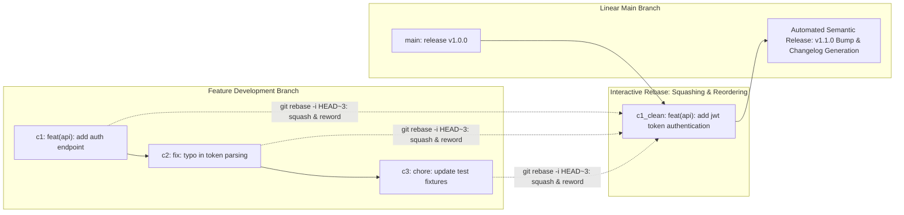

# Conventional Commits & Linear History Management

> **Difficulty**: Intermediate  
> **Target Outcome**: Write structured commit messages that automate changelogs, semantic versioning, and create an auditable history.

---

## Technical Architecture: Git Object DAG and Linear History Lifecycle

Git models history as a cryptographic Directed Acyclic Graph (DAG) of immutable commit objects. Conventional Commits and interactive rebases rewrite history to maintain linear, bisectable project timelines:



---

## Conventional Commit Structure

```text
<type>[optional scope]: <description>

[optional body]

[optional footer(s)]
```

### Primary Commit Types:
- `feat`: A new user-facing feature or API endpoint.
- `fix`: A bug fix.
- `docs`: Documentation changes only.
- `refactor`: Code change that neither fixes a bug nor adds a feature.
- `perf`: Performance optimization.
- `test`: Adding missing tests or correcting existing tests.
- `chore`: Tooling, dependencies, build tasks, repository maintenance.

---

## Examples: Ambiguous vs Standardized Commits

| Ambiguous Message | Standardized Conventional Commit |
| :--- | :--- |
| `fixed stuff` | `fix(auth): handle expired refresh token race condition` |
| `updates` | `feat(billing): integrate stripe webhook handler for recurring subscriptions` |
| `cleanup` | `refactor(db): migrate connection pooling from singleton to dependency injection` |
| `wip` | `feat(api): scaffold user endpoints with zod schema validation` |

---

## Interactive Rebase (`git rebase -i`)

To rewrite, reorder, squash, or edit the last 4 commits:

```bash
git rebase -i HEAD~4
```

Editor command options:
```text
pick e3b4f1a feat(ui): add payment modal markup
squash a1c8d2e fix typo in button label
squash f4a2b9c adjust modal padding
pick 9b8d1e2 feat(api): connect modal to checkout endpoint

# Commands:
# p, pick = use commit
# r, reword = use commit, but edit commit message
# e, edit = use commit, but stop for amending
# s, squash = meld into previous commit
# d, drop = remove commit
```

---

## Contributor Challenges
- [ ] Guide on integrating `commitlint` and `husky` for pre-commit commit message enforcement.
- [ ] Guide on automated releases with `semantic-release` or `changesets`.
