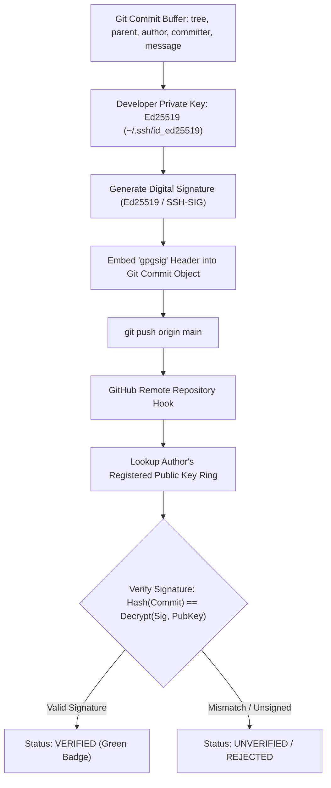

# Git Security, SSH Keys & Cryptographic Commit Signing

> **Difficulty**: Advanced  
> **Target Outcome**: Cryptographically sign commits using SSH keys to ensure provenance and verification.

---

## Technical Architecture: Cryptographic Commit Verification Pipeline

Commit signing embeds an asymmetric digital signature directly inside the raw Git commit object buffer:



---

## Importance of Commit Signing

Without cryptographic signing, git commit metadata can be arbitrarily forged:
```bash
git config user.name "Linus Torvalds"
git config user.email "torvalds@linux-foundation.org"
```
Cryptographic signatures guarantee identity and provenance for every commit pushed to remote repositories.

---

## SSH-Based Commit Signing (Git 2.34+)

Modern Git supports SSH keys directly for commit signatures:

### 1. Configure Git to Use SSH Signing:
```bash
git config --global gpg.format ssh
git config --global user.signingkey ~/.ssh/id_ed25519.pub
git config --global commit.gpgsign true
```

### 2. Add Signing Key to GitHub:
1. Export public key:
   ```bash
   cat ~/.ssh/id_ed25519.pub
   ```
2. Navigate to **GitHub Settings -> SSH and GPG Keys -> New SSH Key**.
3. Set **Key type** to **Signing Key**.
4. Paste the public key and save.

All subsequent commits will display the verified badge on GitHub.

---

## Preventing Credential Exposure

Integrate automated secret scanners into pre-commit workflows:

```bash
# Scan repository for secrets prior to push
trufflehog git file://. --since-commit HEAD~10
```

---

## Contributor Challenges
- [ ] Hardware Security Key (YubiKey) GPG commit signing guide.
- [ ] Pre-commit hook setup with automated Gitleaks verification.
