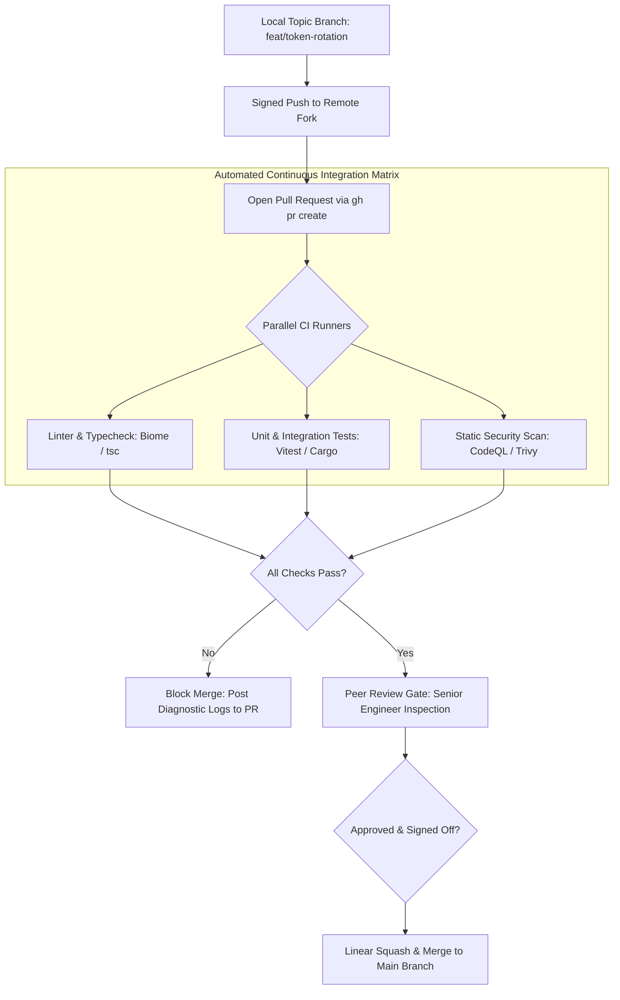

# Pull Request Etiquette & GitHub CLI (`gh`)

> **Difficulty**: Intermediate  
> **Target Outcome**: Structure pull requests for rapid review and master terminal-driven GitHub workflows.

---

## Technical Architecture: Pull Request Lifecycle & CI Quality Gates

A high-signal engineering workflow prevents regressions by automating verification before peer review:



---

## Anatomy of a Standard Pull Request

A well-structured PR minimizes review latency and provides clear historical context.

### Standard Sections:
1. **Summary & Rationale**: Concise description of changes and motivations.
2. **Key Adjustments**: Bulleted breakdown of architectural modifications.
3. **Verification**: Terminal output, test run logs, or reproduction steps.
4. **Issue Linkage**: Reference to tracking issues (`Closes #42`).

```markdown
## Summary
Implements JWT token refresh rotation to eliminate session drops during token expiration windows.

## Changes Made
- Added Redis-backed token blacklist with 15-minute TTL.
- Updated `useAuthStore` interceptor in frontend to retry 401 requests once.
- Added comprehensive unit tests covering token replay attacks.

## Verification
- Ran `npm run test:auth` (All 14 tests passing).
- Verified session refresh flow in staging environment.
```

---

## GitHub CLI (`gh`) Workflows

```bash
# Authenticate GitHub CLI
gh auth login

# Create a PR interactively from terminal
gh pr create --title "feat(auth): token refresh rotation" --body "Closes #42"

# View status of CI checks on your PR
gh pr checks

# Checkout a teammate's PR locally
gh pr checkout 104

# Review and approve a PR directly from CLI
gh pr review 104 --approve --body "Verified implementation."

# Squash and merge PR, then delete remote branch
gh pr merge 104 --squash --delete-branch
```

---

## Contributor Challenges
- [ ] Guide on configuring `.github/CODEOWNERS` for automated reviewer assignments.
- [ ] Standards for constructive, asynchronous code review discussions.
