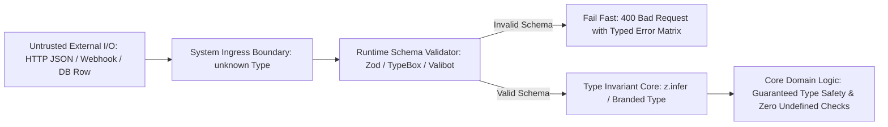

# Type Safety, Runtime Schema Validation & API Contracts

> **Difficulty**: Intermediate  
> **Target Outcome**: Prevent runtime data corruption and mismatched payloads using end-to-end schema validation.

---

## Technical Architecture: Parse, Don't Validate at System Boundaries

Static types exist only at compile time and are stripped by the compiler. Systems remain reliable by enforcing runtime validation barriers at external I/O boundaries:



---

## Static Types vs Runtime Boundaries

Static types disappear upon compilation. When untrusted inputs arrive from HTTP requests, message queues, or third-party webhooks, runtime schema validation is necessary.

Standard Solution: Schema validation with type inference (**Zod**, **Valibot**, or **TypeBox**).

---

## Runtime Validation with Zod

```typescript
import { z } from 'zod';

export const CreateUserSchema = z.object({
  username: z.string().min(3).max(30),
  email: z.string().email(),
  age: z.number().int().positive().optional(),
  role: z.enum(['USER', 'ADMIN', 'GUEST']).default('USER'),
});

export type CreateUserInput = z.infer<typeof CreateUserSchema>;

export function handleIncomingRequest(rawPayload: unknown): CreateUserInput {
  const result = CreateUserSchema.safeParse(rawPayload);
  if (!result.success) {
    throw new Error(`Validation failed: ${result.error.message}`);
  }
  return result.data;
}
```

---

## End-to-End Type Safety

Avoid manual type synchronization between frontend and backend:
1. **tRPC**: Direct type inference between Next.js/React and Node.js backend without build generation.
2. **OpenAPI / Swagger + openapi-typescript**: Generate strongly typed client SDKs automatically during CI.

---

## Contributor Challenges
- [ ] Zod versus Valibot performance and bundle size evaluation.
- [ ] OpenAPI code generation workflow using GitHub Actions.
