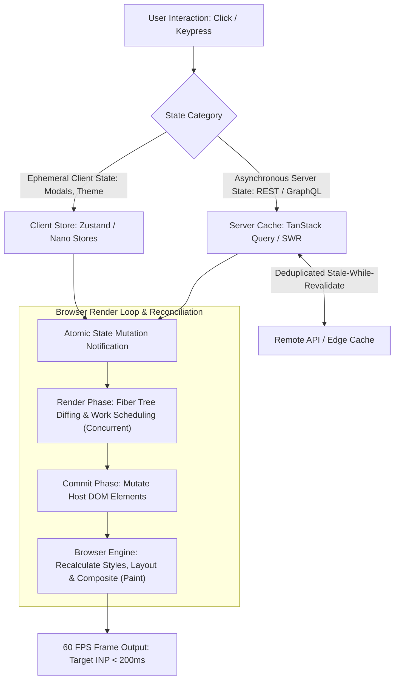

# Frontend Performance & State Architecture

> **Difficulty**: Intermediate  
> **Target Outcome**: Meet Core Web Vitals thresholds and establish predictable UI state architectures.

---

## Technical Architecture: State Lifecycle and DOM Commit Pipeline

High-performance frontends separate asynchronous server cache from ephemeral client UI state, avoiding unnecessary re-renders in the browser engine:



---

## Core Web Vitals (CWV) Targets

1. **LCP (Largest Contentful Paint)**: < 2.5s (Time taken to render main visible content).
2. **INP (Interaction to Next Paint)**: < 200ms (User interaction responsiveness).
3. **CLS (Cumulative Layout Shift)**: < 0.1 (Visual stability during rendering).

---

## Performance Optimization Techniques

### 1. Asset & Image Optimization
- Use WebP and AVIF modern formats.
- Declare explicit `width` and `height` properties to eliminate layout shift (CLS).
- Apply `loading="lazy"` to below-the-fold media.

### 2. Code Splitting & Dynamic Imports
```typescript
import dynamic from 'next/dynamic';

const HeavyAnalyticsChart = dynamic(() => import('@/components/AnalyticsChart'), {
  loading: () => <ChartSkeleton />,
  ssr: false
});
```

### 3. Server State vs Client State Separation
- **Server Cache State**: Use **TanStack Query** (React Query) or SWR for caching, deduplicating, and revalidating server data.
- **Client State**: Use **Zustand** or signals for lightweight, boilerplate-free global UI state.

```typescript
import { create } from 'zustand';

interface ThemeStore {
  mode: 'dark' | 'light';
  toggleMode: () => void;
}

export const useThemeStore = create<ThemeStore>((set) => ({
  mode: 'dark',
  toggleMode: () => set((state) => ({ mode: state.mode === 'dark' ? 'light' : 'dark' })),
}));
```

---

## Contributor Challenges
- [ ] React Server Components (RSC) performance mental model.
- [ ] Bundle analysis guide using `@next/bundle-analyzer` and `vite-bundle-visualizer`.
