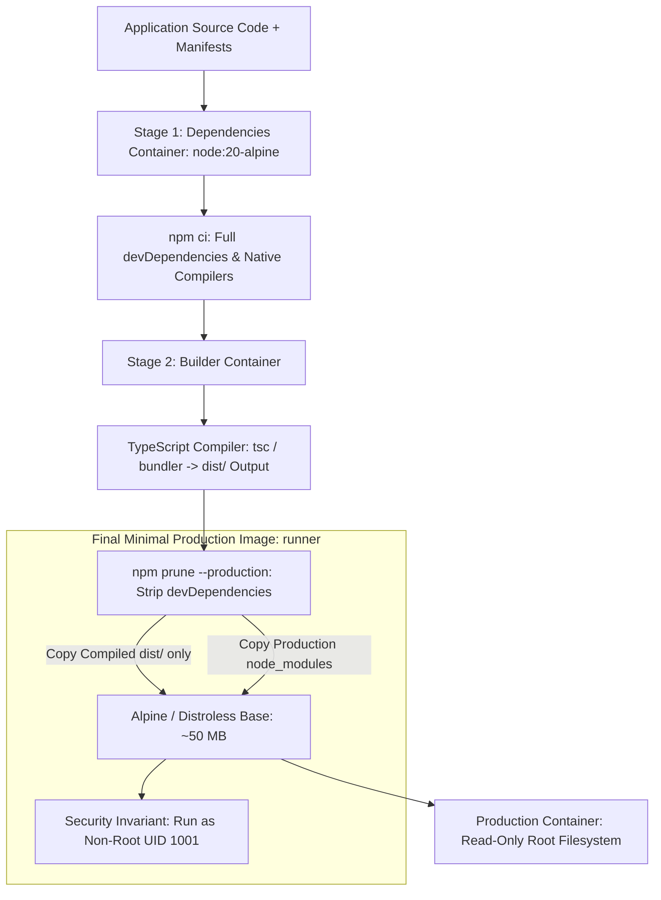

# Docker & Multi-Stage Production Containerization

> **Difficulty**: Intermediate  
> **Target Outcome**: Build lightweight, secure, non-root Docker images with optimized layer caching.

---

## Technical Architecture: Multi-Stage OCI Container Layering

Multi-stage containerization drastically reduces attack surfaces and image footprints by stripping build compilers and package managers from the runtime image:



---

## Multi-Stage Build Architecture

Multi-stage builds separate build-time dependencies from the final minimal production image:

```dockerfile
# Stage 1: Build Dependencies
FROM node:20-alpine AS deps
WORKDIR /app
COPY package.json package-lock.json ./
RUN npm ci

# Stage 2: Build Application
FROM node:20-alpine AS builder
WORKDIR /app
COPY --from=deps /app/node_modules ./node_modules
COPY . .
RUN npm run build && npm prune --production

# Stage 3: Minimal Production Runtime
FROM node:20-alpine AS runner
WORKDIR /app

ENV NODE_ENV=production
ENV PORT=3000

# Security: Run as non-root user
RUN addgroup --system --gid 1001 nodejs && \
    adduser --system --uid 1001 nodejs

COPY --from=builder --chown=nodejs:nodejs /app/dist ./dist
COPY --from=builder --chown=nodejs:nodejs /app/node_modules ./node_modules
COPY --from=builder --chown=nodejs:nodejs /app/package.json ./package.json

USER nodejs
EXPOSE 3000

CMD ["node", "dist/main.js"]
```

---

## Docker Production Standards

1. Order Dockerfile instructions from least frequently changed to most frequently changed to maximize layer cache hit rate.
2. Include a `.dockerignore` file containing `.git`, `node_modules`, `.env`, and test artifacts.
3. Run container processes under dedicated non-root users.
4. Scan container images for CVE vulnerabilities using `trivy image <image_name>`.

---

## Contributor Challenges
- [ ] Multi-stage Dockerfiles for Go, Rust, and Python (FastAPI).
- [ ] Dev Containers (`.devcontainer/devcontainer.json`) reference configuration.
