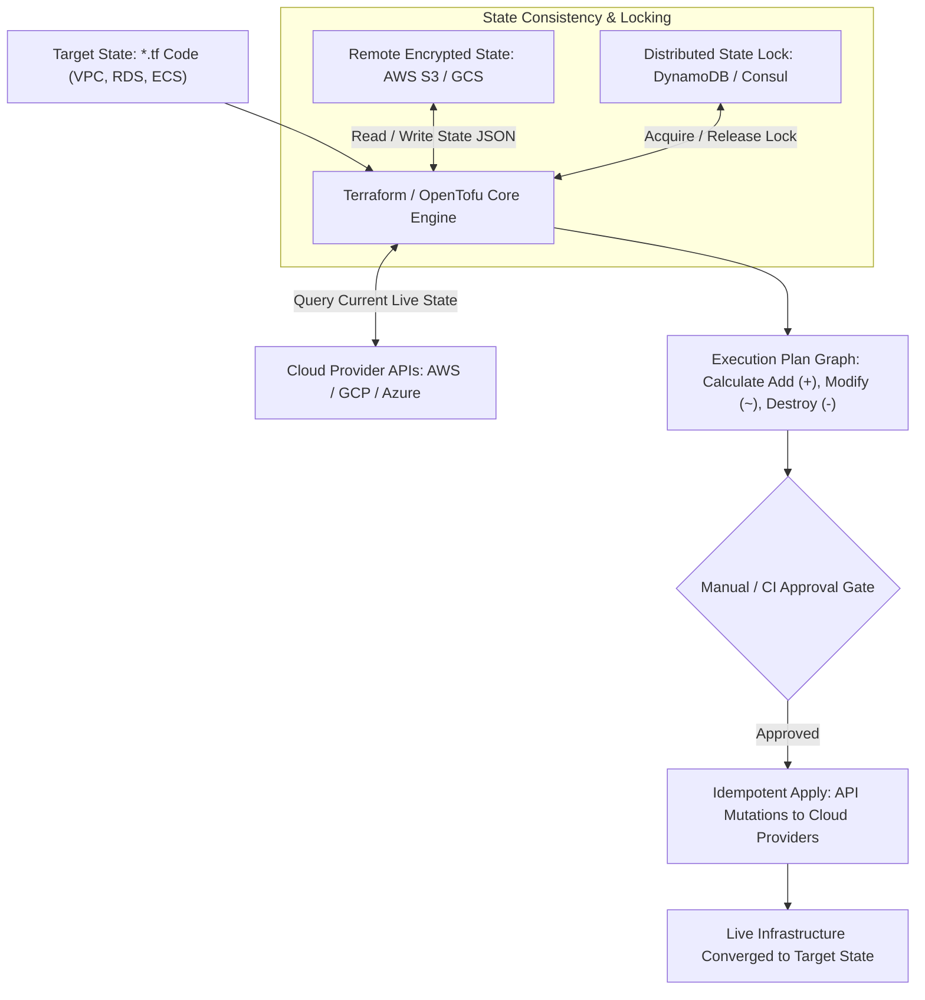

# Infrastructure as Code with Terraform and OpenTofu

> **Difficulty**: Advanced  
> **Target Outcome**: Provision and manage declarative, version-controlled cloud infrastructure.

---

## Technical Architecture: Declarative State Reconciliation Engine

Infrastructure as Code compares target configuration declarations against recorded state and live cloud resources to compute an execution graph:



---

## Principles of Infrastructure as Code

- **Declarative**: Express target infrastructure states rather than imperative execution scripts.
- **Idempotent**: Re-executing infrastructure code converges safely toward the defined state.
- **Auditable**: Infrastructure modifications are reviewed through standard pull requests.

---

## Modular Architecture Layout

```text
terraform/
├── main.tf        # Provider definitions and module calls
├── variables.tf   # Environment inputs
├── outputs.tf     # Exported attributes (VPC IDs, endpoints)
├── backend.tf     # Remote state configuration with locking
└── modules/
    ├── vpc/
    ├── database/
    └── compute/
```

### Remote State Configuration (`backend.tf`):
```hcl
terraform {
  required_version = ">= 1.7.0"
  backend "s3" {
    bucket         = "company-terraform-state-prod"
    key            = "services/aura-api/terraform.tfstate"
    region         = "us-east-1"
    dynamodb_table = "terraform-state-locks"
    encrypt        = true
  }
}
```

---

## Contributor Challenges
- [ ] Pulumi versus Terraform architectural comparison.
- [ ] Local cloud development with LocalStack.
