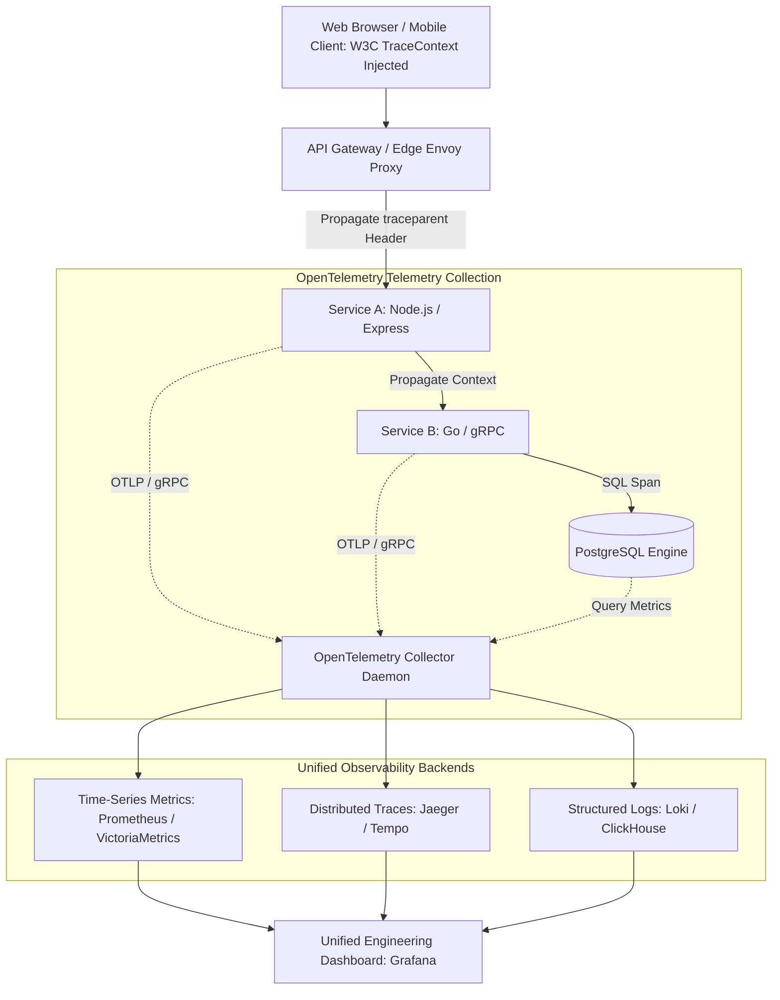

# Observability: Structured Logging, Metrics & OpenTelemetry

> **Difficulty**: Advanced  
> **Target Outcome**: Implement high-cardinality distributed tracing and structured JSON logging across services.

---

## Technical Architecture: OpenTelemetry Distributed Ingestion Pipeline

Distributed systems maintain visibility across service boundaries using standardized telemetry protocols:



---

## 1. Structured JSON Logging

Emit structured JSON with trace correlation IDs rather than unstructured text logs:

```json
{
  "timestamp": "2026-08-15T06:30:12.451Z",
  "level": "error",
  "message": "Payment processing failed",
  "service": "billing-service",
  "traceId": "4bf92f3577b34da6a3ce929d0e0e4736",
  "spanId": "00f067aa0ba902b7",
  "userId": "usr_9981",
  "error": {
    "code": "CARD_DECLINED",
    "details": "Insufficient funds"
  }
}
```

---

## 2. The Four Golden Signals

Site Reliability Engineering establishes four critical signals:

1. **Latency**: Time required to service requests (measure P50, P95, P99).
2. **Traffic**: Demand on the system (requests per second).
3. **Errors**: Failure rate of requests (HTTP 5xx, uncaught exceptions).
4. **Saturation**: Utilization of constrained resources (CPU, RAM, connection pools).

---

## 3. Distributed Tracing with OpenTelemetry

OpenTelemetry establishes standard context propagation across service boundaries:

```typescript
import { trace } from '@opentelemetry/api';

const tracer = trace.getTracer('checkout-service');

export async function processOrder(orderId: string) {
  return tracer.startActiveSpan('processOrder', async (span) => {
    try {
      span.setAttribute('order.id', orderId);
      // Execution logic here
      span.setStatus({ code: 1 }); // OK
    } catch (err: any) {
      span.recordException(err);
      span.setStatus({ code: 2, message: err.message }); // Error
      throw err;
    } finally {
      span.end();
    }
  });
}
```

---

## Contributor Challenges
- [ ] Prometheus alerting rules for SLO degradation.
- [ ] Production Grafana dashboard template for backend runtimes.
