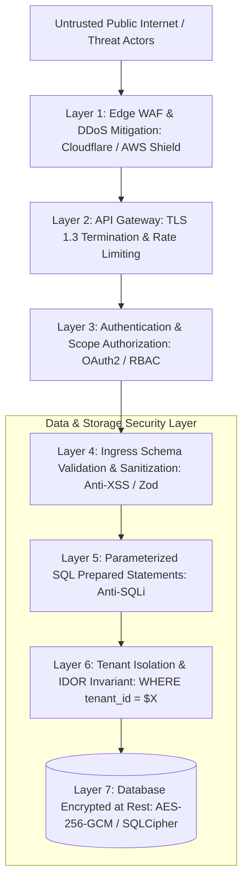

# Application Hardening & OWASP Security Playbook

> **Difficulty**: Intermediate  
> **Target Outcome**: Harden web applications and APIs against the OWASP Top 10 vulnerabilities.

---

## Technical Architecture: Defense-in-Depth Application Security Perimeter

Security cannot rely on a single defensive layer. Production systems enforce layered, zero-trust cryptographic and behavioral gates:



---

## OWASP Top Security Mitigations

### 1. Broken Access Control & IDOR
- Attack Vector: Changing `GET /api/documents/102` to `GET /api/documents/103` to access cross-tenant records.
- Countermeasure: Always enforce tenant and user ownership within query constraints:
  ```sql
  SELECT * FROM documents WHERE id = $1 AND organization_id = $2;
  ```

### 2. Injection Vulnerabilities
- Countermeasure: Use parameterized SQL queries and validated ORM schemas exclusively.

### 3. Cross-Site Scripting (XSS)
- Countermeasure: Context-aware HTML escaping, strict Content Security Policy (CSP), and avoiding unsafe DOM manipulation.

### 4. HTTP Security Headers
Configure hardened HTTP response headers (e.g. using `helmet` in Node.js):

```typescript
import helmet from 'helmet';
import express from 'express';

const app = express();
app.use(helmet({
  contentSecurityPolicy: {
    directives: {
      defaultSrc: ["'self'"],
      scriptSrc: ["'self'"],
      objectSrc: ["'none'"],
      upgradeInsecureRequests: [],
    },
  },
  crossOriginEmbedderPolicy: true,
  hsts: { maxAge: 31536000, includeSubDomains: true, preload: true },
}));
```

---

## Contributor Challenges
- [ ] CORS misconfiguration vectors and security hardening.
- [ ] Distributed rate limiting and DDoS mitigation with Cloudflare and Redis.
