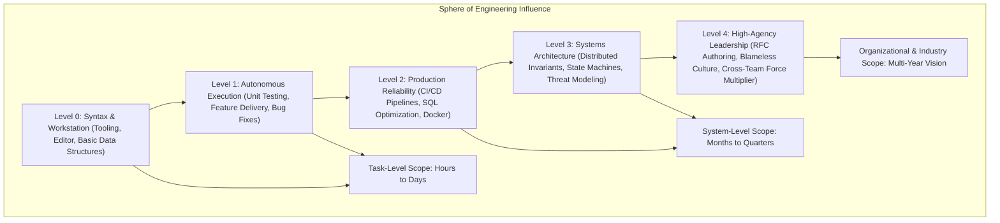

# Engineering Career Velocity, Flow State & Mindset

> **Difficulty**: All Levels  
> **Target Outcome**: Cultivate technical depth, high-agency execution, and sustainable career velocity.

---

## Technical Architecture: Engineering Competency Matrix & Scope of Impact

Career growth in software engineering expands from local syntax execution to global organizational leverage and architectural sovereignty:



---

## The Engineering Progression Model

```text
Level 0: Foundations              -> Environment setup, editor navigation, core language syntax
Level 1: Implementation           -> Feature development, basic CRUD, standard UI components
Level 2: Fluency                  -> Terminal-first workflows, Git rebasing, test-driven development
Level 3: Production Engineering   -> Observability, CI/CD, database optimization, zero-downtime shipping
Level 4: Architecture & Guidance  -> RFC authoring, system design, blameless culture, technical leverage
Level 5: Principal Craft          -> Sustained focus, deep technical craft, organizational multiplier
```

---

## Core Habits for Deep Engineering Work

1. **Dedicated Focus Intervals**: Block 2-3 hours for uninterrupted deep work.
2. **Codebase Exploration**: Regularly read source code of established open-source projects (e.g. Node, Redis, React).
3. **First-Principles Debugging**: Form hypotheses, verify logs and metrics, and isolate root causes methodically.
4. **Pragmatic Simplicity**: Avoid speculative abstractions; favor clear, maintainable solutions.
5. **Continuous Documentation**: Capture technical decisions and operational knowledge in version control.

---

## Contributor Challenges
- [ ] Curated reading list of fundamental computer science texts.
- [ ] Framework for navigating Junior -> Mid -> Senior -> Staff career transitions.
