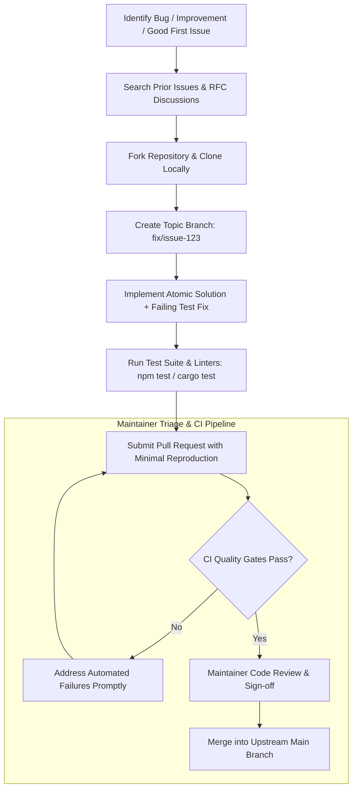

# Open Source Citizenship & Collaboration Etiquette

> **Difficulty**: Beginner to Intermediate  
> **Target Outcome**: Contribute effectively to open-source software and collaborate productively with maintainers.

---

## Technical Architecture: Open-Source Contribution Lifecycle

High-value open-source contributions follow a disciplined lifecycle that respects maintainer bandwidth:

---

## Standards of Open Source Collaboration

1. **Review Contributing Guidelines First**: Inspect `CONTRIBUTING.md`, style guides, and PR requirements prior to opening pull requests.
2. **Search Prior Issues**: Avoid duplicate submissions by searching open and closed issues beforehand.
3. **Provide Minimal Reproductions**: When reporting bugs, attach a minimal reproducible repository or environment script.
4. **Respect Maintainer Capacity**: Provide clear context and communicate constructively.

---

## Identifying Contribution Opportunities

- Search for issues labeled `good first issue` or `help wanted`.
- Improve documentation, test coverage, and typing definitions.
- Progress toward resolving architectural bugs and feature requests.

---

## Contributor Challenges
- [ ] Guide on effective issue triage and issue template automation.
- [ ] Sustainable maintenance strategies for open-source project leads.
