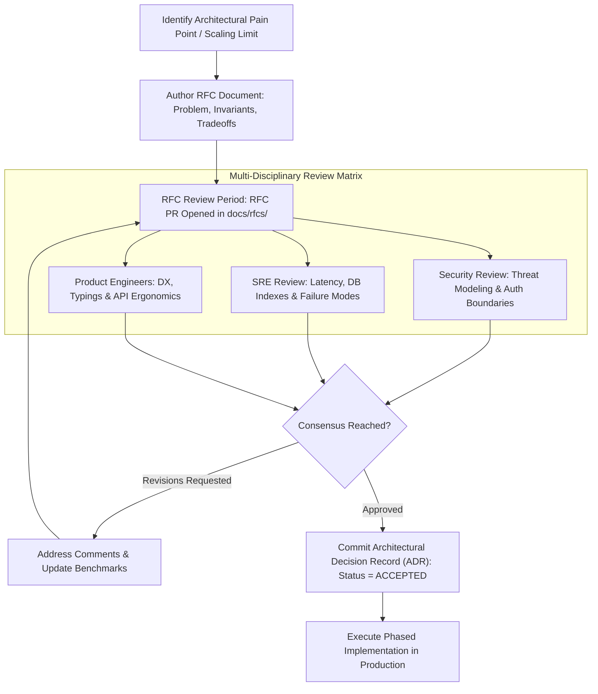

# Technical Writing, ADRs & RFCs

> **Difficulty**: Intermediate  
> **Target Outcome**: Drive organizational consensus and propose major architectural adjustments through structured Request for Comments (RFC) documents.

---

## Technical Architecture: RFC Decision Flow & Architectural Consensus

Engineering organizations avoid costly architectural rewrites by establishing a structured proposal, review, and decision pipeline:



---

## What is a Request for Comments (RFC)?

An RFC details a proposed architectural change, migration, or interface design prior to implementation. It gathers peer review to surface architectural risks and edge cases before substantial engineering time is invested.

---

## Standard RFC Structure

```markdown
# RFC-042: Migration from REST to tRPC for Internal Admin Dashboard

- **Author**: @engineer-name
- **Status**: Proposed / Under Review / Approved / Rejected
- **Target Implementation Date**: Q4 2026

## 1. Problem Statement
The internal dashboard frequently encounters runtime type mismatches when backend DTOs change, resulting in broken UI views and manual type duplication.

## 2. Proposed Architecture
Migrate internal RPC endpoints to tRPC v11, sharing Zod schemas directly across monorepo package boundaries.

## 3. Tradeoffs and Rejected Alternatives
- Alternative A: GraphQL - Rejected due to resolver overhead and schema stitching complexity for a single internal client.
- Alternative B: OpenAPI Generation - Viable, but introduces a manual build step on every backend change.

## 4. Migration Plan and Rollout Phases
- Phase 1: Establish tRPC router in monorepo with 1 new feature endpoint.
- Phase 2: Migrate existing authentication & user endpoints.
- Phase 3: Deprecate legacy REST `/admin/api/*` endpoints.

## 5. Open Questions and Risks
- Impact on serverless cold-start latency under high concurrency.
```

---

## Contributor Challenges
- [ ] Architecture Decision Record (ADR) template and comparison with RFCs.
- [ ] Technical diagram standards with Mermaid and Excalidraw.
