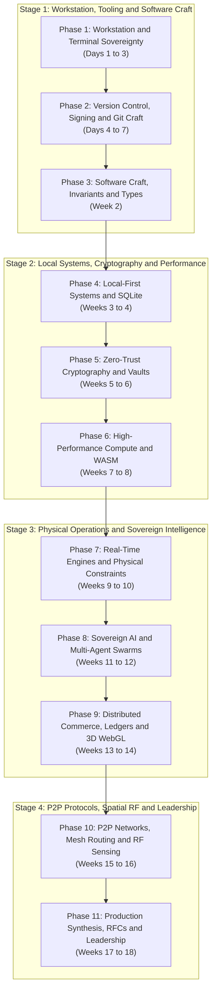

# Beginner Onboarding Flow: The Complete Sovereign Engineering Curriculum

> A Chronological, Step-by-Step Learning Roadmap for Students and Self-Taught Developers Transitioning from Basic Syntax to Elite Systems Architecture.

---

## 1. Overview and Curriculum Philosophy

Welcome to the Aura Sovereign Engineering Curriculum. 

Most conventional programming curricula trap students in an artificial dichotomy:
- **Abstract Syntax Tutorials**: Learning `for` loops, basic syntax, and toy array manipulations without ever building real software.
- **Fragile Cloud SaaS Glue**: Assembling third-party managed services, subscription APIs, and cloud databases without understanding memory, networks, operating systems, or security.

When real challenges emerge—network partitions, hardware station contention, memory leaks under load, cryptographic key management, or offline operation—developers without deep foundations struggle.

This curriculum provides a linear, progressive learning path distilled from 19 production repositories across 10 specialized domains. It takes you systematically from Day 1 environment setup to architecting decentralized P2P wire protocols, air-gapped cryptographic vaults, and local neural intelligence.

---

## 2. The Master Chronological Roadmap

The roadmap is structured into 11 progressive phases spanning 18 weeks. Every phase integrates four essential pedagogical dimensions:
1. **Foundational Track Lesson**: Software engineering practices, tooling, and discipline.
2. **Architectural Principle**: Theoretical design invariants and systems thinking.
3. **Sovereign Builder Module**: Concrete code implementation and technical deep dive.
4. **Production Case Study**: Real-world open-source reference repository to inspect.

---

## 3. The 11-Phase Curriculum Progression

### Phase 1: Workstation, Shell and Terminal Sovereignty
- **Timeline**: Days 1 to 3
- **Pedagogical Target**: Eliminate mouse dependency, configure high-performance development environments, and master the POSIX command-line interface.

#### What to Study
1. [Track 01: IDE and Editor Mastery](./01-foundations-and-setup/ide-and-editor-mastery.md)
2. [Track 01: Terminal and Shell Configuration](./01-foundations-and-setup/terminal-and-shell-alchemy.md)
3. [Track 01: Operating System and Toolchain Setup](./01-foundations-and-setup/os-and-toolchain-setup.md)
4. [Learning Path Stage 1: Workstation Mastery and Shell](./learning-paths/01-foundations-to-local-first/01-workstation-mastery-and-shell.md)

#### Hands-On Sandbox to Build
Build a reproducible workstation configuration using modern CLI utilities (`zsh`, `starship`, `fzf`, `ripgrep`, `bat`). Write a POSIX shell script that audits your machine for installed toolchains (Node.js, Rust, Python, Git) and verifies your PATH variables.

#### Production Reference
- Reference Repo: [MasterZ1311/Dev-AURA](https://github.com/MasterZ1311/Dev-AURA)
- Key Files: `.editorconfig`, shell dotfiles, and automated tooling scripts.

#### Mastery Verification Gate
- Can you navigate, search, edit, and run scripts across your filesystem using only the keyboard?
- Does your prompt display current git branch, dirty state, and execution time without visual latency?

---

### Phase 2: Version Control, Cryptographic Provenance and Git Craft
- **Timeline**: Days 4 to 7
- **Pedagogical Target**: Establish clean linear history, master interactive rebasing, sign commits cryptographically, and practice elite pull request etiquette.

#### What to Study
1. [Track 02: Git Workflows and Branching Strategies](./02-git-and-github-craft/git-workflow-and-branching.md)
2. [Track 02: Conventional Commits and History Management](./02-git-and-github-craft/conventional-commits-and-history.md)
3. [Track 02: Pull Request Etiquette and Code Reviews](./02-git-and-github-craft/pr-etiquette-and-code-reviews.md)
4. [Track 02: Git Security, SSH Keys and Commit Signing](./02-git-and-github-craft/git-security-and-gpg.md)

#### Hands-On Sandbox to Build
Initialize a local Git repository, generate an Ed25519 or SSH signing key, configure `git commit -S`, create a multi-commit feature branch, use `git rebase -i` to squash and reorder commits into Conventional Commit format, and verify cryptographic signatures with `git log --show-signature`.

#### Production Reference
- Reference Repo: [MasterZ1311/Dev-AURA](https://github.com/MasterZ1311/Dev-AURA)
- Key Files: Git history, commit messages, and PR review templates.

#### Mastery Verification Gate
- Every commit message follows the format `type(scope): imperative description`.
- You can resolve merge conflicts without merge bubbles using `git rebase origin/main`.
- `git log --show-signature` outputs `Good "git" signature for user@domain`.

---

### Phase 3: Software Craft, Invariants and Runtime Type Contracts
- **Timeline**: Week 2 (Days 8 to 14)
- **Pedagogical Target**: Master clean architecture, SOLID principles, runtime schema validation, and test-driven development.

#### What to Study
1. [Track 03: Clean Code and SOLID in Practice](./03-code-craft-and-architecture/clean-code-and-solid.md)
2. [Track 03: Type Safety and Runtime Contracts](./03-code-craft-and-architecture/type-safety-and-contracts.md)
3. [Track 03: Testing Pyramid and Test-Driven Development](./03-code-craft-and-architecture/testing-pyramid-and-tdd.md)
4. [Track 03: Design Patterns in Modern Architecture](./03-code-craft-and-architecture/design-patterns-in-practice.md)
5. [Engineering Principle 08: Living Documentation and SSOT](./engineering-principles/08-living-documentation-and-ssot/specification-driven-development.md)

#### Hands-On Sandbox to Build
Implement an order validation and state transition engine in TypeScript or Python. Define strict data boundaries using Zod or Pydantic. Write a comprehensive test suite (unit tests, property-based tests) ensuring illegal states cannot be created.

#### Production Reference
- Reference Repo: [MasterZ1311/Valorant-Tourney-Ops](https://github.com/MasterZ1311/Valorant-Tourney-Ops)
- Key Files: State machines, Zod validation schemas, and Vitest test suites.

#### Mastery Verification Gate
- Code contains zero untyped `any` or loose dictionaries.
- All untrusted input is parsed and validated at the boundary before processing.
- Test coverage covers all nominal and edge-case error branches.

---

### Phase 4: Local-First Systems and Embedded Zero-Cloud Databases
- **Timeline**: Weeks 3 to 4 (Days 15 to 28)
- **Pedagogical Target**: Free applications from cloud lock-in. Learn embedded SQLite, SQLCipher encryption, native Tauri 2.0 architecture, and 60 FPS virtualized UI rendering.

#### What to Study
1. [Track 04: Database Mastery, Normalization and Indexing](./04-fullstack-and-api-engineering/database-mastery-and-indexing.md)
2. [Track 04: Frontend Performance and Reactive State](./04-fullstack-and-api-engineering/frontend-performance-and-state.md)
3. [Engineering Principle 01: Sovereign and Local-First Computing](./engineering-principles/01-sovereign-and-local-first-computing/architectural-patterns.md)
4. [Learning Path Stage 1: Local-First Data with SQLite](./learning-paths/01-foundations-to-local-first/02-local-first-data-with-sqlite.md)
5. [Learning Path Stage 1: Native Desktop with Rust and Tauri](./learning-paths/01-foundations-to-local-first/03-native-desktop-with-rust-tauri.md)
6. [Learning Path Stage 1: Virtualized UI Rendering](./learning-paths/01-foundations-to-local-first/04-virtualized-ui-rendering.md)

#### Case Studies to Inspect
- [CodexOS Developer Operating System](./project-case-studies/native-desktop-and-systems/codexos-developer-os.md)
- [Aura 3.0 Mindful Productivity System](./project-case-studies/native-desktop-and-systems/aura-3-mindful-productivity.md)

#### Hands-On Sandbox to Build
Build a desktop markdown note-taking application using Tauri 2.0 (Rust backend + TypeScript frontend) with an embedded SQLite database. Implement a virtualized list view capable of rendering 100,000 notes smoothly at 60 FPS with zero network calls.

#### Production Reference
- Reference Repos: [CodeSorcerer-007/CodexOS](https://github.com/CodeSorcerer-007/CodexOS), [CodeSorcerer-007/Aura](https://github.com/CodeSorcerer-007/Aura)
- Key Files: `src-tauri/src/main.rs`, SQLite schema migrations, and virtual list render hooks.

#### Mastery Verification Gate
- The application starts and functions fully with Wi-Fi disabled.
- The desktop process consumes less than 80 MB of RAM (compared to 600+ MB for Electron).
- Scrolling through 100,000 items maintains steady 60 FPS without DOM thrashing.

---

### Phase 5: Zero-Trust Cryptography and Air-Gapped Mobile Vaults
- **Timeline**: Weeks 5 to 6 (Days 29 to 42)
- **Pedagogical Target**: Secure user secrets with mathematical guarantees. Master memory-hard key derivation (Argon2id), authenticated encryption (AES-256-GCM), air-gapped Android architecture, and peer-to-peer Signal Double Ratchet protocols.

#### What to Study
1. [Engineering Principle 02: Privacy-by-Design and Zero-Trust Cryptography](./engineering-principles/02-privacy-by-design-and-zero-trust-cryptography/post-quantum-and-airgap-standards.md)
2. [Learning Path Stage 2: Symmetric Encryption and Key Derivation](./learning-paths/02-cryptographic-fortress-and-zero-trust/01-symmetric-encryption-and-key-derivation.md)
3. [Learning Path Stage 2: Air-Gapped Mobile Security](./learning-paths/02-cryptographic-fortress-and-zero-trust/02-air-gapped-mobile-security.md)
4. [Learning Path Stage 2: P2P WebRTC and the Double Ratchet](./learning-paths/02-cryptographic-fortress-and-zero-trust/03-p2p-webrtc-and-the-double-ratchet.md)

#### Case Studies to Inspect
- [Kryptyx Password Fortress](./project-case-studies/cryptography-and-zero-knowledge/kryptyx-password-fortress.md)
- [Calypso Ghost Messenger](./project-case-studies/cryptography-and-zero-knowledge/calypso-ghost-messenger.md)

#### Hands-On Sandbox to Build
Create a CLI password fortress in Node.js or Rust that derives a 256-bit key from a master passphrase using Argon2id (`m=65536, t=3, p=4`), encrypts JSON payloads with AES-256-GCM using unique 96-bit nonces, verifies MAC authentication tags, and explicitly zeroizes plaintext memory buffers after use.

#### Production Reference
- Reference Repos: [CodeSorcerer-007/Kryptx](https://github.com/CodeSorcerer-007/Kryptx), [MasterZ1311/Ghost-Messenger](https://github.com/MasterZ1311/Ghost-Messenger)
- Key Files: Cryptographic derivation engines, Android Keystore bindings, and WebRTC DataChannel signaling.

#### Mastery Verification Gate
- Plaintext passwords never touch persistent disk storage.
- Memory buffers are cleared (`buf.fill(0)`) immediately after cryptographic operations.
- Tampering with ciphertext triggers authentication tag verification failures.

---

### Phase 6: High-Performance In-Browser Compute and WebAssembly
- **Timeline**: Weeks 7 to 8 (Days 43 to 56)
- **Pedagogical Target**: Overcome JavaScript single-threaded limitations. Master Web Workers, transferable ArrayBuffers, WebAssembly compilation, and client-side binary processing.

#### What to Study
1. [Engineering Principle 04: Client-Side Heavy Compute and WASM](./engineering-principles/04-client-side-heavy-compute-and-wasm/memory-and-worker-concurrency.md)
2. [Learning Path Stage 3: Web Workers and Transferable Memory](./learning-paths/03-high-performance-compute-and-wasm/01-web-workers-and-transferable-memory.md)
3. [Learning Path Stage 3: In-Browser PDF and Binary Assembly](./learning-paths/03-high-performance-compute-and-wasm/02-in-browser-pdf-and-binary-assembly.md)

#### Case Studies to Inspect
- [ErgonPDF Client-Side Document Workspace](./project-case-studies/client-side-wasm-compute/ergonpdf-document-workspace.md)

#### Hands-On Sandbox to Build
Build an in-browser binary manipulation utility (e.g., PDF page reordering, image filtering, or 500,000-line CSV parsing). Offload computation entirely to a Web Worker, transfer raw memory using zero-copy `ArrayBuffer` transfer lists, and revoke all generated `blob:` URLs upon component unmount to prevent browser memory leaks.

#### Production Reference
- Reference Repo: [CodeSorcerer-007/ErgonPDF](https://github.com/CodeSorcerer-007/ErgonPDF)
- Key Files: Worker dispatch controllers, `pdf-lib` pipeline wrappers, and blob lifecycle managers.

#### Mastery Verification Gate
- The UI main thread maintains 60 FPS and zero frame drops during heavy data processing.
- Memory profiler shows heap stabilization with no memory leaks after processing multiple files.
- Memory is transferred via ownership transfer (`postMessage(data, [data.buffer])`) rather than structured cloning.

---

### Phase 7: Real-Time Hardware Engines and Physical Operations
- **Timeline**: Weeks 9 to 10 (Days 57 to 70)
- **Pedagogical Target**: Bridge pure software with physical hardware constraints. Model esports LAN tournament stations, round-robin schedule algorithms, and high-concurrency multi-lobby scoring.

#### What to Study
1. [Engineering Principle 03: Invariant-Driven State Machines](./engineering-principles/03-invariant-driven-state-machines/physical-resource-modeling.md)
2. [Learning Path Stage 4: Hardware-Constrained State Machines](./learning-paths/04-realtime-engines-and-physical-systems/01-hardware-constrained-state-machines.md)
3. [Learning Path Stage 4: Tournament Pairing Algorithms](./learning-paths/04-realtime-engines-and-physical-systems/02-tournament-pairing-algorithms.md)
4. [Learning Path Stage 4: Vectorized Scoring and CSV Ingestion](./learning-paths/04-realtime-engines-and-physical-systems/03-vectorized-scoring-and-csv-ingestion.md)

#### Case Studies to Inspect
- [Valorant Tournament Operations Control Center](./project-case-studies/realtime-operations-and-esports/valorant-tournament-operations.md)
- [BGMI Tournament Control Center](./project-case-studies/realtime-operations-and-esports/bgmi-tournament-control-center.md)

#### Hands-On Sandbox to Build
Implement an esports match coordinator that models 10 physical PC stations. Write an invariant-driven state machine where a match cannot transition to `IN_PROGRESS` unless:
1. Both 5-player rosters are checked in.
2. The allocated station hardware is verified `ONLINE`.
3. An official tournament observer is assigned.
Implement the Berger Round-Robin algorithm to generate conflict-free schedules across multiple tournament rounds.

#### Production Reference
- Reference Repos: [MasterZ1311/Valorant-Tourney-Ops](https://github.com/MasterZ1311/Valorant-Tourney-Ops), [MasterZ1311/BGMI-Tourney-Ops](https://github.com/MasterZ1311/BGMI-Tourney-Ops)
- Key Files: State machine definitions, station allocation engines, and BGIS scoring tables.

#### Mastery Verification Gate
- Attempting illegal state transitions throws compile-time type errors and runtime exceptions.
- Physical stations cannot be double-booked across concurrent matches.
- Automated tests verify pairing invariants (no team plays twice in one round).

---

### Phase 8: Sovereign AI, Neural Audio and Multi-Agent Swarms
- **Timeline**: Weeks 11 to 12 (Days 71 to 84)
- **Pedagogical Target**: Run neural networks locally without proprietary cloud APIs. Master PyTorch device dispatch (CUDA/Metal), streaming PCM audio, the Model Context Protocol (MCP), and multi-agent swarms.

#### What to Study
1. [Engineering Principle 05: Autonomous Multi-Agent Choreography](./engineering-principles/05-autonomous-multi-agent-choreography/event-driven-architectures.md)
2. [Learning Path Stage 5: Local Neural Inference with PyTorch](./learning-paths/05-sovereign-ai-and-multi-agent-swarms/01-local-neural-inference-with-pytorch.md)
3. [Learning Path Stage 5: Model Context Protocol and Standardized Tools](./learning-paths/05-sovereign-ai-and-multi-agent-swarms/02-model-context-protocol-and-tools.md)
4. [Learning Path Stage 5: Event-Driven Agent Choreography](./learning-paths/05-sovereign-ai-and-multi-agent-swarms/03-event-driven-agent-choreography.md)

#### Case Studies to Inspect
- [Rheo Sovereign Neural Speech Engine](./project-case-studies/sovereign-ai-and-neural-speech/rheo-neural-speech-engine.md)
- [Skills Bot Multi-Agent Ecosystem](./project-case-studies/sovereign-ai-and-neural-speech/skills-bot-agent-ecosystem.md)

#### Hands-On Sandbox to Build
Build an autonomous two-agent code verification pipeline over an event bus:
- **Agent A (Author)**: Synthesizes a technical implementation for a given requirement.
- **Agent B (Adversary)**: Analyzes the implementation for security vulnerabilities and invariant violations using standardized MCP tool calls.
- Both agents communicate via typed JSON events with idempotency keys.

#### Production Reference
- Reference Repos: [MasterZ1311/Rheo](https://github.com/MasterZ1311/Rheo), [MasterZ1311/Skills-Bot-V.-MZ.0-](https://github.com/MasterZ1311/Skills-Bot-V.-MZ.0-)
- Key Files: PyTorch inference scripts, MCP schema definitions, and event bus dispatchers.

#### Mastery Verification Gate
- Inference runs on local hardware accelerators without external API round-trips.
- Tools adhere strictly to JSON-RPC 2.0 / MCP schemas.
- Event bus handles retries and dropped messages idempotently without state corruption.

---

### Phase 9: Distributed Commerce, Ledgers and 60 FPS WebGL
- **Timeline**: Weeks 13 to 14 (Days 85 to 98)
- **Pedagogical Target**: Engineer mission-critical distributed marketplaces, double-entry financial ledgers, ethical non-extractive health calculations, and hardware-accelerated 3D shaders.

#### What to Study
1. [Engineering Principle 06: Clinical and Ethical Data Governance](./engineering-principles/06-clinical-and-ethical-data-governance/non-extractive-verification.md)
2. [Engineering Principle 07: Sensory Ergonomics and Spatial Design](./engineering-principles/07-sensory-ergonomics-and-spatial-design/auditory-and-gpu-acceleration.md)
3. [Learning Path Stage 6: Concurrency Control and Marketplaces](./learning-paths/06-distributed-commerce-and-creative-engineering/01-concurrency-control-and-marketplaces.md)
4. [Learning Path Stage 6: Double-Entry Accounting Invariants](./learning-paths/06-distributed-commerce-and-creative-engineering/02-double-entry-accounting-invariants.md)
5. [Learning Path Stage 6: Ethical Data and Ephemeral Identity](./learning-paths/06-distributed-commerce-and-creative-engineering/03-ethical-data-and-ephemeral-identity.md)
6. [Learning Path Stage 6: GPU Pipelines and Custom GLSL Shaders](./learning-paths/06-distributed-commerce-and-creative-engineering/04-gpu-pipelines-and-custom-glsl-shaders.md)

#### Case Studies to Inspect
- [Parkly Smart Parking Marketplace](./project-case-studies/distributed-commerce-and-marketplaces/parkly-smart-parking-marketplace.md)
- [Count Transaction Ledgers and Double-Entry Invariants](./project-case-studies/distributed-commerce-and-marketplaces/count-and-transaction-ledgers.md)
- [PinkPulse Oncology Risk Platform](./project-case-studies/clinical-health-and-verification/pinkpulse-oncology-platform.md)
- [SDA Matrimony DigiLocker Verification](./project-case-studies/clinical-health-and-verification/sda-matrimony-digilocker.md)
- [Zeus Interactive 3D Audio and WebGL Shaders](./project-case-studies/creative-engineering-and-3d-web/zeus-interactive-3d-shaders.md)

#### Hands-On Sandbox to Build
Build a double-entry ledger in TypeScript:
1. Enforce integer arithmetic (cents) to eliminate IEEE 754 floating-point drift.
2. Enforce the invariant: `SUM(Debits) - SUM(Credits) = 0` across all transactions.
3. Implement optimistic concurrency control with version locking to prevent double-spending.
4. Render an interactive WebGL canvas showing transaction velocity with custom GLSL shaders running at 60 FPS.

#### Production Reference
- Reference Repos: [MasterZ1311/Parkly](https://github.com/MasterZ1311/Parkly), [MasterZ1311/FinTrack-Pro](https://github.com/MasterZ1311/FinTrack-Pro), [CodeSorcerer-007/Zeus](https://github.com/CodeSorcerer-007/Zeus)
- Key Files: Concurrency version locks, ledger transaction managers, and Three.js shader materials.

#### Mastery Verification Gate
- Parallel booking requests on the same resource result in exactly 1 success and N optimistic lock conflicts.
- Property-based tests generate 10,000 random ledger entries without balance drift.
- WebGL canvas caps Device Pixel Ratio (DPR <= 2.0) and cleans up buffers on unmount.

---

### Phase 10: Decentralized P2P Networks, Mesh Protocols and Edge RF Sensing
- **Timeline**: Weeks 15 to 16 (Days 99 to 112)
- **Pedagogical Target**: Master decentralized networking, binary wire protocols, delay-tolerant store-and-forward mesh routing, Wi-Fi CSI spatial radar, and frameworkless local RAG vector mathematics.

#### What to Study
1. [Learning Path Stage 7: BitTorrent Protocol and Bencoding](./learning-paths/07-p2p-mesh-and-edge-rf-sensing/01-bittorrent-protocol-and-bencoding.md)
2. [Learning Path Stage 7: Local Mesh Relaying and Store-and-Forward](./learning-paths/07-p2p-mesh-and-edge-rf-sensing/02-local-mesh-relaying-and-store-and-forward.md)
3. [Learning Path Stage 7: Wi-Fi Sensing and CSI Signal Processing](./learning-paths/07-p2p-mesh-and-edge-rf-sensing/03-wifi-sensing-and-csi-signal-processing.md)
4. [Learning Path Stage 7: Frameworkless Local RAG from Scratch](./learning-paths/07-p2p-mesh-and-edge-rf-sensing/04-frameworkless-local-rag-from-scratch.md)

#### Case Studies to Inspect
- [NuTorrent BitTorrent Protocol Engine](./project-case-studies/peer-to-peer-and-mesh-protocols/nutorrent-bittorrent-engine.md)
- [NOVA Offline Mesh Sharing Protocol](./project-case-studies/peer-to-peer-and-mesh-protocols/nova-offline-mesh-sharing.md)
- [MeshLink Epidemic Delay-Tolerant Routing](./project-case-studies/peer-to-peer-and-mesh-protocols/meshlink-epidemic-routing.md)
- [RuView Wi-Fi Sensing and CSI Radar](./project-case-studies/edge-sensing-and-radio-physics/ruview-wifi-densepose.md)
- [Frameworkless Local RAG Retrieval Architecture](./project-case-studies/sovereign-ai-and-neural-speech/frameworkless-local-rag.md)

#### Hands-On Sandbox to Build
Build a zero-cloud local vector retrieval system (RAG) in pure Python or TypeScript:
1. Parse raw text into structured chunks.
2. Generate 384-dimensional dense vectors using a local embedding model.
3. Compute semantic similarity using pure dot products and cosine distance without external vector databases.
4. Pass retrieved chunks as context to a local Ollama LLM with strict defensive framing.

#### Production Reference
- Reference Repos: [MasterZ1311/NuTorrent](https://github.com/MasterZ1311/NuTorrent), [MasterZ1311/RuView](https://github.com/MasterZ1311/RuView), [iamvishaal491/college_recom_colvex](https://github.com/iamvishaal491/college_recom_colvex)
- Key Files: Bencoding parser, CSI signal filter, and vector similarity calculators.

#### Mastery Verification Gate
- Vector retrieval executes in less than 50 milliseconds using pure in-memory matrix operations.
- The system operates entirely offline with zero external network connectivity.
- Wi-Fi CSI phase unwrapping cleans raw radio signals without NaN or infinite values.

---

### Phase 11: Production Systems Synthesis, RFCs and Architecture Leadership
- **Timeline**: Weeks 17 to 18 (Days 113 to 126)
- **Pedagogical Target**: Synthesize all architectural disciplines into senior engineering leadership: RFC authoring, incident response postmortems, automated CI/CD pipelines, and open-source stewardship.

#### What to Study
1. [Track 05: Docker and Containerization](./05-devops-cicd-and-cloud/docker-and-containerization.md)
2. [Track 05: CI/CD Pipelines and Automation](./05-devops-cicd-and-cloud/cicd-pipelines-and-automation.md)
3. [Track 06: Observability, Metrics and Distributed Tracing](./06-observability-security-reliability/observability-metrics-tracing.md)
4. [Track 06: Incident Response and Blameless Postmortems](./06-observability-security-reliability/incident-response-and-postmortems.md)
5. [Track 07: Technical Writing and RFC Design Documents](./07-dev-aura-and-soft-skills/technical-writing-and-rfcs.md)
6. [Track 07: The Art of Constructive Code Review](./07-dev-aura-and-soft-skills/the-art-of-code-review.md)
7. [Master Retrospective: Architectural Principles and Systems Synthesis](./ARCHITECTURAL_PRINCIPLES_AND_RETROSPECTIVE.md)

#### Capstone Project to Build
Author a comprehensive Request for Comments (RFC) technical design document for a sovereign, air-gapped system. Package the system with Docker multi-stage builds, automated GitHub Actions CI/CD pipelines, OpenTelemetry instrumentation, and blameless postmortem runbooks.

#### Production Reference
- Reference Repo: [MasterZ1311/Dev-AURA](https://github.com/MasterZ1311/Dev-AURA)
- Key Files: `.github/workflows/`, RFC templates, and postmortem documentation.

#### Mastery Verification Gate
- RFC clearly articulates problem statement, invariant constraints, alternatives considered, and failure modes.
- CI/CD pipeline enforces linters, security audits, and automated test gates on every PR.
- You can lead architectural design discussions and conduct rigorous code reviews.

---

## 4. Common Beginner Traps and Remediation Matrix

| Beginner Trap | Root Cause | Engineering Remediation | Relevant Curriculum Module |
| :--- | :--- | :--- | :--- |
| **Tutorial Hell** | Passively following tutorials without building independent software. | Build runnable sandboxes from scratch; modify constraints and handle deliberate failures. | [All Learning Path Sandboxes](./learning-paths/README.md) |
| **Cloud SaaS Lock-in** | Assuming every feature requires an external paid cloud service. | Design local-first using embedded SQLite, Web Workers, and local models. | [Principle 01: Local-First](./engineering-principles/01-sovereign-and-local-first-computing/architectural-patterns.md) |
| **Floating-Point Drift** | Using standard numbers for financial transactions (`0.1 + 0.2 = 0.30000000000000004`). | Store and calculate currency strictly in integer cents; verify balanced debits and credits. | [Stage 6: Double-Entry Invariants](./learning-paths/06-distributed-commerce-and-creative-engineering/02-double-entry-accounting-invariants.md) |
| **Main Thread Freezes** | Running heavy parsing, encryption, or file compression on the UI thread. | Offload CPU-heavy computation to Web Workers using transferable ArrayBuffers. | [Stage 3: Web Workers](./learning-paths/03-high-performance-compute-and-wasm/01-web-workers-and-transferable-memory.md) |
| **Double-Booking Bugs** | Updating database records without concurrency locks under concurrent access. | Implement Optimistic Concurrency Control with integer version columns. | [Stage 6: Concurrency Control](./learning-paths/06-distributed-commerce-and-creative-engineering/01-concurrency-control-and-marketplaces.md) |
| **Leaking Credentials** | Hardcoding API keys or storing passwords in plaintext in app storage. | Use Argon2id key derivation, AES-256-GCM authenticated encryption, and hardware keystores. | [Stage 2: Key Derivation](./learning-paths/02-cryptographic-fortress-and-zero-trust/01-symmetric-encryption-and-key-derivation.md) |
| **Untyped Input** | Passing raw network payloads directly into application logic. | Parse and validate all untrusted boundaries using strict runtime schemas (Zod/Pydantic). | [Track 03: Type Safety](./03-code-craft-and-architecture/type-safety-and-contracts.md) |
| **Unbounded Canvas RAM** | Setting WebGL render targets to native mobile screen resolutions (3x, 4x DPR). | Clamp device pixel ratio to a maximum of 2.0; dispose geometries and textures on unmount. | [Stage 6: 3D WebGL Pipelines](./learning-paths/06-distributed-commerce-and-creative-engineering/04-gpu-pipelines-and-custom-glsl-shaders.md) |

---

## 5. How to Study Each Lesson (The 7-Part Blueprint)

Every guide in this curriculum follows an identical 7-part pedagogical blueprint designed to take you from conceptual intuition to production mastery:

1. **The Hook: Why You Need This in Your Arsenal**: Explains the exact real-world failure that occurs when this principle is ignored.
2. **The Mental Model: Intuitive Analogy and Visual Topology**: Provides real-world metaphors and Mermaid architecture diagrams before technical jargon.
3. **Deep Dive: Under the Hood**: Analyzes operating system mechanics, protocols, memory structures, and architectural trade-offs.
4. **Zero-to-One Interactive Playground**: Step-by-step, runnable starter sandbox with explicit commands and expected console outputs.
5. **Battle Scars: What Breaks in Production and How to Debug It**: Real production failure modes, debugging procedures, and preventive linters.
6. **The Weekend Hackathon Challenge**: Practical, multi-tier project assignment to build for your portfolio.
7. **Knowledge Check and Next Steps**: Diagnostic scenario questions to test your retention and link to the next curriculum phase.

---

## 6. Full Source Code Repository Directory

Keep these repositories open in secondary editor tabs while following the curriculum:

| Repository Name | Direct GitHub Link | Domain and Architectural Focus |
| :--- | :--- | :--- |
| **Dev-AURA (Curriculum Flagship)** | [MasterZ1311/Dev-AURA](https://github.com/MasterZ1311/Dev-AURA) | Sovereign Developer Handbook, Engineering Standards & Pedagogical Guides |
| **CodexOS** | [CodeSorcerer-007/CodexOS](https://github.com/CodeSorcerer-007/CodexOS) | Tauri 2.0 Native Desktop OS, Rust PTY Terminals, Monaco Editor |
| **Aura 3.0** | [CodeSorcerer-007/Aura](https://github.com/CodeSorcerer-007/Aura) | Mindful Productivity, Tone.js Sound Synthesis, Local-First Zustand |
| **Kryptyx** | [CodeSorcerer-007/Kryptx](https://github.com/CodeSorcerer-007/Kryptx) | Air-Gapped Android Password Fortress, Argon2id, ML-KEM-768 Lattice Cryptography |
| **Ghost Messenger** | [MasterZ1311/Ghost-Messenger](https://github.com/MasterZ1311/Ghost-Messenger) | WebRTC DataChannel P2P, Signal Double Ratchet, BIP-39 Mnemonic Identity |
| **ErgonPDF** | [CodeSorcerer-007/ErgonPDF](https://github.com/CodeSorcerer-007/ErgonPDF) | Client-Side WASM PDF Workspace, Web Workers, Transferable Memory |
| **Rheo / VoiceBox** | [MasterZ1311/Rheo](https://github.com/MasterZ1311/Rheo) | Local PyTorch Neural Speech Synthesis, Dynamic MPS/CUDA Hardware Dispatch |
| **Skills Bot** | [MasterZ1311/Skills-Bot-V.-MZ.0-](https://github.com/MasterZ1311/Skills-Bot-V.-MZ.0-) | Model Context Protocol (MCP) Standardized Tool Registry and Multi-Agent Orchestration |
| **Valorant Tourney Ops** | [MasterZ1311/Valorant-Tourney-Ops](https://github.com/MasterZ1311/Valorant-Tourney-Ops) | Real-Time Esports Station Modeling, Invariant State Machines, Berger Round-Robin |
| **BGMI Tourney Ops** | [MasterZ1311/BGMI-Tourney-Ops](https://github.com/MasterZ1311/BGMI-Tourney-Ops) | Battle Royale 25-Team Multi-Lobby Scoring, PapaParse CSV Ingestion |
| **Parkly** | [MasterZ1311/Parkly](https://github.com/MasterZ1311/Parkly) | Smart Parking Marketplace, Optimistic Concurrency Control, Supabase RLS |
| **FinTrack Pro / Count** | [MasterZ1311/FinTrack-Pro](https://github.com/MasterZ1311/FinTrack-Pro) | Double-Entry Accounting Invariants, Integer Cents Arithmetic, Fast-Check Testing |
| **PinkPulse** | [MasterZ1311/Pink-Pulse](https://github.com/MasterZ1311/Pink-Pulse) | Client-Side Oncology Risk Calculator, Gail Model Math, Privacy Invariants |
| **SDA Matrimony** | [MasterZ1311/SDA-Matrimony-Site](https://github.com/MasterZ1311/SDA-Matrimony-Site) | DigiLocker Non-Extractive OAuth2 Verification, Ephemeral Identity Vaults |
| **Zeus** | [CodeSorcerer-007/Zeus](https://github.com/CodeSorcerer-007/Zeus) | Hardware-Accelerated 3D WebGL, Custom GLSL Shaders, Web Audio Synthesis |
| **NuTorrent** | [MasterZ1311/NuTorrent](https://github.com/MasterZ1311/NuTorrent) | BitTorrent Binary Wire Protocol, Bencoding Parser, Kademlia DHT XOR Metric |
| **NOVA** | [MasterZ1311/Dev-AURA](https://github.com/MasterZ1311/Dev-AURA) | Zero-Cloud Offline Mesh File Sharing, mDNS Peer Discovery, Streaming Chunks |
| **MeshLink** | [MasterZ1311/Dev-AURA](https://github.com/MasterZ1311/Dev-AURA) | Epidemic Delay-Tolerant Mesh Protocol, Vector Clocks, Store-and-Forward Routing |
| **RuView** | [MasterZ1311/RuView](https://github.com/MasterZ1311/RuView) | Wi-Fi Channel State Information (CSI) Spatial Radar, Vital Signs Extraction |
| **ColVex / College Recom** | [iamvishaal491/college_recom_colvex](https://github.com/iamvishaal491/college_recom_colvex) | Frameworkless Dense Vector Retrieval (RAG), Cosine Similarity, Local Ollama LLM |

---

## 7. Next Step: Begin Phase 1

You now have the complete roadmap. Do not rush through the material. Follow each phase in sequence:

1. Open [Phase 1: Workstation Mastery and Shell](./learning-paths/01-foundations-to-local-first/01-workstation-mastery-and-shell.md).
2. Set up your local development environment according to the instructions.
3. Build the first sandbox project, run verification checks, and commit your work to Git.
