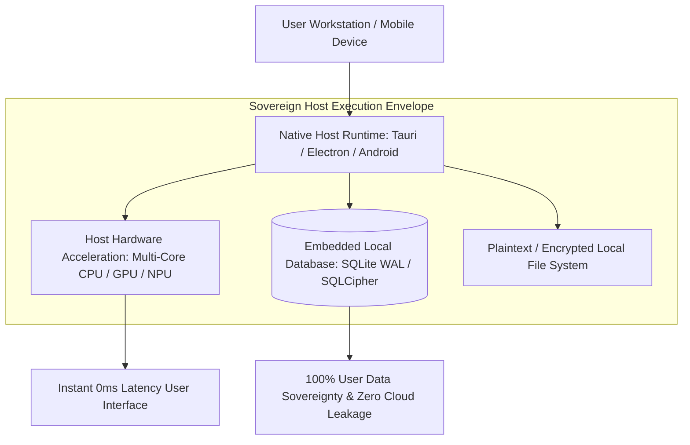

# Principle 01: Sovereign and Local-First Computing

> The user must retain absolute ownership of their data, compute resources, and software availability.

---

## Core Tenets

1. **Zero Cloud Dependence**: Applications must offer full utility without requiring internet connectivity, remote account authentication, or telemetry beacons.
2. **Compute on the Host**: Heavy computations (neural synthesis, AST parsing, document manipulation) execute directly on the user's CPU, GPU, or NPU rather than cloud serverless functions.
3. **Open and Transparent Persistence**: Data is written locally in accessible formats (SQLite, JSON, standard file hierarchies), eliminating vendor lock-in.

---

## Technical Architecture: Sovereign Local-First System Model

---

## Architectural Applications Across Portfolio

- **CodexOS**: Replaced cloud IDE telemetry with local Rust-based process management and on-device Mistral AI diagnostics.
- **Aura 3.0**: Engineered as an air-gapped desktop productivity sanctuary without remote database synchronization or background analytics.
- **Rheo**: Neural voice cloning and speech transcription executed entirely on consumer hardware (Metal, CUDA, ROCm).
- **Kryptyx**: Offline password vault operating completely disconnected from network infrastructure.

---

## Open Research & Contribution Topics

- [ ] Local conflict-free replicated data types (CRDTs) for offline-first peer synchronization.
- [ ] Cross-platform local encrypted file-storage schemas.
