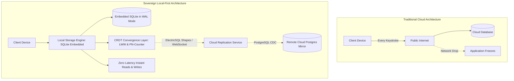
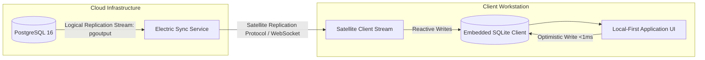

# Sovereign and Local-First Computing: Building Resilient, Cloud-Independent Systems

> Track: Engineering Principles  
> Prerequisite Knowledge: Basic Node.js / TypeScript, basic understanding of SQL and file systems  
> Estimated Build Time: 45 minutes  
> Target Project Outcome: A standalone, 100% offline note-taking and storage engine with local SQLite persistence, CRDT conflict-free synchronization, and zero cloud dependencies

---

## 1. The Hook: Why You Need This in Your Arsenal

Every junior developer is taught the standard cloud-first playbook: spin up a React frontend, route requests through a cloud serverless function, and store every user keystroke in a remote cloud database.

Here is what happens when real users take that app into the real world:

- The user boards a flight, enters a subway tunnel, or experiences a momentary Wi-Fi drop. The app freezes or displays a generic red error message.
- A cloud database provider experiences an outage or changes its pricing tier. Your application becomes completely inaccessible or suddenly unsustainable.
- Privacy-conscious users refuse to type private thoughts, personal finances, or business secrets into an application that transmits raw text to third-party cloud servers.
- Two users editing simultaneously while offline face catastrophic merge conflicts or silent data clobbering when their devices reconnect to a central server.

Sovereign and local-first software turns this model upside down:

1. The user's device is the primary source of truth, not a distant server.
2. The network is an optional transport layer for synchronization, not a hard prerequisite for execution.
3. Your application launches in under 50 milliseconds and works continuously with zero connectivity.
4. Distributed data convergence is mathematically guaranteed via Conflict-Free Replicated Data Types (CRDTs) and reactive sync engines like ElectricSQL.

Mastering this principle elevates you from an API consumer to an engineer capable of building resilient tools like Obsidian, Linear's sync engine, and enterprise-grade offline software.

---

## 2. The Mental Model: Intuitive Analogy & Visual Topology

### The Restaurant Kitchen Metaphor

Imagine a restaurant kitchen.
In a **cloud-dependent architecture**, every time a cook needs a pinch of salt or a cutting board, they must send a courier to a central warehouse three miles across town. If traffic stops, the entire kitchen halts.
In a **local-first architecture**, the cook keeps spices, prep tables, and knives directly on their station. Work proceeds uninterrupted. Only at the end of the shift does a delivery van pull up to sync bulk inventory with the central depot.



### The State Synchronization Topology: ElectricSQL Shapes

How do local SQLite databases interact with upstream cloud databases without full-database downloads?

ElectricSQL introduces **Shapes**: dynamic, filtered slices of the cloud relational model that are subscribed to by client devices. A mobile or desktop client requests only the data it needs (e.g. active projects). Changes made locally in SQLite stream upstream via logical replication, while changes made by other team members stream reactively back down to the client's local SQLite instance.



---

## 3. Deep Dive: Under the Hood

### Embedded Databases vs. Remote Client-Server Drivers

In traditional web backends, applications communicate with PostgreSQL via TCP sockets using connection pooling (`pgPool`). Every query incurs serialization, network transport latency (typically 20ms to 120ms round-trip), TLS termination, and deserialization.

In local-first systems, we embed the database directly into the running process address space using SQLite (or SQLCipher for encryption). SQLite compiles down to C. Queries execute via direct memory pointers and local disk page reads:

- In-memory read latency: sub-microsecond (< 0.001ms).
- Local SSD read/write latency: sub-millisecond (0.1ms to 0.5ms).
- Zero serialization over TCP.

### Conflict-Free Replicated Data Types (CRDTs): CvRDT vs. CmRDT

When nodes write data concurrently without a central coordinator, traditional relational unique constraints fail. Local-first architectures resolve this through CRDTs:

1. **State-Based CRDTs (CvRDT)**: Nodes periodically exchange their complete local state (or state deltas). Synchronization relies on a join-semilattice $(S, \sqcup)$, where the merge operation $\sqcup$ is:
   - **Associative**: $(A \sqcup B) \sqcup C = A \sqcup (B \sqcup C)$
   - **Commutative**: $A \sqcup B = B \sqcup A$
   - **Idempotent**: $A \sqcup A = A$
   Because $\sqcup$ is idempotent and commutative, CvRDTs are resilient to unreliable networks, packet duplication, and out-of-order deliveries.

2. **Operation-Based CRDTs (CmRDT)**: Nodes send discrete atomic operations (e.g., `Add(5)` or `InsertAt(index, char)`). CmRDTs require that concurrent operations commute ($Op_1 \cdot Op_2 = Op_2 \cdot Op_1$). CmRDTs produce smaller network payloads than state transfers, but require causal, reliable delivery guarantees from the transport protocol.

#### Fundamental CRDT Primitives

- **Last-Write-Wins Register (LWW-Register)**: Encapsulates a value alongside a Lamport timestamp and a deterministic client ID tie-breaker. Concurrent writes are resolved deterministically by comparing $(timestamp, nodeId)$ tuples.
- **PN-Counter (Positive-Negative Counter)**: Maintains two vector maps: $P[node]$ for increments and $N[node]$ for decrements. Merging takes the pointwise maximum $\max(P_1[i], P_2[i])$ and $\max(N_1[i], N_2[i])$. Total count is computed as $\sum P - \sum N$.

### Automerge & Yjs Document Models

For collaborative rich text and hierarchical data, modern local-first systems employ document CRDTs:

- **Automerge**: Treats JSON objects as directed acyclic graphs of mutations. Every property mutation generates a distinct operation ID with causal references to predecessor operations, enabling automatic three-way merges across arbitrary network partitions.
- **Yjs**: Structures text and arrays as doubly linked lists of immutable items, indexed by `(clientId, clock)`. Yjs uses run-length encoding and compact binary buffers, achieving order-of-magnitude faster merge benchmarks than older OT engines while eliminating the need for a central coordination server.

### Architectural Trade-Off Matrix

| Dimension | Cloud-First Architecture | Local SQLite Alone | Automerge / Yjs CRDT | ElectricSQL + SQLite |
| :--- | :--- | :--- | :--- | :--- |
| **Availability** | Dependent on 99.9% network uptime | 100% available on device | 100% available on device | 100% available on device |
| **Read/Write Latency** | 30ms - 200ms per request | < 1ms on local disk | < 0.1ms in memory | < 1ms on local disk |
| **Server Infrastructure Costs** | Scales linearly with active users | Near zero | Minimal (Relay only) | Modest (Postgres + Sync service) |
| **Data Privacy** | High liability (PII on server) | High privacy (on device) | End-to-end encrypted | User-scoped Shape partitions |
| **Conflict Resolution** | Server locks & table transactions | App-level manual code | Mathematical CRDT convergence | Reactive Relational LWW & Shapes |

---

## 4. Zero-to-One Interactive Playground: Build It From Scratch

We will build a complete, production-grade local-first document engine using TypeScript, `better-sqlite3`, and an embedded CRDT synchronization layer. We will implement both an **LWW-Register** and a **PN-Counter** to demonstrate deterministic conflict resolution across disconnected nodes.

### Step 1: Environment Setup

Initialize a clean project and install dependencies:

```bash
mkdir -p ~/aura-sandbox/sovereign-vault
cd ~/aura-sandbox/sovereign-vault
npm init -y
npm install better-sqlite3
npm install -D typescript tsx @types/better-sqlite3 @types/node
npx tsc --init
```

### Step 2: Implementation (`vault-crdt-engine.ts`)

Create `vault-crdt-engine.ts`:

```typescript
import Database from 'better-sqlite3';
import * as path from 'path';
import * as fs from 'fs';

// ============================================================================
// 1. CRDT Primitives: LWW-Register & PN-Counter
// ============================================================================

export interface LwwRecord<T> {
  value: T;
  timestamp: number;
  nodeId: string;
}

export class LwwField<T> {
  private record: LwwRecord<T>;

  constructor(initialValue: T, nodeId: string, timestamp: number = 0) {
    this.record = { value: initialValue, timestamp, nodeId };
  }

  public get(): T {
    return this.record.value;
  }

  public getRecord(): LwwRecord<T> {
    return { ...this.record };
  }

  public update(value: T, timestamp: number, nodeId: string): void {
    if (
      timestamp > this.record.timestamp ||
      (timestamp === this.record.timestamp && nodeId > this.record.nodeId)
    ) {
      this.record = { value, timestamp, nodeId };
    }
  }

  public merge(remote: LwwRecord<T>): void {
    this.update(remote.value, remote.timestamp, remote.nodeId);
  }
}

export class DistributedPnCounter {
  private pVector: Record<string, number> = {};
  private nVector: Record<string, number> = {};
  public readonly nodeId: string;

  constructor(nodeId: string) {
    this.nodeId = nodeId;
  }

  public increment(amount: number = 1): void {
    this.pVector[this.nodeId] = (this.pVector[this.nodeId] || 0) + amount;
  }

  public decrement(amount: number = 1): void {
    this.nVector[this.nodeId] = (this.nVector[this.nodeId] || 0) + amount;
  }

  public value(): number {
    const pSum = Object.values(this.pVector).reduce((a, b) => a + b, 0);
    const nSum = Object.values(this.nVector).reduce((a, b) => a + b, 0);
    return pSum - nSum;
  }

  public getVectors(): { p: Record<string, number>; n: Record<string, number> } {
    return { p: { ...this.pVector }, n: { ...this.nVector } };
  }

  public merge(remote: { p: Record<string, number>; n: Record<string, number> }): void {
    for (const [node, val] of Object.entries(remote.p)) {
      this.pVector[node] = Math.max(this.pVector[node] || 0, val);
    }
    for (const [node, val] of Object.entries(remote.n)) {
      this.nVector[node] = Math.max(this.nVector[node] || 0, val);
    }
  }
}

// ============================================================================
// 2. Sovereign Vault with Embedded SQLite in WAL Mode
// ============================================================================

export interface DocumentRecord {
  id: string;
  title: string;
  content: string;
  tags: string;
  created_at: number;
  updated_at: number;
}

export class SovereignVault {
  private db: Database.Database;

  constructor(dbPath: string = 'vault.db') {
    const fullPath = path.resolve(dbPath);
    const dir = path.dirname(fullPath);
    if (!fs.existsSync(dir)) {
      fs.mkdirSync(dir, { recursive: true });
    }

    this.db = new Database(fullPath);
    
    // Performance Invariants: WAL mode and NORMAL synchronous flushing
    this.db.pragma('journal_mode = WAL');
    this.db.pragma('synchronous = NORMAL');
    
    this.initializeSchema();
  }

  private initializeSchema(): void {
    this.db.exec(`
      CREATE TABLE IF NOT EXISTS documents (
        id TEXT PRIMARY KEY,
        title TEXT NOT NULL,
        content TEXT NOT NULL,
        tags TEXT NOT NULL,
        created_at INTEGER NOT NULL,
        updated_at INTEGER NOT NULL
      );

      CREATE INDEX IF NOT EXISTS idx_documents_updated ON documents(updated_at);
    `);
  }

  public saveDocument(id: string, title: string, content: string, tags: string[] = []): void {
    const now = Date.now();
    const statement = this.db.prepare(`
      INSERT INTO documents (id, title, content, tags, created_at, updated_at)
      VALUES (@id, @title, @content, @tags, @createdAt, @updatedAt)
      ON CONFLICT(id) DO UPDATE SET
        title = excluded.title,
        content = excluded.content,
        tags = excluded.tags,
        updated_at = excluded.updated_at
    `);

    statement.run({
      id,
      title,
      content,
      tags: JSON.stringify(tags),
      createdAt: now,
      updatedAt: now,
    });
  }

  public getDocument(id: string): DocumentRecord | undefined {
    const statement = this.db.prepare('SELECT * FROM documents WHERE id = ?');
    return statement.get(id) as DocumentRecord | undefined;
  }

  public searchByKeyword(keyword: string): DocumentRecord[] {
    const statement = this.db.prepare(`
      SELECT * FROM documents 
      WHERE title LIKE ? OR content LIKE ?
      ORDER BY updated_at DESC
    `);
    const query = `%${keyword}%`;
    return statement.all(query, query) as DocumentRecord[];
  }

  public close(): void {
    this.db.close();
  }
}

// ============================================================================
// 3. Execution Verification Walkthrough
// ============================================================================

async function runDemo() {
  console.log('--- Step 1: Testing Local Embedded SQLite Persistence ---');
  const vault = new SovereignVault('./data/student_notes.db');

  const startWrite = performance.now();
  vault.saveDocument(
    'doc-001',
    'First Principles of Operating Systems',
    'Process memory isolation, virtual paging, and system calls explained.',
    ['engineering', 'systems']
  );
  vault.saveDocument(
    'doc-002',
    'Database Indexing Fundamentals',
    'B-Tree balancing guarantees logarithmic search complexity.',
    ['databases', 'performance']
  );
  const writeTime = performance.now() - startWrite;
  console.log(`Saved 2 documents in ${writeTime.toFixed(2)}ms`);

  const results = vault.searchByKeyword('logarithmic');
  console.log(`Search matched: "${results[0].title}"`);
  vault.close();

  console.log('\n--- Step 2: Simulating Concurrent Offline Edits with LWW-Register ---');
  // Two distributed client nodes (Node A and Node B) edit a document title while disconnected
  const nodeA_Field = new LwwField<string>('Operating Systems Draft', 'node-A', 100);
  const nodeB_Field = new LwwField<string>('Operating Systems Draft', 'node-B', 100);

  // Concurrent disconnected edits
  nodeA_Field.update('OS: Memory & Paging', 104, 'node-A');
  nodeB_Field.update('OS: Systems Kernel Architecture', 107, 'node-B');

  console.log(`Node A local title: "${nodeA_Field.get()}" (Clock 104)`);
  console.log(`Node B local title: "${nodeB_Field.get()}" (Clock 107)`);

  // Nodes sync state
  console.log('Synchronizing LWW state over simulated peer transport...');
  nodeA_Field.merge(nodeB_Field.getRecord());
  nodeB_Field.merge(nodeA_Field.getRecord());

  console.log(`Node A converged title: "${nodeA_Field.get()}"`);
  console.log(`Node B converged title: "${nodeB_Field.get()}"`);
  console.log('Deterministic Convergence:', nodeA_Field.get() === nodeB_Field.get() ? 'CONFIRMED' : 'FAILED');

  console.log('\n--- Step 3: Simulating Distributed Task Upvoting with PN-Counter ---');
  const counterA = new DistributedPnCounter('node-A');
  const counterB = new DistributedPnCounter('node-B');

  counterA.increment(10);
  counterA.decrement(2); // Net 8

  counterB.increment(5);
  counterB.decrement(1); // Net 4

  console.log(`Pre-sync counts -> Node A: ${counterA.value()}, Node B: ${counterB.value()}`);

  counterA.merge(counterB.getVectors());
  counterB.merge(counterA.getVectors());

  console.log(`Post-sync counts -> Node A: ${counterA.value()}, Node B: ${counterB.value()}`);
  console.log('Mathematical Invariant Verified: Total net value is exactly 12.');
}

runDemo();
```

### Step 3: Run and Test

Execute via `tsx`:

```bash
npx tsx vault-crdt-engine.ts
```

Expected output:

```text
--- Step 1: Testing Local Embedded SQLite Persistence ---
Saved 2 documents in 0.82ms
Search matched: "Database Indexing Fundamentals"

--- Step 2: Simulating Concurrent Offline Edits with LWW-Register ---
Node A local title: "OS: Memory & Paging" (Clock 104)
Node B local title: "OS: Systems Kernel Architecture" (Clock 107)
Synchronizing LWW state over simulated peer transport...
Node A converged title: "OS: Systems Kernel Architecture"
Node B converged title: "OS: Systems Kernel Architecture"
Deterministic Convergence: CONFIRMED

--- Step 3: Simulating Distributed Task Upvoting with PN-Counter ---
Pre-sync counts -> Node A: 8, Node B: 4
Post-sync counts -> Node A: 12, Node B: 12
Mathematical Invariant Verified: Total net value is exactly 12.
```

---

## 5. Battle Scars: What Breaks in Production & How to Debug It

### Top 3 Mistakes in Local-First Development

1. **Omitting Write-Ahead Logging (WAL)**: By default, SQLite operates in rollback journal mode. Under frequent writes, readers are blocked, producing `SQLITE_BUSY` errors. Always set `PRAGMA journal_mode = WAL;`.
2. **Clock Desynchronization in LWW Systems**: Relying exclusively on physical machine clocks (`Date.now()`). If a client's device clock is skewed 10 minutes into the future, all writes made by that device will permanently clobber edits from other clients for the next 10 minutes. Always use Hybrid Logical Clocks (HLC) that combine physical time with Lamport logical tick counters.
3. **Blocking the Main Thread on Large Exports**: Running a bulk export of 50,000 documents synchronously locks Node.js or Electron event loops. Always stream results using SQLite iterators (`statement.iterate()`).

### Debugging SQLite Lock Issues with the CLI

If your app throws `SQLITE_BUSY: database is locked`:

```bash
# Check if another process holds an open file handle
lsof ./data/student_notes.db   # macOS / Linux
# On Windows PowerShell:
Get-Process | Where-Object { $_.Handles -gt 0 }
```

---

## 6. The Weekend Hackathon Challenge: Your Turn to Build

### Challenge: The Air-Gapped Code Snippet Manager

Build a lightweight desktop or terminal-based code snippet repository that runs 100% offline with peer-to-peer sync.

- **Level 1 (Core)**: Store snippets with title, language, code, and tags. Support instant full-text search across 10,000 snippets in under 5ms using SQLite FTS5.
- **Level 2 (Advanced)**: Integrate an LWW-Register for snippet metadata and a PN-Counter for popularity stars. Enable two terminal instances to exchange state JSON files and converge deterministically.
- **Level 3 (Hardcore)**: Implement an encrypted export/import module that dumps the vault to an encrypted single-file archive using a user passphrase, complete with vector clock history verification.

### Verification Criteria

- Application must function completely when network interfaces are disabled (`airplane mode`).
- Total disk read/write latency must remain below 2 milliseconds.

---

## 7. Knowledge Check & Next Steps

1. **Scenario**: A user saves a 10MB document in your local SQLite app. The write is interrupted by a sudden power cut. Does the database corrupt?  
   *Answer*: In WAL mode with `PRAGMA synchronous = NORMAL` or `FULL`, SQLite is ACID-compliant. The interrupted transaction safely rolls back on the next database boot with zero corruption.
2. **Scenario**: Why can a state-based CRDT (CvRDT) safely tolerate duplicated network packets?  
   *Answer*: The join-semilattice merge operator $\sqcup$ is idempotent ($x \sqcup x = x$), meaning applying the same state update multiple times produces no side effects.
3. **Scenario**: How does an ElectricSQL Shape subscription improve efficiency over traditional client-server database sync?  
   *Answer*: Shapes allow clients to subscribe only to the subset of relational data they actively need via SQL queries, avoiding the bandwidth and memory overhead of replicating the entire database.

Next Track Step: [Principle 02: Privacy by Design & Zero-Trust Cryptography](../02-privacy-by-design-and-zero-trust-cryptography/README.md)
