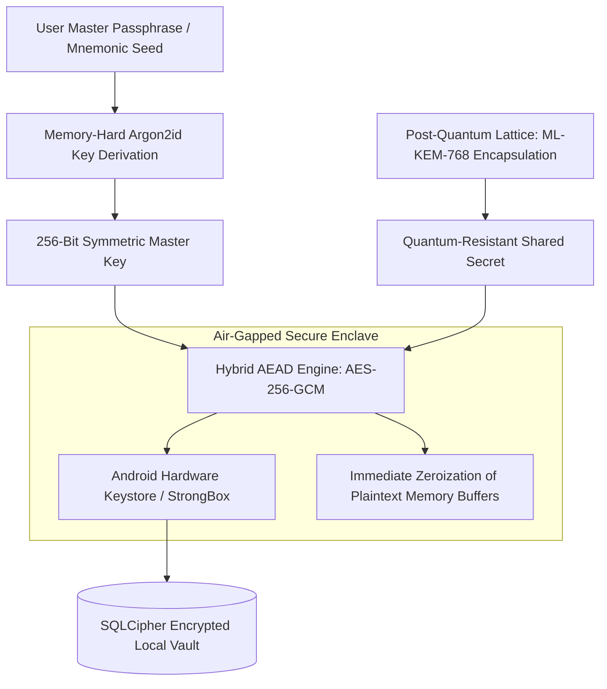

# Principle 02: Privacy by Design and Zero-Trust Cryptography

> Confidentiality and security are mathematical guarantees, not corporate policy promises.

---

## Core Tenets

1. **Air-Gap Verification via OS Permissions**: When an application manages sensitive secrets, removing network permissions at the operating system manifest level provides mathematically verifiable isolation.
2. **Post-Quantum Defense in Depth**: Classical symmetric encryption (AES-256-GCM) combined with memory-hard key derivation (Argon2id) and post-quantum key encapsulation (ML-KEM-768 / Kyber) protects against retrospective decryption.
3. **Double Ratchet and Ephemeral Signaling**: Peer-to-peer communication using the Signal Protocol ensures that intermediate signaling servers possess zero visibility into message contents or timing metadata.

---

## Technical Architecture: Zero-Trust Cryptographic Pipeline

---

## Architectural Applications Across Portfolio

- **Kryptyx**: 100% offline Android password fortress with 0 network permissions, biometric hardware keystore, and ML-KEM-768 post-quantum encryption.
- **Ghost Messenger (Calypso)**: WebRTC DataChannel transport with Signal Protocol Double Ratchet, BIP-39 mnemonic accounts, and SQLCipher encrypted local databases.
- **SDA Matrimony DigiLocker**: Identity verification through cryptographically authorized government tokens without capturing biometric or facial recognition records.

---

## Open Research & Contribution Topics

- [ ] Implementation benchmarks of ML-KEM-768 vs ML-KEM-1024 on mobile ARM processors.
- [ ] Automated static analysis tools for verifying zero network socket creation in compiled binaries.
