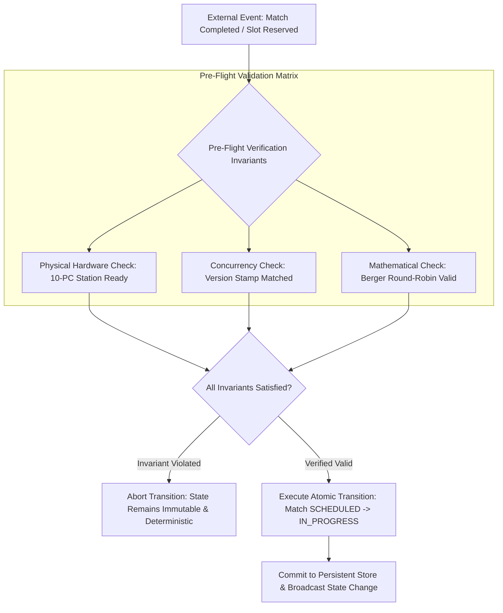

# Principle 03: Invariant-Driven State Machines

> Software state models must reflect physical constraints and mathematical determinism, preventing corrupt or impossible states by construction.

---

## Core Tenets

1. **Physical Resource Modeling**: Software schedulers and state managers must model physical real-world boundaries (workstations, network subnets, power availability, geographical parking bays).
2. **Explicit State Transitions**: Entities transition exclusively through strictly defined finite state machines; invalid transitions trigger deterministic rejections rather than unhandled side effects.
3. **Pre-Flight Validation Pipelines**: Major state lifecycle changes (tournament launch, booking confirmation, payment capture) require multi-point automated validation gates before writes are committed.

---

## Technical Architecture: Invariant-Driven Finite State Machine

---

## Architectural Applications Across Portfolio

- **Valorant Tournament Operations System (VTO)**: Direct mapping of 10-PC LAN stations to match schedules, combined with a 10-point pre-flight validation gate and Berger round-robin mathematics.
- **BGMI Tournament Control Center (TCC)**: Multi-lobby concurrent tournament wizard enforcing squad limits, map rotations, and real-time UID duplicate detection.
- **Parkly**: Optimistic concurrency control and atomic slot allocation state machines to eliminate double-booking during peak reservation periods.

---

## Open Research & Contribution Topics

- [ ] Formal verification of tournament bracket state machines using TLA+ or Alloy.
- [ ] Optimistic versus pessimistic locking benchmarks under high-concurrency reservation bursts.
