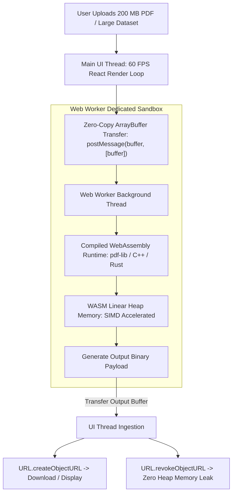

# Principle 04: Client-Side Heavy Compute and WebAssembly

> Push computation directly to the client runtime to eliminate server infrastructure costs, reduce latency, and preserve data confidentiality.

---

## Core Tenets

1. **Browser Runtime as a Compute Node**: Modern web browsers possess multi-core WebAssembly runtimes and hardware-accelerated canvas pipelines capable of high-throughput data processing.
2. **Main Thread Isolation**: Intensive tasks (parsing, compression, cryptographic hashing, rendering) execute inside dedicated Web Workers, ensuring the UI thread remains responsive at 60 FPS.
3. **Explicit Memory Deallocation**: Memory allocated in WebAssembly and browser heaps must be released promptly (e.g. revoking object URLs) to prevent tab crashes.

---

## Technical Architecture: Off-Thread Client Compute & WASM Pipeline

---

## Architectural Applications Across Portfolio

- **ErgonPDF**: Complete PDF manipulation suite (merging, splitting, encryption, compression, OCR) running entirely in the browser using WASM and Web Workers with zero server uploads.
- **CodexOS**: Integrated xterm.js terminal emulation and Monaco code editing with DOM virtualization for handling large file logs.
- **Aura 3.0**: Virtualized timeline rendering using `@tanstack/react-virtual` to display large task collections without frame drops.

---

## Open Research & Contribution Topics

- [ ] SharedArrayBuffer and WebAssembly SIMD performance comparisons for binary manipulation.
- [ ] Browser-based OCR and vector extraction using local ONNX / WASM runtimes.
