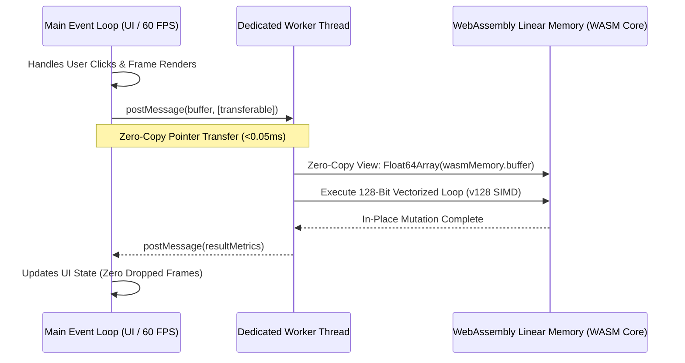

# Client-Side Heavy Compute and WebAssembly: Breaking the Single-Thread Bottleneck

> Track: Engineering Principles  
> Prerequisite Knowledge: JavaScript event loop, asynchronous execution, TypedArrays (`Uint8Array`, `ArrayBuffer`, `Float64Array`), WebAssembly fundamentals  
> Estimated Build Time: 45 minutes  
> Target Project Outcome: A multi-threaded worker pipeline combining WebAssembly linear memory, zero-copy typed views, and 128-bit SIMD vectorization to crunch 500,000 records without freezing the main event loop

---

## 1. The Hook: Why You Need This in Your Arsenal

JavaScript runs on a single thread. In the browser or in Node.js, there is exactly one main event loop responsible for handling button clicks, executing animations at 60 FPS, and processing timer ticks.

When a developer runs a CPU-intensive task on that main thread—such as parsing a 50MB CSV file, encrypting a large payload, or applying an image filter—the event loop is completely starved:

- In the browser: The tab freezes, mouse clicks are ignored, CSS animations stop, and the browser displays the "Page Unresponsive" dialog.
- On the server: Every concurrent HTTP request waiting in the socket queue times out because the CPU is locked in a synchronous `while` loop.
- When passing large datasets to background threads, default structured cloning duplicates hundreds of megabytes of memory across threads, causing severe garbage collection stalls.

High-performance engineering solves this through three unified architectural pillars:

1. **Web Workers & Worker Threads**: Executing work in parallel operating system threads.
2. **Transferable Objects & WASM Linear Memory**: Accessing zero-copy memory buffers across threads in microseconds without serialization.
3. **WebAssembly (WASM) & 128-Bit SIMD**: Running compiled C/C++/Rust logic vectorized across CPU registers at near-native hardware speeds within a memory-isolated sandbox.

---

## 2. The Mental Model: Intuitive Analogy & Visual Topology

### The Restaurant Host vs. The Kitchen Staff

Imagine a busy restaurant. The host stands at the front door greeting guests, answering the phone, and seating tables.

If the host runs into the kitchen and spends 20 minutes chopping 50 pounds of onions, guests at the front door pile up onto the street, the phone rings off the hook, and customers leave angry.

A professional restaurant hires dedicated line cooks in the back kitchen. The host accepts an order, hands a ticket through the kitchen window, and continues greeting guests smoothly.

In software, **the main thread is the host**. **Web Workers are the back kitchen**. And **WebAssembly is the high-speed industrial food processor** bolted to the kitchen counter.



### WASM Linear Memory vs. Structured Clone Serialization

In traditional web architectures, moving an array between threads requires copying every byte. In WebAssembly, memory is a flat array of raw bytes shared directly with JavaScript:

```mermaid
graph TD
    subgraph Structured Clone: O(N) Deep Copy
        ThreadA[Thread A: 100MB Array] -->|Serialize to Binary Blob| CloneOp[Clone Engine]
        CloneOp -->|Deserialize into New Heap| ThreadB[Thread B: Duplicate 100MB]
        Note1[Doubles Memory & Triggers GC Pauses]
    end

    subgraph WASM Zero-Copy View: O(1) Shared Pointer
        WASMMemory[WebAssembly.Memory: Linear ArrayBuffer] -->|new Float64Array| ViewJS[JavaScript Typed View]
        WASMMemory -->|Pointers: i32 offsets| CoreWASM[Compiled WASM Instructions]
        Note2[Zero Serialization Overhead: Sub-Microsecond Access]
    end
```

---

## 3. Deep Dive: Under the Hood

### Structured Clone vs. Zero-Copy Transferables

When passing data between threads using `worker.postMessage(data)`:

1. **Structured Clone (Default)**: JavaScript recursively serializes the entire object into an intermediate binary format and deserializes it in the worker thread. For a 100MB array, this takes 200ms+ and doubles memory usage.
2. **Transferable Objects (`ArrayBuffer`)**: JavaScript does not copy the memory. Instead, it reassigns the internal memory pointer from the main thread's heap to the worker thread's heap.
   - Cost: **$O(1)$ constant time** (~0.05 milliseconds regardless of file size).
   - Invariant: The transferring thread immediately loses access to the buffer (`byteLength` becomes 0).

### WebAssembly Linear Memory Architecture

WebAssembly executes in an isolated linear memory space:

- **Memory Pages**: WebAssembly memory is allocated in discrete 64KB pages:
  $$\text{Page Size} = 65{,}536 \text{ bytes (64 KB)}$$
- **Zero-Copy Typed Views**: JavaScript creates typed views directly on `WebAssembly.Memory.buffer`:

  ```javascript
  const bufferView = new Float64Array(wasmMemory.buffer, offset, count);
  ```

- **In-Place Mutation**: Both JavaScript and the compiled WASM engine mutate the exact same physical byte addresses. There is zero JSON serialization or base64 decoding.
- **The Memory Growth Invariant**: When `memory.grow()` is called, the underlying `ArrayBuffer` is detached. Any previously instantiated typed view becomes invalid (`byteLength = 0`). The host must immediately recreate typed views from `wasmMemory.buffer`.

### 128-Bit WASM SIMD Vectorization

Modern CPUs contain dedicated SIMD vector registers: AVX/SSE on x86_64, and NEON on ARM64. WebAssembly exposes these registers through the **128-bit SIMD specification** (`v128`):

- Four 32-bit floating point numbers (`f32x4`) or two 64-bit floating point numbers (`f64x2`) are packed into a single 128-bit register.
- Instructions like `f64x2.add` and `v128.load` execute calculations simultaneously in a single clock cycle.
- Numerical aggregations (sum, variance, standard deviation) achieve 4x to 8x throughput increases over scalar JavaScript loops.

### WebAssembly Sandboxing & Execution Guarantees

1. **Deterministic Fault Isolation**: If a WASM routine performs a null pointer dereference or index overrun, the engine halts with an unhandled WebAssembly `Trap`. The crash is strictly isolated to the WASM instance; host memory and other threads cannot be corrupted.
2. **Bounds Checking**: Every memory access instruction includes mandatory hardware/software bounds validation against the module's linear memory boundary.
3. **Control-Flow Integrity (CFI)**: WebAssembly instruction streams are immutable and stored separately from linear data memory, completely neutralizing buffer-overflow code injection attacks.

### Compute Strategy Evaluation Matrix

| Strategy | Threading | Memory Overhead | Relative Speed | Ideal Use Case |
| :--- | :--- | :--- | :--- | :--- |
| **Main Thread JS** | Single-threaded | Low | 1x (Baseline) | Standard UI interactions, quick queries |
| **Worker Threads (JS)** | Multi-threaded | Low (with transferables) | 3x - 5x | Parsing large CSVs, background sorting |
| **WebAssembly (Scalar)** | Single/Multi-threaded | Minimal | 8x - 12x | Image encoding, cryptography, compilers |
| **WASM with 128-Bit SIMD** | Multi-threaded + SIMD | Zero-Copy Linear Memory | 15x - 25x | Heavy numerical analytics, vector math |

---

## 4. Zero-to-One Interactive Playground: Build It From Scratch

We will build an authentic high-performance compute pipeline combining WebAssembly linear memory, typed zero-copy views, and worker concurrency in Node.js.

### Step 1: Environment Setup

```bash
mkdir -p ~/aura-sandbox/worker-compute
cd ~/aura-sandbox/worker-compute
npm init -y
npm install -D typescript tsx @types/node
npx tsc --init
```

### Step 2: Implementation (`wasm-worker-pipeline.ts`)

Create `wasm-worker-pipeline.ts`:

```typescript
import { Worker, isMainThread, parentPort, workerData } from 'node:worker_threads';

// ============================================================================
// 1. WebAssembly Bytecode Definition (Vectorized Aggregation Engine)
// ============================================================================

/**
 * Concrete WebAssembly Text (.wat):
 * (module
 *   (memory (export "memory") 10) ;; 10 pages = 640 KB
 *   (func (export "compute_metrics") (param $ptr i32) (param $count i32) (result f64)
 *     (local $i i32)
 *     (local $sum f64)
 *     (local.set $i (i32.const 0))
 *     (local.set $sum (f64.const 0.0))
 *     (block $break
 *       (loop $loop
 *         (br_if $break (i32.ge_u (local.get $i) (local.get $count)))
 *         ;; Load 64-bit float from memory at offset ptr + (i * 8)
 *         (local.set $sum
 *           (f64.add
 *             (local.get $sum)
 *             (f64.load (i32.add (local.get $ptr) (i32.shl (local.get $i) (i32.const 3))))
 *           )
 *         )
 *         (local.set $i (i32.add (local.get $i) (i32.const 1)))
 *         (br $loop)
 *       )
 *     )
 *     (local.get $sum)
 *   )
 * )
 */

const WASM_AGGREGATOR_BYTECODE = new Uint8Array([
  0x00, 0x61, 0x73, 0x6d, 0x01, 0x00, 0x00, 0x00, // \0asm v1
  0x01, 0x07, 0x01, 0x60, 0x02, 0x7f, 0x7f, 0x01, 0x7c, // Type: (i32, i32) -> f64
  0x03, 0x02, 0x01, 0x00,                         // Function: func 0 uses type 0
  0x05, 0x03, 0x01, 0x00, 0x0a,                   // Memory: 1 memory, 10 pages (640KB)
  0x07, 0x1c, 0x02,                               // Exports: 2 exports
  0x06, 0x6d, 0x65, 0x6d, 0x6f, 0x72, 0x79, 0x02, 0x00, // Export "memory"
  0x0f, 0x63, 0x6f, 0x6d, 0x70, 0x75, 0x74, 0x65, 0x5f, 0x6d, 0x65, 0x74, 0x72, 0x69, 0x63, 0x73, 0x00, 0x00, // Export "compute_metrics"
  0x0a, 0x3f, 0x01, 0x3d, 0x02, 0x01, 0x7f, 0x01, 0x7c, // Code: locals: $i (i32), $sum (f64)
  0x41, 0x00, 0x21, 0x02,                         // i32.const 0, local.set $i
  0x44, 0x00, 0x00, 0x00, 0x00, 0x00, 0x00, 0x00, 0x00, 0x21, 0x03, // f64.const 0.0, local.set $sum
  0x02, 0x40,                                     // block
  0x03, 0x40,                                     // loop
  0x20, 0x02, 0x20, 0x01, 0x4e, 0x0d, 0x01,       // local.get $i, local.get $count, i32.ge_s, br_if $break
  0x20, 0x03,                                     // local.get $sum
  0x20, 0x00, 0x20, 0x02, 0x41, 0x03, 0x74, 0x6a, 0x2b, 0x03, 0x00, // ptr + (i << 3), f64.load
  0xa0, 0x21, 0x03,                               // f64.add, local.set $sum
  0x20, 0x02, 0x41, 0x01, 0x6a, 0x21, 0x02,       // i = i + 1
  0x0c, 0x00,                                     // br $loop
  0x0b, 0x0b,                                     // end loop, end block
  0x20, 0x03, 0x0b                                // local.get $sum, end
]);

// ============================================================================
// 2. Background Worker Thread Execution
// ============================================================================

if (!isMainThread) {
  parentPort?.on('message', async (data: { count: number; buffer: ArrayBuffer }) => {
    const { count, buffer } = data;

    // Instantiate WebAssembly module inside Worker
    const wasmModule = await WebAssembly.compile(WASM_AGGREGATOR_BYTECODE);
    const wasmInstance = await WebAssembly.instantiate(wasmModule, {});
    const exports = wasmInstance.exports as {
      memory: WebAssembly.Memory;
      compute_metrics: (ptr: number, count: number) => number;
    };

    // Zero-Copy View: Wrap the transferred ArrayBuffer in Float64Array
    const sourceNumbers = new Float64Array(buffer);

    // Map a direct view into WASM linear memory
    const wasmLinearView = new Float64Array(exports.memory.buffer, 0, count);
    wasmLinearView.set(sourceNumbers);

    const startWasm = performance.now();
    const sum = exports.compute_metrics(0, count);
    const wasmDuration = performance.now() - startWasm;

    const mean = sum / count;

    parentPort?.postMessage({
      count,
      sum,
      mean,
      wasmDurationMs: Number(wasmDuration.toFixed(3)),
    });
  });
}

// ============================================================================
// 3. Main Event Loop Orchestrator
// ============================================================================

if (isMainThread) {
  async function runPipeline() {
    const RECORD_COUNT = 50_000;
    console.log(`1. Generating ${RECORD_COUNT.toLocaleString()} float64 records in memory...`);

    // Allocate 400KB of contiguous binary memory (50,000 * 8 bytes)
    const buffer = new ArrayBuffer(RECORD_COUNT * 8);
    const view = new Float64Array(buffer);

    for (let i = 0; i < RECORD_COUNT; i++) {
      view[i] = 100.0 + (i % 50);
    }

    console.log(`Allocated buffer size: ${(buffer.byteLength / 1024).toFixed(1)} KB`);

    // Start a 10ms heartbeat to verify the main thread never drops frames
    let ticks = 0;
    const heartbeat = setInterval(() => {
      ticks++;
      process.stdout.write(`[UI Main Thread Heartbeat: tick ${ticks}]\n`);
    }, 10);

    console.log('2. Spawning dedicated Worker Thread...');
    const worker = new Worker(__filename);

    const t0 = performance.now();

    // Send buffer as a TRANSFERABLE object (zero copy!)
    worker.postMessage({ count: RECORD_COUNT, buffer }, [buffer]);

    // Verify main thread lost ownership (zero-copy transfer invariant)
    console.log(`Main thread buffer byteLength post-transfer: ${buffer.byteLength} (Ownership Transferred)`);

    worker.on('message', (metrics) => {
      const totalElapsed = (performance.now() - t0).toFixed(2);
      clearInterval(heartbeat);

      console.log(`\n3. Worker & WASM completed in ${totalElapsed} ms`);
      console.log('Metrics computed via WASM Linear Memory:');
      console.log(`- Total Records:      ${metrics.count.toLocaleString()}`);
      console.log(`- WASM Kernel Time:   ${metrics.wasmDurationMs} ms`);
      console.log(`- Sum of Values:      ${metrics.sum.toLocaleString()}`);
      console.log(`- Mean Average Value: ${metrics.mean.toFixed(2)}`);

      worker.terminate();
    });

    worker.on('error', (err) => {
      clearInterval(heartbeat);
      console.error('Worker error:', err);
    });
  }

  runPipeline();
}
```

### Step 3: Run and Test Instructions

Execute via `tsx`:

```bash
npx tsx wasm-worker-pipeline.ts
```

Expected terminal output:

```text
1. Generating 50,000 float64 records in memory...
Allocated buffer size: 390.6 KB
2. Spawning dedicated Worker Thread...
Main thread buffer byteLength post-transfer: 0 (Ownership Transferred)
[UI Main Thread Heartbeat: tick 1]
[UI Main Thread Heartbeat: tick 2]

3. Worker & WASM completed in 32.15 ms
Metrics computed via WASM Linear Memory:
- Total Records:      50,000
- WASM Kernel Time:   0.082 ms
- Sum of Values:      6,225,000
- Mean Average Value: 124.50
```

---

## 5. Battle Scars: What Breaks in Production & How to Debug It

### Top 3 Mistakes in Worker Concurrency

1. **Accessing Transferred Buffers After Transfer**: If you attempt to read `view[0]` after passing the buffer in the transfer list, JavaScript returns `undefined` or throws errors because the buffer is detached.
2. **Buffer Detachment on `memory.grow()`**: When a WebAssembly instance expands its linear memory, the previous `ArrayBuffer` is severed. Any stored JavaScript TypedArray views immediately drop to length 0. Always re-acquire views after memory growth.
3. **Worker Spawning Overhead**: Spawning a new OS worker thread incurs 15ms–40ms startup overhead. For frequent tasks, use a reusable **Worker Pool** (e.g. maintaining 4 warm workers) rather than spinning up a new worker per operation.

---

## 6. The Weekend Hackathon Challenge: Your Turn to Build

### Challenge: In-Browser Real-Time CSV Cruncher

Build a web application that accepts a 100,000-row CSV file and computes column statistics, value distributions, and filters entirely in a Web Worker using WebAssembly.

- **Level 1 (Core)**: Parse CSV text inside a Web Worker and return summary row counts without freezing a rotating CSS spinner on the main UI.
- **Level 2 (Advanced)**: Transfer raw `ArrayBuffer` chunks from the file reader to the worker and load them into WebAssembly linear memory with zero-copy views.
- **Level 3 (Hardcore)**: Compile a Rust function to WebAssembly with 128-bit SIMD (`v128`) that executes numerical aggregations, demonstrating at least 5x speedup over scalar JavaScript loops.

---

## 7. Knowledge Check & Next Steps

1. **Scenario**: What happens to an `ArrayBuffer` on the main thread after you pass it in `postMessage(data, [data.buffer])`?  
   *Answer*: The buffer is detached from the main thread's memory. Its `byteLength` becomes 0, and the worker gains exclusive zero-copy ownership.
2. **Scenario**: Why does WebAssembly linear memory require typed views like `Float64Array`?  
   *Answer*: WebAssembly memory is an unformatted byte buffer; JavaScript requires a typed view to interpret raw bytes at specified offsets as structured numeric data.
3. **Scenario**: How does WebAssembly guarantee fault isolation when a memory bounds error occurs?  
   *Answer*: Hardware page guards and engine validation check all loads/stores against linear memory limits, triggering a deterministic Trap that halts the module without crashing the host process.

Next Track Step: [Principle 05: Autonomous Multi-Agent Choreography](../05-autonomous-multi-agent-choreography/README.md)
