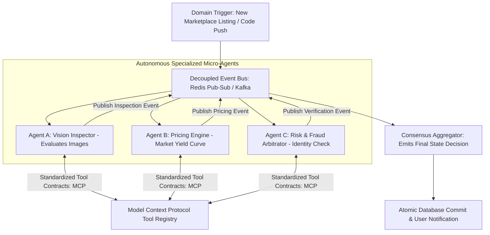

# Principle 05: Autonomous Multi-Agent Choreography

> Complex business ecosystems are best served by small, autonomous, specialized agents collaborating asynchronously over shared event buses.

---

## Core Tenets

1. **Domain-Specific Agents**: Instead of relying on a monolithic AI assistant, decompose responsibilities into specialized agents (e.g. pricing, space inspection, dispute arbitration, customer support).
2. **Event Choreography Over Tight Coupling**: Agents communicate via decoupled message streams (EventBridge, Redis Pub/Sub, Kafka), eliminating single points of failure.
3. **Structured Tool Interfaces**: Expose capabilities through strict schemas (Model Context Protocol or JSON Schema) to ensure safe, predictable operations.

---

## Technical Architecture: Event-Driven Multi-Agent Swarm

---

## Architectural Applications Across Portfolio

- **Parkly**: Autonomous multi-agent marketplace coordinating host onboarding, computer vision driveway inspection, dynamic vacancy pricing, and dispute adjudication.
- **Skills Bot**: Library of over 1,900 agentic tool definitions executed across bioinformatics, software engineering, and cloud deployment pipelines.
- **Aura Core**: Specialized agentic engines (Chronos engine, Projection engine, Universal AI service).

---

## Open Research & Contribution Topics

- [ ] Consensus and negotiation protocols between competing economic agents.
- [ ] Self-healing agent loops with automatic rollback and error recovery.
