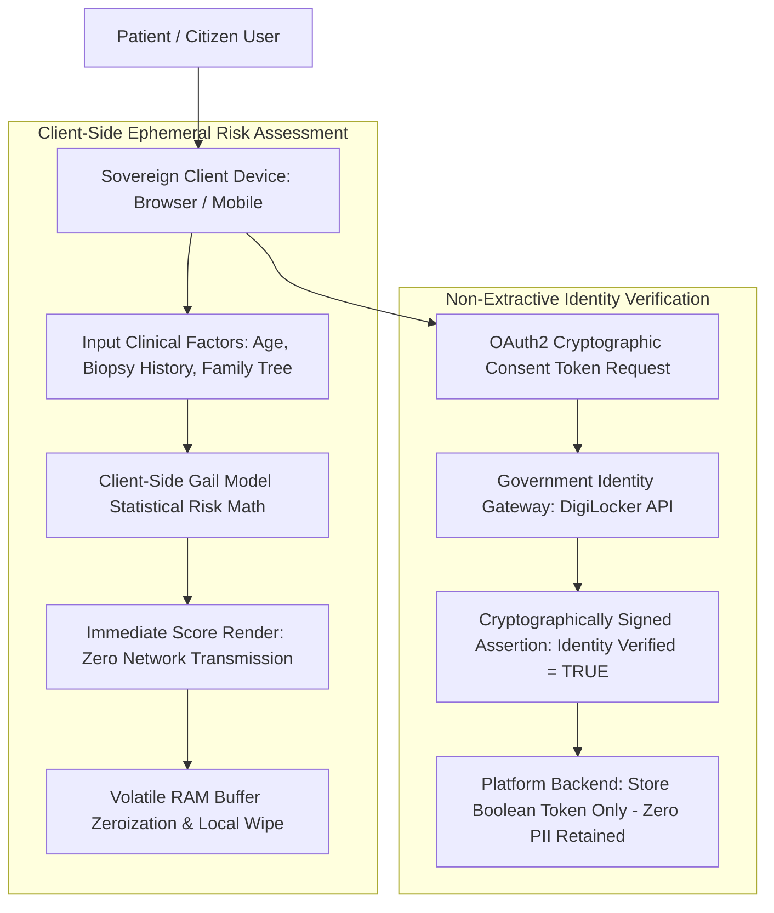

# Principle 06: Clinical and Ethical Data Governance

> Handle sensitive health and identity data with statistical rigor, clear auditability, and non-extractive verification flows.

---

## Core Tenets

1. **Validated Statistical Modeling**: Health calculations and risk scores must be based on established clinical models (e.g. Gail Model, Tyrer-Cuzick standards) rather than unverified heuristics.
2. **Non-Extractive Verification**: Verify credentials and identity using cryptographic tokens or third-party authorizations without retaining unnecessary biometric or identity records.
3. **Auditable System Records**: All modifications to sensitive clinical or personal records must generate immutable audit logs for regulatory compliance.

---

## Technical Architecture: Non-Extractive Clinical Governance Pipeline

---

## Architectural Applications Across Portfolio

- **PinkPulse**: Digital oncology platform combining multi-stage clinical risk assessment with patient-controlled local symptom tracking and auditable clinical dashboards.
- **SDA Matrimony DigiLocker**: Identity verification pipeline that purposefully avoids facial recognition and biometric storage by using DigiLocker OAuth2 consent tokens.

---

## Open Research & Contribution Topics

- [ ] Zero-knowledge proofs for verifying age, citizenship, and income without disclosing raw attributes.
- [ ] Differential privacy patterns for population-level medical analytics.
