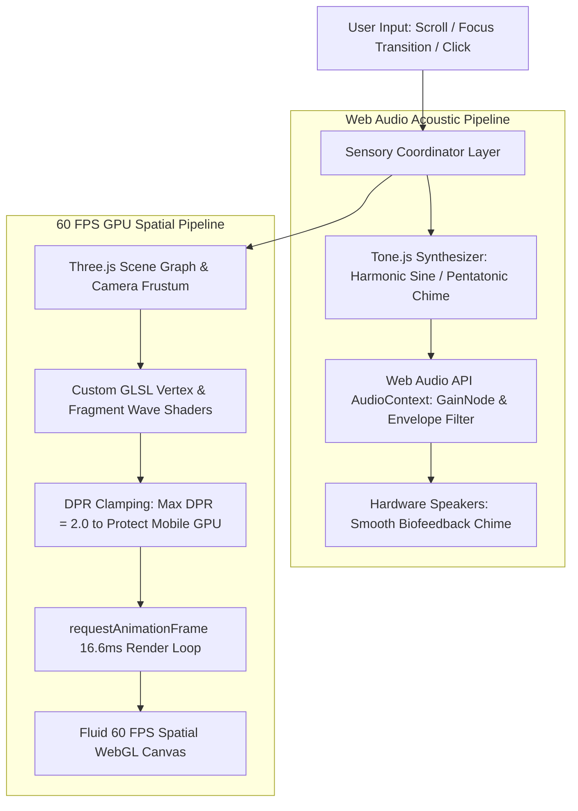

# Principle 07: Sensory Ergonomics and Spatial Design

> Human perception is multi-sensory. Software should reduce cognitive strain through deliberate acoustic feedback, high-framerate rendering, and considerate interface design.

---

## Core Tenets

1. **Acoustic Design for Deep Focus**: Replace jarring system beeps with warm, harmonically tuned audio (using Tone.js) that gently signals task transitions and focus intervals.
2. **GPU-Accelerated 60 FPS Interfaces**: Utilize WebGL, Three.js, and CSS hardware acceleration to maintain fluid, responsive micro-interactions.
3. **Respectful UX**: Explain *why* a permission or step is needed before requesting it, avoiding sudden dialogs and reducing cognitive friction.

---

## Technical Architecture: GPU Render Loop & Web Audio Pipeline

---

## Architectural Applications Across Portfolio

- **Aura 3.0**: Incorporates Tone.js audio soundscapes to support deep work intervals, paired with a virtualized chronological timeline.
- **ZEUS & Zeus New Web**: High-performance Three.js scenes, custom shaders, and GSAP animations running at 60 FPS on mobile and desktop.
- **Rheo**: Low-latency neural speech streaming with responsive waveform visualizations.

---

## Open Research & Contribution Topics

- [ ] Web Audio API memory lifecycle and audio context management across tab suspensions.
- [ ] Shader optimizations for battery-constrained mobile web devices.
