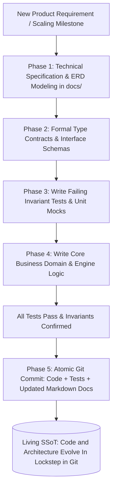

# Principle 08: Living Documentation and Single Source of Truth

> Architectural clarity before code. Living documentation prevents miscommunication and ensures long-term system maintainability.

---

## Core Tenets

1. **Specification Before Implementation**: Author comprehensive architectural specifications, entity-relationship diagrams, and sprint backlogs before writing application code.
2. **Version-Controlled Single Source of Truth (SSoT)**: Architectural documents live directly alongside the codebase in git, updated in the same pull requests that modify system behavior.
3. **Strict Engineering Standards**: Enforce Conventional Commits, atomic PRs, and clear markdown hierarchies to maintain an auditable project history.

---

## Technical Architecture: Specification-Driven Development & Living SSoT

---

## Architectural Applications Across Portfolio

- **Parkly**: Complete 8-part Master Documentation Suite detailing market analysis, unit economics, ERDs, REST contracts, and multi-agent topologies.
- **Valorant Tournament Operations System (VTO)**: Comprehensive architectural specification covering physical resource models, bracket state machines, and pre-flight gates.
- **Aura Handbook**: Open-source engineering standards with contribution rules (`RULES.md`), automated CI linters, and clear track syllabi.

---

## Open Research & Contribution Topics

- [ ] Automated generation of OpenAPI specs from type-safe TypeScript schemas.
- [ ] Bi-directional syncing between Mermaid.js architecture diagrams and infrastructure definitions.
