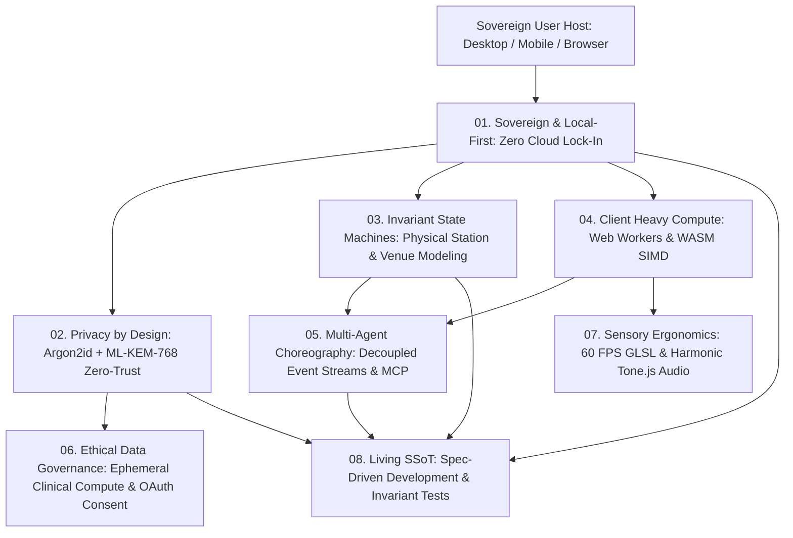

# Engineering Principles

> Foundational architectural paradigms distilled from our multi-project engineering portfolio.

---

## Technical Architecture: Unified Sovereign Systems Topology

---

## Directory Overview

This directory documents the 8 foundational engineering principles that guide our technical decisions across systems programming, cryptography, distributed computing, state machines, and human-computer interaction.

| Principle Module | Directory | Core Focus |
| :--- | :--- | :--- |
| **01. Sovereign & Local-First Computing** | [`01-sovereign-and-local-first-computing/`](./01-sovereign-and-local-first-computing/README.md) | Zero-cloud dependence, host hardware compute, offline persistence |
| **02. Privacy by Design & Zero-Trust** | [`02-privacy-by-design-and-zero-trust-cryptography/`](./02-privacy-by-design-and-zero-trust-cryptography/README.md) | Manifest air-gapping, post-quantum cryptography, Double Ratchet |
| **03. Invariant-Driven State Machines** | [`03-invariant-driven-state-machines/`](./03-invariant-driven-state-machines/README.md) | Physical reality modeling, deterministic bracket progression |
| **04. Client-Side Heavy Compute & WASM** | [`04-client-side-heavy-compute-and-wasm/`](./04-client-side-heavy-compute-and-wasm/README.md) | Web Workers, WebAssembly memory sandboxes, DOM virtualization |
| **05. Autonomous Multi-Agent Choreography** | [`05-autonomous-multi-agent-choreography/`](./05-autonomous-multi-agent-choreography/README.md) | Decoupled agent roles, event-driven message buses, tool protocols |
| **06. Clinical & Ethical Data Governance** | [`06-clinical-and-ethical-data-governance/`](./06-clinical-and-ethical-data-governance/README.md) | Statistical risk models, non-extractive verification, privacy ethics |
| **07. Sensory Ergonomics & Spatial Design** | [`07-sensory-ergonomics-and-spatial-design/`](./07-sensory-ergonomics-and-spatial-design/README.md) | Auditory biofeedback, 60 FPS GPU acceleration, respectful UX |
| **08. Living Documentation & SSoT** | [`08-living-documentation-and-ssot/`](./08-living-documentation-and-ssot/README.md) | Upfront architectural specifications, conventional history |

---

## The Unified Philosophy

Every principle in this repository represents an empirical standard verified in production. We prioritize:
- Determinism over speculation.
- Local sovereignty over rented cloud APIs.
- Mathematical safety over security-by-obscurity.
- Ergonomic clarity over cognitive bloat.
