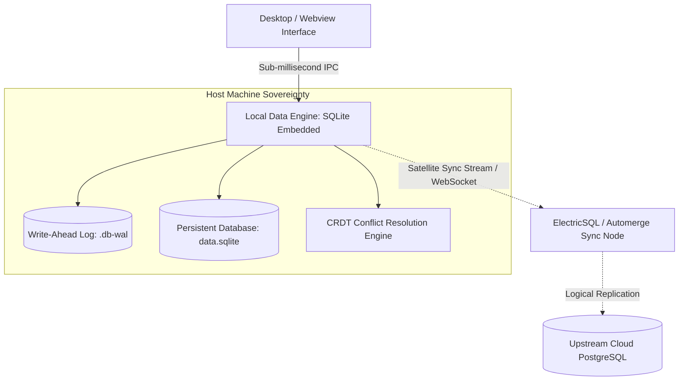
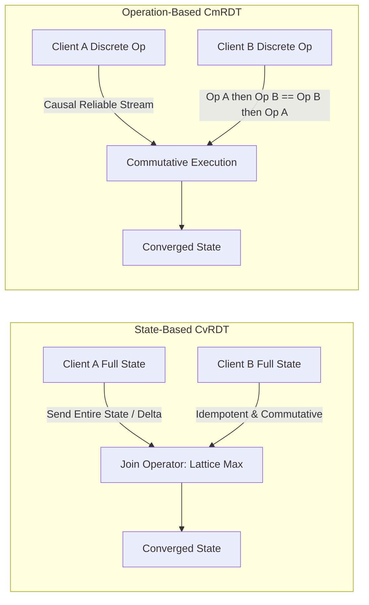

# Local-First Data with SQLite

> Track: Stage 1 (Foundations to Local-First Systems)  
> Prerequisite Knowledge: Basic SQL syntax (SELECT, INSERT, UPDATE), JavaScript / Node.js fundamentals  
> Estimated Build Time: 60 minutes  
> Target Project Outcome: Building a sovereign, offline-capable local note and task database using embedded SQLite with Write-Ahead Logging (WAL), Conflict-Free Replicated Data Types (CRDTs), and reactive sync topologies

---

## 1. The Hook: Why You Need This in Your Arsenal

When developers are taught fullstack engineering, they are almost universally shown this architecture:
`React Frontend -> Express/FastAPI Backend -> AWS RDS PostgreSQL Cloud Database`.

What happens when your user is on an airplane, riding a subway, or facing a Wi-Fi outage?
Your application displays an empty screen with a spinning loader and becomes completely unusable.

Even worse:

- The user's private notes and thoughts are stored on your cloud servers, creating privacy risks and monthly database hosting bills.
- Every keystroke requires a network roundtrip of 150 milliseconds.
- When two users edit documents concurrently while disconnected, traditional databases reject writes with lock conflicts or silently overwrite changes via naive last-write-wins at the server table level.

In **Aura 3.0**, we inverted this model: **Local-First Software**.

- The primary copy of the data lives directly on the user's local disk in an embedded SQLite database.
- Read operations take **0.2 milliseconds** instead of 150 milliseconds.
- The application functions seamlessly with zero internet connection.
- When collaboration or cloud backup is required, data synchronization relies on **Conflict-Free Replicated Data Types (CRDTs)** and **ElectricSQL Shapes**, guaranteeing mathematical convergence without a central locking authority.

---

## 2. The Mental Model: Intuitive Analogy & Visual Topology

### The Local Ledger vs. The Central Bureaucracy

- **Cloud-First SaaS**: Like needing to call a government office in another country every time you want to write a grocery list on your kitchen counter. If the phone line is down, you cannot write your list.
- **Local-First Computing**: You have a physical paper notebook directly on your desk. You write in it instantaneously. If you choose to photocopy it and mail a copy to a friend later, you can do so whenever convenient.



### The Two Paradigms of Conflict-Free Replication: CvRDT vs. CmRDT

When two offline devices make concurrent modifications, how do they reconcile their data upon reconnection without losing work?

- **State-Based CRDTs (CvRDT / Convergent)**: Like two colleagues exchanging their entire completed notebooks. Each colleague reviews the notebooks and applies an unambiguous mathematical merge rule (a join-semilattice) to combine the notes. State-based synchronization can tolerate duplicate deliveries, dropped packets, and out-of-order networks because merging identical state produces the exact same result.
- **Operation-Based CRDTs (CmRDT / Commutative)**: Like two telegraph operators sending discrete atomic commands: "Add 5 to account X" or "Append character 'c' at position 12". The transport layer must guarantee causal, reliable delivery, but the operations themselves are mathematically designed to commute ($A \cdot B = B \cdot A$).



---

## 3. Deep Dive: Under the Hood

### Embedded Database vs. Client-Server Database

- **PostgreSQL / MySQL**: Client-server databases. They run as standalone operating system processes, listen on TCP sockets (e.g., port 5432), and require authentication, network packets, and serialization on every query.
- **SQLite**: An in-process library. It does not run as a separate server. It compiles directly into your application process and reads/writes local disk pages directly via OS file locks.

### Why Write-Ahead Logging (WAL) Mode is Mandatory

By default, SQLite uses a rollback journal for transactions. When a transaction writes to the database, it locks the entire file, blocking all concurrent readers.

Enabling **Write-Ahead Logging (`PRAGMA journal_mode = WAL;`)** fundamentally changes this:

1. Changes are appended to a separate `.wal` file rather than modifying the main database file in place.
2. **Readers never block writers**, and **writers never block readers**.
3. Writes become fast sequential disk appends.
4. Periodically, SQLite executes a "checkpoint" that merges the WAL log back into the main database file.

### Mathematical Foundations of CRDT Primitives

A Conflict-Free Replicated Data Type is defined over a partially ordered set $(S, \le)$ equipped with a binary join operator $\sqcup$:

1. **Associativity**: $(x \sqcup y) \sqcup z = x \sqcup (y \sqcup z)$ (batching order does not affect the outcome).
2. **Commutativity**: $x \sqcup y = y \sqcup x$ (arrival order across network nodes does not affect the outcome).
3. **Idempotence**: $x \sqcup x = x$ (receiving duplicate sync messages produces zero side effects).

#### 1. Last-Write-Wins Register (LWW-Register)

An LWW-Register stores a value $v$, a monotonic timestamp $t$ (such as a Lamport logical clock or hybrid logical clock), and a deterministic node identifier $nodeId$:

- State: $R = (v, t, nodeId)$
- Merge rule:
  $$R_1 \sqcup R_2 = \begin{cases} R_1 & \text{if } t_1 > t_2 \\ R_2 & \text{if } t_2 > t_1 \\ R_1 & \text{if } t_1 = t_2 \land nodeId_1 > nodeId_2 \\ R_2 & \text{otherwise} \end{cases}$$

#### 2. Positive-Negative Counter (PN-Counter)

A PN-Counter supports both increments and decrements across distributed nodes without a central lock. It is composed of two state-based Grow-only Counters (G-Counters):

- $P$: Vector of positive increments, where $P[i]$ is the total increments performed by node $i$.
- $N$: Vector of negative decrements, where $N[i]$ is the total decrements performed by node $i$.
- Current value: $\text{Value} = \sum_{i} P[i] - \sum_{i} N[i]$
- Merge rule:
  $$P_{\text{merged}}[i] = \max(P_1[i], P_2[i]), \quad N_{\text{merged}}[i] = \max(N_1[i], N_2[i])$$

### Automerge & Yjs Document Models vs. Operational Transformation (OT)

In traditional collaborative apps like Google Docs, **Operational Transformation (OT)** requires a centralized server to act as the single source of truth, ordering concurrent edits and rewriting index offsets. If the server disconnects, clients cannot reliably transform operations.

Modern local-first applications use CRDT document models:

- **Automerge**: Represents documents as directed acyclic graphs (DAGs) of operations. Every map key and list item has a unique, immutable operation ID (`actorId@counter`). Rich text is represented as a sequence CRDT where deletions insert "tombstones" or mark intervals, preserving intentional formatting and concurrent edits across peers.
- **Yjs**: Implements a high-performance doubly linked list of items. Each item stores its left and right origins (`origin` and `originRight`). By referencing immutable item IDs rather than mutable array indexes, Yjs merges concurrent keystrokes in $O(\log N)$ or $O(1)$ amortized time, packing operations into binary buffers via the `lib0` encoding standard.

### ElectricSQL & Local Sync Topologies

Instead of rebuilding database tables from scratch in custom CRDT documents, **ElectricSQL** brings local-first synchronization directly to relational SQLite and PostgreSQL:

1. **Shapes**: A client declares a dynamic subscription called a "Shape"—a filtered subset of the Postgres relational graph (for example, `SELECT * FROM tasks WHERE project_id = 'proj-99'`).
2. **Satellite Replication**: ElectricSQL uses PostgreSQL logical replication streams (`pgoutput`) to capture change-data-capture (CDC) WAL events and streams them over WebSockets to client devices.
3. **Reactive SQLite**: The client writes optimistically to local embedded SQLite in microseconds. The local database reacts immediately to drive UI rendering. In the background, local changes are sent to ElectricSQL, validated against relational invariants, and replicated to Postgres and peer devices.

### Trade-Off Matrix: Storage & Sync Engines

| Attribute | Cloud PostgreSQL | Browser IndexedDB | Local Embedded SQLite | Automerge / Yjs CRDT | ElectricSQL + SQLite |
| :--- | :--- | :--- | :--- | :--- | :--- |
| **Read Latency** | 50ms - 200ms | 5ms - 15ms | < 0.5ms | < 0.1ms (In-memory) | < 0.5ms (Local disk) |
| **Offline Support** | 0% | 100% | 100% | 100% | 100% |
| **Query Power** | Full SQL | Key-Value / Object | Full SQL (JOINs, CTEs) | In-Memory Object Traversal | Full SQL locally & cloud |
| **Conflict Resolution** | Server row locks | Manual app code | Manual app code | Automatic CRDT convergence | Automatic relational LWW/CRDT |
| **Data Sovereignty** | Centralized | Browser cache | User-owned disk file | Local memory / file | Local SQLite + optional sync |

---

## 4. Zero-to-One Interactive Playground: Build It From Scratch

Let us build an interactive local-first engine in TypeScript. We will combine embedded SQLite in WAL mode with mathematically verified CRDT primitives: an **LWW-Register** and a **PN-Counter**. We will simulate two disconnected clients making concurrent edits and verify that their states converge identically.

### Step 1: Environment Setup

Create a playground directory and install dependencies:

```bash
mkdir -p ~/aura-sandbox/local-sqlite
cd ~/aura-sandbox/local-sqlite
npm init -y
npm install better-sqlite3
npm install --save-dev typescript @types/node @types/better-sqlite3 tsx
```

### Step 2: Implementation (`local-vault-crdt.ts`)

Create `local-vault-crdt.ts`:

```typescript
import Database from 'better-sqlite3';

// ============================================================================
// Part A: CRDT Primitives (LWW-Register and PN-Counter)
// ============================================================================

export interface LwwState<T> {
  value: T;
  timestamp: number;
  nodeId: string;
}

export class LwwRegister<T> {
  private state: LwwState<T>;

  constructor(initialValue: T, nodeId: string, timestamp: number = 0) {
    this.state = {
      value: initialValue,
      timestamp,
      nodeId,
    };
  }

  public get(): T {
    return this.state.value;
  }

  public getState(): LwwState<T> {
    return { ...this.state };
  }

  public set(value: T, timestamp: number, nodeId: string): void {
    if (
      timestamp > this.state.timestamp ||
      (timestamp === this.state.timestamp && nodeId > this.state.nodeId)
    ) {
      this.state = { value, timestamp, nodeId };
    }
  }

  public merge(remote: LwwState<T>): void {
    this.set(remote.value, remote.timestamp, remote.nodeId);
  }
}

export interface PnCounterState {
  p: Record<string, number>;
  n: Record<string, number>;
}

export class PnCounter {
  private p: Record<string, number> = {};
  private n: Record<string, number> = {};
  private readonly nodeId: string;

  constructor(nodeId: string, initialState?: PnCounterState) {
    this.nodeId = nodeId;
    if (initialState) {
      this.p = { ...initialState.p };
      this.n = { ...initialState.n };
    }
  }

  public increment(amount: number = 1): void {
    this.p[this.nodeId] = (this.p[this.nodeId] || 0) + amount;
  }

  public decrement(amount: number = 1): void {
    this.n[this.nodeId] = (this.n[this.nodeId] || 0) + amount;
  }

  public value(): number {
    const totalP = Object.values(this.p).reduce((sum, v) => sum + v, 0);
    const totalN = Object.values(this.n).reduce((sum, v) => sum + v, 0);
    return totalP - totalN;
  }

  public getState(): PnCounterState {
    return {
      p: { ...this.p },
      n: { ...this.n },
    };
  }

  public merge(remoteState: PnCounterState): void {
    // Pointwise maximum for positive increments
    for (const [node, val] of Object.entries(remoteState.p)) {
      this.p[node] = Math.max(this.p[node] || 0, val);
    }
    // Pointwise maximum for negative decrements
    for (const [node, val] of Object.entries(remoteState.n)) {
      this.n[node] = Math.max(this.n[node] || 0, val);
    }
  }
}

// ============================================================================
// Part B: Embedded SQLite Engine with WAL Mode & Atomic Transactions
// ============================================================================

export interface NoteRecord {
  id: string;
  title: string;
  content: string;
  tags: string[];
  updatedAt: string;
}

export class LocalVault {
  private db: Database.Database;

  constructor(dbPath: string = ':memory:') {
    this.db = new Database(dbPath);

    // Performance & Concurrency Invariant: Enable Write-Ahead Logging (WAL)
    this.db.pragma('journal_mode = WAL');
    this.db.pragma('synchronous = NORMAL');
    this.db.pragma('foreign_keys = ON');

    this.initSchema();
  }

  private initSchema(): void {
    this.db.exec(`
      CREATE TABLE IF NOT EXISTS notes (
        id TEXT PRIMARY KEY,
        title TEXT NOT NULL,
        content TEXT NOT NULL,
        tags_json TEXT NOT NULL DEFAULT '[]',
        updated_at TEXT NOT NULL
      );

      CREATE INDEX IF NOT EXISTS idx_notes_updated ON notes(updated_at DESC);
    `);
  }

  public saveNote(note: NoteRecord): void {
    const stmt = this.db.prepare(`
      INSERT INTO notes (id, title, content, tags_json, updated_at)
      VALUES (@id, @title, @content, @tagsJson, @updatedAt)
      ON CONFLICT(id) DO UPDATE SET
        title = excluded.title,
        content = excluded.content,
        tags_json = excluded.tags_json,
        updated_at = excluded.updated_at
    `);

    stmt.run({
      id: note.id,
      title: note.title,
      content: note.content,
      tagsJson: JSON.stringify(note.tags),
      updatedAt: note.updatedAt,
    });
  }

  public getNote(id: string): NoteRecord | null {
    const row = this.db.prepare(`SELECT * FROM notes WHERE id = ?`).get(id) as any;
    if (!row) return null;

    return {
      id: row.id,
      title: row.title,
      content: row.content,
      tags: JSON.parse(row.tags_json),
      updatedAt: row.updated_at,
    };
  }

  public close(): void {
    this.db.close();
  }
}

// ============================================================================
// Part C: Verification Walkthrough & Concurrent Convergence Simulation
// ============================================================================

console.log('=== Step 1: Testing Local SQLite in WAL Mode ===');
const vault = new LocalVault('notes-test.db');
vault.saveNote({
  id: 'note-01',
  title: 'Local-First Principles',
  content: 'Store user data on local disk. Cloud is merely a replica.',
  tags: ['architecture', 'sovereignty'],
  updatedAt: new Date().toISOString(),
});

const fetched = vault.getNote('note-01');
console.log('Retrieved note from SQLite:', fetched?.title);
vault.close();

console.log('\n=== Step 2: Testing LWW-Register Conflict Resolution ===');
// Client A and Client B start with the same document title
const clientA_Title = new LwwRegister<string>('Draft Outline', 'client-A', 100);
const clientB_Title = new LwwRegister<string>('Draft Outline', 'client-B', 100);

// Both disconnect and make concurrent offline edits
console.log('Client A edits title offline at logical timestamp 105...');
clientA_Title.set('Architecture Blueprint v1', 105, 'client-A');

console.log('Client B edits title offline at logical timestamp 108...');
clientB_Title.set('Architecture Blueprint Final', 108, 'client-B');

// Reconnection: Clients exchange LWW states
console.log('Syncing LWW-Register states between Client A and Client B...');
clientA_Title.merge(clientB_Title.getState());
clientB_Title.merge(clientA_Title.getState());

console.log('Client A Title converged to:', clientA_Title.get());
console.log('Client B Title converged to:', clientB_Title.get());
console.log(
  'LWW-Register Converged Identically:',
  clientA_Title.get() === clientB_Title.get() ? 'YES' : 'NO'
);

console.log('\n=== Step 3: Testing Distributed PN-Counter Synchronization ===');
// Client A and Client B track total task upvotes while offline
const counterA = new PnCounter('client-A');
const counterB = new PnCounter('client-B');

console.log('Client A upvotes 5 times and downvotes 1 time...');
counterA.increment(5);
counterA.decrement(1);

console.log('Client B upvotes 3 times and downvotes 2 times...');
counterB.increment(3);
counterB.decrement(2);

console.log(`Pre-sync: Client A local value = ${counterA.value()}`);
console.log(`Pre-sync: Client B local value = ${counterB.value()}`);

// Reconnection: Exchange state vectors
console.log('Exchanging PN-Counter state vectors over simulated network...');
const stateA = counterA.getState();
const stateB = counterB.getState();

counterA.merge(stateB);
counterB.merge(stateA);

console.log(`Post-sync: Client A converged value = ${counterA.value()}`);
console.log(`Post-sync: Client B converged value = ${counterB.value()}`);
console.log(
  'PN-Counter Mathematical Convergence:',
  counterA.value() === counterB.value() && counterA.value() === 5 ? 'VERIFIED (5 total upvotes)' : 'FAILED'
);
```

### Step 3: Run and Test Instructions

Run the script using `tsx`:

```bash
npx tsx local-vault-crdt.ts
```

Expected terminal output:

```text
=== Step 1: Testing Local SQLite in WAL Mode ===
Retrieved note from SQLite: Local-First Principles

=== Step 2: Testing LWW-Register Conflict Resolution ===
Client A edits title offline at logical timestamp 105...
Client B edits title offline at logical timestamp 108...
Syncing LWW-Register states between Client A and Client B...
Client A Title converged to: Architecture Blueprint Final
Client B Title converged to: Architecture Blueprint Final
LWW-Register Converged Identically: YES

=== Step 3: Testing Distributed PN-Counter Synchronization ===
Client A upvotes 5 times and downvotes 1 time...
Client B upvotes 3 times and downvotes 2 times...
Pre-sync: Client A local value = 4
Pre-sync: Client B local value = 1
Exchanging PN-Counter state vectors over simulated network...
Post-sync: Client A converged value = 5
Post-sync: Client B converged value = 5
PN-Counter Mathematical Convergence: VERIFIED (5 total upvotes)
```

---

## 5. Battle Scars: What Breaks in Production & How to Debug It

### Top 3 Mistakes Beginners Make

1. **Relying on Wall-Clock Timestamps for LWW-Registers**: Using `Date.now()` without logical clocks. Physical computer clocks drift by hundreds of milliseconds. If Client A's laptop clock is running 2 seconds fast, Client A's edits will silently overwrite subsequent edits made by Client B for the next two seconds.  
   **Remediation**: Use Hybrid Logical Clocks (HLC) or Lamport clocks that increment monotonically on every local write and sync event, ensuring causal ordering over raw wall clocks.
2. **Forgetting to Enable WAL Mode in SQLite**: Leaving SQLite in its default rollback journal mode. When a background sync thread writes to the database, any frontend read query throws a `SQLITE_BUSY: database is locked` error.  
   **Remediation**: Always execute `PRAGMA journal_mode = WAL;` immediately after opening the connection.
3. **Tombstone Accumulation in Sequence CRDTs**: Deleting items in list CRDTs without garbage collection. Over months of typing and backspacing, invisible tombstones accumulate, expanding document size to dozens of megabytes.  
   **Remediation**: Use state compaction mechanisms, periodic snapshot pruning, or run compaction passes when all participating peers have acknowledged a vector clock frontier.

---

## 6. The Weekend Hackathon Challenge: Your Turn to Build

### Challenge: The Sovereign Local Note & Tagging Engine

Build a desktop-grade local note engine with full-text search and conflict-free sync.

- **Level 1 (Core)**: Implement the local SQLite database with notes, tags, and full CRUD operations running in WAL mode.
- **Level 2 (Advanced)**: Integrate an LWW-Register for document metadata and a PN-Counter for note revision tracking. Simulate two offline nodes syncing changes without data loss.
- **Level 3 (Hardcore)**: Connect SQLite to an FTS5 (Full-Text Search 5) virtual table for sub-millisecond keyword search across title and content fields. Implement single-file export and import that preserves CRDT vector clock history.

---

## 7. Knowledge Check & Next Steps

1. **Scenario**: Why does `PRAGMA journal_mode = WAL;` improve concurrency in local applications?  
   *Answer*: WAL mode allows concurrent readers to continue reading from the database while a writer appends to the log, eliminating read-write contention.
2. **Scenario**: What are the three mathematical properties required for a state-based CRDT merge operator $\sqcup$?  
   *Answer*: Associativity (grouping does not matter), Commutativity (order of message arrival does not matter), and Idempotence (duplicate messages do not alter state).
3. **Scenario**: How does ElectricSQL sync data to local devices without downloading an entire cloud database?  
   *Answer*: It uses "Shapes"—dynamic SQL queries that partition the relational database into focused subscriptions, replicating only the specific tables and rows required by the client.

Next Lesson: [Native Desktop with Rust & Tauri](./03-native-desktop-with-rust-tauri.md)
