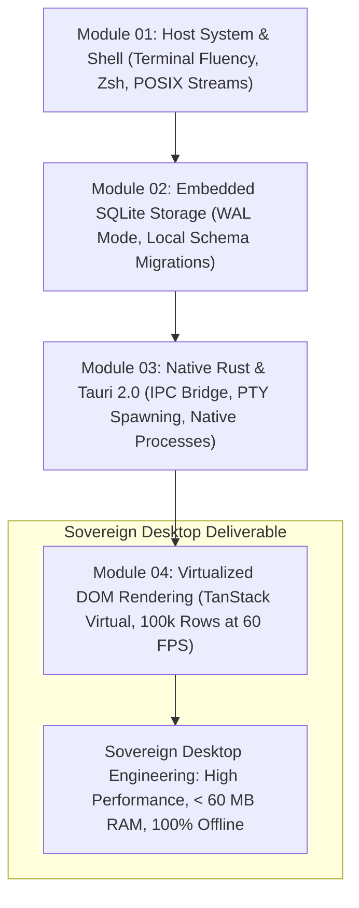

# Stage 1: Foundations to Local-First Systems

> Escaping the Cloud Trap: Operating System Mastery, Terminal Fluency, and Sovereign Local-First Desktop Engineering.

---

## Overview

Most software engineering education pushes students immediately toward cloud-hosted web apps, third-party authentication services, and hosted databases. This breeds developers who cannot build when disconnected from the internet, and who cannot inspect the operating system on which their code runs.

In Stage 1, you will reclaim the host system:

1. Transition from slow GUI mouse navigation to keyboard-driven terminal workflows.
2. Replace fragile remote database dependencies with embedded, sovereign SQLite and SQLCipher engines.
3. Understand why heavy runtimes like Electron exhaust system resources, and learn to build native, low-latency desktop applications using Rust and Tauri 2.0 (as engineered in *CodexOS*).
4. Master DOM virtualization to render hundreds of thousands of records at 60 FPS without leaking memory.

---

## Technical Architecture: Stage 1 Progressive Roadmap



---

## Modules in This Stage

```text
01-foundations-to-local-first/
├── README.md                                 # Stage syllabus & roadmap
├── 01-workstation-mastery-and-shell.md       # Keyboard flow, Zsh, Starship & CLI tooling
├── 02-local-first-data-with-sqlite.md        # Sovereign local databases & offline sync
├── 03-native-desktop-with-rust-tauri.md      # Rust FFI, Tauri 2.0, and PTY processes
└── 04-virtualized-ui-rendering.md            # TanStack Virtual, 100k records at 60 FPS
```

---

## Learning Objectives

- **Terminal Fluency**: Navigate directories, inspect running processes, pipe streams, and automate tasks using POSIX utilities without touching a mouse.
- **Local Data Ownership**: Design local schemas in SQLite, manage database migrations, and handle offline state persistence.
- **Systems Interoperability**: Bridge a native Rust backend with a modern TypeScript frontend via Tauri 2.0 IPC commands.
- **UI Performance**: Render dense data tables, logs, and esports rosters using virtualized windowing techniques.

---

## Prerequisites

- Basic familiarity with at least one programming language (JavaScript, TypeScript, Python, or Rust).
- A Unix-like environment (macOS, Linux, or Windows WSL2).
