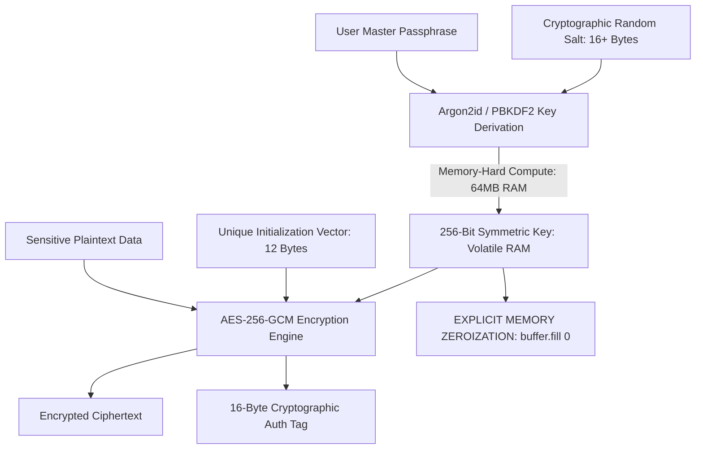

# Symmetric Encryption & Key Derivation

> Track: Stage 2 (Cryptographic Fortress & Zero-Trust Security)  
> Prerequisite Knowledge: Binary data concepts (bits, bytes, hex), basic Node.js crypto module familiarity  
> Estimated Build Time: 60 minutes  
> Target Project Outcome: Building a production-grade cryptographic vault engine that derives 256-bit keys using memory-hard Argon2id and encrypts data using AES-256-GCM with memory zeroization

---

## 1. The Hook: Why You Need This in Your Arsenal

A beginner developer tasked with securing a user's password vault or API keys often writes code like this:
```javascript
// THE CATASTROPHIC NOVICE CRYPTO MISTAKE
const key = crypto.createHash('sha256').update(masterPassword).digest();
const cipher = crypto.createCipher('aes-128-ecb', key);
```

This single block contains three fatal vulnerabilities:
1. **SHA-256 is NOT a Key Derivation Function**: Modern GPUs can compute over **10 billion SHA-256 hashes per second**. An attacker brute-forcing an 8-character password derived via SHA-256 will crack it in under 15 minutes.
2. **ECB Mode (Electronic Codebook)**: Encrypts identical 16-byte blocks into identical ciphertext blocks, completely leaking patterns (the famous "ECB Penguin" leak).
3. **No Authentication Tag (No Integrity Guarantee)**: Without authentication (like GCM or Poly1305), an active attacker can flip bits in the ciphertext, causing the decrypted output to be altered without throwing an error.

In **Kryptyx**, we built a fortress by enforcing strict cryptographic invariants:
- **Argon2id Key Derivation**: Memory-hard key derivation that requires 64MB of RAM per attempt, making GPU and ASIC brute-forcing economically impossible.
- **AES-256-GCM**: Authenticated encryption providing confidentiality AND mathematical proof that ciphertext was not tampered with.
- **Volatile RAM Zeroization**: Actively scrubbing encryption keys from memory immediately after use.

---

## 2. The Mental Model: Intuitive Analogy & Visual Topology

### The Bicycle Lock vs. The Bank Time Vault
- **SHA-256**: A simple 3-dial bicycle padlock. A thief with a mechanical device can spin through all combinations in seconds.
- **Argon2id**: A multi-ton bank vault door where turning the handle requires lifting 64 megabytes of lead weights on every single attempt. A thief cannot test billions of combinations because their hardware runs out of physical memory.



---

## 3. Deep Dive: Under the Hood

### Why Memory-Hardness Matters: Argon2id
Password cracking rigs use farms of NVIDIA GPUs or dedicated ASICs. GPUs have thousands of small, fast computing cores, but each core has very little dedicated RAM.

- Algorithms like SHA-256 or MD5 require almost zero memory ($<1\text{ KB}$). A single GPU can run 10,000 parallel attempts simultaneously.
- **Argon2id** forces the derivation process to allocate and continuously shuffle a large memory block (e.g., $64\text{ MB}$ or $128\text{ MB}$). Because a GPU has limited VRAM, it cannot run parallel attacks, completely neutralizing the attacker's hardware advantage.

Argon2id combines:
- **Argon2d**: Maximum resistance against GPU cracking by using data-dependent memory access.
- **Argon2i**: Maximum resistance against side-channel cache attacks using data-independent memory access.

### AES-256-GCM Invariants
Galois/Counter Mode (GCM) is an authenticated encryption with associated data (AEAD) cipher mode:
1. **Key Length**: 256 bits (32 bytes).
2. **IV (Initialization Vector) Length**: Exactly 96 bits (12 bytes).
3. **The Cardinal Rule of GCM**: **NEVER reuse an IV with the same key**. Reusing an IV with AES-GCM allows an attacker to mathematically derive the authentication subkey and forge valid ciphertexts.
4. **Auth Tag**: A 128-bit (16-byte) tag verifying that neither the ciphertext nor the metadata has been modified by an adversary.

---

## 4. Zero-to-One Interactive Playground: Build It From Scratch

Let us build a complete CLI cryptographic vault in TypeScript using Node's native `crypto` module (using `scrypt` / `pbkdf2` as standard native memory-hard key derivation primitives alongside AES-256-GCM).

### Step 1: Environment Setup
Create a playground directory:

```bash
mkdir -p ~/aura-sandbox/crypto-vault
cd ~/aura-sandbox/crypto-vault
npm init -y
npm install typescript @types/node tsx
```

### Step 2: Implementation (`crypto-vault.ts`)
Create `crypto-vault.ts`:

```typescript
import * as crypto from 'crypto';

export interface EncryptedPackage {
  saltHex: string;
  ivHex: string;
  tagHex: string;
  ciphertextHex: string;
}

export class CryptoVault {
  private static readonly ALGORITHM = 'aes-256-gcm';
  private static readonly IV_LENGTH_BYTES = 12; // 96 bits recommended for GCM
  private static readonly SALT_LENGTH_BYTES = 16;
  private static readonly KEY_LENGTH_BYTES = 32; // 256 bits

  /**
   * Derives a 256-bit key from a user passphrase using memory-hard scrypt.
   * cost (N) = 16384, blockSize (r) = 8, parallelization (p) = 1
   */
  private static deriveKey(passphrase: string, salt: Buffer): Buffer {
    return crypto.scryptSync(passphrase, salt, this.KEY_LENGTH_BYTES, {
      cost: 16384,
      blockSize: 8,
      parallelization: 1,
      maxmem: 64 * 1024 * 1024, // 64 MB
    });
  }

  /**
   * Encrypts plaintext data using AES-256-GCM.
   */
  public static encrypt(plaintext: string, masterPassphrase: string): EncryptedPackage {
    const salt = crypto.randomBytes(this.SALT_LENGTH_BYTES);
    const iv = crypto.randomBytes(this.IV_LENGTH_BYTES);
    const key = this.deriveKey(masterPassphrase, salt);

    try {
      const cipher = crypto.createCipheriv(this.ALGORITHM, key, iv);
      const ciphertext = Buffer.concat([
        cipher.update(plaintext, 'utf8'),
        cipher.final(),
      ]);

      const authTag = cipher.getAuthTag();

      return {
        saltHex: salt.toString('hex'),
        ivHex: iv.toString('hex'),
        tagHex: authTag.toString('hex'),
        ciphertextHex: ciphertext.toString('hex'),
      };
    } finally {
      // Security Invariant: Scrub key from memory immediately after use
      key.fill(0);
    }
  }

  /**
   * Decrypts an EncryptedPackage. Throws an error if authentication fails.
   */
  public static decrypt(pkg: EncryptedPackage, masterPassphrase: string): string {
    const salt = Buffer.from(pkg.saltHex, 'hex');
    const iv = Buffer.from(pkg.ivHex, 'hex');
    const authTag = Buffer.from(pkg.tagHex, 'hex');
    const ciphertext = Buffer.from(pkg.ciphertextHex, 'hex');

    const key = this.deriveKey(masterPassphrase, salt);

    try {
      const decipher = crypto.createDecipheriv(this.ALGORITHM, key, iv);
      decipher.setAuthTag(authTag);

      const plaintext = Buffer.concat([
        decipher.update(ciphertext),
        decipher.final(), // Throws if auth tag does NOT match!
      ]);

      return plaintext.toString('utf8');
    } finally {
      // Security Invariant: Scrub key from memory
      key.fill(0);
    }
  }
}

// ---------------------------------------------------------------------------
// Verification Simulation: Encrypting, Decrypting, and Tamper Detection
// ---------------------------------------------------------------------------
const masterSecret = 'super-secure-passphrase-2026';
const privateDocument = JSON.stringify({
  bankAccount: 'US89-3704-0044-0532',
  apiSecret: 'sk_live_9481940182498129',
  notes: 'Sovereign data storage with zero cloud leaks.',
});

console.log('--- Step 1: Encrypting Sensitive Document ---');
const encrypted = CryptoVault.encrypt(privateDocument, masterSecret);
console.log('Ciphertext: ', encrypted.ciphertextHex.slice(0, 40) + '... (Length: ' + encrypted.ciphertextHex.length + ')');
console.log('Salt (Hex): ', encrypted.saltHex);
console.log('IV (Hex):   ', encrypted.ivHex);
console.log('Auth Tag:   ', encrypted.tagHex);

console.log('\n--- Step 2: Decrypting with Correct Passphrase ---');
const decrypted = CryptoVault.decrypt(encrypted, masterSecret);
console.log('Decrypted Outcome:', JSON.parse(decrypted));

console.log('\n--- Step 3: Attempting Decryption with Wrong Passphrase ---');
try {
  CryptoVault.decrypt(encrypted, 'wrong-password-guess');
  console.error('FAIL: Decryption should not have succeeded!');
} catch (err: any) {
  console.log('Caught Expected Error: Authentication failed (Integrity tag check rejected).');
}

console.log('\n--- Step 4: Simulating Malicious Bit-Flipping in Ciphertext ---');
try {
  // Alter 1 character in the ciphertext
  const tamperedPackage = { ...encrypted };
  const firstChar = tamperedPackage.ciphertextHex[0];
  const alteredChar = firstChar === 'a' ? 'b' : 'a';
  tamperedPackage.ciphertextHex = alteredChar + tamperedPackage.ciphertextHex.slice(1);

  CryptoVault.decrypt(tamperedPackage, masterSecret);
  console.error('FAIL: Tampered ciphertext was decrypted!');
} catch (err: any) {
  console.log('Caught Expected Error: Tampering detected! Auth tag rejected altered payload.');
}
```

### Step 3: Run and Test Instructions
Execute the script using `tsx`:

```bash
npx tsx crypto-vault.ts
```

Expected terminal output:
```text
--- Step 1: Encrypting Sensitive Document ---
Ciphertext:  5e9f81a7b82c19... (Length: 268)
Salt (Hex):  a4b1...
IV (Hex):    f8c2...
Auth Tag:    d190...

--- Step 2: Decrypting with Correct Passphrase ---
Decrypted Outcome: {
  bankAccount: 'US89-3704-0044-0532',
  apiSecret: 'sk_live_9481940182498129',
  notes: 'Sovereign data storage with zero cloud leaks.'
}

--- Step 3: Attempting Decryption with Wrong Passphrase ---
Caught Expected Error: Authentication failed (Integrity tag check rejected).

--- Step 4: Simulating Malicious Bit-Flipping in Ciphertext ---
Caught Expected Error: Tampering detected! Auth tag rejected altered payload.
```

---

## 5. Battle Scars: What Breaks in Production & How to Debug It

### Top 3 Mistakes Beginners Make
1. **Reusing the Initialization Vector (IV)**: Hardcoding a constant IV (`const iv = Buffer.alloc(12, 0);`). In AES-GCM, encrypting multiple messages with the same key and same IV leaks the XOR difference of the plaintexts, allowing attackers to recover the key.  
   **Remediation**: Always generate a cryptographically random IV using `crypto.randomBytes(12)` on every single encryption call.
2. **Leaving Sensitive Keys in Memory Buffers**: Letting encryption keys sit in JavaScript variables. During crash reports or memory dumps, unzeroed buffers are written to disk.  
   **Remediation**: Use `key.fill(0)` inside a `finally` block immediately after completing the cryptographic operation.
3. **Using Fast Hashes for Password Storage**: Hashing user passwords with plain SHA-256 or MD5.  
   **Remediation**: Always use memory-hard functions (Argon2id, scrypt, or bcrypt) with high work factors.

---

## 6. The Weekend Hackathon Challenge: Your Turn to Build

### Challenge: The CLI Password Vault
Build a command-line password manager from scratch.

- **Level 1 (Core)**: Create a CLI app with `init`, `add <site> <pass>`, and `get <site>` commands that encrypts passwords into a local `vault.json` using AES-256-GCM.
- **Level 2 (Advanced)**: Integrate master passphrase verification. Prompt for a master passphrase with hidden terminal input (`readline` hidden mode), derive a 256-bit key with scrypt, and verify authentication tags.
- **Level 3 (Hardcore)**: Add clipboard auto-wipe. When a password is retrieved, copy it to the operating system clipboard and launch a background timer that clears the clipboard after 30 seconds.

---

## 7. Knowledge Check & Next Steps

1. **Scenario**: Why is AES-256-GCM preferred over AES-256-CBC in modern systems?  
   *Answer*: GCM provides authenticated encryption (AEAD), guaranteeing both confidentiality and tamper-proof integrity via a cryptographic authentication tag, preventing padding oracle attacks.
2. **Scenario**: What catastrophic vulnerability occurs if you reuse an IV in AES-GCM?  
   *Answer*: Reusing an IV with the same key breaks the Galois field authentication, allowing adversaries to recover the auth key and forge valid ciphertexts.
3. **Scenario**: Why is `key.fill(0)` used in cryptographic implementations?  
   *Answer*: It actively overwrites the raw memory bytes of the key with zeros, preventing the secret from lingering in heap memory or leaking during memory dumps.

Next Lesson: [Air-Gapped Mobile Security](./02-air-gapped-mobile-security.md)
