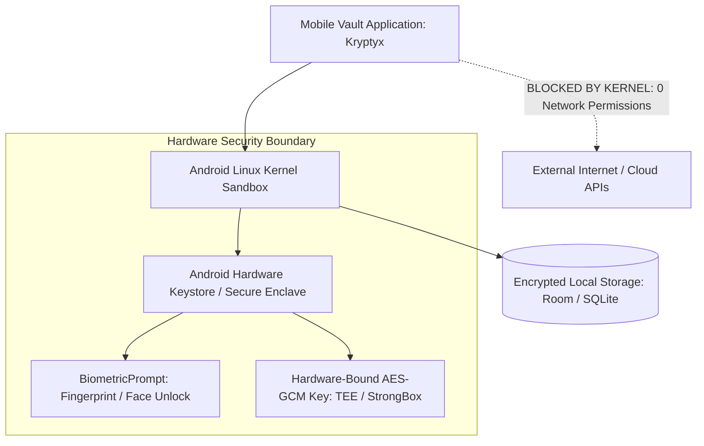

# Air-Gapped Mobile Security

> Track: Stage 2 (Cryptographic Fortress & Zero-Trust Security)  
> Prerequisite Knowledge: Mobile app fundamentals (Android/iOS concepts), OS permission models  
> Estimated Build Time: 60 minutes  
> Target Project Outcome: Understanding and implementing mathematically verifiable air-gapping by omitting network permissions and binding cryptographic keys to hardware security modules

---

## 1. The Hook: Why You Need This in Your Arsenal

Every major password manager on the market today (1Password, Bitwarden, LastPass) advertises "End-to-End Encryption."
Yet, all of them require network permissions to sync your encrypted vault to their cloud servers.

What happens when:
- A malicious SDK update is injected into the mobile application bundle?
- A rogue employee pushes an update that logs passwords during memory decryption?
- The cloud provider's API infrastructure is breached or subjected to government subpoenas?

In **Kryptyx**, our mobile password fortress, we asked a radical question:
**Why does a password manager need an internet connection at all?**

By explicitly excluding the `android.permission.INTERNET` flag from the `AndroidManifest.xml`:
- The operating system kernel enforces a physical sandbox boundary.
- Even if a dependency contains malicious malware or a zero-day exploit, the operating system physically refuses to open network sockets.
- The user is granted mathematical proof of sovereign data air-gapping.

---

## 2. The Mental Model: Intuitive Analogy & Visual Topology

### The Safe with No Windows vs. The Cloud Storage Locker
- **Cloud Vault**: A storage locker in a public warehouse. You lock it with your key, but the warehouse has roads, security guards, delivery trucks, and Wi-Fi antennas. Someone could potentially tamper with the doors or intercept packages.
- **Air-Gapped Fortress**: A solid titanium safe buried 50 feet underground in your basement with zero electrical cables, zero radio antennas, and zero doors to the outside world. To put something in or take something out, you must be physically standing in front of it.



---

## 3. Deep Dive: Under the Hood

### The Android Manifest Air-Gap Guarantee
In Android development, accessing the network requires declaring the permission:
```xml
<!-- In naive mobile applications -->
<uses-permission android:name="android.permission.INTERNET" />
```

When this line is omitted:
1. The Linux kernel assigns the application a unique Linux UID (User Identifier).
2. The kernel's networking stack (`iptables` and socket filters) drops any `socket()` or `connect()` syscall from that UID.
3. Attempting to call `fetch()`, `HttpURLConnection`, or OkHttp throws a fatal `SecurityException` at the kernel level.
4. Security researchers can decompile the APK and verify in 5 seconds that data exfiltration is physically impossible.

### Hardware-Backed Keystores & StrongBox Keymaster
Where do cryptographic keys live?
- **Software Keystore**: Keys are stored on regular flash memory encrypted by an OS password. Susceptible to memory extraction on rooted devices.
- **Hardware-Backed Keystore (TEE / Secure Enclave)**: Keys are generated and stored inside an isolated physical processor core (Trusted Execution Environment).
- **StrongBox Keymaster**: A dedicated tamper-resistant hardware chip (Secure Element) with its own CPU and storage, providing physical resistance against side-channel analysis and cold-boot memory freezing attacks.

### Trade-Off Matrix: Mobile Security Postures

| Strategy | Cloud-Synced Vault | Local-First with Network | Sovereign Air-Gapped (Kryptyx) |
| :--- | :--- | :--- | :--- |
| **Network Attack Surface** | Large (REST APIs, WebSockets) | Moderate (Telemetry, updates) | Absolute Zero (No sockets) |
| **Supply Chain Vulnerability** | High (SDK exfiltration risk) | High | Minimal (Cannot phone home) |
| **Sync Convenience** | Automated background sync | Manual export / LAN sync | Physical QR code / USB export |
| **User Sovereignty** | Tied to cloud SaaS uptime | Moderate | 100% User-Owned |

---

## 4. Zero-to-One Interactive Playground: Build It From Scratch

Let us write a TypeScript simulator of an air-gapped security runtime. This simulator inspects the runtime environment, validates that all network requests are blocked, and binds secrets to a simulated hardware keystore with biometric authorization.

### Step 1: Environment Setup
Create a playground directory:

```bash
mkdir -p ~/aura-sandbox/airgap-mobile
cd ~/aura-sandbox/airgap-mobile
npm init -y
npm install typescript @types/node tsx
```

### Step 2: Implementation (`airgap-runtime.ts`)
Create `airgap-runtime.ts`:

```typescript
import * as crypto from 'crypto';

export interface HardwareKeyDescriptor {
  keyAlias: string;
  isStrongBoxBacked: boolean;
  requiresBiometricAuth: boolean;
}

export class AirGappedSecurityEngine {
  private isNetworkAllowed: boolean;
  private hardwareKeystore: Map<string, Buffer> = new Map();

  constructor(hasInternetPermission: boolean = false) {
    this.isNetworkAllowed = hasInternetPermission;

    // Initialize mock StrongBox hardware key
    const hardwareKey = crypto.randomBytes(32);
    this.hardwareKeystore.set('master_vault_key', hardwareKey);
  }

  /**
   * Enforces the Kernel Air-Gap Boundary.
   * Throws SecurityException if network is attempted without permission.
   */
  public executeNetworkCall(url: string): void {
    if (!this.isNetworkAllowed) {
      throw new Error(
        `KERNEL SECURITY EXCEPTION: Network request to '${url}' denied. android.permission.INTERNET is omitted from manifest.`
      );
    }
    console.log(`[NETWORK SUCCESS] Connected to ${url}`);
  }

  /**
   * Simulates Hardware Keystore access requiring biometric approval.
   */
  public unlockWithBiometrics(keyAlias: string, userPassedBiometrics: boolean): Buffer {
    if (!userPassedBiometrics) {
      throw new Error('BiometricAuthenticationFailed: Fingerprint does not match hardware sensor.');
    }

    const key = this.hardwareKeystore.get(keyAlias);
    if (!key) {
      throw new Error(`KeyNotFound: No hardware key for alias '${keyAlias}'`);
    }

    console.log(`[HARDWARE KEYSTORE] Key '${keyAlias}' unlocked via Secure Enclave.`);
    return key;
  }

  /**
   * Encrypts data using hardware-backed AES-256-GCM.
   */
  public encryptVaultData(plaintext: string, hardwareKey: Buffer): { iv: string; ciphertext: string; tag: string } {
    const iv = crypto.randomBytes(12);
    const cipher = crypto.createCipheriv('aes-256-gcm', hardwareKey, iv);

    const ciphertext = Buffer.concat([cipher.update(plaintext, 'utf8'), cipher.final()]);
    const tag = cipher.getAuthTag();

    return {
      iv: iv.toString('hex'),
      ciphertext: ciphertext.toString('hex'),
      tag: tag.toString('hex'),
    };
  }
}

// ---------------------------------------------------------------------------
// Verification Simulation: Testing Air-Gap Guarantees & Keystore Integration
// ---------------------------------------------------------------------------
console.log('--- Step 1: Initializing Sovereign Air-Gapped Engine (0 Permissions) ---');
const vaultEngine = new AirGappedSecurityEngine(false);

console.log('\n--- Step 2: Testing Air-Gap Defense (Attempting Network Call) ---');
try {
  vaultEngine.executeNetworkCall('https://telemetry.evil-ad-network.com/collect');
  console.error('FAIL: Network call should have been blocked!');
} catch (err: any) {
  console.log('Verified Defense:', err.message);
}

console.log('\n--- Step 3: Attempting Hardware Keystore Unlock without Biometrics ---');
try {
  vaultEngine.unlockWithBiometrics('master_vault_key', false);
} catch (err: any) {
  console.log('Verified Defense:', err.message);
}

console.log('\n--- Step 4: Legitimate Unlock with Successful Biometrics ---');
const key = vaultEngine.unlockWithBiometrics('master_vault_key', true);
const encrypted = vaultEngine.encryptVaultData('Secret Recovery Seed: 12 Words', key);
console.log('Encrypted Payload:', encrypted);
console.log('Sovereign Security: Data encrypted at rest via hardware-bound keys with zero network leaks.');
```

### Step 3: Run and Test Instructions
Execute the script using `tsx`:

```bash
npx tsx airgap-runtime.ts
```

Expected terminal output:
```text
--- Step 1: Initializing Sovereign Air-Gapped Engine (0 Permissions) ---

--- Step 2: Testing Air-Gap Defense (Attempting Network Call) ---
Verified Defense: KERNEL SECURITY EXCEPTION: Network request to 'https://telemetry.evil-ad-network.com/collect' denied. android.permission.INTERNET is omitted from manifest.

--- Step 3: Attempting Hardware Keystore Unlock without Biometrics ---
Verified Defense: BiometricAuthenticationFailed: Fingerprint does not match hardware sensor.

--- Step 4: Legitimate Unlock with Successful Biometrics ---
[HARDWARE KEYSTORE] Key 'master_vault_key' unlocked via Secure Enclave.
Encrypted Payload: { iv: '...', ciphertext: '...', tag: '...' }
Sovereign Security: Data encrypted at rest via hardware-bound keys with zero network leaks.
```

---

## 5. Battle Scars: What Breaks in Production & How to Debug It

### Top 3 Mistakes Beginners Make
1. **Accidental Network Permissions Injected by Third-Party Libraries**: A developer installs a benign UI library whose internal `AndroidManifest.xml` contains `<uses-permission android:name="android.permission.INTERNET" />`. Gradle merges manifests during build time, silently granting internet access.  
   **Remediation**: Use manifest node removal in your main app manifest:
   ```xml
   <uses-permission android:name="android.permission.INTERNET" tools:node="remove" />
   ```
2. **Storing Keystore Keys in RAM as Unmanaged Strings**: In Java/Kotlin, converting passwords to `String` objects puts them in immutable string pools that cannot be zeroed out.  
   **Remediation**: Always handle credentials as primitive `CharArray` or byte arrays (`ByteArray`) and overwrite with zeros immediately after use.
3. **Failing to Handle Hardware Sensor Unavailability**: Assuming every user device has a working fingerprint or Face Unlock sensor.  
   **Remediation**: Always provide fallback authentication to a secure user-defined master passphrase.

---

## 6. The Weekend Hackathon Challenge: Your Turn to Build

### Challenge: The Air-Gapped QR Vault
Build an air-gapped data bridge using animated QR codes.

- **Level 1 (Core)**: Create a mobile or web app with zero network permissions that encrypts a secret into AES-GCM and displays the encrypted payload as a static QR code on screen.
- **Level 2 (Advanced)**: Implement a camera scanner that reads an encrypted QR code from another device's screen and decrypts it locally using a master PIN.
- **Level 3 (Hardcore)**: Implement animated multi-frame QR codes (Fountain / UR codes) to transfer multi-megabyte files (such as an encrypted SQLite database) between two completely disconnected air-gapped devices.

---

## 7. Knowledge Check & Next Steps

1. **Scenario**: How does removing `android.permission.INTERNET` protect against compromised third-party SDK dependencies?  
   *Answer*: The OS kernel blocks the application process from opening network sockets, making it mathematically impossible for any bundled SDK to transmit telemetry or exfiltrate secrets.
2. **Scenario**: What is the difference between a software keystore and a hardware-backed StrongBox Keymaster?  
   *Answer*: StrongBox runs on a dedicated, tamper-resistant physical chip with its own CPU and storage, protecting cryptographic keys against OS kernel compromises and memory freezing attacks.
3. **Scenario**: How can two completely air-gapped devices transfer data without Wi-Fi, Bluetooth, or cables?  
   *Answer*: Via optical data transfer using camera lenses and animated multi-frame QR codes, preserving the air-gap boundary.

Next Lesson: [P2P WebRTC & The Double Ratchet](./03-p2p-webrtc-and-the-double-ratchet.md)
