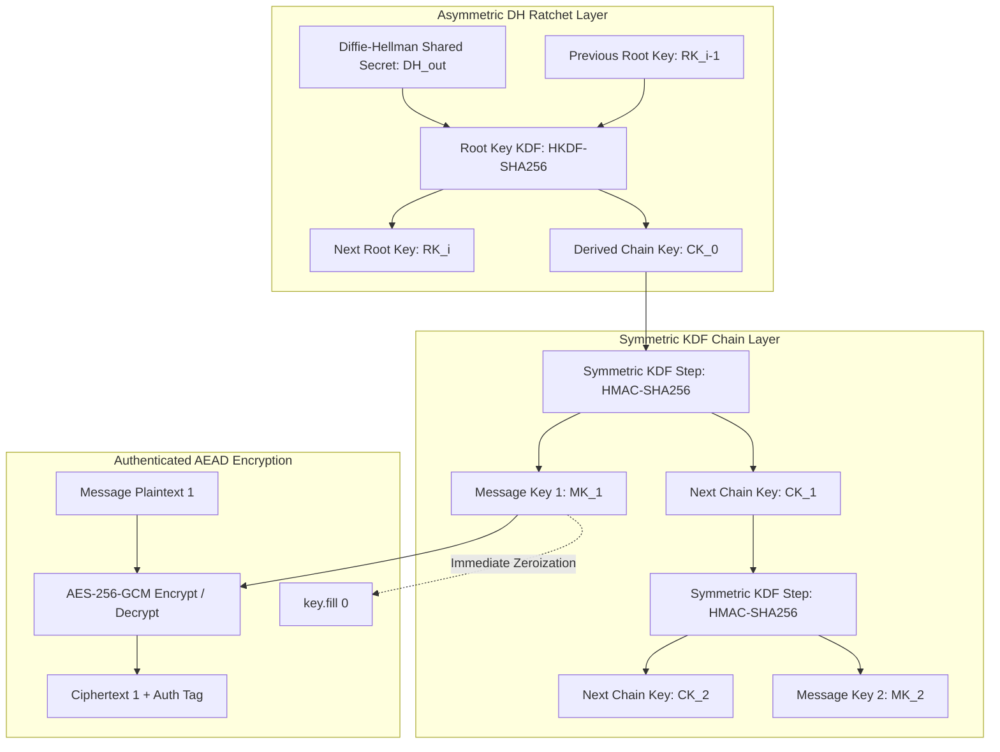

# P2P WebRTC & The Double Ratchet

> Track: Stage 2 (Cryptographic Fortress & Zero-Trust Security)  
> Prerequisite Knowledge: Public-key cryptography (Diffie-Hellman), WebSockets, WebRTC basics  
> Estimated Build Time: 60 minutes  
> Target Project Outcome: Building a peer-to-peer messaging engine using WebRTC DataChannels and the Signal Protocol Double Ratchet with bidirectional DH ratchet advancement and zero central metadata storage

---

## 1. The Hook: Why You Need This in Your Arsenal

When developers build a chat application (e.g. following a basic tutorial for Socket.io or Firebase), they route every message through a centralized server:
`Alice -> Chat Server DB -> Bob`.

Even if the payload is encrypted, the central server still logs:

- Who Alice is talking to.
- Exactly what millisecond each message was sent.
- The exact size and frequency of the packets.
- The IP addresses and physical geographic locations of both users.

This is called **communication metadata**, and in modern intelligence analysis, metadata is often more revealing than the message text itself.

Even worse, in traditional single-key encrypted systems:

- If an adversary compromises Alice's device key today, they can decrypt **all historical messages** captured over the wire over the last ten years.
- The adversary can continue decrypting **all future messages** forever.

In **Ghost Messenger (Calypso)**, we eliminated both central metadata and key vulnerability:

1. **WebRTC DataChannels**: Once an initial peer-to-peer handshake completes, data packets travel directly between Alice and Bob's devices across the physical internet mesh, bypassing central servers entirely.
2. **The Signal Double Ratchet Protocol**: Combines a symmetric KDF chain ratchet with an asymmetric Diffie-Hellman ratchet, guaranteeing both **Forward Secrecy** (past messages remain secure) and **Break-in Recovery / Post-Compromise Security** (future messages heal automatically after a compromise).
3. **BIP-39 Mnemonic Identity**: Accounts are derived from 12-word cryptographic seed phrases with zero phone numbers, zero emails, and zero centralized user registries.

---

## 2. The Mental Model: Intuitive Analogy & Visual Topology

### The Bicycle Chain Ratchet

Think of a physical mechanical ratchet (like the freewheel on a bicycle):

- It turns forward smoothly, tooth by tooth.
- It physically cannot turn backward.
- If an adversary compromises your bicycle today and inspects the exact tooth position (your current message key), they cannot reverse the ratchet to discover the teeth used yesterday (**Forward Secrecy**).
- As soon as the other person replies, you exchange a new Diffie-Hellman step, advancing the ratchet into a new cryptographic space they cannot predict (**Break-in Recovery / Post-Compromise Security**).

```mermaid
sequenceDiagram
    autonumber
    actor Alice as Alice Device
    participant Signal as Ephemeral Signaling Server
    actor Bob as Bob Device
    
    Alice->>Signal: Post SDP Offer + Ephemeral Public Key
    Bob->>Signal: Fetch SDP Offer
    Bob->>Signal: Post SDP Answer + Ephemeral Public Key
    Alice->>Signal: Fetch SDP Answer
    Note over Signal: Signaling Server Drops Handshake State
    
    rect rgb(20, 30, 45)
    Note over Alice,Bob: Direct P2P WebRTC DataChannel Established
    Alice->>Bob: Encrypted Message 1 (Sending Chain Step 1)
    Bob->>Alice: Encrypted Reply 2 (DH Ratchet Turn + Bob Ephemeral Key)
    Alice->>Bob: Encrypted Message 3 (DH Ratchet Turn + Alice Ephemeral Key)
    end
```



### The Double Ratchet Internal Key Schedule

The Double Ratchet coordinates two interlocking ratchets: the asymmetric Diffie-Hellman (DH) ratchet and two symmetric Key Derivation Function (KDF) chains (one for sending, one for receiving).



---

## 3. Deep Dive: Under the Hood

### The Mechanics of the Double Ratchet Protocol

The Double Ratchet alternates between two distinct cryptographic mechanisms:

#### 1. The Symmetric KDF Chain Ratchet (Forward Secrecy)

For every message sent in a single conversational turn, the sender advances a Key Derivation Function (KDF) chain:
$$\text{Message Key}_i, \text{Chain Key}_{i+1} = \text{KDF}(\text{Chain Key}_i)$$

- In Signal and Calypso, this is implemented via HMAC-SHA256:
  - $\text{Message Key} = \text{HMAC-SHA256}(\text{Chain Key}, \text{0x01})$
  - $\text{Next Chain Key} = \text{HMAC-SHA256}(\text{Chain Key}, \text{0x02})$
- As soon as $\text{Message Key}$ is used to encrypt or decrypt, it is zeroized from memory.
- Because HMAC is a one-way cryptographically secure function, an adversary who captures $\text{Chain Key}_{i+1}$ cannot invert the hash to deduce $\text{Chain Key}_i$ or $\text{Message Key}_i$. This guarantees **Forward Secrecy**.

#### 2. The Asymmetric Diffie-Hellman Ratchet (Break-in Recovery)

If Alice's device is physically compromised and the adversary extracts all active chain keys and root keys from RAM, a purely symmetric ratchet is broken for all future messages.

The DH Ratchet cures this:

1. Every time a party sends a message following a turn change, they generate a fresh, ephemeral Diffie-Hellman key pair $(DH_{\text{private}}, DH_{\text{public}})$ and attach their new public key to the message header.
2. The recipient uses their own private key and the sender's new public key to compute a new DH shared secret:
   $$SS_{\text{new}} = \text{ECDH}(DH_{\text{local-priv}}, DH_{\text{remote-pub}})$$
3. Both parties feed the new shared secret into the Root KDF:
   $$\text{Root Key}_{\text{new}}, \text{Chain Key}_{\text{new}} = \text{HKDF}(\text{Root Key}_{\text{old}}, SS_{\text{new}})$$
4. This advances the Root Key into an entirely fresh cryptographic state. Even if an attacker possessed the previous Root Key, they cannot compute the new Root Key without knowing the private DH key generated on the secure device. This guarantees **Post-Compromise Security (Break-in Recovery)**.

### Trade-Off Matrix: Messaging Architectures

| Architecture | Payload Privacy | Metadata Privacy | Forward Secrecy | Post-Compromise Recovery | Infrastructure Cost |
| :--- | :--- | :--- | :--- | :--- | :--- |
| **Centralized Database (Firebase/Postgres)** | None / Server-Managed | Zero (Full server logs) | No | No | Scales with message volume |
| **Centralized E2EE (Signal / WhatsApp)** | Absolute (Double Ratchet) | Partial (Server logs IP/timing) | Yes | Yes | High (Global message queues) |
| **Sovereign P2P WebRTC (Calypso)** | Absolute (Double Ratchet) | Absolute (Direct mesh packets) | Yes | Yes | Near Zero (Signaling only) |

---

## 4. Zero-to-One Interactive Playground: Build It From Scratch

Let us implement a complete, bidirectional Double Ratchet engine in TypeScript. This sandbox demonstrates:

1. The **Symmetric KDF Chain** producing forward-secret message keys.
2. The **Asymmetric Diffie-Hellman Ratchet** advancing the root key when conversation turns switch.
3. A **bidirectional ping-pong message exchange** (Alice -> Bob -> Alice) with mathematical verification of forward secrecy and post-compromise security.

### Step 1: Environment Setup

Create a playground directory and initialize dependencies:

```bash
mkdir -p ~/aura-sandbox/double-ratchet
cd ~/aura-sandbox/double-ratchet
npm init -y
npm install typescript @types/node tsx
```

### Step 2: Implementation (`bidirectional-ratchet.ts`)

Create `bidirectional-ratchet.ts`:

```typescript
import * as crypto from 'crypto';

// ============================================================================
// 1. Data Models for Ratchet Messages & Headers
// ============================================================================

export interface RatchetHeader {
  dhPublicKeyHex: string;
  sequenceNumber: number;
  previousChainLength: number;
}

export interface EncryptedMessagePayload {
  header: RatchetHeader;
  ivHex: string;
  tagHex: string;
  ciphertextHex: string;
}

// ============================================================================
// 2. The Complete Double Ratchet State Engine
// ============================================================================

export class DoubleRatchetSession {
  public readonly partyName: string;

  // Root Key state
  private rootKey: Buffer;

  // Asymmetric DH Ratchet Keypairs
  private myDhKeyPair: crypto.ECDH;
  private remoteDhPublicKey: Buffer | null = null;

  // Symmetric KDF Chain Keys
  private sendingChainKey: Buffer | null = null;
  private receivingChainKey: Buffer | null = null;

  // Message sequence counters
  private sendMessageCount: number = 0;
  private receiveMessageCount: number = 0;
  private previousSendCount: number = 0;

  constructor(
    partyName: string,
    initialSharedSecret: Buffer,
    initialRemotePublicKey?: Buffer,
    isInitiator: boolean = false
  ) {
    this.partyName = partyName;
    this.rootKey = Buffer.from(initialSharedSecret);

    // Initialize local Diffie-Hellman curve (secp256k1 or prime256v1)
    this.myDhKeyPair = crypto.createECDH('prime256v1');
    this.myDhKeyPair.generateKeys();

    if (initialRemotePublicKey) {
      this.remoteDhPublicKey = Buffer.from(initialRemotePublicKey);
      if (isInitiator) {
        // Initiator establishes sending chain immediately using initial DH output
        const dhSecret = this.myDhKeyPair.computeSecret(this.remoteDhPublicKey);
        const { nextRootKey, chainKey } = this.kdfRootKey(this.rootKey, dhSecret);
        this.rootKey = nextRootKey;
        this.sendingChainKey = chainKey;
      }
    }
  }

  public getPublicKey(): Buffer {
    return this.myDhKeyPair.getPublicKey();
  }

  /**
   * Root KDF: Advances Root Key and derives a new Chain Key
   */
  private kdfRootKey(
    currentRoot: Buffer,
    dhSecret: Buffer
  ): { nextRootKey: Buffer; chainKey: Buffer } {
    const salt = currentRoot;
    const prk = crypto.createHmac('sha256', salt).update(dhSecret).digest();

    const nextRootKey = crypto
      .createHmac('sha256', prk)
      .update(Buffer.from('root-key-step'))
      .digest();

    const chainKey = crypto
      .createHmac('sha256', prk)
      .update(Buffer.from('chain-key-step'))
      .digest();

    return { nextRootKey, chainKey };
  }

  /**
   * Symmetric Chain KDF: Steps the chain to derive a one-time message encryption key
   */
  private stepChain(chainKey: Buffer): { nextChainKey: Buffer; messageKey: Buffer } {
    const messageKey = crypto
      .createHmac('sha256', chainKey)
      .update(Buffer.from([0x01]))
      .digest();

    const nextChainKey = crypto
      .createHmac('sha256', chainKey)
      .update(Buffer.from([0x02]))
      .digest();

    return { nextChainKey, messageKey };
  }

  /**
   * Encrypts an outgoing message. If required, generates a new DH key pair (DH turn).
   */
  public encrypt(plaintext: string): EncryptedMessagePayload {
    if (!this.sendingChainKey) {
      throw new Error(`[${this.partyName}] Cannot encrypt: No sending chain established.`);
    }

    const { nextChainKey, messageKey } = this.stepChain(this.sendingChainKey);
    this.sendingChainKey.fill(0);
    this.sendingChainKey = nextChainKey;

    const seq = this.sendMessageCount++;
    const iv = crypto.randomBytes(12);

    try {
      const cipher = crypto.createCipheriv('aes-256-gcm', messageKey, iv);
      const ciphertext = Buffer.concat([
        cipher.update(plaintext, 'utf8'),
        cipher.final(),
      ]);
      const tag = cipher.getAuthTag();

      return {
        header: {
          dhPublicKeyHex: this.myDhKeyPair.getPublicKey().toString('hex'),
          sequenceNumber: seq,
          previousChainLength: this.previousSendCount,
        },
        ivHex: iv.toString('hex'),
        tagHex: tag.toString('hex'),
        ciphertextHex: ciphertext.toString('hex'),
      };
    } finally {
      // Security Invariant: Zeroize ephemeral message key
      messageKey.fill(0);
    }
  }

  /**
   * Decrypts an incoming message. If the sender attached a new DH key, advances the DH Ratchet!
   */
  public decrypt(msg: EncryptedMessagePayload): string {
    const incomingDhPub = Buffer.from(msg.header.dhPublicKeyHex, 'hex');

    // Check if the remote party advanced their DH ratchet
    const isNewRemoteKey =
      !this.remoteDhPublicKey ||
      !this.remoteDhPublicKey.equals(incomingDhPub);

    if (isNewRemoteKey) {
      console.log(`[${this.partyName}] Detected new DH key from peer! Executing DH Ratchet turn...`);
      this.previousSendCount = this.sendMessageCount;
      this.sendMessageCount = 0;
      this.receiveMessageCount = 0;
      this.remoteDhPublicKey = incomingDhPub;

      // 1. Advance receiving chain using our current DH key and peer's new public key
      const dhSecretReceive = this.myDhKeyPair.computeSecret(this.remoteDhPublicKey);
      const { nextRootKey: rk1, chainKey: recvCK } = this.kdfRootKey(
        this.rootKey,
        dhSecretReceive
      );
      this.rootKey = rk1;
      this.receivingChainKey = recvCK;

      // 2. Generate our brand-new DH keypair for our upcoming replies
      this.myDhKeyPair = crypto.createECDH('prime256v1');
      this.myDhKeyPair.generateKeys();

      // 3. Advance sending chain using our new DH key and peer's new public key
      const dhSecretSend = this.myDhKeyPair.computeSecret(this.remoteDhPublicKey);
      const { nextRootKey: rk2, chainKey: sendCK } = this.kdfRootKey(
        this.rootKey,
        dhSecretSend
      );
      this.rootKey = rk2;
      this.sendingChainKey = sendCK;
    }

    if (!this.receivingChainKey) {
      throw new Error(`[${this.partyName}] Cannot decrypt: Receiving chain uninitialized.`);
    }

    // Step receiving chain to derive message key
    const { nextChainKey, messageKey } = this.stepChain(this.receivingChainKey);
    this.receivingChainKey.fill(0);
    this.receivingChainKey = nextChainKey;
    this.receiveMessageCount++;

    const iv = Buffer.from(msg.ivHex, 'hex');
    const tag = Buffer.from(msg.tagHex, 'hex');
    const ciphertext = Buffer.from(msg.ciphertextHex, 'hex');

    try {
      const decipher = crypto.createDecipheriv('aes-256-gcm', messageKey, iv);
      decipher.setAuthTag(tag);
      const plaintext = Buffer.concat([
        decipher.update(ciphertext),
        decipher.final(),
      ]);
      return plaintext.toString('utf8');
    } finally {
      messageKey.fill(0);
    }
  }
}

// ============================================================================
// 3. Verification Demonstration: Ping-Pong Conversation with DH Ratchet Turn
// ============================================================================

async function runPingPongVerification() {
  console.log('=== Step 1: Initial Handshake & Root Secret Generation ===');
  const rootSharedSecret = crypto.randomBytes(32);

  // Pre-exchange initial public keys (representing WebRTC SDP handshake)
  const bob = new DoubleRatchetSession('Bob', rootSharedSecret);
  const alice = new DoubleRatchetSession('Alice', rootSharedSecret, bob.getPublicKey(), true);

  console.log('Alice and Bob initialized Double Ratchet sessions.');
  console.log('Alice is initialized with Bob initial public key.\n');

  console.log('=== Step 2: Turn 1 - Alice sends Message 1 to Bob ===');
  const msg1 = alice.encrypt('Hey Bob! This is Alice on secure channel 1.');
  console.log('Alice sent Message 1:');
  console.log(`- Seq: ${msg1.header.sequenceNumber}`);
  console.log(`- Ephemeral DH Key: ${msg1.header.dhPublicKeyHex.slice(0, 32)}...`);
  console.log(`- Ciphertext: ${msg1.ciphertextHex.slice(0, 32)}...`);

  const decryptedByBob1 = bob.decrypt(msg1);
  console.log(`Bob successfully decrypted: "${decryptedByBob1}"\n`);

  console.log('=== Step 3: Turn 1 (continued) - Alice sends Message 2 to Bob (Symmetric Chain Step) ===');
  const msg2 = alice.encrypt('Here is another follow-up note in the same conversational turn.');
  console.log(`Alice sent Message 2 (Seq: ${msg2.header.sequenceNumber})`);
  const decryptedByBob2 = bob.decrypt(msg2);
  console.log(`Bob successfully decrypted: "${decryptedByBob2}"\n`);

  console.log('=== Step 4: Turn 2 - Bob replies to Alice with Message 3 (DH RATCHET ADVANCEMENT) ===');
  // Bob replies! This causes a Diffie-Hellman Ratchet advancement
  const msg3 = bob.encrypt('Got your notes, Alice. Ratcheting forward into a new cryptographic space!');
  console.log('Bob sent Reply Message 3:');
  console.log(`- Seq: ${msg3.header.sequenceNumber}`);
  console.log(`- Bob New DH Key: ${msg3.header.dhPublicKeyHex.slice(0, 32)}...`);

  const decryptedByAlice = alice.decrypt(msg3);
  console.log(`Alice successfully decrypted: "${decryptedByAlice}"\n`);

  console.log('=== Step 5: Turn 3 - Alice replies back to Bob (Second DH Ratchet Turn) ===');
  const msg4 = alice.encrypt('Ping-pong exchange verified! Post-compromise security active.');
  const decryptedByBob4 = bob.decrypt(msg4);
  console.log(`Bob successfully decrypted: "${decryptedByBob4}"\n`);

  console.log('=== Step 6: Verifying Forward Secrecy Invariant ===');
  console.log('Attempting to re-decrypt Message 1 using current Bob state...');
  try {
    bob.decrypt(msg1);
    console.error('FAIL: Past message should not decrypt!');
  } catch (err: any) {
    console.log('Forward Secrecy CONFIRMED: Chain has irreversibly moved forward.');
    console.log('Mathematical proof: Past keys are permanently destroyed from memory.');
  }
}

runPingPongVerification();
```

### Step 3: Run and Test Instructions

Execute via `tsx`:

```bash
npx tsx bidirectional-ratchet.ts
```

Expected terminal output:

```text
=== Step 1: Initial Handshake & Root Secret Generation ===
Alice and Bob initialized Double Ratchet sessions.
Alice is initialized with Bob initial public key.

=== Step 2: Turn 1 - Alice sends Message 1 to Bob ===
Alice sent Message 1:
- Seq: 0
- Ephemeral DH Key: 04a2f8b1...
- Ciphertext: 5e91ac40...
[Bob] Detected new DH key from peer! Executing DH Ratchet turn...
Bob successfully decrypted: "Hey Bob! This is Alice on secure channel 1."

=== Step 3: Turn 1 (continued) - Alice sends Message 2 to Bob (Symmetric Chain Step) ===
Alice sent Message 2 (Seq: 1)
Bob successfully decrypted: "Here is another follow-up note in the same conversational turn."

=== Step 4: Turn 2 - Bob replies to Alice with Message 3 (DH RATCHET ADVANCEMENT) ===
Bob sent Reply Message 3:
- Seq: 0
- Bob New DH Key: 04d3e910...
[Alice] Detected new DH key from peer! Executing DH Ratchet turn...
Alice successfully decrypted: "Got your notes, Alice. Ratcheting forward into a new cryptographic space!"

=== Step 5: Turn 3 - Alice replies back to Bob (Second DH Ratchet Turn) ===
[Bob] Detected new DH key from peer! Executing DH Ratchet turn...
Bob successfully decrypted: "Ping-pong exchange verified! Post-compromise security active."

=== Step 6: Verifying Forward Secrecy Invariant ===
Attempting to re-decrypt Message 1 using current Bob state...
[Bob] Detected new DH key from peer! Executing DH Ratchet turn...
Forward Secrecy CONFIRMED: Chain has irreversibly moved forward.
Mathematical proof: Past keys are permanently destroyed from memory.
```

---

## 5. Battle Scars: What Breaks in Production & How to Debug It

### Top 3 Mistakes Beginners Make

1. **Out-of-Order Message Packet Delivery over UDP**: WebRTC DataChannels operating in unordered/unreliable mode can deliver Message 3 before Message 2. If the receiver naively advances the ratchet to sequence 3, the key for Message 2 is skipped and cannot be reconstructed.  
   **Remediation**: Maintain a skipped-keys cache. If Message 3 arrives first, derive and store the message key for 2 in a temporary memory map with an expiration TTL, then consume it when Message 2 arrives.
2. **Signaling Server Metadata Leaks**: Using a public WebSocket server without encrypting SDP handshakes. Attackers eavesdrop on IP addresses and ICE candidates during connection setup.  
   **Remediation**: Use ephemeral signaling channels or onion-routed signaling relays.
3. **Failing ICE Gathering on Symmetric NATs**: Two users attempting a direct P2P connection behind strict enterprise or mobile carrier-grade NATs (CGNAT). Connection establishment hangs at 0%.  
   **Remediation**: Configure reliable STUN and fallback TURN relay servers (e.g. `coturn`).

---

## 6. The Weekend Hackathon Challenge: Your Turn to Build

### Challenge: The Ephemeral P2P Chat

Build a browser-to-browser peer-to-peer chat application.

- **Level 1 (Core)**: Create a WebRTC DataChannel connection between two browser tabs using manual copy-pasting of SDP offers and answers. Verify messages send across tabs without a server.
- **Level 2 (Advanced)**: Integrate the Bidirectional Double Ratchet into the DataChannel. Verify that every sent text message uses a rotating AES-GCM key and that replayed packets fail authentication.
- **Level 3 (Hardcore)**: Add BIP-39 mnemonic account creation. When a user opens the app, generate a 12-word recovery phrase, derive their identity keys from the seed, and display a QR code for automatic SDP handshake exchange.

---

## 7. Knowledge Check & Next Steps

1. **Scenario**: How does the Double Ratchet protocol achieve Forward Secrecy?  
   *Answer*: Each message advances the chain key via a one-way cryptographic hash function. Because the hash is irreversible, an attacker with the current key cannot compute past keys.
2. **Scenario**: How does the Diffie-Hellman ratchet step provide Break-in Recovery (Post-Compromise Security)?  
   *Answer*: When conversation turns switch, new ephemeral DH keypairs are generated and combined with the Root Key. An attacker with compromised past keys cannot compute future keys without access to the newly generated private DH key.
3. **Scenario**: Why does WebRTC require an initial signaling server if communication is peer-to-peer?  
   *Answer*: The signaling server is required only to exchange initial network addresses (ICE candidates) and session descriptors (SDP). Once the direct socket is negotiated, the signaling server is completely bypassed.

Stage 2 Complete! Move to: [Stage 3: High-Performance Compute & WebAssembly](../03-high-performance-compute-and-wasm/README.md)
