# P2P WebRTC & The Double Ratchet

> Track: Stage 2 (Cryptographic Fortress & Zero-Trust Security)  
> Prerequisite Knowledge: Public-key cryptography (Diffie-Hellman), WebSockets, WebRTC basics  
> Estimated Build Time: 60 minutes  
> Target Project Outcome: Building a peer-to-peer messaging engine using WebRTC DataChannels and the Signal Protocol Double Ratchet with zero central metadata storage

---

## 1. The Hook: Why You Need This in Your Arsenal

When developers build a chat application (e.g. following a basic tutorial for Socket.io or Firebase), they route every message through a centralized server:
`Alice -> Chat Server DB -> Bob`.

Even if the payload is encrypted, the central server still logs:
- Who Alice is talking to.
- Exactly what millisecond each message was sent.
- The exact size and frequency of the packets.
- The IP addresses and physical geographic locations of both users.

This is called **communication metadata**, and in modern intelligence analysis, metadata is often more revealing than the message text itself.

In **Ghost Messenger (Calypso)**, we eliminated central metadata:
1. **WebRTC DataChannels**: Once an initial peer-to-peer handshake completes, data packets travel directly between Alice and Bob's devices across the physical internet mesh, bypassing central servers entirely.
2. **The Signal Double Ratchet Protocol**: Every single message is encrypted with a brand-new, rotating ephemeral key.
3. **BIP-39 Mnemonic Identity**: Accounts are derived from 12-word cryptographic seed phrases with zero phone numbers, zero emails, and zero centralized user registries.

---

## 2. The Mental Model: Intuitive Analogy & Visual Topology

### The Bicycle Chain Ratchet
Think of a physical mechanical ratchet (like the freewheel on a bicycle):
- It turns forward smoothly, tooth by tooth.
- It physically cannot turn backward.
- If an adversary compromises your bicycle today and inspects the exact tooth position (your current message key), they cannot reverse the ratchet to discover the teeth used yesterday (**Forward Secrecy**).
- As soon as the other person replies, you exchange a new Diffie-Hellman step, advancing the ratchet into a new cryptographic space they cannot predict (**Break-in Recovery / Post-Compromise Security**).

```mermaid
sequenceDiagram
    autonumber
    actor Alice as Alice Device
    participant Signal as Ephemeral Signaling Server
    actor Bob as Bob Device
    
    Alice->>Signal: Post SDP Offer + Ephemeral Public Key
    Bob->>Signal: Fetch SDP Offer
    Bob->>Signal: Post SDP Answer + Ephemeral Public Key
    Alice->>Signal: Fetch SDP Answer
    Note over Signal: Signaling Server Drops Handshake State
    
    rect rgb(20, 30, 45)
    Note over Alice,Bob: Direct P2P WebRTC DataChannel Established
    Alice->>Bob: Encrypted Message (Ratchet Step 1)
    Bob->>Alice: Encrypted Reply (Ratchet Step 2 + DH Turn)
    Alice->>Bob: Encrypted Message (Ratchet Step 3)
    end
```



---

## 3. Deep Dive: Under the Hood

### The Mechanics of the Double Ratchet Protocol
The Double Ratchet combines two distinct ratchets:
1. **The Symmetric KDF Chain Ratchet**:
   For every message sent in a single turn, the sender advances a Key Derivation Function (KDF) chain:
   $$\text{Output Key}, \text{Next Chain Key} = \text{KDF}(\text{Current Chain Key})$$
   Because the KDF is a one-way cryptographic hash function, past keys cannot be derived from current keys (**Forward Secrecy**).
2. **The Asymmetric Diffie-Hellman (DH) Ratchet**:
   Whenever a party replies, a new ephemeral Diffie-Hellman key pair is generated and attached to the message header. A new shared secret is calculated:
   $$\text{New Root Key} = \text{KDF}(\text{Old Root Key}, \text{DH}(\text{Private}_{\text{Alice}}, \text{Public}_{\text{Bob}}))$$
   This guarantees **Break-in Recovery**: even if an attacker steals your device's memory today, the moment your contact replies, future messages become secure again.

### Trade-Off Matrix: Messaging Architectures

| Architecture | Payload Privacy | Metadata Privacy | Offline Delivery | Infrastructure Cost |
| :--- | :--- | :--- | :--- | :--- |
| **Centralized Database (Firebase/Postgres)** | None / Server-Managed | Zero (Full server logs) | Trivial (Stored in DB) | Scales with message volume |
| **Centralized E2EE (Signal / WhatsApp)** | Absolute (Double Ratchet) | Partial (Server logs IP/timing) | Handled by server queue | High (Global message queues) |
| **Sovereign P2P WebRTC (Calypso)** | Absolute (Double Ratchet) | Absolute (Direct mesh packet transfer) | Requires peer online / P2P relay | Near Zero (Signaling only) |

---

## 4. Zero-to-One Interactive Playground: Build It From Scratch

Let us build a working simulation of a Symmetric KDF Chain Ratchet in TypeScript, demonstrating forward secrecy and irreversible key advancement across sequential messages.

### Step 1: Environment Setup
Create a playground directory:

```bash
mkdir -p ~/aura-sandbox/double-ratchet
cd ~/aura-sandbox/double-ratchet
npm init -y
npm install typescript @types/node tsx
```

### Step 2: Implementation (`symmetric-ratchet.ts`)
Create `symmetric-ratchet.ts`:

```typescript
import * as crypto from 'crypto';

export interface RatchetMessage {
  sequenceNumber: number;
  ivHex: string;
  tagHex: string;
  ciphertextHex: string;
}

export class SymmetricKdfRatchet {
  private chainKey: Buffer;
  private sequenceNumber: number = 0;

  constructor(initialSharedSecret: Buffer) {
    this.chainKey = Buffer.from(initialSharedSecret);
  }

  /**
   * Advances the ratchet to produce a message encryption key.
   * The chain key is irreversibly mutated via HMAC-SHA256.
   */
  private stepKdf(): Buffer {
    // 1. Generate Message Encryption Key: HMAC(chainKey, 0x01)
    const messageKey = crypto
      .createHmac('sha256', this.chainKey)
      .update(Buffer.from([0x01]))
      .digest();

    // 2. Advance Chain Key: HMAC(chainKey, 0x02)
    const nextChainKey = crypto
      .createHmac('sha256', this.chainKey)
      .update(Buffer.from([0x02]))
      .digest();

    // Zeroize old chain key and update state
    this.chainKey.fill(0);
    this.chainKey = nextChainKey;

    return messageKey;
  }

  /**
   * Encrypts a message and permanently ratchets the sender state forward.
   */
  public encrypt(plaintext: string): RatchetMessage {
    const seq = this.sequenceNumber++;
    const messageKey = this.stepKdf();
    const iv = crypto.randomBytes(12);

    try {
      const cipher = crypto.createCipheriv('aes-256-gcm', messageKey, iv);
      const ciphertext = Buffer.concat([cipher.update(plaintext, 'utf8'), cipher.final()]);
      const tag = cipher.getAuthTag();

      return {
        sequenceNumber: seq,
        ivHex: iv.toString('hex'),
        tagHex: tag.toString('hex'),
        ciphertextHex: ciphertext.toString('hex'),
      };
    } finally {
      // Security Invariant: Scrub ephemeral message key
      messageKey.fill(0);
    }
  }

  /**
   * Decrypts an incoming message and advances receiver state to match.
   */
  public decrypt(msg: RatchetMessage): string {
    const messageKey = this.stepKdf();
    const iv = Buffer.from(msg.ivHex, 'hex');
    const tag = Buffer.from(msg.tagHex, 'hex');
    const ciphertext = Buffer.from(msg.ciphertextHex, 'hex');

    try {
      const decipher = crypto.createDecipheriv('aes-256-gcm', messageKey, iv);
      decipher.setAuthTag(tag);
      const plaintext = Buffer.concat([decipher.update(ciphertext), decipher.final()]);
      return plaintext.toString('utf8');
    } finally {
      messageKey.fill(0);
    }
  }
}

// ---------------------------------------------------------------------------
// Verification Simulation: Alice sends a stream of ratcheted messages to Bob
// ---------------------------------------------------------------------------
// Pre-shared root secret established via initial Diffie-Hellman handshake
const initialSecret = crypto.randomBytes(32);

// Both parties initialize their symmetric ratchets with the shared secret
const alice = new SymmetricKdfRatchet(initialSecret);
const bob = new SymmetricKdfRatchet(initialSecret);

console.log('--- Step 1: Alice sends Message 1 ---');
const msg1 = alice.encrypt('Hey Bob, this is message 1.');
console.log('Alice Message 1 Ratchet Seq:', msg1.sequenceNumber);
console.log('Bob Decrypts:                ', bob.decrypt(msg1));

console.log('\n--- Step 2: Alice sends Message 2 (New Ratchet Key) ---');
const msg2 = alice.encrypt('Message 2 uses a completely new key derived forward.');
console.log('Alice Message 2 Ratchet Seq:', msg2.sequenceNumber);
console.log('Bob Decrypts:                ', bob.decrypt(msg2));

console.log('\n--- Step 3: Verifying Forward Secrecy ---');
console.log('Attempting to re-decrypt Message 1 using current receiver ratchet state:');
try {
  bob.decrypt(msg1);
  console.error('FAIL: Ratchet should not be able to decrypt past messages!');
} catch (err: any) {
  console.log('Verified Forward Secrecy: Ratchet has moved forward. Past keys are mathematically destroyed.');
}
```

### Step 3: Run and Test Instructions
Execute the script using `tsx`:

```bash
npx tsx symmetric-ratchet.ts
```

Expected terminal output:
```text
--- Step 1: Alice sends Message 1 ---
Alice Message 1 Ratchet Seq: 0
Bob Decrypts:                 Hey Bob, this is message 1.

--- Step 2: Alice sends Message 2 (New Ratchet Key) ---
Alice Message 2 Ratchet Seq: 1
Bob Decrypts:                 Message 2 uses a completely new key derived forward.

--- Step 3: Verifying Forward Secrecy ---
Attempting to re-decrypt Message 1 using current receiver ratchet state:
Verified Forward Secrecy: Ratchet has moved forward. Past keys are mathematically destroyed.
```

---

## 5. Battle Scars: What Breaks in Production & How to Debug It

### Top 3 Mistakes Beginners Make
1. **Out-of-Order Message Packet Delivery over UDP**: WebRTC DataChannels operating in unordered/unreliable mode can deliver Message 3 before Message 2. If the receiver naively advances the ratchet to sequence 3, the key for Message 2 is skipped and cannot be reconstructed.  
   **Remediation**: Maintain a skipped-keys cache. If Message 3 arrives first, derive and store the message key for 2 in a temporary memory map with an expiration TTL, then consume it when Message 2 arrives.
2. **Signaling Server Metadata Leaks**: Using a public WebSocket server without encrypting SDP handshakes. Attackers eavesdrop on IP addresses and ICE candidates during connection setup.  
   **Remediation**: Use ephemeral signaling channels or onion-routed signaling relays.
3. **Failing ICE Gathering on Symmetric NATs**: Two users attempting a direct P2P connection behind strict enterprise or mobile carrier-grade NATs (CGNAT). Connection establishment hangs at 0%.  
   **Remediation**: Configure reliable STUN and fallback TURN relay servers (e.g. `coturn`).

---

## 6. The Weekend Hackathon Challenge: Your Turn to Build

### Challenge: The Ephemeral P2P Chat
Build a browser-to-browser peer-to-peer chat application.

- **Level 1 (Core)**: Create a WebRTC DataChannel connection between two browser tabs using manual copy-pasting of SDP offers and answers. Verify messages send across tabs without a server.
- **Level 2 (Advanced)**: Integrate the Symmetric KDF Ratchet into the DataChannel. Verify that every sent text message uses a rotating AES-GCM key and that replayed packets fail authentication.
- **Level 3 (Hardcore)**: Add BIP-39 mnemonic account creation. When a user opens the app, generate a 12-word recovery phrase, derive their identity keys from the seed, and display a QR code for automatic SDP handshake exchange.

---

## 7. Knowledge Check & Next Steps

1. **Scenario**: How does the Double Ratchet protocol achieve Forward Secrecy?  
   *Answer*: Each message advances the chain key via a one-way cryptographic hash function. Because the hash is irreversible, an attacker with the current key cannot compute past keys.
2. **Scenario**: What is communication metadata, and why is routing messages through a central server risky?  
   *Answer*: Metadata includes sender, recipient, timestamp, message frequency, and packet size. Even if message payloads are encrypted, central servers log these behavioral patterns.
3. **Scenario**: Why does WebRTC require an initial signaling server if communication is peer-to-peer?  
   *Answer*: The signaling server is required only to exchange initial network addresses (ICE candidates) and session descriptors (SDP). Once the direct socket is negotiated, the signaling server is completely bypassed.

Stage 2 Complete! Move to: [Stage 3: High-Performance Compute & WebAssembly](../03-high-performance-compute-and-wasm/README.md)
