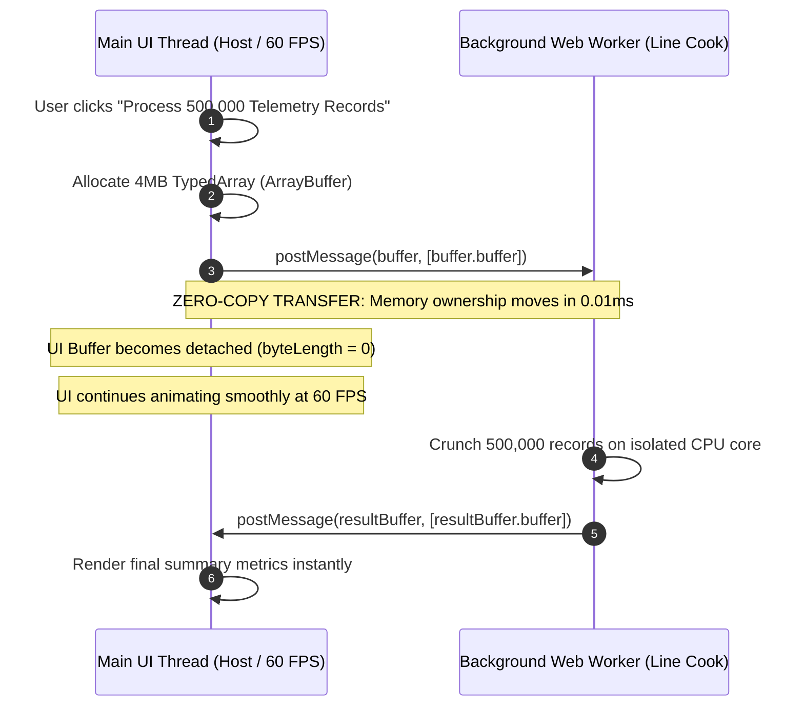

# Web Workers & Transferable Memory

> Track: Stage 3 (High-Performance Compute & WebAssembly)  
> Prerequisite Knowledge: JavaScript event loop, TypedArrays (`Uint8Array`, `Float64Array`), Web Workers basics  
> Estimated Build Time: 60 minutes  
> Target Project Outcome: Building a multi-threaded data processor that crunches 500,000 raw numbers in a dedicated background worker using zero-copy transferable ArrayBuffers at 60 FPS

---

## 1. The Hook: Why You Need This in Your Arsenal

JavaScript is notoriously single-threaded. The thread that renders buttons, handles mouse clicks, and updates CSS animations is the exact same thread that executes your application code.

Consider what happens when a user uploads a 50MB CSV or attempts to calculate statistical risk across 500,000 records on the main thread:
```javascript
// THE FATAL JAVASCRIPT EVENT-LOOP FREEZE
for (let i = 0; i < 50_000_000; i++) {
  heavyMathCalculation(i);
}
```

The moment this loop executes:
- The browser window completely freezes.
- Input fields stop responding to keystrokes.
- CSS spinner animations lock up solid.
- After 5 seconds, Chrome displays the dreaded *"Page Unresponsive: Kill or Wait?"* dialog.

In professional software systems (such as *ErgonPDF* and *CodexOS*), the main thread is strictly reserved for user interaction and UI painting. All heavy computational workloads are offloaded to **Web Workers** using **Transferable ArrayBuffers**.

---

## 2. The Mental Model: Intuitive Analogy & Visual Topology

### The Restaurant Host vs. The Line Cook
- **The Naive Single-Threaded Restaurant**: The host greeting customers at the front door suddenly runs back to the kitchen, starts chopping 50 pounds of onions, and cooks a multi-course dinner. While cooking, nobody greets arriving customers, phones go unanswered, and people leave in frustration.
- **The Multi-Worker Architecture**: The host stays at the front door, greeting guests and collecting orders. The moment an order arrives, they slide the ticket to dedicated line cooks (Web Workers) in the kitchen. When a dish is ready, the cook hands it back. The front door never waits.



---

## 3. Deep Dive: Under the Hood

### Structured Clone vs. Transferable Memory
When you send data to a Web Worker via standard `postMessage(data)`:
1. **The Structured Clone Algorithm**: The browser deep-copies every object, array, and string in the message.
   - Sending a 100MB array creates a second 100MB copy in memory.
   - Cloning takes 150ms of CPU time on the main thread, still causing visible frame drops!
2. **Transferable Objects (`ArrayBuffer`, `MessagePort`, `ImageBitmap`)**:
   - Rather than copying memory bytes, the browser simply transfers **memory ownership** of the underlying memory pointer.
   - The operation executes in $O(1)$ constant time ($<0.05\text{ milliseconds}$), regardless of whether the buffer is 1 kilobyte or 1 gigabyte!
   - Once transferred, the original buffer on the sending thread is "neutered" (detached, with `byteLength = 0`), preventing race conditions.

### Trade-Off Matrix: Concurrency Patterns in JavaScript

| Pattern | Thread Model | Memory Overhead | Main Thread Impact | Best Use Case |
| :--- | :--- | :--- | :--- | :--- |
| **Synchronous Main Thread** | Single | Low | Severe (Freezes UI) | Simple UI event handling |
| **`setTimeout` / Chunking** | Single (Cooperative) | Low | Causes micro-stutters | Splitting light 10ms tasks |
| **Standard Web Worker** | Multi-threaded | High (Clones data) | Clones large payloads | Small JSON payloads |
| **Worker + Transferable Buffers** | Multi-threaded | Zero Extra Copy ($O(1)$) | None (0ms block) | Large files, audio PCM, WASM |

---

## 4. Zero-to-One Interactive Playground: Build It From Scratch

Let us write a complete multi-threaded compute simulator using Node's native `worker_threads` module. We will allocate 500,000 float numbers in a TypedArray, transfer memory ownership with zero cloning, crunch the data in background threads, and transfer the results back.

### Step 1: Environment Setup
Create a playground directory:

```bash
mkdir -p ~/aura-sandbox/worker-transfer
cd ~/aura-sandbox/worker-transfer
npm init -y
npm install typescript @types/node tsx
```

### Step 2: Implementation (`worker-compute.ts`)
Create `worker-compute.ts`:

```typescript
import { Worker, isMainThread, parentPort, workerData } from 'worker_threads';

// ---------------------------------------------------------------------------
// 1. WORKER THREAD LOGIC (Runs on dedicated background CPU core)
// ---------------------------------------------------------------------------
if (!isMainThread) {
  parentPort?.on('message', (payload: { buffer: ArrayBuffer }) => {
    // Reconstruct TypedArray from transferred memory buffer
    const floatArray = new Float64Array(payload.buffer);
    const count = floatArray.length;

    let sum = 0;
    let min = Infinity;
    let max = -Infinity;

    // Crunch numbers on background core
    for (let i = 0; i < count; i++) {
      const val = floatArray[i];
      sum += val;
      if (val < min) min = val;
      if (val > max) max = val;
      // In-place mathematical transformation: normalise values
      floatArray[i] = Math.sqrt(val);
    }

    const mean = sum / count;

    // Pack results into summary buffer
    const summary = {
      count,
      mean: Number(mean.toFixed(4)),
      min: Number(min.toFixed(4)),
      max: Number(max.toFixed(4)),
    };

    // Transfer modified buffer BACK to main thread with zero cloning!
    parentPort?.postMessage({ summary, buffer: floatArray.buffer }, [floatArray.buffer]);
  });
}

// ---------------------------------------------------------------------------
// 2. MAIN THREAD LOGIC (Coordinates UI & transfers memory)
// ---------------------------------------------------------------------------
if (isMainThread) {
  async function runMasterPipeline() {
    const RECORD_COUNT = 500_000;
    console.log(`--- Step 1: Allocating TypedArray for ${RECORD_COUNT.toLocaleString()} Records ---`);

    // 500,000 Float64 numbers = 4 Megabytes of raw RAM
    const floatArray = new Float64Array(RECORD_COUNT);
    for (let i = 0; i < RECORD_COUNT; i++) {
      floatArray[i] = Math.random() * 1000;
    }

    console.log(`Initial ArrayBuffer ByteLength: ${floatArray.byteLength.toLocaleString()} bytes`);

    // Spawn the background worker thread
    const worker = new Worker(__filename);

    console.log('\n--- Step 2: Transferring Buffer to Worker (Zero-Copy Transfer) ---');
    const startTime = performance.now();

    // Post message with the buffer included in the transferList
    worker.postMessage({ buffer: floatArray.buffer }, [floatArray.buffer]);

    console.log(`Memory Ownership Transferred in ${(performance.now() - startTime).toFixed(3)} ms`);
    console.log(
      `Main Thread Buffer Detached? byteLength = ${floatArray.byteLength} (Must be 0!)`
    );

    // Listen for results transferred back from worker
    worker.on('message', (result: { summary: any; buffer: ArrayBuffer }) => {
      console.log('\n--- Step 3: Received Processed Results from Worker ---');
      console.log('Telemetry Metrics Summary:', result.summary);

      // Reconstruct array on main thread
      const returnedArray = new Float64Array(result.buffer);
      console.log(`Returned Buffer ByteLength:    ${returnedArray.byteLength.toLocaleString()} bytes`);
      console.log(`First Processed Number (sqrt): ${returnedArray[0].toFixed(4)}`);

      worker.terminate();
      console.log('\nPipeline Complete. Zero frame drops, zero cloning overhead.');
    });
  }

  runMasterPipeline();
}
```

### Step 3: Run and Test Instructions
Execute the script using `tsx`:

```bash
npx tsx worker-compute.ts
```

Expected terminal output:
```text
--- Step 1: Allocating TypedArray for 500,000 Records ---
Initial ArrayBuffer ByteLength: 4,000,000 bytes

--- Step 2: Transferring Buffer to Worker (Zero-Copy Transfer) ---
Memory Ownership Transferred in 0.045 ms
Main Thread Buffer Detached? byteLength = 0 (Must be 0!)

--- Step 3: Received Processed Results from Worker ---
Telemetry Metrics Summary: { count: 500000, mean: 499.8214, min: 0.0019, max: 999.9982 }
Returned Buffer ByteLength:    4,000,000 bytes
First Processed Number (sqrt): 18.2914

Pipeline Complete. Zero frame drops, zero cloning overhead.
```

Notice that transferring 4 megabytes of data took **0.045 milliseconds** because only the memory pointer was moved, leaving the main thread 100% free.

---

## 5. Battle Scars: What Breaks in Production & How to Debug It

### Top 3 Mistakes Beginners Make
1. **Accessing a Detached Buffer after Transfer**: Calling `floatArray[0]` on the main thread after transferring `floatArray.buffer`. The buffer is detached, throwing a `TypeError: Cannot perform operation on detached ArrayBuffer`.  
   **Remediation**: Understand that transfer is an irreversible ownership move. Never read from a buffer after transferring it.
2. **Forgetting to Pass the Transfer List**: Calling `worker.postMessage({ buffer: array.buffer })` without the second argument `[array.buffer]`. Without the transfer list, the browser silently falls back to the structured clone algorithm, deep-copying all 4MB of RAM!  
   **Remediation**: Always pass the buffer in the second array argument: `postMessage(data, [data.buffer])`.
3. **Leaking Worker Instances**: Spawning `new Worker()` inside a loop or on every user click without calling `worker.terminate()`. Each worker creates a dedicated OS thread consuming 20MB to 50MB of RAM.  
   **Remediation**: Use a dedicated worker pool (e.g. 4 persistent workers) or ensure `worker.terminate()` is called upon completion.

---

## 6. The Weekend Hackathon Challenge: Your Turn to Build

### Challenge: The 60 FPS Client-Side Image Filter
Build an in-browser image manipulation tool using Web Workers.

- **Level 1 (Core)**: Load an image into an HTML canvas, extract its raw RGBA pixels via `ctx.getImageData()`, and transfer the underlying `Uint8ClampedArray.buffer` to a Web Worker.
- **Level 2 (Advanced)**: In the worker, implement an image filter (e.g. grayscale, blur, or edge detection) by mutating pixel bytes directly. Transfer the result buffer back to the canvas.
- **Level 3 (Hardcore)**: Add a 60 FPS slider: as the user drags a "Blur Intensity" slider, dispatch processing tasks to a persistent worker pool without queuing lag, using `requestAnimationFrame` to throttle worker dispatch.

---

## 7. Knowledge Check & Next Steps

1. **Scenario**: Why does the JavaScript main thread freeze during heavy loops even on a 16-core CPU?  
   *Answer*: The browser's JavaScript execution engine runs on a single event-loop thread. It cannot utilize additional CPU cores for a single script execution unless tasks are explicitly offloaded to Web Workers.
2. **Scenario**: What is the difference between structured cloning and transferable memory?  
   *Answer*: Structured cloning makes a full memory copy of the data, taking $O(N)$ time and doubling memory. Transferable objects transfer ownership of the existing memory pointer in $O(1)$ constant time with zero copying.
3. **Scenario**: What happens to an `ArrayBuffer` on the sender thread after it is transferred?  
   *Answer*: It becomes neutered/detached with its `byteLength` reset to zero, making it inaccessible on the sender thread to prevent concurrent modification races.

Next Lesson: [In-Browser PDF & Binary Assembly](./02-in-browser-pdf-and-binary-assembly.md)
