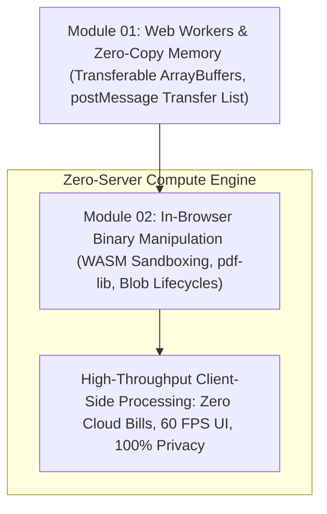

# Stage 3: High-Performance Compute & WebAssembly

> Transforming the Browser into a Sandboxed Supercomputer: Web Workers, Transferable Memory, and Client-Side Binary Processing.

---

## Overview

Traditional web development offloads all heavy computation to cloud servers:

- Need to convert an image? Upload it to an AWS Lambda function.
- Need to parse a 200MB CSV? Send it to a backend Python API.
- Need to merge or encrypt a PDF? Pay a SaaS provider per API request.

This pattern introduces network upload latency, recurring server bills, and severe data privacy violations.

In Stage 3, you will learn to turn the user's browser runtime into a sovereign, high-performance computing sandbox (as demonstrated in *ErgonPDF*):

1. Overcoming the single-thread JavaScript bottleneck using dedicated Web Workers.
2. Transferring hundreds of megabytes of raw memory in zero-copy constant time ($O(1)$) using transferable `ArrayBuffer` objects.
3. Loading and manipulating binary file trees (such as PDF objects and fonts) in browser memory with `pdf-lib` and WebAssembly.
4. Managing `Blob` URL lifecycles to prevent fatal browser memory leaks.

---

## Technical Architecture: Stage 3 Client Compute Roadmap



---

## Modules in This Stage

```text
03-high-performance-compute-and-wasm/
├── README.md                                         # Stage syllabus & roadmap
├── 01-web-workers-and-transferable-memory.md         # Thread concurrency & zero-copy buffers
└── 02-in-browser-pdf-and-binary-assembly.md          # Binary file parsing, WASM & Blob lifecycles
```

---

## Learning Objectives

- **Concurrency in JavaScript**: Decouple heavy CPU tasks from the main UI thread to guarantee uninterrupted 60 FPS animations.
- **Zero-Copy Memory Transfers**: Use `postMessage(data, [transferList])` to pass memory ownership across worker boundaries without cloning overhead.
- **Binary Stream Engineering**: Read, mutate, compress, and assemble complex binary documents directly in client RAM.
- **Memory Lifecycle Discipline**: Explicitly revoke object URLs and garbage-collect large typed arrays to prevent browser tab crashes.
