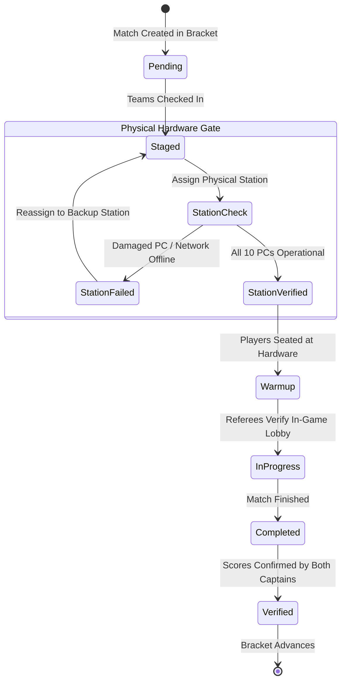

# Hardware-Constrained State Machines

> Track: Stage 4 (Real-Time Engines & Physical Hardware Constraints)  
> Prerequisite Knowledge: Finite State Machines (FSM), relational modeling, TypeScript types  
> Estimated Build Time: 60 minutes  
> Target Project Outcome: Building a hardware-aware tournament match dispatcher in TypeScript where physical station availability is modeled directly in the state transition lifecycle

---

## 1. The Hook: Why You Need This in Your Arsenal

Imagine developing software for an in-person esports tournament at a university gaming lab.
Thirty-two teams of five players each arrive on Saturday morning.

In a generic tournament app:
- The bracket engine schedules Match 12 to "Station 4, 11:00 AM".
- The referee walks over to Station 4, only to discover that PC #7 has a dead power supply and PC #9 has a failed display cable.
- The match stalls. The tournament falls 90 minutes behind schedule.
- Frustrated players crowd the admin desk, live streams display static holding screens, and admins scramble to reschedule matches on paper.

This failure occurred because the software treated scheduling as an abstract mathematical puzzle rather than an operation governed by **physical hardware invariants**.

In **VALORANT Tournament Operations (VTO)**, we solved this by making physical hardware stations a **first-class scheduling entity**. A match cannot transition from `STAGED` to `IN_PROGRESS` unless the physical station has completed an automated hardware pre-flight check.

---

## 2. The Mental Model: Intuitive Analogy & Visual Topology

### Air Traffic Control vs. A Generic Calendar
- **A Generic Calendar App**: Lets you create an event called "Flight 402 lands at 2:00 PM" without checking whether Runway 3L has another plane on it or whether ground crews are on strike.
- **Air Traffic Control**: The plane cannot touch down unless the physical runway is verified empty, emergency crews are standing by, and taxiways are cleared.



---

## 3. Deep Dive: Under the Hood

### Modeling Physical Reality in Relational Schemas
In physical LAN venues, a "Station" is not just a string name; it is an aggregation of physical components:
- $10\times$ Gaming PCs (5 Home, 5 Away)
- $10\times$ Monitors with verified minimum refresh rates (e.g. $\ge 144\text{ Hz}$)
- $1\times$ Network switch port assigned to a dedicated low-latency tournament VLAN
- $1\times$ Assigned Tournament Referee

```typescript
export interface PhysicalStation {
  id: string;
  stationName: string;
  totalPcCount: number;
  operationalPcCount: number;
  isNetworkVerified: boolean;
  isOccupied: boolean;
  currentMatchId: string | null;
}
```

### The State Machine Invariant Gate
Before transitioning a match to `IN_PROGRESS`, the system evaluates the **Station Invariant Formula**:

$$\text{CanLaunch} = (\text{operationalPcs} \ge 10) \land (\text{isNetworkVerified} = \text{true}) \land (\text{isOccupied} = \text{false})$$

If any condition fails, the state transition is rejected at both the type level and the runtime level.

### Sub-Millisecond Input Polling & High-Frequency Telemetry

In premier esports titles such as VALORANT, Counter-Strike 2, and Overwatch, the competitive integrity of a LAN tournament depends on microsecond-level determinism. Physical station modeling cannot stop at verifying whether a PC turns on; it must guarantee real-time input pipeline and telemetry fidelity.

#### 1. 1000Hz vs 8000Hz USB HID Polling Dynamics
Standard consumer peripherals poll over USB Human Interface Device (HID) protocols at 125Hz ($8\text{ ms}$ interval). Competitive esports equipment operates at:
- **1000Hz Polling**: 1 report every $1.0\text{ ms}$ ($1000\text{ packets/sec}$).
- **8000Hz Polling**: 1 report every $125\ \mu\text{s}$ ($0.125\text{ ms}$, $8000\text{ packets/sec}$).

At 8000Hz, each connected peripheral fires 8,000 hardware interrupts per second per device. On a 10-PC tournament stage with 10 mice, 10 keyboards, and audio interfaces, unoptimized kernel scheduling triggers Deferred Procedure Call (DPC) and Interrupt Service Routine (ISR) spikes. When an operating system core spends excessive cycles handling interrupt storms, render threads experience micro-stutters and dropped frames.

Tournament workstations enforce core affinity pinning, dedicating CPU cores 0-1 exclusively to kernel interrupts while game simulation and client tick loops run isolated on higher-index performance cores.

#### 2. Microsecond Timestamping and Clock Drift
JavaScript standard `Date.now()` resolution is coarse (typically $1\text{ ms}$ to $15.6\text{ ms}$ on Windows due to default OS timer tick resolution of 64Hz). For physical input telemetry and tick reconstruction, coarse timestamps cause catastrophic aliasing and synthetic jitter.

Real-time telemetry systems mandate monotonic, high-resolution microsecond clocks:
- **Web / Node.js**: `performance.now()`, which returns fractional milliseconds with sub-millisecond (microsecond-level) precision referenced from process start (`timeOrigin`).
- **Native OS (Windows)**: `QueryPerformanceCounter` (QPC) backed by the CPU Hardware Invariant Time Stamp Counter (TSC), delivering sub-microsecond resolution ($< 100\text{ ns}$).

Between client PCs and the central LAN tournament observer controller, physical oscillators drift over time due to ambient stage temperature variations and quartz crystal tolerances (typically 10-50 parts per million, causing 1-5 milliseconds of drift every 100 seconds).

LAN tournament engines calculate instantaneous clock offset $\Delta t$ and round-trip time (RTT) using symmetric packet exchange:

$$\text{RTT} = (T_4 - T_1) - (T_3 - T_2)$$

$$\Delta t = \frac{(T_2 - T_1) + (T_3 - T_4)}{2}$$

Where:
- $T_1$: Client send timestamp (monotonic)
- $T_2$: Server receive timestamp
- $T_3$: Server reply timestamp
- $T_4$: Client receive timestamp

The client clock phase is adjusted via linear slew rates rather than abrupt time steps to prevent temporal backward jumps in simulation state.

#### 3. Jitter Buffer Mitigation
High-frequency telemetry packets traversing local venue network switches encounter queuing variance, resulting in packet arrival jitter. If a telemetry observer renders events immediately upon receipt, uneven inter-arrival intervals cause visible stutter.

The station telemetry receiver implements an adaptive jitter buffer:
1. Telemetry samples are buffered into an ordered circular queue indexed by monotonic sequence number.
2. The buffer maintains a target playout delay $D_{\text{playout}} = \bar{D} + 3\sigma_D$, where $\bar{D}$ is mean one-way transit delay and $\sigma_D$ is standard deviation (jitter).
3. Telemetry values between discrete ticks are evaluated using Hermite spline interpolation for continuous camera angles and linear interpolation for coordinate telemetry, eliminating observer hitching while preserving exact tournament state invariants.

### Trade-Off Matrix: Scheduling Architectures

| Approach | Hardware Modeling | Real-World Resilience | Implementation Complexity | Best Use Case |
| :--- | :--- | :--- | :--- | :--- |
| **Abstract Bracket Only** | None (Assumes infinite PCs) | Very Low (Fails on hardware loss) | Very Low | Purely online remote tournaments |
| **Manual Admin Assignment** | Mental notes / Paper | Low (Human error prone) | Low | Small 4-team casual LANs |
| **Hardware-Constrained FSM** | Explicit in schema & states | High (Guarantees zero idle time) | Moderate | Production LAN arenas & university labs |

---

## 4. Zero-to-One Interactive Playground: Build It From Scratch

Let us build a complete hardware-constrained match state machine in TypeScript. It verifies physical station health before allowing match progression.

### Step 1: Environment Setup
Create a playground directory:

```bash
mkdir -p ~/aura-sandbox/hardware-fsm
cd ~/aura-sandbox/hardware-fsm
npm init -y
npm install typescript @types/node tsx
```

### Step 2: Implementation (`station-fsm.ts`)
Create `station-fsm.ts`:

```typescript
export type MatchStatus = 'PENDING' | 'STAGED' | 'WARMUP' | 'IN_PROGRESS' | 'COMPLETED';

export interface PhysicalStation {
  id: string;
  name: string;
  operationalPcs: number;
  isNetworkVlanHealthy: boolean;
  isOccupied: boolean;
  usbPollingRateHz: number;
  telemetryJitterMs: number;
}

export interface EsportsMatch {
  id: string;
  homeTeam: string;
  awayTeam: string;
  status: MatchStatus;
  assignedStationId: string | null;
}

export class TournamentStationDispatcher {
  private stations: Map<string, PhysicalStation> = new Map();
  private matches: Map<string, EsportsMatch> = new Map();

  public registerStation(station: PhysicalStation): void {
    this.stations.set(station.id, station);
  }

  public registerMatch(match: EsportsMatch): void {
    this.matches.set(match.id, match);
  }

  /**
   * Pre-flight gate: assigns a physical station to a staged match.
   * Enforces 10 operational PCs, healthy VLAN, >=1000Hz USB polling, and jitter < 0.25ms.
   */
  public assignStationToMatch(matchId: string, stationId: string): void {
    const match = this.matches.get(matchId);
    const station = this.stations.get(stationId);

    if (!match) throw new Error(`Match ${matchId} not found`);
    if (!station) throw new Error(`Station ${stationId} not found`);

    if (match.status !== 'PENDING' && match.status !== 'STAGED') {
      throw new Error(`Invalid state transition: Match in status ${match.status} cannot be assigned`);
    }

    // Physical Hardware Invariant Gate
    if (station.operationalPcs < 10) {
      throw new Error(
        `PRE-FLIGHT HARDWARE REJECTION: ${station.name} has only ${station.operationalPcs}/10 operational PCs. Match cannot proceed.`
      );
    }

    if (!station.isNetworkVlanHealthy) {
      throw new Error(
        `PRE-FLIGHT NETWORK REJECTION: ${station.name} tournament VLAN is reported OFFLINE.`
      );
    }

    // Sub-millisecond Telemetry Invariant Gate
    if (station.usbPollingRateHz < 1000) {
      throw new Error(
        `PRE-FLIGHT TELEMETRY REJECTION: ${station.name} USB HID polling rate ${station.usbPollingRateHz}Hz is below the 1000Hz esports minimum.`
      );
    }

    if (station.telemetryJitterMs > 0.25) {
      throw new Error(
        `PRE-FLIGHT JITTER REJECTION: ${station.name} telemetry jitter ${station.telemetryJitterMs}ms exceeds 0.25ms threshold.`
      );
    }

    if (station.isOccupied) {
      throw new Error(`CONCURRENCY REJECTION: ${station.name} is currently occupied by another match.`);
    }

    // Mutate state atomically
    station.isOccupied = true;
    match.assignedStationId = station.id;
    match.status = 'STAGED';

    console.log(
      `[DISPATCH] Match ${match.homeTeam} vs ${match.awayTeam} staged at ${station.name} ` +
      `(${station.usbPollingRateHz}Hz HID, ${station.telemetryJitterMs}ms jitter)`
    );
  }

  /**
   * Transitions match from STAGED to WARMUP to IN_PROGRESS.
   */
  public startMatch(matchId: string): void {
    const match = this.matches.get(matchId);
    if (!match) throw new Error(`Match ${matchId} not found`);

    if (match.status !== 'STAGED') {
      throw new Error(`Match must be STAGED at a verified station before starting`);
    }

    match.status = 'IN_PROGRESS';
    console.log(`[LIVE] Match ${match.homeTeam} vs ${match.awayTeam} is now LIVE on physical hardware.`);
  }

  public finishMatch(matchId: string): void {
    const match = this.matches.get(matchId);
    if (!match || match.status !== 'IN_PROGRESS') {
      throw new Error(`Only in-progress matches can be completed`);
    }

    const station = this.stations.get(match.assignedStationId!);
    if (station) {
      station.isOccupied = false; // Release physical station for next match!
    }

    match.status = 'COMPLETED';
    console.log(`[FINISHED] Match ${match.id} completed. Physical station released to available pool.`);
  }
}

// ---------------------------------------------------------------------------
// Verification Simulation: Testing Physical Constraints & Telemetry Gates
// ---------------------------------------------------------------------------
const dispatcher = new TournamentStationDispatcher();

// Register 2 physical stages in a university computer lab
dispatcher.registerStation({
  id: 'station-main-stage',
  name: 'Main Arena Stage',
  operationalPcs: 10,
  isNetworkVlanHealthy: true,
  isOccupied: false,
  usbPollingRateHz: 8000,
  telemetryJitterMs: 0.08,
});

dispatcher.registerStation({
  id: 'station-lab-b',
  name: 'Lab B (Backup Stage)',
  operationalPcs: 9, // One PC has a broken monitor!
  isNetworkVlanHealthy: true,
  isOccupied: false,
  usbPollingRateHz: 1000,
  telemetryJitterMs: 0.12,
});

dispatcher.registerMatch({
  id: 'match-01',
  homeTeam: 'Sentinels',
  awayTeam: 'Fnatic',
  status: 'PENDING',
  assignedStationId: null,
});

console.log('--- Step 1: Attempting to assign match to broken Station (Lab B: 9 PCs) ---');
try {
  dispatcher.assignStationToMatch('match-01', 'station-lab-b');
} catch (err: any) {
  console.log('Caught Expected Error:', err.message);
}

console.log('\n--- Step 2: Assigning match to verified Main Arena Stage (10 PCs, 8000Hz HID) ---');
dispatcher.assignStationToMatch('match-01', 'station-main-stage');

console.log('\n--- Step 3: Starting Match on Physical Hardware ---');
dispatcher.startMatch('match-01');

console.log('\n--- Step 4: Completing Match & Releasing Station ---');
dispatcher.finishMatch('match-01');
```

### Step 3: Run and Test Instructions
Execute the script using `tsx`:

```bash
npx tsx station-fsm.ts
```

Expected terminal output:
```text
--- Step 1: Attempting to assign match to broken Station (Lab B: 9 PCs) ---
Caught Expected Error: PRE-FLIGHT HARDWARE REJECTION: Lab B (Backup Stage) has only 9/10 operational PCs. Match cannot proceed.

--- Step 2: Assigning match to verified Main Arena Stage (10 PCs, 8000Hz HID) ---
[DISPATCH] Match Sentinels vs Fnatic staged at Main Arena Stage (8000Hz HID, 0.08ms jitter)

--- Step 3: Starting Match on Physical Hardware ---
[LIVE] Match Sentinels vs Fnatic is now LIVE on physical hardware.

--- Step 4: Completing Match & Releasing Station ---
[FINISHED] Match match-01 completed. Physical station released to available pool.
```

---

## 5. Battle Scars: What Breaks in Production & How to Debug It

### Top 3 Mistakes Beginners Make
1. **Double-Booking Stations During Delays**: If Match 1 goes to double-overtime (lasting 90 minutes instead of 45), an automated timer marks the station as free and attempts to seat Match 2 on the same computers while Match 1 is still being played.  
   **Remediation**: Stations must only be released when the tournament referee explicitly submits the final verified match score, never based on elapsed time estimates.
2. **Missing Network Health Probes**: Assuming a station is ready because all 10 PCs turn on. A player sits down, launches the game client, and discovers the local switch has lost gateway internet.  
   **Remediation**: Run continuous ICMP ping or HTTP health probes from each station back to the tournament controller before staging matches.
3. **Unvalidated Player Check-Ins**: Starting a match when only 4 out of 5 players on a team have physically arrived at the computer lab.  
   **Remediation**: Require all 10 individual player badges to be scanned at the physical station terminal before enabling the "Start Match" button.

---

## 6. The Weekend Hackathon Challenge: Your Turn to Build

### Challenge: The Physical LAN Station Orchestrator
Build a web-based operations dashboard for a gaming lab.

- **Level 1 (Core)**: Create a dashboard displaying 4 physical stations (Stations 1 through 4) with status indicators (Available, Occupied, Damaged). Allow admins to manually flag damaged PCs.
- **Level 2 (Advanced)**: Implement an auto-dispatch queue: when a match finishes, automatically pull the next pending match from the bracket and assign it to the first available healthy station.
- **Level 3 (Hardcore)**: Implement an automated Pre-Flight Gate modal: when an admin clicks "Launch Match", run a 5-step automated check (10 PCs verified, both team rosters full, ping $<10\text{ ms}$, ref assigned) with green checkmarks before unlocking the start trigger.

---

## 7. Knowledge Check & Next Steps

1. **Scenario**: Why must physical computer hardware be represented in tournament database schemas?  
   *Answer*: Software cannot execute physical LAN matches without functioning hardware. Modeling physical stations prevents scheduling games to offline, damaged, or currently occupied computers.
2. **Scenario**: Why should physical station availability never be managed using time duration estimates?  
   *Answer*: Competitive matches frequently run long due to technical pauses, tactical timeouts, or overtime rounds. Releasing stations on a timer causes two teams to collide at the same physical desk.
3. **Scenario**: What is the purpose of a Pre-Flight Invariant Gate?  
   *Answer*: It executes a strict set of preconditions that must evaluate to true before allowing a state transition, preventing corrupted states from entering production.

Next Lesson: [Tournament Pairing Algorithms](./02-tournament-pairing-algorithms.md)
