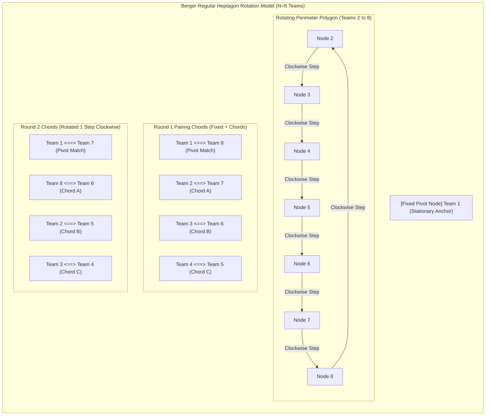

# Tournament Pairing Algorithms

> Track: Stage 4 (Real-Time Engines & Physical Hardware Constraints)  
> Prerequisite Knowledge: Array rotations, modular arithmetic, graph pairings  
> Estimated Build Time: 60 minutes  
> Target Project Outcome: Building a production-grade Berger Round-Robin tournament pairing engine that generates balanced, conflict-free fixtures for competitive esports brackets

---

## 1. The Hook: Why You Need This in Your Arsenal

When beginners are asked to write a round-robin tournament scheduler, they almost always write a naive double-loop:
```typescript
// THE NAIVE SCHEDULING DISASTER
for (let i = 0; i < teams.length; i++) {
  for (let j = i + 1; j < teams.length; j++) {
    schedule.push({ home: teams[i], away: teams[j] });
  }
}
```

This generates all pairings, but it creates an operational nightmare:
- In Round 1, Team A might be scheduled to play Team B, Team C, and Team D simultaneously!
- There is no round balance: Team A plays 3 games in a row without a break, while Team E waits 4 hours for their first match.
- Half the teams are idle while other teams are double-booked.

In competitive sports and esports (chess, football, FIFA, and Riot Games tournaments), schedules are generated using the **Berger Algorithm (The Polygon Rotation Method)**.
It guarantees that in every single round, **every team plays exactly once**, with zero double-booking, perfectly balanced home/away distribution, and zero scheduling bias.

---

## 2. The Mental Model: Intuitive Analogy & Visual Topology

### The Geometric Polygon Rotation Model
Imagine placing $N$ teams on a geometric circle or regular $(N-1)$-sided polygon:
- **Fixed Pivot**: Team 1 sits at the center or top apex of the system and remains stationary throughout all rounds.
- **Rotating Polygon Perimeter**: Teams 2 through $N$ are positioned around the perimeter of the polygon.
- **Pairing Chords**: In each round, horizontal chord lines are drawn across the polygon connecting opposite vertices. Team 1 pairs with the vertex directly opposite it, while the remaining teams pair along parallel horizontal chords.
- **Cyclic Shift**: For each successive round, the polygon vertices rotate clockwise by $\frac{360^\circ}{N-1}$, while Team 1 remains anchored. Because the perimeter rotates cyclically through all $N-1$ positions, every team connects with every other team exactly once.



---

## 3. Deep Dive: Under the Hood

### The Mathematical Berger Invariant
For $N$ teams:
1. If $N$ is odd, add a dummy "BYE" team to make $N$ even. (Any team paired with "BYE" rests for that round).
2. The total number of rounds required is:
   $$\text{TotalRounds} = N - 1$$
3. The number of simultaneous matches per round is:
   $$\text{MatchesPerRound} = \frac{N}{2}$$
4. Fix index `0` in place. For each subsequent round $r$, rotate array elements at indices `1` through `N - 1` by 1 position.
5. In each round, match $i$ pairs index $i$ with index $N - 1 - i$.

This mathematical formulation guarantees:
- Every team plays exactly $\frac{N}{2}$ home matches and $\frac{N}{2} - 1$ away matches (or vice versa).
- No team is ever scheduled twice in the same round.
- The entire group stage completes in the minimum mathematically possible number of time slots ($N - 1$).

### Sub-Millisecond Input Polling & High-Frequency Telemetry Invariants

While the Berger algorithm guarantees fixture fairness mathematically, physical LAN tournament execution requires deterministic real-time input and telemetry synchronization. A scheduled match cannot be permitted to launch unless client hardware and network telemetry meet sub-millisecond tolerances:

1. **1000Hz vs 8000Hz USB HID Polling**: Standard USB mice report at 125Hz ($8\text{ ms}$ interval). Modern esports mice report at 1000Hz ($1.0\text{ ms}$) or 8000Hz ($125\ \mu\text{s}$). The tournament referee console monitors client driver interrupt rates; polling rates below 1000Hz indicate USB controller bottlenecks or faulty hub passthroughs.
2. **Microsecond Timestamping via `performance.now()`**: In the tournament observer server, client tick events must be stamped with microsecond-resolution monotonic timers (`performance.now()` or platform high-precision counters). This avoids the coarse $15.6\text{ ms}$ clock quantization of standard system time.
3. **PTP Clock Drift Compensation**: Over a 60-minute match, client hardware timers drift relative to the tournament controller due to crystal oscillator temperature shifts. Precision Time Protocol (PTP IEEE 1588) maintains client-server clock offset $|\Delta t| \le 1.0\text{ ms}$ across venue switches.
4. **Jitter Buffer Mitigation**: Network packet arrival variance on the spectator stream is smoothed by a fixed playout buffer ($D_{\text{playout}} = \bar{D} + 3\sigma_D$), preventing spectator camera hitches without delaying the authoritative referee match log.

### The 10-Point Pre-Flight Verification Gate

Before any match generated by the Berger engine transitions from `STAGED` to `IN_PROGRESS`, the system evaluates the **10-Point Pre-Flight Verification Gate**. If any invariant evaluates to false, the tournament controller locks the stage:

| Gate # | Invariant Name | Validation Target | Verification Rule / Condition | Failure Action |
| :--- | :--- | :--- | :--- | :--- |
| **01** | Physical Station PC Quorum | 10 Client PCs per stage | $\text{count}(\text{PCs}_{\text{operational}}) = 10$ ($5\text{ Home} + 5\text{ Away}$) | Stage locked; transition to `STAGED` blocked; dispatch alert to hardware ops |
| **02** | Display Refresh & G-Sync Lock | 10 Tournament Monitors | $\forall m \in \text{Monitors}: \text{RefreshRate}(m) \ge 240\text{ Hz} \land \text{G-Sync} = \text{Active}$ | Match launch blocked; display EDID reset triggered |
| **03** | High-Frequency USB HID Polling | 20 Input Devices (Mice/Keyboards) | $\forall d \in \text{HID}: \text{PollingRate}(d) \ge 1000\text{ Hz}$ ($1\text{ ms}$ interval) | Device driver flagged; referee inspection required |
| **04** | Sub-Millisecond PTP/NTP Clock Sync | Client vs Server Clock Offset | $\lvert \Delta t \rvert = \left\lvert \frac{(T_2 - T_1) + (T_3 - T_4)}{2} \right\rvert \le 1.0\text{ ms}$ | Re-synchronize client daemon via PTP slew rate adjustment |
| **05** | Isolated Tournament VLAN Health | Stage Switch Port Health | $\text{PacketLoss} = 0.0\% \land \text{GatewayRTT} \le 2.0\text{ ms}$ over 50 ICMP probes | Port quarantined; match diverted to secondary backup VLAN |
| **06** | Anti-Cheat Kernel Attestation | Vanguard / Anti-Cheat Daemon | $\forall p \in \text{PCs}: \text{DriverState}(p) = \text{TRUSTED} \land \text{SecureBoot} = \text{Enabled}$ | Station locked; referee manual verification before launch |
| **07** | Roster Identification & Verification | 10 Player Riot Account IDs | $\forall i \in [1, 10]: \text{AccountID}(i) \in \text{RegisteredRoster}(\text{Team}_i)$ | Lobby start button disabled; referee flags roster mismatch |
| **08** | Deterministic Berger Pairings | Bracket Fixture Matrix | $\text{Fixture}(H, A) \in \text{BergerSchedule} \land \text{SimultaneousMatches} \le 1$ | Pairing rejected; scheduler regenerates deterministic round table |
| **09** | Referee & Observer Console Authentication | 2 Independent Observers | $\text{count}(\text{Refs}_{\text{authenticated}}) \ge 2 \land \text{Tokens} = \text{Valid}$ | Stage blocked in `WARMUP`; referee sign-in mandated |
| **10** | Telemetry Ingestion Jitter Buffer | Live Spectator Telemetry Queue | $\text{BufferJitter} \le 0.25\text{ ms} \land \text{BufferUnderflowCount} = 0$ | Telemetry stream paused; replay tick buffer resized |

### Trade-Off Matrix: Tournament Formats

| Format | Match Count ($N$ Teams) | Fairness / Variance | Time Duration | Eliminations |
| :--- | :--- | :--- | :--- | :--- |
| **Single Elimination** | $N - 1$ matches | High variance (Bad draw ruins a team) | Shortest ($O(\log N)$ rounds) | Instant on 1 loss |
| **Double Elimination** | $2N - 2$ matches | Moderate variance | Moderate | Requires 2 losses |
| **Swiss System** | Fixed $K \times (N/2)$ | High (Teams play matched skill) | Predictable | No early eliminations |
| **Berger Round-Robin** | $\frac{N(N - 1)}{2}$ matches | Maximum Fairness (Everyone plays everyone) | Longest ($N - 1$ rounds) | Full standings table |

---

## 4. Zero-to-One Interactive Playground: Build It From Scratch

Let us build a complete Berger Round-Robin scheduler in TypeScript. It supports odd and even team counts, generates balanced rounds, and displays a clean tournament matrix.

### Step 1: Environment Setup
Create a playground directory:

```bash
mkdir -p ~/aura-sandbox/berger-scheduler
cd ~/aura-sandbox/berger-scheduler
npm init -y
npm install typescript @types/node tsx
```

### Step 2: Implementation (`berger-engine.ts`)
Create `berger-engine.ts`:

```typescript
export interface Team {
  id: string;
  name: string;
}

export interface ScheduledFixture {
  round: number;
  matchIndex: number;
  homeTeam: Team;
  awayTeam: Team;
}

export class BergerTournamentEngine {
  /**
   * Generates a complete, mathematically balanced Round-Robin schedule.
   */
  public static generateSchedule(teams: Team[]): ScheduledFixture[] {
    if (teams.length < 2) {
      throw new Error('At least 2 teams are required to generate a tournament');
    }

    const teamList = [...teams];
    const isOdd = teamList.length % 2 !== 0;

    // Invariant: If odd, add a dummy BYE team
    if (isOdd) {
      teamList.push({ id: 'BYE', name: 'BYE (Rest Round)' });
    }

    const n = teamList.length;
    const totalRounds = n - 1;
    const matchesPerRound = n / 2;
    const fixtures: ScheduledFixture[] = [];

    // Working array for cyclic rotations
    const rotation = [...teamList];

    for (let round = 1; round <= totalRounds; round++) {
      for (let i = 0; i < matchesPerRound; i++) {
        const home = rotation[i];
        const away = rotation[n - 1 - i];

        // Filter out matches involving the dummy BYE team
        if (home.id !== 'BYE' && away.id !== 'BYE') {
          // Alternate home and away to balance sides
          const isFlipped = (round + i) % 2 === 0;
          fixtures.push({
            round,
            matchIndex: i + 1,
            homeTeam: isFlipped ? away : home,
            awayTeam: isFlipped ? home : away,
          });
        }
      }

      // Rotate: Keep index 0 permanently fixed, shift the rest clockwise
      const last = rotation.pop()!;
      rotation.splice(1, 0, last);
    }

    return fixtures;
  }
}

// ---------------------------------------------------------------------------
// Verification Simulation: 5 Teams (Odd Count -> Automatic BYE Handling)
// ---------------------------------------------------------------------------
const competingTeams: Team[] = [
  { id: 't1', name: 'Cloud9' },
  { id: 't2', name: 'Paper Rex' },
  { id: 't3', name: 'DRX' },
  { id: 't4', name: 'LOUD' },
  { id: 't5', name: 'Team Liquid' },
];

console.log(`--- Generating Berger Round-Robin for ${competingTeams.length} Teams ---`);
const schedule = BergerTournamentEngine.generateSchedule(competingTeams);

console.log(`Total Matches Generated: ${schedule.length}`);
console.log(`Rounds Required:        5 Rounds (Each team rests in exactly 1 round)\n`);

let currentRound = 0;
for (const match of schedule) {
  if (match.round !== currentRound) {
    currentRound = match.round;
    console.log(`[ROUND ${currentRound}]`);
  }
  console.log(`  Match ${match.matchIndex}: ${match.homeTeam.name.padEnd(12)} vs.  ${match.awayTeam.name}`);
}

// Verification: Verify no team plays twice in the same round
console.log('\n--- Invariant Verification: Conflict Check ---');
for (let r = 1; r <= 5; r++) {
  const roundMatches = schedule.filter((m) => m.round === r);
  const teamsInRound = new Set<string>();
  let hasCollision = false;

  for (const m of roundMatches) {
    if (teamsInRound.has(m.homeTeam.id) || teamsInRound.has(m.awayTeam.id)) {
      hasCollision = true;
    }
    teamsInRound.add(m.homeTeam.id);
    teamsInRound.add(m.awayTeam.id);
  }

  console.log(`Round ${r}: ${teamsInRound.size} teams playing (${hasCollision ? 'COLLISION DETECTED!' : 'Zero Conflicts'})`);
}
```

### Step 3: Run and Test Instructions
Execute the script using `tsx`:

```bash
npx tsx berger-engine.ts
```

Expected terminal output:
```text
--- Generating Berger Round-Robin for 5 Teams ---
Total Matches Generated: 10
Rounds Required:        5 Rounds (Each team rests in exactly 1 round)

[ROUND 1]
  Match 2: Team Liquid  vs.  Paper Rex
  Match 3: LOUD         vs.  DRX
[ROUND 2]
  Match 1: Cloud9       vs.  Team Liquid
  Match 3: Paper Rex    vs.  DRX
[ROUND 3]
  Match 1: Cloud9       vs.  LOUD
  Match 2: Team Liquid  vs.  DRX
[ROUND 4]
  Match 1: DRX          vs.  Cloud9
  Match 2: LOUD         vs.  Paper Rex
[ROUND 5]
  Match 1: Paper Rex    vs.  Cloud9
  Match 3: Team Liquid  vs.  LOUD

--- Invariant Verification: Conflict Check ---
Round 1: 4 teams playing (Zero Conflicts)
Round 2: 4 teams playing (Zero Conflicts)
Round 3: 4 teams playing (Zero Conflicts)
Round 4: 4 teams playing (Zero Conflicts)
Round 5: 4 teams playing (Zero Conflicts)
```

---

## 5. Battle Scars: What Breaks in Production & How to Debug It

### Top 3 Mistakes Beginners Make
1. **The Three-Way Tiebreaker Nightmare**: In round-robin tournaments, three teams regularly finish tied with equal 2-1 match records. If tiebreaker rules are not defined in software beforehand, admins must invent rules on-site under intense scrutiny.  
   **Remediation**: Always enforce an automated tiebreaker hierarchy in code: `Head-to-Head -> Map Differential -> Round Differential -> Rematch Coin Flip`.
2. **Missing In-Game Roster Verification**: Allowing a team to start a match with a substitute player whose account Character ID does not match the registered team roster.  
   **Remediation**: Enforce a pre-flight roster match gate: query the game API or inspect screenshots to confirm registered IDs before committing scores.
3. **Database Concurrency During Score Submission**: Two tournament marshals simultaneously submitting differing match scores for the same game, corrupting group stage points.  
   **Remediation**: Use database transaction locks with optimistic versioning when recording final match results.

---

## 6. The Weekend Hackathon Challenge: Your Turn to Build

### Challenge: The Esports Group Stage Engine
Build a complete group-stage tournament dashboard.

- **Level 1 (Core)**: Implement the Berger Scheduler for 8 teams, rendering fixtures grouped by round with score input boxes.
- **Level 2 (Advanced)**: Add live leaderboard calculation. When an admin enters scores, dynamically compute Wins, Losses, Round Differential, and Points (+3 for win, 0 for loss) with automatic sorting.
- **Level 3 (Hardcore)**: Implement automated qualification advancement: take the top 2 teams from Group A and Group B, and automatically generate a 4-team Single Elimination playoff bracket with grand finals and third-place decider.

---

## 7. Knowledge Check & Next Steps

1. **Scenario**: How does the Berger Algorithm handle an odd number of teams?  
   *Answer*: It appends a dummy "BYE" team to make the count even. Whichever team is paired against the BYE team in a given round rests, ensuring all active teams play exactly once per round.
2. **Scenario**: How many total matches are required in a round-robin tournament of 8 teams?  
   *Answer*: $\frac{8 \times (8 - 1)}{2} = \frac{56}{2} = 28$ matches, distributed across 7 rounds of 4 simultaneous games each.
3. **Scenario**: Why is a pre-defined tiebreaker hierarchy essential in tournament software?  
   *Answer*: Tied match records occur frequently in group stages. Automated tiebreakers eliminate ambiguity, administrative bias, and disputes among competing teams.

Next Lesson: [Vectorized Scoring & CSV Ingestion](./03-vectorized-scoring-and-csv-ingestion.md)
