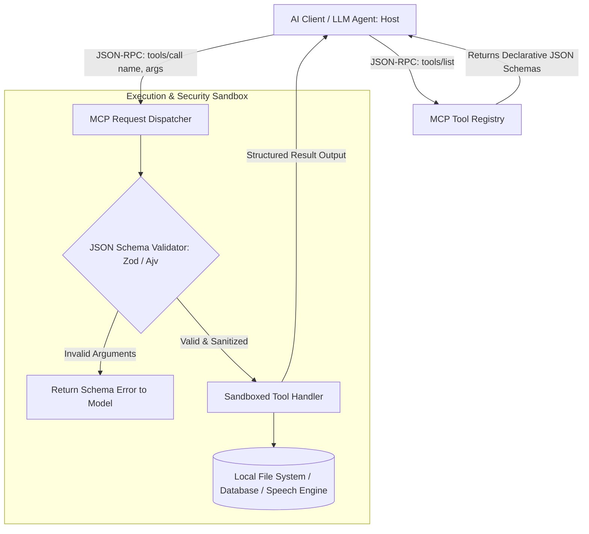

# Model Context Protocol & Tools

> Track: Stage 5 (Sovereign AI & Multi-Agent Swarms)  
> Prerequisite Knowledge: JSON Schema, function calling concepts, API design  
> Estimated Build Time: 60 minutes  
> Target Project Outcome: Building a standardized Model Context Protocol (MCP) tool registry in TypeScript that validates input schemas and executes sandboxed tool operations safely

---

## 1. The Hook: Why You Need This in Your Arsenal

When developers start connecting Large Language Models to real-world code, they usually write ad-hoc function calling logic:
```javascript
// THE FRAGILE AD-HOC FUNCTION CALLING TRAP
if (llmResponse.includes('RUN_SQL:')) {
  const sql = llmResponse.split('RUN_SQL:')[1];
  db.raw(sql); // INJECTION DISASTER!
}
```

This naive approach breaks immediately:
- The LLM hallucinates parameters or omits required fields, causing backend crashes.
- Swapping models (from OpenAI to Claude to a local Ollama model) requires rewriting all integration code because every provider has different proprietary function-calling formats.
- There are no rate limits, no permission boundaries, and no input sanitization, exposing your database or local system to arbitrary command execution.

In **Skills Bot**, we standardized our entire ecosystem of over 1,900 agentic tools around open, declarative interfaces: **The Model Context Protocol (MCP)**.
- Tools are declared with strict **JSON Schema contracts**.
- Inputs are validated at runtime before execution.
- LLMs can discover, invoke, and inspect tools across uniform, model-agnostic boundaries.

---

## 2. The Mental Model: Intuitive Analogy & Visual Topology

### The USB-C Universal Port vs. Proprietary Cables
- **Proprietary Function Calling**: Like having 10 different electronic gadgets, each with its own weird proprietary charging pin. You need a different custom adapter for every single device.
- **Model Context Protocol (MCP)**: The USB-C standard for AI capabilities. Any AI model (host) plugs into any local tool server through a universal, bidirectional JSON-RPC wire protocol.



---

## 3. Deep Dive: Under the Hood

### The MCP Architecture: Host, Client, and Server
The Model Context Protocol specifies three roles:
1. **Host**: The user-facing AI application (e.g., Claude Desktop, IDE, or custom agent runtime).
2. **Client**: Connects to one or more MCP servers using transport channels (stdio, WebSockets, or HTTP SSE).
3. **Server**: A lightweight program that exposes three primary primitives:
   - **Tools**: Executable functions that take arguments and perform actions (e.g. `execute_query`, `synthesize_speech`).
   - **Resources**: Read-only context data (e.g. file contents, database schemas).
   - **Prompts**: Pre-configured prompt templates.

### The JSON Schema Invariant
Every tool contract defines:
- `name`: Unique machine-readable identifier.
- `description`: Explains to the model *when* and *why* to use this tool.
- `inputSchema`: A standard JSON Schema object declaring `type`, `properties`, and `required` fields.

```json
{
  "name": "generate_report",
  "description": "Generates a sovereign clinical report PDF locally.",
  "inputSchema": {
    "type": "object",
    "properties": {
      "patientId": { "type": "string", "description": "Anonymized patient identifier" },
      "riskScore": { "type": "number", "minimum": 0, "maximum": 100 }
    },
    "required": ["patientId", "riskScore"]
  }
}
```

### Authentic Model Context Protocol (MCP) JSON-RPC 2.0 Wire Messages

The official Model Context Protocol (MCP) specification defines communication between hosts (such as Claude Desktop or custom agents) and local tool servers using **JSON-RPC 2.0** framing over two primary transport channels:

1. **`stdio` Transport**: Messages are sent as single-line UTF-8 JSON objects delimited by newlines (`\n`) over standard input (`stdin`) and standard output (`stdout`). This is the default transport for local subprocesses and command-line agents.
2. **`HTTP with SSE` Transport**: The host issues HTTP POST requests containing JSON-RPC payloads to the server, and listens for server notifications and responses via a persistent Server-Sent Events (`text/event-stream`) connection.

#### 1. Lifecycle Handshake: `initialize`
Before discovering or invoking tools, host and server establish protocol capabilities:

**Host Request (`stdio` -> Server `stdin`)**:
```json
{
  "jsonrpc": "2.0",
  "id": 1,
  "method": "initialize",
  "params": {
    "protocolVersion": "2024-11-05",
    "capabilities": {
      "roots": { "listChanged": true },
      "sampling": {}
    },
    "clientInfo": {
      "name": "AuraSovereignHost",
      "version": "1.0.0"
    }
  }
}
```

**Server Response (Server `stdout` -> Host)**:
```json
{
  "jsonrpc": "2.0",
  "id": 1,
  "result": {
    "protocolVersion": "2024-11-05",
    "capabilities": {
      "tools": { "listChanged": false },
      "resources": { "subscribe": false }
    },
    "serverInfo": {
      "name": "AuraLocalDiagnosticsServer",
      "version": "1.0.0"
    }
  }
}
```

Upon receipt, the host sends an unacknowledged notification confirming readiness:
```json
{
  "jsonrpc": "2.0",
  "method": "notifications/initialized"
}
```

#### 2. Tool Discovery: `tools/list`
The host queries available tools to inject their declarative JSON Schemas into the LLM system prompt.

**Host Request**:
```json
{
  "jsonrpc": "2.0",
  "id": 2,
  "method": "tools/list",
  "params": {}
}
```

**Server Response**:
```json
{
  "jsonrpc": "2.0",
  "id": 2,
  "result": {
    "tools": [
      {
        "name": "check_station_health",
        "description": "Verifies physical operational PC count and network VLAN integrity for a LAN esports station.",
        "inputSchema": {
          "type": "object",
          "properties": {
            "stationId": {
              "type": "string",
              "description": "Identifier of the tournament hardware station (e.g. station-main-01)"
            }
          },
          "required": ["stationId"]
        }
      }
    ]
  }
}
```

#### 3. Tool Execution: `tools/call`
When the LLM decides to invoke an external capability, the host translates the model's function call into a wire request.

**Host Request**:
```json
{
  "jsonrpc": "2.0",
  "id": 3,
  "method": "tools/call",
  "params": {
    "name": "check_station_health",
    "arguments": {
      "stationId": "station-main-01"
    }
  }
}
```

**Server Success Response**:
The tool output is returned in a standard `content` array of multimodal items:
```json
{
  "jsonrpc": "2.0",
  "id": 3,
  "result": {
    "content": [
      {
        "type": "text",
        "text": "{\"stationId\":\"station-main-01\",\"operationalPcs\":10,\"networkVlan\":\"10.200.4.0/24\",\"usbPollingRateHz\":8000,\"isReady\":true}"
      }
    ],
    "isError": false
  }
}
```

#### 4. Structured Error Wire Formatting
The MCP wire protocol differentiates between two classes of errors:

1. **Protocol-Level JSON-RPC Errors**: Used when parsing fails, the method does not exist, or the JSON-RPC envelope is malformed. The server returns a top-level `error` object with standard error codes:
   - `-32700`: Parse error (invalid JSON)
   - `-32600`: Invalid Request (missing jsonrpc version or method)
   - `-32601`: Method not found
   - `-32602`: Invalid params (arguments do not conform to schema)
   - `-32603`: Internal server error

   ```json
   {
     "jsonrpc": "2.0",
     "id": 4,
     "error": {
       "code": -32601,
       "message": "Method 'delete_entire_database' not found on this MCP server."
     }
   }
   ```

2. **Tool Execution Errors**: When the tool itself encounters a runtime failure (such as a database query timeout or missing file), the server returns a successful JSON-RPC envelope with `isError: true` inside `result`:
   ```json
   {
     "jsonrpc": "2.0",
     "id": 5,
     "result": {
       "content": [
         {
           "type": "text",
           "text": "Hardware Pre-Flight Check Failed: Station station-lab-b has only 9/10 operational PCs."
         }
       ],
       "isError": true
     }
   }
   ```
   *Why this invariant matters*: Returning application errors inside `result.isError` allows the LLM to inspect the error message and attempt self-correction without terminating the host transport connection.

---

## 4. Zero-to-One Interactive Playground: Build It From Scratch

Let us build an in-memory MCP Tool Registry in TypeScript. It registers declarative tools, validates inputs against schemas, and executes handlers safely.

### Step 1: Environment Setup
Create a playground directory:

```bash
mkdir -p ~/aura-sandbox/mcp-registry
cd ~/aura-sandbox/mcp-registry
npm init -y
npm install typescript @types/node tsx
```

### Step 2: Implementation (`mcp-tool-registry.ts`)
Create `mcp-tool-registry.ts`:

```typescript
export interface JsonRpcRequest {
  jsonrpc: '2.0';
  id?: string | number | null;
  method: string;
  params?: Record<string, any>;
}

export interface JsonRpcResponse {
  jsonrpc: '2.0';
  id: string | number | null;
  result?: any;
  error?: {
    code: number;
    message: string;
    data?: any;
  };
}

export interface McpToolDefinition {
  name: string;
  description: string;
  inputSchema: {
    type: 'object';
    properties: Record<string, { type: string; description?: string }>;
    required?: string[];
  };
  handler: (args: Record<string, any>) => Promise<any>;
}

export class McpJsonRpcServer {
  private tools: Map<string, McpToolDefinition> = new Map();
  private isInitialized = false;

  public registerTool(tool: McpToolDefinition): void {
    if (this.tools.has(tool.name)) {
      throw new Error(`Tool ${tool.name} is already registered`);
    }
    this.tools.set(tool.name, tool);
  }

  /**
   * Processes an incoming raw JSON-RPC 2.0 string over stdio or SSE transport.
   * Returns a spec-compliant JSON-RPC 2.0 response string.
   */
  public async handleWireMessage(rawJson: string): Promise<string> {
    let request: JsonRpcRequest;

    // 1. JSON-RPC Syntax / Parse Error (-32700)
    try {
      request = JSON.parse(rawJson);
    } catch {
      return JSON.stringify({
        jsonrpc: '2.0',
        id: null,
        error: { code: -32700, message: 'Parse error: Invalid JSON string' },
      });
    }

    // 2. Validate JSON-RPC 2.0 Envelope (-32600)
    if (request.jsonrpc !== '2.0' || typeof request.method !== 'string') {
      return JSON.stringify({
        jsonrpc: '2.0',
        id: request.id ?? null,
        error: { code: -32600, message: 'Invalid Request: Missing jsonrpc version or method' },
      });
    }

    // Handle Unacknowledged Notifications
    if (request.id === undefined || request.id === null) {
      if (request.method === 'notifications/initialized') {
        this.isInitialized = true;
      }
      return ''; // Notifications do not generate wire responses
    }

    const id = request.id;

    // 3. Dispatch Methods
    switch (request.method) {
      case 'initialize': {
        return JSON.stringify({
          jsonrpc: '2.0',
          id,
          result: {
            protocolVersion: '2024-11-05',
            capabilities: { tools: { listChanged: false } },
            serverInfo: { name: 'AuraLocalDiagnosticsServer', version: '1.0.0' },
          },
        });
      }

      case 'tools/list': {
        const toolList = Array.from(this.tools.values()).map(
          ({ name, description, inputSchema }) => ({ name, description, inputSchema })
        );
        return JSON.stringify({
          jsonrpc: '2.0',
          id,
          result: { tools: toolList },
        });
      }

      case 'tools/call': {
        const { name, arguments: toolArgs } = request.params ?? {};
        if (!name || typeof name !== 'string') {
          return JSON.stringify({
            jsonrpc: '2.0',
            id,
            error: { code: -32602, message: 'Invalid params: Missing tool name' },
          });
        }

        const tool = this.tools.get(name);
        if (!tool) {
          return JSON.stringify({
            jsonrpc: '2.0',
            id,
            error: { code: -32601, message: `Method not found: Tool '${name}' does not exist` },
          });
        }

        // Validate Required Parameters
        const required = tool.inputSchema.required ?? [];
        const actualArgs = toolArgs ?? {};
        for (const reqField of required) {
          if (actualArgs[reqField] === undefined || actualArgs[reqField] === null) {
            return JSON.stringify({
              jsonrpc: '2.0',
              id,
              error: {
                code: -32602,
                message: `Invalid params: Missing required parameter '${reqField}' for tool '${name}'`,
              },
            });
          }
        }

        // Execute Handler with Structured Tool Content
        try {
          const handlerOutput = await tool.handler(actualArgs);
          return JSON.stringify({
            jsonrpc: '2.0',
            id,
            result: {
              content: [
                {
                  type: 'text',
                  text: typeof handlerOutput === 'string' ? handlerOutput : JSON.stringify(handlerOutput),
                },
              ],
              isError: false,
            },
          });
        } catch (execErr: any) {
          // Application-level tool error preserved in result.isError
          return JSON.stringify({
            jsonrpc: '2.0',
            id,
            result: {
              content: [{ type: 'text', text: `Tool Execution Failure: ${execErr.message}` }],
              isError: true,
            },
          });
        }
      }

      default: {
        return JSON.stringify({
          jsonrpc: '2.0',
          id,
          error: { code: -32601, message: `Method not found: '${request.method}'` },
        });
      }
    }
  }
}

// ---------------------------------------------------------------------------
// Verification Simulation: JSON-RPC 2.0 Stdio Wire Protocol Exchange
// ---------------------------------------------------------------------------
async function runMcpWireDemo() {
  const server = new McpJsonRpcServer();

  // Register Tournament Station Health Tool
  server.registerTool({
    name: 'check_station_health',
    description: 'Checks the operational PC and network status of a physical LAN station.',
    inputSchema: {
      type: 'object',
      properties: {
        stationId: { type: 'string', description: 'ID of the station, e.g. station-main-01' },
      },
      required: ['stationId'],
    },
    handler: async (args) => {
      if (args.stationId === 'station-broken-02') {
        throw new Error('Station has only 8/10 operational PCs (Hardware Quorum Failure)');
      }
      return {
        stationId: args.stationId,
        operationalPcs: 10,
        networkVlan: '10.200.4.0/24 (Healthy)',
        usbPollingRateHz: 8000,
        isReady: true,
      };
    },
  });

  console.log('=== Step 1: Handshake (initialize) ===');
  const initMsg = JSON.stringify({
    jsonrpc: '2.0',
    id: 1,
    method: 'initialize',
    params: { protocolVersion: '2024-11-05' },
  });
  console.log('Host -> Wire:', initMsg);
  console.log('Server -> Wire:', await server.handleWireMessage(initMsg));

  console.log('\n=== Step 2: Tool Discovery (tools/list) ===');
  const listMsg = JSON.stringify({ jsonrpc: '2.0', id: 2, method: 'tools/list', params: {} });
  console.log('Host -> Wire:', listMsg);
  console.log('Server -> Wire:', await server.handleWireMessage(listMsg));

  console.log('\n=== Step 3: Valid Tool Call (tools/call) ===');
  const callMsg = JSON.stringify({
    jsonrpc: '2.0',
    id: 3,
    method: 'tools/call',
    params: { name: 'check_station_health', arguments: { stationId: 'station-main-01' } },
  });
  console.log('Host -> Wire:', callMsg);
  console.log('Server -> Wire:', await server.handleWireMessage(callMsg));

  console.log('\n=== Step 4: Schema Validation Error (-32602) ===');
  const badParamMsg = JSON.stringify({
    jsonrpc: '2.0',
    id: 4,
    method: 'tools/call',
    params: { name: 'check_station_health', arguments: {} },
  });
  console.log('Host -> Wire:', badParamMsg);
  console.log('Server -> Wire:', await server.handleWireMessage(badParamMsg));

  console.log('\n=== Step 5: Application-Level Tool Execution Error (isError: true) ===');
  const appErrorMsg = JSON.stringify({
    jsonrpc: '2.0',
    id: 5,
    method: 'tools/call',
    params: { name: 'check_station_health', arguments: { stationId: 'station-broken-02' } },
  });
  console.log('Host -> Wire:', appErrorMsg);
  console.log('Server -> Wire:', await server.handleWireMessage(appErrorMsg));

  console.log('\n=== Step 6: Non-Existent Method (-32601) ===');
  const unknownMethodMsg = JSON.stringify({
    jsonrpc: '2.0',
    id: 6,
    method: 'drop_database_tables',
    params: {},
  });
  console.log('Host -> Wire:', unknownMethodMsg);
  console.log('Server -> Wire:', await server.handleWireMessage(unknownMethodMsg));
}

runMcpWireDemo();
```

### Step 3: Run and Test Instructions
Execute the script using `tsx`:

```bash
npx tsx mcp-tool-registry.ts
```

Expected terminal output:
```text
=== Step 1: Handshake (initialize) ===
Host -> Wire: {"jsonrpc":"2.0","id":1,"method":"initialize","params":{"protocolVersion":"2024-11-05"}}
Server -> Wire: {"jsonrpc":"2.0","id":1,"result":{"protocolVersion":"2024-11-05","capabilities":{"tools":{"listChanged":false}},"serverInfo":{"name":"AuraLocalDiagnosticsServer","version":"1.0.0"}}}

=== Step 2: Tool Discovery (tools/list) ===
Host -> Wire: {"jsonrpc":"2.0","id":2,"method":"tools/list","params":{}}
Server -> Wire: {"jsonrpc":"2.0","id":2,"result":{"tools":[{"name":"check_station_health","description":"Checks the operational PC and network status of a physical LAN station.","inputSchema":{"type":"object","properties":{"stationId":{"type":"string","description":"ID of the station, e.g. station-main-01"}},"required":["stationId"]}}]}}

=== Step 3: Valid Tool Call (tools/call) ===
Host -> Wire: {"jsonrpc":"2.0","id":3,"method":"tools/call","params":{"name":"check_station_health","arguments":{"stationId":"station-main-01"}}}
Server -> Wire: {"jsonrpc":"2.0","id":3,"result":{"content":[{"type":"text","text":"{\"stationId\":\"station-main-01\",\"operationalPcs\":10,\"networkVlan\":\"10.200.4.0/24 (Healthy)\",\"usbPollingRateHz\":8000,\"isReady\":true}"}],"isError":false}}

=== Step 4: Schema Validation Error (-32602) ===
Host -> Wire: {"jsonrpc":"2.0","id":4,"method":"tools/call","params":{"name":"check_station_health","arguments":{}}}
Server -> Wire: {"jsonrpc":"2.0","id":4,"error":{"code":-32602,"message":"Invalid params: Missing required parameter 'stationId' for tool 'check_station_health'"}}

=== Step 5: Application-Level Tool Execution Error (isError: true) ===
Host -> Wire: {"jsonrpc":"2.0","id":5,"method":"tools/call","params":{"name":"check_station_health","arguments":{"stationId":"station-broken-02"}}}
Server -> Wire: {"jsonrpc":"2.0","id":5,"result":{"content":[{"type":"text","text":"Tool Execution Failure: Station has only 8/10 operational PCs (Hardware Quorum Failure)"}],"isError":true}}

=== Step 6: Non-Existent Method (-32601) ===
Host -> Wire: {"jsonrpc":"2.0","id":6,"method":"drop_database_tables","params":{}}
Server -> Wire: {"jsonrpc":"2.0","id":6,"error":{"code":-32601,"message":"Method not found: 'drop_database_tables'"}}
```

---

## 5. Battle Scars: What Breaks in Production & How to Debug It

### Top 3 Mistakes Beginners Make
1. **Vague Tool Descriptions Causing Hallucinated Calls**: Giving a tool a description like `"Runs code"`. The LLM has no context on when or why to choose it versus other tools.  
   **Remediation**: Write explicit descriptions detailing expected inputs, side effects, and concrete scenarios (e.g. `"Evaluates Gail Model risk scores locally. Use only when patient survey answers are present."`).
2. **Executing Shell Commands Directly from Model Outputs**: Passing an un-sanitized string argument from an LLM directly into `child_process.exec()`. Prompt injection attacks can compromise your server with `rm -rf /`.  
   **Remediation**: Always parse arguments into strict typed enums and use parameterized execution (`execFile` with argument arrays, never raw shell strings).
3. **Unbounded Output Payloads Flooding Context Windows**: A tool returns a 10MB SQL table dump back to the LLM. The token count exceeds the model's context window, crashing the generation.  
   **Remediation**: Enforce strict output truncation or pagination limits on tool returns.

---

## 6. The Weekend Hackathon Challenge: Your Turn to Build

### Challenge: The Personal MCP System Assistant
Build an MCP server that exposes your local developer environment to AI models.

- **Level 1 (Core)**: Create an MCP server in Node.js or Python with 3 tools: `get_system_time`, `list_directory`, and `read_file_head`.
- **Level 2 (Advanced)**: Add security boundary validation: forbid path traversal (e.g. `../` or `/etc/passwd`) and restrict file reading to a specific safe folder.
- **Level 3 (Hardcore)**: Connect your MCP server to Claude Desktop or a local LLM runner (like Ollama) using the standard `stdio` transport, and have the model execute a real file inspection workflow.

---

## 7. Knowledge Check & Next Steps

1. **Scenario**: Why is JSON Schema used to declare MCP tool contracts?  
   *Answer*: JSON Schema is a universal, machine-readable format understood by all modern LLMs, allowing models to construct valid arguments deterministically.
2. **Scenario**: How does MCP protect against proprietary model vendor lock-in?  
   *Answer*: MCP standardizes the communication wire protocol (JSON-RPC) between models and tools. The exact same tool server can be used by OpenAI, Anthropic Claude, or local open-source models without rewriting integration code.
3. **Scenario**: Why must tool handlers execute input validation even if the LLM followed the schema?  
   *Answer*: LLMs are probabilistic engines and can hallucinate arguments or fall victim to prompt injection. Defensive engineering requires runtime assertions at all execution boundaries.

Next Lesson: [Event-Driven Agent Choreography](./03-event-driven-agent-choreography.md)
