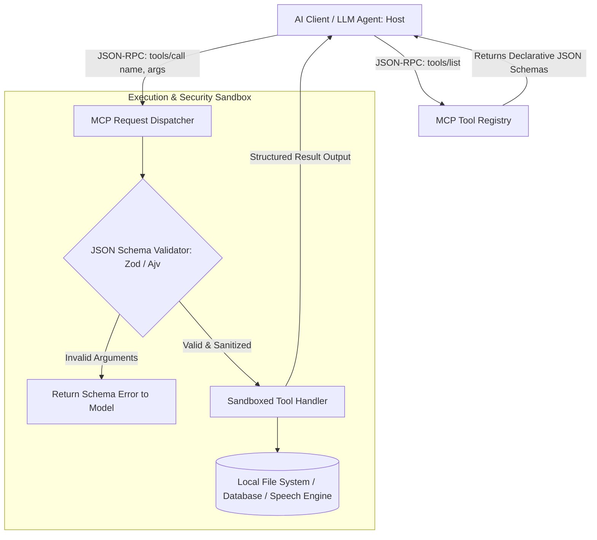

# Model Context Protocol & Tools

> Track: Stage 5 (Sovereign AI & Multi-Agent Swarms)  
> Prerequisite Knowledge: JSON Schema, function calling concepts, API design  
> Estimated Build Time: 60 minutes  
> Target Project Outcome: Building a standardized Model Context Protocol (MCP) tool registry in TypeScript that validates input schemas and executes sandboxed tool operations safely

---

## 1. The Hook: Why You Need This in Your Arsenal

When developers start connecting Large Language Models to real-world code, they usually write ad-hoc function calling logic:
```javascript
// THE FRAGILE AD-HOC FUNCTION CALLING TRAP
if (llmResponse.includes('RUN_SQL:')) {
  const sql = llmResponse.split('RUN_SQL:')[1];
  db.raw(sql); // INJECTION DISASTER!
}
```

This naive approach breaks immediately:
- The LLM hallucinates parameters or omits required fields, causing backend crashes.
- Swapping models (from OpenAI to Claude to a local Ollama model) requires rewriting all integration code because every provider has different proprietary function-calling formats.
- There are no rate limits, no permission boundaries, and no input sanitization, exposing your database or local system to arbitrary command execution.

In **Skills Bot**, we standardized our entire ecosystem of over 1,900 agentic tools around open, declarative interfaces: **The Model Context Protocol (MCP)**.
- Tools are declared with strict **JSON Schema contracts**.
- Inputs are validated at runtime before execution.
- LLMs can discover, invoke, and inspect tools across uniform, model-agnostic boundaries.

---

## 2. The Mental Model: Intuitive Analogy & Visual Topology

### The USB-C Universal Port vs. Proprietary Cables
- **Proprietary Function Calling**: Like having 10 different electronic gadgets, each with its own weird proprietary charging pin. You need a different custom adapter for every single device.
- **Model Context Protocol (MCP)**: The USB-C standard for AI capabilities. Any AI model (host) plugs into any local tool server through a universal, bidirectional JSON-RPC wire protocol.



---

## 3. Deep Dive: Under the Hood

### The MCP Architecture: Host, Client, and Server
The Model Context Protocol specifies three roles:
1. **Host**: The user-facing AI application (e.g., Claude Desktop, IDE, or custom agent runtime).
2. **Client**: Connects to one or more MCP servers using transport channels (stdio, WebSockets, or HTTP SSE).
3. **Server**: A lightweight program that exposes three primary primitives:
   - **Tools**: Executable functions that take arguments and perform actions (e.g. `execute_query`, `synthesize_speech`).
   - **Resources**: Read-only context data (e.g. file contents, database schemas).
   - **Prompts**: Pre-configured prompt templates.

### The JSON Schema Invariant
Every tool contract defines:
- `name`: Unique machine-readable identifier.
- `description`: Explains to the model *when* and *why* to use this tool.
- `inputSchema`: A standard JSON Schema object declaring `type`, `properties`, and `required` fields.

```json
{
  "name": "generate_report",
  "description": "Generates a sovereign clinical report PDF locally.",
  "inputSchema": {
    "type": "object",
    "properties": {
      "patientId": { "type": "string", "description": "Anonymized patient identifier" },
      "riskScore": { "type": "number", "minimum": 0, "maximum": 100 }
    },
    "required": ["patientId", "riskScore"]
  }
}
```

---

## 4. Zero-to-One Interactive Playground: Build It From Scratch

Let us build an in-memory MCP Tool Registry in TypeScript. It registers declarative tools, validates inputs against schemas, and executes handlers safely.

### Step 1: Environment Setup
Create a playground directory:

```bash
mkdir -p ~/aura-sandbox/mcp-registry
cd ~/aura-sandbox/mcp-registry
npm init -y
npm install typescript @types/node tsx
```

### Step 2: Implementation (`mcp-tool-registry.ts`)
Create `mcp-tool-registry.ts`:

```typescript
export interface McpToolDefinition {
  name: string;
  description: string;
  inputSchema: {
    type: 'object';
    properties: Record<string, { type: string; description?: string }>;
    required?: string[];
  };
  handler: (args: Record<string, any>) => Promise<any>;
}

export class McpToolRegistry {
  private tools: Map<string, McpToolDefinition> = new Map();

  /**
   * Registers a new tool with a declarative contract.
   */
  public registerTool(tool: McpToolDefinition): void {
    if (this.tools.has(tool.name)) {
      throw new Error(`Tool ${tool.name} is already registered`);
    }
    this.tools.set(tool.name, tool);
    console.log(`[MCP SERVER] Registered Tool: '${tool.name}'`);
  }

  /**
   * Returns list of tool schemas for AI model discovery (tools/list).
   */
  public listTools(): Array<Omit<McpToolDefinition, 'handler'>> {
    return Array.from(this.tools.values()).map(({ name, description, inputSchema }) => ({
      name,
      description,
      inputSchema,
    }));
  }

  /**
   * Executes a tool with runtime schema validation (tools/call).
   */
  public async callTool(name: string, args: Record<string, any>): Promise<any> {
    const tool = this.tools.get(name);
    if (!tool) {
      throw new Error(`McpToolNotFound: Tool '${name}' does not exist on this server`);
    }

    // 1. Validate Required Fields
    const required = tool.inputSchema.required ?? [];
    for (const reqField of required) {
      if (args[reqField] === undefined || args[reqField] === null) {
        throw new Error(
          `McpSchemaValidationError: Missing required parameter '${reqField}' for tool '${name}'`
        );
      }
    }

    // 2. Validate Primitive Types
    for (const [key, value] of Object.entries(args)) {
      const expectedProp = tool.inputSchema.properties[key];
      if (expectedProp) {
        const actualType = typeof value;
        if (expectedProp.type === 'number' && actualType !== 'number') {
          throw new Error(`McpTypeError: Field '${key}' must be a number, got ${actualType}`);
        }
        if (expectedProp.type === 'string' && actualType !== 'string') {
          throw new Error(`McpTypeError: Field '${key}' must be a string, got ${actualType}`);
        }
      }
    }

    // 3. Execute Handler safely
    console.log(`[MCP EXECUTE] Executing '${name}' with arguments:`, args);
    return await tool.handler(args);
  }
}

// ---------------------------------------------------------------------------
// Verification Simulation: Registering Tools & Simulating AI Invocations
// ---------------------------------------------------------------------------
async function runMcpDemo() {
  const registry = new McpToolRegistry();

  // Register Tool 1: Tournament Station Checker
  registry.registerTool({
    name: 'check_station_health',
    description: 'Checks the operational PC and network status of a physical LAN station.',
    inputSchema: {
      type: 'object',
      properties: {
        stationId: { type: 'string', description: 'ID of the station, e.g. station-01' },
      },
      required: ['stationId'],
    },
    handler: async (args) => {
      return {
        stationId: args.stationId,
        operationalPcs: 10,
        networkVlan: '10.200.4.0/24 (Healthy)',
        isReady: true,
      };
    },
  });

  // Register Tool 2: Local Audio Synthesizer
  registry.registerTool({
    name: 'synthesize_speech_pcm',
    description: 'Synthesizes spoken audio from text using local neural models.',
    inputSchema: {
      type: 'object',
      properties: {
        text: { type: 'string', description: 'Text prompt to convert to speech' },
        voiceTone: { type: 'string', description: 'Warm / Authoritative / Neutral' },
      },
      required: ['text'],
    },
    handler: async (args) => {
      return {
        sampleRate: 24000,
        chunkCount: 8,
        bytesGenerated: 38400,
        status: 'DISPATCHED_TO_LOCAL_SPEAKERS',
      };
    },
  });

  console.log('\n--- Step 1: AI Model queries available tools (tools/list) ---');
  const availableTools = registry.listTools();
  console.log(JSON.stringify(availableTools, null, 2));

  console.log('\n--- Step 2: AI Model executes valid tool call (tools/call) ---');
  const result = await registry.callTool('check_station_health', { stationId: 'station-main-01' });
  console.log('Tool Result returned to model:\n', result);

  console.log('\n--- Step 3: AI Model sends invalid parameters (Missing required field) ---');
  try {
    await registry.callTool('check_station_health', {}); // Missing stationId!
  } catch (err: any) {
    console.log('Caught Expected Error:', err.message);
  }

  console.log('\n--- Step 4: AI Model attempts to invoke non-existent tool ---');
  try {
    await registry.callTool('delete_entire_database', { confirm: true });
  } catch (err: any) {
    console.log('Caught Expected Error:', err.message);
  }
}

runMcpDemo();
```

### Step 3: Run and Test Instructions
Execute the script using `tsx`:

```bash
npx tsx mcp-tool-registry.ts
```

Expected terminal output:
```text
[MCP SERVER] Registered Tool: 'check_station_health'
[MCP SERVER] Registered Tool: 'synthesize_speech_pcm'

--- Step 1: AI Model queries available tools (tools/list) ---
[
  {
    "name": "check_station_health",
    "description": "Checks the operational PC and network status of a physical LAN station.",
    "inputSchema": { ... }
  },
  {
    "name": "synthesize_speech_pcm",
    "description": "Synthesizes spoken audio from text using local neural models.",
    "inputSchema": { ... }
  }
]

--- Step 2: AI Model executes valid tool call (tools/call) ---
[MCP EXECUTE] Executing 'check_station_health' with arguments: { stationId: 'station-main-01' }
Tool Result returned to model:
 {
  stationId: 'station-main-01',
  operationalPcs: 10,
  networkVlan: '10.200.4.0/24 (Healthy)',
  isReady: true
}

--- Step 3: AI Model sends invalid parameters (Missing required field) ---
Caught Expected Error: McpSchemaValidationError: Missing required parameter 'stationId' for tool 'check_station_health'

--- Step 4: AI Model attempts to invoke non-existent tool ---
Caught Expected Error: McpToolNotFound: Tool 'delete_entire_database' does not exist on this server
```

---

## 5. Battle Scars: What Breaks in Production & How to Debug It

### Top 3 Mistakes Beginners Make
1. **Vague Tool Descriptions Causing Hallucinated Calls**: Giving a tool a description like `"Runs code"`. The LLM has no context on when or why to choose it versus other tools.  
   **Remediation**: Write explicit descriptions detailing expected inputs, side effects, and concrete scenarios (e.g. `"Evaluates Gail Model risk scores locally. Use only when patient survey answers are present."`).
2. **Executing Shell Commands Directly from Model Outputs**: Passing an un-sanitized string argument from an LLM directly into `child_process.exec()`. Prompt injection attacks can compromise your server with `rm -rf /`.  
   **Remediation**: Always parse arguments into strict typed enums and use parameterized execution (`execFile` with argument arrays, never raw shell strings).
3. **Unbounded Output Payloads Flooding Context Windows**: A tool returns a 10MB SQL table dump back to the LLM. The token count exceeds the model's context window, crashing the generation.  
   **Remediation**: Enforce strict output truncation or pagination limits on tool returns.

---

## 6. The Weekend Hackathon Challenge: Your Turn to Build

### Challenge: The Personal MCP System Assistant
Build an MCP server that exposes your local developer environment to AI models.

- **Level 1 (Core)**: Create an MCP server in Node.js or Python with 3 tools: `get_system_time`, `list_directory`, and `read_file_head`.
- **Level 2 (Advanced)**: Add security boundary validation: forbid path traversal (e.g. `../` or `/etc/passwd`) and restrict file reading to a specific safe folder.
- **Level 3 (Hardcore)**: Connect your MCP server to Claude Desktop or a local LLM runner (like Ollama) using the standard `stdio` transport, and have the model execute a real file inspection workflow.

---

## 7. Knowledge Check & Next Steps

1. **Scenario**: Why is JSON Schema used to declare MCP tool contracts?  
   *Answer*: JSON Schema is a universal, machine-readable format understood by all modern LLMs, allowing models to construct valid arguments deterministically.
2. **Scenario**: How does MCP protect against proprietary model vendor lock-in?  
   *Answer*: MCP standardizes the communication wire protocol (JSON-RPC) between models and tools. The exact same tool server can be used by OpenAI, Anthropic Claude, or local open-source models without rewriting integration code.
3. **Scenario**: Why must tool handlers execute input validation even if the LLM followed the schema?  
   *Answer*: LLMs are probabilistic engines and can hallucinate arguments or fall victim to prompt injection. Defensive engineering requires runtime assertions at all execution boundaries.

Next Lesson: [Event-Driven Agent Choreography](./03-event-driven-agent-choreography.md)
