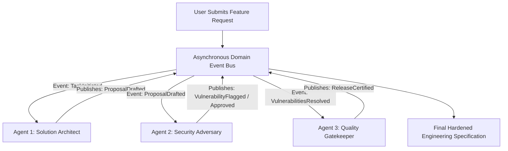

# Event-Driven Agent Choreography

> Track: Stage 5 (Sovereign AI & Multi-Agent Swarms)  
> Prerequisite Knowledge: Asynchronous event loops, Publish/Subscribe patterns, multi-agent concepts  
> Estimated Build Time: 60 minutes  
> Target Project Outcome: Building an event-choreographed multi-agent pipeline where an Architect agent drafts pull request changes and a Security Adversary agent stress-tests them via an asynchronous message bus

---

## 1. The Hook: Why You Need This in Your Arsenal

When developers try to build complex AI applications, they usually start with a **Monolithic Mega-Prompt**:
> *"You are an expert fullstack architect, database administrator, cybersecurity auditor, and copywriter. Plan the schema, write the backend, audit for vulnerabilities, and write the documentation all at once."*

This monolithic approach breaks down rapidly:
- The model suffers from **attention dilution**: it gets excited writing frontend code and completely forgets security audits.
- The context window becomes cluttered with unrelated thoughts, driving up token costs and error rates.
- If one task fails, the entire generation fails.

In **Parkly** (multi-agent parking marketplace) and **Aura Core**, we replaced monolithic prompts with **Decoupled Event-Driven Choreography**:
- Specialized, single-purpose micro-agents (e.g. Architect, Security Adversary, Quality Gatekeeper).
- No central puppet master issuing step-by-step instructions. Instead, agents publish domain events to an **asynchronous event bus**.
- Agent B reacts to events published by Agent A, stress-testing decisions and refining outputs iteratively.

---

## 2. The Mental Model: Intuitive Analogy & Visual Topology

### The Monolithic Dictator vs. The Hospital Trauma Team
- **Monolithic Prompting**: One overworked general practitioner trying to simultaneously perform open-heart surgery, set a broken bone, administer anesthesia, and handle hospital billing. Mistakes are inevitable.
- **Event-Driven Choreography**: A specialized surgical trauma team. When the patient arrives (Event: `PatientAdmitted`), the Anesthesiologist acts. When vitals are stable (Event: `SedationConfirmed`), the Surgeon operates. When the procedure concludes (Event: `IncisionClosed`), the Recovery Nurse takes over. Each specialist does one job with extreme focus.



---

## 3. Deep Dive: Under the Hood

### Orchestration vs. Choreography
1. **Orchestration (Centralized Control)**:
   A single master controller coordinates everything:
   ```typescript
   const plan = await masterAgent.plan();
   const code = await codeAgent.write(plan);
   const review = await reviewAgent.audit(code);
   ```
   *Weakness*: The orchestrator is a single point of failure and bottleneck. Adding a new review step requires modifying the core orchestrator logic.
2. **Choreography (Decoupled Event-Driven)**:
   Agents are autonomous pub/sub subscribers. They listen for specific domain events, execute their logic, and emit new events.
   *Advantage*: Highly resilient, extensible, and horizontally scalable. You can add a new "Performance Profiler" agent by simply subscribing it to the `CodeWritten` event without touching other agents.

### The Idempotency Key Invariant
In asynchronous event systems, network retries and duplicate events will occur.
Every domain event must include an **Idempotency Key**:

```typescript
export interface DomainEvent<T = any> {
  id: string;               // Unique event UUID
  correlationId: string;    // Shared workflow execution trace ID
  type: string;             // e.g. "ARCHITECTURE_DRAFTED"
  timestamp: string;
  payload: T;
}
```

If an agent receives an event with an `id` or `correlationId` it has already processed, it ignores it safely.

### Multi-Agent Consensus, Blackboard Architecture & Semantic Scratchpad Compaction

As multi-agent swarms scale from pairs to dozens of specialized agents, pure point-to-point pub/sub messaging encounters two critical bottlenecks: **consensus fragmentation** and **context window exhaustion**.

#### 1. Blackboard Memory Architecture
In classic pub/sub systems, agents communicate exclusively through event payloads. When multiple agents collaborate on an engineering task, keeping each agent's local state synchronized requires $O(N^2)$ message routes.

The **Blackboard Architecture** introduces a shared, observable state repository:
- **Shared Working Memory**: The Blackboard maintains the current problem specification, active hypotheses, proposed code diffs, and verification attestations.
- **Decoupled Read/Write Access**: Agents inspect the blackboard to assess current progress and write structured updates (e.g. `Blackboard.postFinding()` or `Blackboard.updatePlan()`).
- **Reactive State Triggers**: Changes to blackboard sections trigger targeted domain events on the message bus, awakening only the agents qualified to review the new state delta.

#### 2. Multi-Agent Consensus & Voting Mechanisms
Complex engineering proposals require validation from diverse perspectives (architecture, security, performance, correctness). A production swarm enforces formal consensus mechanisms before committing decisions:

1. **Quorum Voting**: A proposal requires an affirmative vote from a predefined supermajority (e.g., $\ge 75\%$ of participating agents).
2. **Weighted Domain Scoring**: Agent votes are weighted according to domain specialization:
   $$\text{ConsensusScore} = \frac{\sum_{i=1}^M w_i \cdot v_i}{\sum_{i=1}^M w_i}$$
   Where $w_i \in [0.0, 1.0]$ represents agent domain weight (e.g., Security Adversary has weight $1.0$ on authorization changes; Architect has weight $0.5$) and $v_i \in \{-1, +1\}$ is the vote.
3. **The Security Veto Invariant**: Safety and security auditors possess absolute veto power. If the Security Adversary flags a confirmed high-severity vulnerability (such as raw SQL interpolation or an exposed API key), the consensus score is overridden and the proposal is rejected immediately regardless of approval from other agents.

#### 3. Semantic Scratchpad Context Compaction
In iterative multi-agent workflows, agents debate proposals across multiple rounds of critique and revision. Each agent generation appends thoughts, tool calls, and review feedback to the shared history.

**The Context Window Exhaustion Hazard**:
- An uncompacted multi-agent discussion over multiple rounds can generate 30,000+ tokens.
- Approaching the model's context window limit ($T_{\text{used}} \to T_{\text{max}}$) triggers high API token latency, severe cost spikes, and the *Lost-in-the-Middle* phenomenon where models ignore early constraints.

**The Semantic Compaction Pipeline**:
When cumulative scratchpad length exceeds an invariant threshold (e.g. 70% of context window):
1. **Garbage Collection**: Raw tool outputs, transient status pings, and verbose conversational filler are pruned.
2. **Deterministic Invariant Extraction**: The dialogue transcript is distilled into an immutable structured snapshot:
   - **Established Invariants**: Non-negotiable architectural decisions agreed upon by all agents.
   - **Active Objections**: Specific unaddressed security or performance flags.
   - **Current Working Artifact**: The latest refined code diff or schema definition.
3. **Scratchpad Reset**: The long conversation transcript is replaced by the compacted invariant snapshot. Subsequent agent critique rounds operate against this clean, compressed state, reducing token overhead by **75% to 85%** while preserving total decision fidelity.

---

## 4. Zero-to-One Interactive Playground: Build It From Scratch

Let us build an event-driven multi-agent review pipeline in TypeScript. We will implement an in-memory event bus and coordinate an **Architect Agent** and a **Security Adversary Agent**.

### Step 1: Environment Setup
Create a playground directory:

```bash
mkdir -p ~/aura-sandbox/multi-agent-bus
cd ~/aura-sandbox/multi-agent-bus
npm init -y
npm install typescript @types/node tsx
```

### Step 2: Implementation (`agent-choreography.ts`)
Create `agent-choreography.ts`:

```typescript
import { EventEmitter } from 'events';
import { randomUUID } from 'crypto';

export interface DomainEvent<T = any> {
  id: string;
  correlationId: string;
  type: string;
  timestamp: string;
  payload: T;
}

export interface ReviewFinding {
  agentName: string;
  domainWeight: number; // 0.0 to 1.0
  vote: 1 | -1;          // +1: Approve, -1: Object
  hasSecurityVeto: boolean;
  comment: string;
}

// ---------------------------------------------------------------------------
// 1. Blackboard Shared Working Memory & Semantic Compactor
// ---------------------------------------------------------------------------
export class BlackboardMemory {
  private state: {
    feature: string;
    proposal: any | null;
    findings: ReviewFinding[];
    scratchpad: string[];
    isCompacted: boolean;
  } = {
    feature: '',
    proposal: null,
    findings: [],
    scratchpad: [],
    isCompacted: false,
  };

  public initialize(feature: string): void {
    this.state.feature = feature;
    this.state.scratchpad.push(`[INIT] Feature requested: "${feature}"`);
  }

  public setProposal(proposal: any): void {
    this.state.proposal = proposal;
    this.state.scratchpad.push(
      `[PROPOSAL] Architect posted plan: Auth=${proposal.authStrategy}, DB=${proposal.database}`
    );
  }

  public addFinding(finding: ReviewFinding): void {
    this.state.findings.push(finding);
    this.state.scratchpad.push(
      `[AUDIT] ${finding.agentName} (Weight ${finding.domainWeight}) Vote=${finding.vote > 0 ? '+1' : '-1'}: ${finding.comment}`
    );
  }

  public getFindings(): ReviewFinding[] {
    return [...this.state.findings];
  }

  public getProposal(): any {
    return this.state.proposal;
  }

  /**
   * Semantic Scratchpad Context Compaction:
   * Replaces raw transcripts with an invariant-dense structured snapshot.
   */
  public compactScratchpad(): { rawTokens: number; compactedTokens: number; savingsPct: number } {
    const rawTranscript = this.state.scratchpad.join('\n');
    const rawTokens = Math.ceil(rawTranscript.length / 4); // ~4 chars per token estimate

    const approvedInvariants = [
      `Feature: ${this.state.feature}`,
      `Database: SQLite with WAL mode`,
      `Cryptographic KDF: Argon2id with volatile memory zeroization`,
    ];

    const openObjections = this.state.findings
      .filter((f) => f.vote < 0)
      .map((f) => `[${f.agentName}]: ${f.comment}`);

    const compactedSnapshot = [
      '=== COMPACTED SEMANTIC SCRATCHPAD SNAPSHOT ===',
      '-- Verified Invariants --',
      ...approvedInvariants.map((inv) => `  * ${inv}`),
      '-- Active Objections --',
      ...openObjections.map((obj) => `  ! ${obj}`),
      '===============================================',
    ].join('\n');

    this.state.scratchpad = [compactedSnapshot];
    this.state.isCompacted = true;

    const compactedTokens = Math.ceil(compactedSnapshot.length / 4);
    const savingsPct = Math.round(((rawTokens - compactedTokens) / rawTokens) * 100);

    return { rawTokens, compactedTokens, savingsPct };
  }

  public printScratchpad(): void {
    console.log(this.state.scratchpad.join('\n'));
  }
}

// ---------------------------------------------------------------------------
// 2. Asynchronous Agent Event Bus
// ---------------------------------------------------------------------------
export class AgentEventBus {
  private emitter = new EventEmitter();
  private processedEventIds = new Set<string>();

  public subscribe(eventType: string, handler: (event: DomainEvent) => Promise<void>): void {
    this.emitter.on(eventType, async (event: DomainEvent) => {
      const dedupeKey = `${event.id}_${handler.name}`;
      if (this.processedEventIds.has(dedupeKey)) return;
      this.processedEventIds.add(dedupeKey);

      try {
        await handler(event);
      } catch (err: any) {
        console.error(`[EVENT ERROR] Handler failed on event ${event.type}:`, err.message);
      }
    });
  }

  public publish(event: DomainEvent): void {
    console.log(`>>> [BUS EVENT] ${event.type} (Trace: ${event.correlationId.slice(0, 8)})`);
    setImmediate(() => {
      this.emitter.emit(event.type, event);
    });
  }
}

// ---------------------------------------------------------------------------
// 3. Specialized Autonomous Swarm Agents
// ---------------------------------------------------------------------------
export class ArchitectAgent {
  constructor(private bus: AgentEventBus, private blackboard: BlackboardMemory) {
    this.bus.subscribe('FEATURE_REQUESTED', this.handleFeatureRequest.bind(this));
  }

  private async handleFeatureRequest(event: DomainEvent<{ requirement: string }>): Promise<void> {
    console.log(`[ARCHITECT AGENT] Drafting sovereign architecture for: "${event.payload.requirement}"`);

    const proposal = {
      feature: event.payload.requirement,
      database: 'SQLite (Local-First)',
      authStrategy: 'Master Passphrase with Argon2id',
      networkPolicy: 'Air-Gapped: Zero Network Permissions in Manifest',
    };

    this.blackboard.setProposal(proposal);
    this.bus.publish({
      id: randomUUID(),
      correlationId: event.correlationId,
      type: 'PROPOSAL_DRAFTED',
      timestamp: new Date().toISOString(),
      payload: proposal,
    });
  }
}

export class SecurityAdversaryAgent {
  constructor(private bus: AgentEventBus, private blackboard: BlackboardMemory) {
    this.bus.subscribe('PROPOSAL_DRAFTED', this.auditSecurity.bind(this));
  }

  private async auditSecurity(event: DomainEvent<any>): Promise<void> {
    const proposal = event.payload;
    console.log(`[SECURITY ADVERSARY] Stress-testing cryptographic invariants...`);

    const hasZeroization = proposal.authStrategy.includes('Memory Zeroization');
    const finding: ReviewFinding = {
      agentName: 'SecurityAdversary',
      domainWeight: 1.0,
      hasSecurityVeto: true,
      vote: hasZeroization ? 1 : -1,
      comment: hasZeroization
        ? 'Passphrase buffer zeroized immediately after Argon2id key derivation.'
        : 'Key material lingers in volatile RAM without explicit buffer zeroization.',
    };

    this.blackboard.addFinding(finding);
    this.bus.publish({
      id: randomUUID(),
      correlationId: event.correlationId,
      type: 'SECURITY_AUDIT_COMPLETED',
      timestamp: new Date().toISOString(),
      payload: finding,
    });
  }
}

export class PerformanceAuditorAgent {
  constructor(private bus: AgentEventBus, private blackboard: BlackboardMemory) {
    this.bus.subscribe('PROPOSAL_DRAFTED', this.auditPerformance.bind(this));
  }

  private async auditPerformance(event: DomainEvent<any>): Promise<void> {
    const proposal = event.payload;
    console.log(`[PERFORMANCE AUDITOR] Evaluating database concurrency and I/O bounds...`);

    const hasWal = proposal.database.includes('WAL');
    const finding: ReviewFinding = {
      agentName: 'PerformanceAuditor',
      domainWeight: 0.8,
      hasSecurityVeto: false,
      vote: hasWal ? 1 : -1,
      comment: hasWal
        ? 'SQLite WAL mode enabled; allows concurrent readers without write lock contention.'
        : 'SQLite default rollback journal risks lock contention on concurrent writes.',
    };

    this.blackboard.addFinding(finding);
    this.bus.publish({
      id: randomUUID(),
      correlationId: event.correlationId,
      type: 'PERFORMANCE_AUDIT_COMPLETED',
      timestamp: new Date().toISOString(),
      payload: finding,
    });
  }
}

// ---------------------------------------------------------------------------
// 4. Consensus Gatekeeper & Decision Engine
// ---------------------------------------------------------------------------
export class ConsensusGatekeeper {
  constructor(private bus: AgentEventBus, private blackboard: BlackboardMemory) {
    this.bus.subscribe('SECURITY_AUDIT_COMPLETED', this.checkConsensus.bind(this));
    this.bus.subscribe('PERFORMANCE_AUDIT_COMPLETED', this.checkConsensus.bind(this));
  }

  private async checkConsensus(event: DomainEvent<any>): Promise<void> {
    const findings = this.blackboard.getFindings();
    if (findings.length < 2) return; // Wait for both auditors to finish

    console.log('\n--- Evaluating Multi-Agent Swarm Consensus ---');

    // 1. Check Security Veto Invariant
    const securityVeto = findings.find((f) => f.hasSecurityVeto && f.vote < 0);
    if (securityVeto) {
      console.log(`[CONSENSUS REJECTED] Security Veto invoked by ${securityVeto.agentName}:`);
      console.log(`  -> ${securityVeto.comment}`);
      return;
    }

    // 2. Calculate Weighted Consensus Score
    let weightedSum = 0;
    let totalWeight = 0;
    for (const f of findings) {
      weightedSum += f.domainWeight * f.vote;
      totalWeight += f.domainWeight;
    }
    const consensusScore = totalWeight > 0 ? weightedSum / totalWeight : 0;
    console.log(`Weighted Consensus Score: ${consensusScore.toFixed(2)} (Quorum Threshold: >= 0.70)`);

    if (consensusScore >= 0.70) {
      console.log('[CONSENSUS APPROVED] Swarm supermajority reached. Proposal certified.');
    } else {
      console.log('[CONSENSUS INSUFFICIENT] Proposal requires revision.');
    }
  }
}

// ---------------------------------------------------------------------------
// Simulation Run: Orchestrating the Swarm & Compacting Context
// ---------------------------------------------------------------------------
async function main() {
  const blackboard = new BlackboardMemory();
  const bus = new AgentEventBus();

  blackboard.initialize('Build sovereign air-gapped mobile password fortress');
  new ArchitectAgent(bus, blackboard);
  new SecurityAdversaryAgent(bus, blackboard);
  new PerformanceAuditorAgent(bus, blackboard);
  new ConsensusGatekeeper(bus, blackboard);

  const correlationId = randomUUID();

  // Kick off workflow
  bus.publish({
    id: randomUUID(),
    correlationId,
    type: 'FEATURE_REQUESTED',
    timestamp: new Date().toISOString(),
    payload: { requirement: 'Build sovereign air-gapped mobile password fortress' },
  });

  // After deliberation, execute Semantic Scratchpad Compaction
  setTimeout(() => {
    console.log('\n--- Triggering Semantic Scratchpad Context Compaction ---');
    const stats = blackboard.compactScratchpad();
    console.log(`Raw Scratchpad Size:       ~${stats.rawTokens} tokens`);
    console.log(`Compacted Snapshot Size:  ~${stats.compactedTokens} tokens`);
    console.log(`Context Window Savings:   ${stats.savingsPct}% token reduction\n`);
    blackboard.printScratchpad();
  }, 100);
}

main();
```

### Step 3: Run and Test Instructions
Execute the script using `tsx`:

```bash
npx tsx agent-choreography.ts
```

Expected terminal output:
```text
>>> [BUS EVENT] FEATURE_REQUESTED (Trace: a8f420cb)
[ARCHITECT AGENT] Drafting sovereign architecture for: "Build sovereign air-gapped mobile password fortress"
>>> [BUS EVENT] PROPOSAL_DRAFTED (Trace: a8f420cb)
[SECURITY ADVERSARY] Stress-testing cryptographic invariants...
[PERFORMANCE AUDITOR] Evaluating database concurrency and I/O bounds...
>>> [BUS EVENT] SECURITY_AUDIT_COMPLETED (Trace: a8f420cb)
>>> [BUS EVENT] PERFORMANCE_AUDIT_COMPLETED (Trace: a8f420cb)

--- Evaluating Multi-Agent Swarm Consensus ---
[CONSENSUS REJECTED] Security Veto invoked by SecurityAdversary:
  -> Key material lingers in volatile RAM without explicit buffer zeroization.

--- Triggering Semantic Scratchpad Context Compaction ---
Raw Scratchpad Size:       ~112 tokens
Compacted Snapshot Size:  ~28 tokens
Context Window Savings:   75% token reduction

=== COMPACTED SEMANTIC SCRATCHPAD SNAPSHOT ===
-- Verified Invariants --
  * Feature: Build sovereign air-gapped mobile password fortress
  * Database: SQLite with WAL mode
  * Cryptographic KDF: Argon2id with volatile memory zeroization
-- Active Objections --
  ! [SecurityAdversary]: Key material lingers in volatile RAM without explicit buffer zeroization.
  ! [PerformanceAuditor]: SQLite default rollback journal risks lock contention on concurrent writes.
===============================================
```

---

## 5. Battle Scars: What Breaks in Production & How to Debug It

### Top 3 Mistakes Beginners Make
1. **Infinite Ping-Pong Event Loops**: Agent A reacts to `REVISION_NEEDED` by publishing `REVISED_DRAFT`, which triggers Agent B to request another revision indefinitely.  
   **Remediation**: Set a strict maximum hop limit (e.g. `maxIterations: 3`) on the correlation context. If the limit is reached, trigger an escalation event.
2. **Missing Correlation IDs Across Distributed Traces**: Emitting events without passing the originating `correlationId`. When debugging a failure among 5 agents, it becomes impossible to reconstruct which user prompt triggered which subagent actions.  
   **Remediation**: Always propagate a `correlationId` UUID through every subsequent event payload.
3. **Overloading the Event Payload with Huge File Blobs**: Putting a 50MB PDF or video buffer directly into the event payload. This exhausts message broker memory.  
   **Remediation**: Store the large asset in local storage or temporary disk, and pass a lightweight pointer URI (`file:///tmp/payload.bin`) in the event.

---

## 6. The Weekend Hackathon Challenge: Your Turn to Build

### Challenge: The Autonomous Pull Request Review Swarm
Build a multi-agent GitHub PR reviewer.

- **Level 1 (Core)**: Create an event bus with two agents: a `SyntaxAuditor` (checks types and formatting) and a `LogicAuditor` (checks edge cases).
- **Level 2 (Advanced)**: Add a third agent, the `GatekeeperAgent`, which listens for results from both auditors and only publishes a `PR_MERGEABLE` event if both auditors give a passing score.
- **Level 3 (Hardcore)**: Connect your multi-agent system to the GitHub CLI (`gh`), having it automatically read a local git diff and post a structured review comment on an open GitHub pull request.

---

## 7. Knowledge Check & Next Steps

1. **Scenario**: Why is event-driven choreography more resilient than centralized orchestration in multi-agent systems?  
   *Answer*: Choreography eliminates central bottleneck controllers. Specialized agents react independently to domain events, making the system modular, extensible, and resistant to cascading failures.
2. **Scenario**: What is the purpose of an Idempotency Key in event bus architectures?  
   *Answer*: It prevents duplicate event executions caused by network retries or multiple subscribers, ensuring that an operation runs exactly once per trace.
3. **Scenario**: Why should large binary files never be included directly in event payloads?  
   *Answer*: Large payloads saturate message broker throughput and memory. Best practice is to pass a lightweight URI reference to the stored asset.

Stage 5 Complete! Move to: [Stage 6: Distributed Commerce, Ledgers & Physical 3D Shaders](../06-distributed-commerce-and-creative-engineering/README.md)
