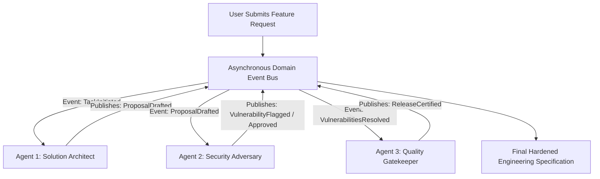

# Event-Driven Agent Choreography

> Track: Stage 5 (Sovereign AI & Multi-Agent Swarms)  
> Prerequisite Knowledge: Asynchronous event loops, Publish/Subscribe patterns, multi-agent concepts  
> Estimated Build Time: 60 minutes  
> Target Project Outcome: Building an event-choreographed multi-agent pipeline where an Architect agent drafts pull request changes and a Security Adversary agent stress-tests them via an asynchronous message bus

---

## 1. The Hook: Why You Need This in Your Arsenal

When developers try to build complex AI applications, they usually start with a **Monolithic Mega-Prompt**:
> *"You are an expert fullstack architect, database administrator, cybersecurity auditor, and copywriter. Plan the schema, write the backend, audit for vulnerabilities, and write the documentation all at once."*

This monolithic approach breaks down rapidly:
- The model suffers from **attention dilution**: it gets excited writing frontend code and completely forgets security audits.
- The context window becomes cluttered with unrelated thoughts, driving up token costs and error rates.
- If one task fails, the entire generation fails.

In **Parkly** (multi-agent parking marketplace) and **Aura Core**, we replaced monolithic prompts with **Decoupled Event-Driven Choreography**:
- Specialized, single-purpose micro-agents (e.g. Architect, Security Adversary, Quality Gatekeeper).
- No central puppet master issuing step-by-step instructions. Instead, agents publish domain events to an **asynchronous event bus**.
- Agent B reacts to events published by Agent A, stress-testing decisions and refining outputs iteratively.

---

## 2. The Mental Model: Intuitive Analogy & Visual Topology

### The Monolithic Dictator vs. The Hospital Trauma Team
- **Monolithic Prompting**: One overworked general practitioner trying to simultaneously perform open-heart surgery, set a broken bone, administer anesthesia, and handle hospital billing. Mistakes are inevitable.
- **Event-Driven Choreography**: A specialized surgical trauma team. When the patient arrives (Event: `PatientAdmitted`), the Anesthesiologist acts. When vitals are stable (Event: `SedationConfirmed`), the Surgeon operates. When the procedure concludes (Event: `IncisionClosed`), the Recovery Nurse takes over. Each specialist does one job with extreme focus.



---

## 3. Deep Dive: Under the Hood

### Orchestration vs. Choreography
1. **Orchestration (Centralized Control)**:
   A single master controller coordinates everything:
   ```typescript
   const plan = await masterAgent.plan();
   const code = await codeAgent.write(plan);
   const review = await reviewAgent.audit(code);
   ```
   *Weakness*: The orchestrator is a single point of failure and bottleneck. Adding a new review step requires modifying the core orchestrator logic.
2. **Choreography (Decoupled Event-Driven)**:
   Agents are autonomous pub/sub subscribers. They listen for specific domain events, execute their logic, and emit new events.
   *Advantage*: Highly resilient, extensible, and horizontally scalable. You can add a new "Performance Profiler" agent by simply subscribing it to the `CodeWritten` event without touching other agents.

### The Idempotency Key Invariant
In asynchronous event systems, network retries and duplicate events will occur.
Every domain event must include an **Idempotency Key**:

```typescript
export interface DomainEvent<T = any> {
  id: string;               // Unique event UUID
  correlationId: string;    // Shared workflow execution trace ID
  type: string;             // e.g. "ARCHITECTURE_DRAFTED"
  timestamp: string;
  payload: T;
}
```

If an agent receives an event with an `id` or `correlationId` it has already processed, it ignores it safely.

---

## 4. Zero-to-One Interactive Playground: Build It From Scratch

Let us build an event-driven multi-agent review pipeline in TypeScript. We will implement an in-memory event bus and coordinate an **Architect Agent** and a **Security Adversary Agent**.

### Step 1: Environment Setup
Create a playground directory:

```bash
mkdir -p ~/aura-sandbox/multi-agent-bus
cd ~/aura-sandbox/multi-agent-bus
npm init -y
npm install typescript @types/node tsx
```

### Step 2: Implementation (`agent-choreography.ts`)
Create `agent-choreography.ts`:

```typescript
import { EventEmitter } from 'events';
import { randomUUID } from 'crypto';

export interface DomainEvent<T = any> {
  id: string;
  correlationId: string;
  type: string;
  timestamp: string;
  payload: T;
}

export class AgentEventBus {
  private emitter = new EventEmitter();
  private processedEventIds = new Set<string>();

  public subscribe(eventType: string, handler: (event: DomainEvent) => Promise<void>): void {
    this.emitter.on(eventType, async (event: DomainEvent) => {
      // Idempotency Gate
      const dedupeKey = `${event.id}_${handler.name}`;
      if (this.processedEventIds.has(dedupeKey)) {
        console.log(`[EVENT BUS] Skipping duplicate event ${event.id}`);
        return;
      }
      this.processedEventIds.add(dedupeKey);

      try {
        await handler(event);
      } catch (err: any) {
        console.error(`[EVENT ERROR] Handler failed on event ${event.type}:`, err.message);
      }
    });
  }

  public publish(event: DomainEvent): void {
    console.log(`\n>>> [BUS EVENT PUBLISHED] ${event.type} (Trace: ${event.correlationId.slice(0, 8)})`);
    // Emit asynchronously to prevent blocking publisher
    setImmediate(() => {
      this.emitter.emit(event.type, event);
    });
  }
}

// ---------------------------------------------------------------------------
// Autonomous Micro-Agents
// ---------------------------------------------------------------------------

export class ArchitectAgent {
  constructor(private bus: AgentEventBus) {
    this.bus.subscribe('FEATURE_REQUESTED', this.handleFeatureRequest.bind(this));
  }

  private async handleFeatureRequest(event: DomainEvent<{ requirement: string }>): Promise<void> {
    console.log(`[ARCHITECT AGENT] Analyzing requirement: "${event.payload.requirement}"`);

    // Simulate architecture drafting
    const proposedArchitecture = {
      feature: event.payload.requirement,
      database: 'SQLite (Local-First)',
      authStrategy: 'Master Passphrase with Argon2id',
      networkPolicy: 'Air-Gapped: Zero Network Permissions in Manifest',
    };

    console.log('[ARCHITECT AGENT] Proposal drafted. Publishing to event bus...');
    this.bus.publish({
      id: randomUUID(),
      correlationId: event.correlationId,
      type: 'PROPOSAL_DRAFTED',
      timestamp: new Date().toISOString(),
      payload: proposedArchitecture,
    });
  }
}

export class SecurityAdversaryAgent {
  constructor(private bus: AgentEventBus) {
    this.bus.subscribe('PROPOSAL_DRAFTED', this.auditProposal.bind(this));
  }

  private async auditProposal(event: DomainEvent<any>): Promise<void> {
    const proposal = event.payload;
    console.log(`[ADVERSARY AGENT] Stress-testing proposal: "${proposal.feature}"`);

    const vulnerabilities: string[] = [];

    // Adversarial rule evaluation
    if (proposal.authStrategy.includes('Argon2id') && !proposal.authStrategy.includes('Memory Zeroization')) {
      vulnerabilities.push('Key lingering in volatile RAM without explicit buffer zeroization');
    }
    if (proposal.database.includes('SQLite') && !proposal.database.includes('WAL')) {
      vulnerabilities.push('SQLite not configured for Write-Ahead Logging (WAL) concurrency');
    }

    if (vulnerabilities.length > 0) {
      console.log(`[ADVERSARY AGENT] Flagged ${vulnerabilities.length} security edge cases!`);
      this.bus.publish({
        id: randomUUID(),
        correlationId: event.correlationId,
        type: 'VULNERABILITY_FLAGGED',
        timestamp: new Date().toISOString(),
        payload: { proposal, vulnerabilities },
      });
    } else {
      console.log('[ADVERSARY AGENT] Proposal certified. Zero critical flaws found.');
      this.bus.publish({
        id: randomUUID(),
        correlationId: event.correlationId,
        type: 'PROPOSAL_APPROVED',
        timestamp: new Date().toISOString(),
        payload: { proposal },
      });
    }
  }
}

// ---------------------------------------------------------------------------
// Simulation Run: Orchestrating the Swarm
// ---------------------------------------------------------------------------
const bus = new AgentEventBus();
new ArchitectAgent(bus);
new SecurityAdversaryAgent(bus);

const correlationId = randomUUID();

// Subscribe to final approval or rejection for logging
bus.subscribe('VULNERABILITY_FLAGGED', async (e) => {
  console.log('\n[FINAL REPORT] Security Review Results:');
  e.payload.vulnerabilities.forEach((v: string) => console.log(`  - CRITICAL: ${v}`));
});

console.log('--- Triggering Initial Feature Request Event ---');
bus.publish({
  id: randomUUID(),
  correlationId,
  type: 'FEATURE_REQUESTED',
  timestamp: new Date().toISOString(),
  payload: { requirement: 'Build sovereign air-gapped mobile password fortress' },
});
```

### Step 3: Run and Test Instructions
Execute the script using `tsx`:

```bash
npx tsx agent-choreography.ts
```

Expected terminal output:
```text
--- Triggering Initial Feature Request Event ---

>>> [BUS EVENT PUBLISHED] FEATURE_REQUESTED (Trace: e2b4a189)
[ARCHITECT AGENT] Analyzing requirement: "Build sovereign air-gapped mobile password fortress"
[ARCHITECT AGENT] Proposal drafted. Publishing to event bus...

>>> [BUS EVENT PUBLISHED] PROPOSAL_DRAFTED (Trace: e2b4a189)
[ADVERSARY AGENT] Stress-testing proposal: "Build sovereign air-gapped mobile password fortress"
[ADVERSARY AGENT] Flagged 2 security edge cases!

>>> [BUS EVENT PUBLISHED] VULNERABILITY_FLAGGED (Trace: e2b4a189)

[FINAL REPORT] Security Review Results:
  - CRITICAL: Key lingering in volatile RAM without explicit buffer zeroization
  - CRITICAL: SQLite not configured for Write-Ahead Logging (WAL) concurrency
```

---

## 5. Battle Scars: What Breaks in Production & How to Debug It

### Top 3 Mistakes Beginners Make
1. **Infinite Ping-Pong Event Loops**: Agent A reacts to `REVISION_NEEDED` by publishing `REVISED_DRAFT`, which triggers Agent B to request another revision indefinitely.  
   **Remediation**: Set a strict maximum hop limit (e.g. `maxIterations: 3`) on the correlation context. If the limit is reached, trigger an escalation event.
2. **Missing Correlation IDs Across Distributed Traces**: Emitting events without passing the originating `correlationId`. When debugging a failure among 5 agents, it becomes impossible to reconstruct which user prompt triggered which subagent actions.  
   **Remediation**: Always propagate a `correlationId` UUID through every subsequent event payload.
3. **Overloading the Event Payload with Huge File Blobs**: Putting a 50MB PDF or video buffer directly into the event payload. This exhausts message broker memory.  
   **Remediation**: Store the large asset in local storage or temporary disk, and pass a lightweight pointer URI (`file:///tmp/payload.bin`) in the event.

---

## 6. The Weekend Hackathon Challenge: Your Turn to Build

### Challenge: The Autonomous Pull Request Review Swarm
Build a multi-agent GitHub PR reviewer.

- **Level 1 (Core)**: Create an event bus with two agents: a `SyntaxAuditor` (checks types and formatting) and a `LogicAuditor` (checks edge cases).
- **Level 2 (Advanced)**: Add a third agent, the `GatekeeperAgent`, which listens for results from both auditors and only publishes a `PR_MERGEABLE` event if both auditors give a passing score.
- **Level 3 (Hardcore)**: Connect your multi-agent system to the GitHub CLI (`gh`), having it automatically read a local git diff and post a structured review comment on an open GitHub pull request.

---

## 7. Knowledge Check & Next Steps

1. **Scenario**: Why is event-driven choreography more resilient than centralized orchestration in multi-agent systems?  
   *Answer*: Choreography eliminates central bottleneck controllers. Specialized agents react independently to domain events, making the system modular, extensible, and resistant to cascading failures.
2. **Scenario**: What is the purpose of an Idempotency Key in event bus architectures?  
   *Answer*: It prevents duplicate event executions caused by network retries or multiple subscribers, ensuring that an operation runs exactly once per trace.
3. **Scenario**: Why should large binary files never be included directly in event payloads?  
   *Answer*: Large payloads saturate message broker throughput and memory. Best practice is to pass a lightweight URI reference to the stored asset.

Stage 5 Complete! Move to: [Stage 6: Distributed Commerce, Ledgers & Physical 3D Shaders](../06-distributed-commerce-and-creative-engineering/README.md)
