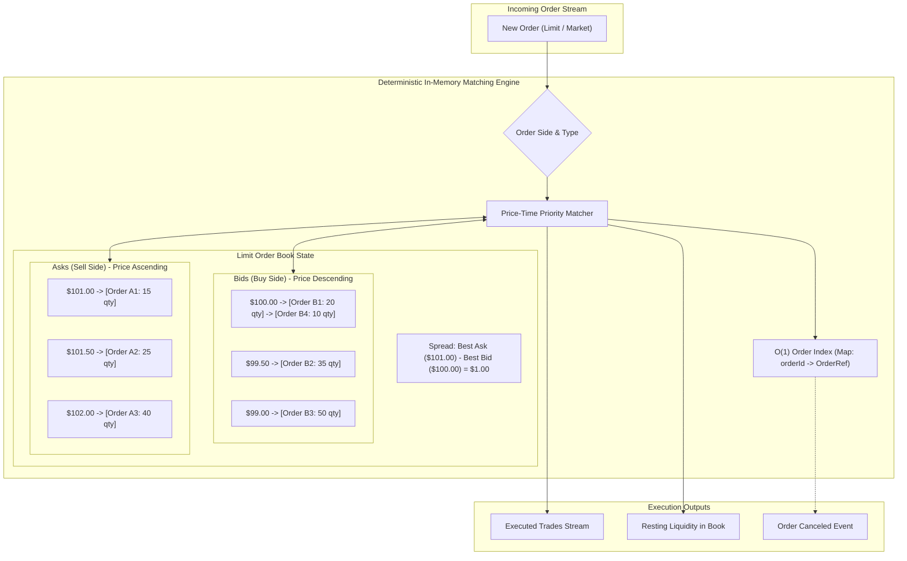

# Concurrency Control & Marketplaces: The Limit Order Book Matching Engine

> Track: Stage 6 (Distributed Commerce, Ledgers & Physical 3D Shaders)  
> Prerequisite Knowledge: Data structures (queues, maps), asynchronous execution, financial exchange concepts  
> Estimated Build Time: 60 minutes  
> Target Project Outcome: Building an in-memory Limit Order Book (LOB) matching engine in TypeScript with price-time priority, level-2 depth visualization, market/limit orders, partial fills, and cancellations

---

## 1. The Hook: Why You Need This in Your Arsenal

When software engineers transition from simple e-commerce apps to distributed financial marketplaces, standard database design fails completely.

In a traditional retail checkout (such as ticket booking or parking reservations in *Parkly*), an e-commerce platform sells items from single inventories where Optimistic Concurrency Control (OCC) with integer version counters prevents double bookings.
However, in modern financial exchanges, cryptocurrency brokerages, and algorithmic prediction markets, thousands of anonymous buyers and sellers trade continuously against each other in a continuous double auction.

Imagine executing trades in a relational database:
```sql
-- The Relational Database Anti-Pattern in Financial Exchanges
SELECT * FROM orders 
WHERE side = 'SELL' AND price <= 101.50 
ORDER BY price ASC, created_at ASC 
FOR UPDATE;
```

Under 50,000 orders per second:
1. **Lock Contention Collapse**: Row-level and table-level locks stall incoming transactions, creating cascading queue latency and connection pool starvation.
2. **Race Condition Slippage**: By the time an order matches on disk, market prices have moved, leading to negative slippage or failed executions.
3. **Throughput Bottlenecks**: Relational write-ahead logs (WAL) on NVMe drives top out at thousands of disk writes per second, whereas modern financial engines must match orders in sub-microsecond in-memory cycles.

To operate at global financial scale, exchanges decouple matching from persistent storage. The engine runs entirely in memory as a deterministic **Limit Order Book (LOB)**. Every bid and ask is organized into price-time priority queues, matching millions of shares per second before asynchronously streaming immutable trade execution logs to durable ledgers.

---

## 2. The Mental Model: Intuitive Analogy & Visual Topology

### The Dual Cafeteria Queue
Think of a busy farmers' market where buyers and sellers meet at two opposing counters:
- **The Bid Side (Buyers)**: Buyers queue on the left side of the room. The buyer willing to pay the highest price stands at the front of the line (**Best Bid**). If two buyers offer the exact same price, whoever arrived first gets priority (**Time Priority**).
- **The Ask Side (Sellers)**: Sellers queue on the right side of the room. The seller willing to accept the lowest price stands at the front of the line (**Best Ask**).
- **The Bid-Ask Spread**: The gap between the best bid and the best ask. If buyers are offering \$100 and sellers are demanding \$101, no trades happen; the market sits at a \$1 spread.
- **The Taker Match**: An aggressive buyer enters the room and announces: *"I will buy 30 units right now at up to \$101.50!"* The matching engine immediately matches this buyer against the cheapest sellers at the front of the ask line. The trade executes immediately at the seller's resting price, and any remaining seller quantity continues waiting for the next order.



---

## 3. Deep Dive: Under the Hood

### Data Structures for Price-Time Priority
A high-throughput matching engine must satisfy three performance invariants:
1. **Best Price Access**: Finding the highest bid or lowest ask must take $\mathcal{O}(1)$ time.
2. **Time-Priority Insertion**: Inserting an order into an existing price level must take $\mathcal{O}(1)$ time.
3. **Order Cancellation**: Canceling an unfilled order by ID must take $\mathcal{O}(1)$ time without traversing the entire book.

To achieve this, production engines combine two data structures:
- **Price Levels Map**: A balanced tree or sorted map where keys are price ticks.
  - Bids are ordered descending: $P_{\text{bid}, 1} > P_{\text{bid}, 2} > P_{\text{bid}, 3}$.
  - Asks are ordered ascending: $P_{\text{ask}, 1} < P_{\text{ask}, 2} < P_{\text{ask}, 3}$.
- **FIFO Queue per Price Level**: A doubly linked list or array of orders at that exact price. When an order arrives, it is appended to the tail. Matches are consumed from the head.
- **Global Order Index**: A hash map mapping `orderId` to `{ order, price, side }`. When a cancellation request arrives, the engine accesses the order directly, unlinks it from the price queue, and cleans up the empty price level.

### Execution Semantics: Limit vs. Market Orders
- **Limit Order**: Specifies both price and quantity.
  - If the limit price crosses the opposite side of the book (Buy price $\ge$ Best Ask or Sell price $\le$ Best Bid), it executes aggressively as a **Taker** against resting liquidity.
  - The trade executes at the maker's resting price, giving the aggressive taker price improvement.
  - If any unfilled quantity remains after matching all qualifying opposite levels, the unfilled portion rests in the book as **Maker** liquidity.
- **Market Order**: Specifies only quantity.
  - Matches immediately against the opposing book at whatever prices are currently available.
  - Continues walking through deeper price levels until fully filled or until all available book liquidity is exhausted.
  - Never rests in the order book. Any unfilled quantity is marked completed or rejected.

### Trade-Off Matrix: Marketplace Matching Architectures

| Architecture | Throughput | Latency | Determinism | Best Use Case |
| :--- | :--- | :--- | :--- | :--- |
| **Relational SQL (`FOR UPDATE`)** | 500 - 2,000 ops/sec | 5 - 20 ms | High | Low-frequency single-inventory bookings (e.g. Parkly parking slots) |
| **In-Memory Limit Order Book (LOB)** | 500,000 - 5,000,000 ops/sec | 50 - 500 ns | Absolute | High-frequency continuous double auctions (equities, crypto) |
| **Automated Market Maker (AMM / Uniswap)** | 10 - 500 ops/sec | Block-time (seconds) | Deterministic pool curve | Decentralized ledgers with atomic pool state |

---

## 4. Zero-to-One Interactive Playground: Build It From Scratch

Let us build a complete, authentic Limit Order Book matching engine in TypeScript. It supports price-time priority matching, limit orders, market orders, partial fills, cancellations, and real-time Level-2 depth visualization.

### Step 1: Environment Setup
Create a playground directory:

```bash
mkdir -p ~/aura-sandbox/lob-engine
cd ~/aura-sandbox/lob-engine
npm init -y
npm install typescript @types/node tsx
```

### Step 2: Implementation (`lob-engine.ts`)
Create `lob-engine.ts`:

```typescript
export type OrderSide = 'BUY' | 'SELL';
export type OrderType = 'LIMIT' | 'MARKET';
export type OrderStatus = 'NEW' | 'PARTIALLY_FILLED' | 'FILLED' | 'CANCELED' | 'REJECTED';

export interface Order {
  id: string;
  side: OrderSide;
  type: OrderType;
  price: number; // Integer price in cents (e.g., 10050 = $100.50). For MARKET orders, 0.
  quantity: number;
  remainingQuantity: number;
  timestamp: number;
  status: OrderStatus;
}

export interface Trade {
  tradeId: string;
  takerOrderId: string;
  makerOrderId: string;
  side: OrderSide; // Side of the incoming aggressive order
  price: number;
  quantity: number;
  timestamp: number;
}

export interface PriceLevelDepth {
  price: number;
  totalQuantity: number;
  orderCount: number;
}

export interface OrderBookDepth {
  bids: PriceLevelDepth[];
  asks: PriceLevelDepth[];
  spread: number | null;
}

export class LimitOrderBook {
  // Bids sorted descending by price (highest buy price first)
  // Asks sorted ascending by price (lowest sell price first)
  private bids: Map<number, Order[]> = new Map();
  private asks: Map<number, Order[]> = new Map();

  // Fast order lookup for O(1) status and cancellation
  private orderIndex: Map<string, { order: Order; price: number; side: OrderSide }> = new Map();

  private tradeHistory: Trade[] = [];
  private tradeCounter = 0;

  /**
   * Submits a new Limit or Market order to the matching engine.
   */
  public submitOrder(params: {
    id: string;
    side: OrderSide;
    type: OrderType;
    price?: number;
    quantity: number;
  }): { order: Order; trades: Trade[] } {
    if (this.orderIndex.has(params.id)) {
      throw new Error(`Duplicate order ID: ${params.id}`);
    }
    if (!Number.isInteger(params.quantity) || params.quantity <= 0) {
      throw new Error(`Quantity must be a positive integer. Got: ${params.quantity}`);
    }

    const price = params.price ?? 0;
    if (params.type === 'LIMIT' && (!Number.isInteger(price) || price <= 0)) {
      throw new Error(`Limit order requires a positive integer price. Got: ${price}`);
    }

    const order: Order = {
      id: params.id,
      side: params.side,
      type: params.type,
      price: params.type === 'LIMIT' ? price : 0,
      quantity: params.quantity,
      remainingQuantity: params.quantity,
      timestamp: Date.now(),
      status: 'NEW',
    };

    const trades: Trade[] = [];

    // Execute matching against opposing book
    if (order.side === 'BUY') {
      this.matchBuyOrder(order, trades);
    } else {
      this.matchSellOrder(order, trades);
    }

    // Determine post-match status
    if (order.remainingQuantity === 0) {
      order.status = 'FILLED';
    } else if (order.remainingQuantity < order.quantity) {
      order.status = 'PARTIALLY_FILLED';
    }

    // Resting Liquidity: If limit order has unfilled quantity, append to book
    if (order.type === 'LIMIT' && order.remainingQuantity > 0) {
      this.addRestingOrder(order);
    } else if (order.type === 'MARKET' && order.remainingQuantity > 0) {
      // Market orders never rest. Unfilled quantity is rejected if liquidity is exhausted.
      if (trades.length === 0) {
        order.status = 'REJECTED';
      }
    }

    if (order.status !== 'FILLED' && order.type === 'LIMIT') {
      this.orderIndex.set(order.id, { order, price: order.price, side: order.side });
    }

    return { order, trades };
  }

  /**
   * Matches an incoming BUY order against resting ASKS.
   */
  private matchBuyOrder(takerOrder: Order, trades: Trade[]): void {
    const askPrices = Array.from(this.asks.keys()).sort((a, b) => a - b);

    for (const askPrice of askPrices) {
      if (takerOrder.remainingQuantity === 0) break;

      // Price limit check for LIMIT BUY orders: cannot pay more than takerOrder.price
      if (takerOrder.type === 'LIMIT' && askPrice > takerOrder.price) {
        break; // Best ask is higher than taker's maximum price limit
      }

      const levelQueue = this.asks.get(askPrice)!;
      let i = 0;

      while (i < levelQueue.length && takerOrder.remainingQuantity > 0) {
        const makerOrder = levelQueue[i];
        const matchQty = Math.min(takerOrder.remainingQuantity, makerOrder.remainingQuantity);

        takerOrder.remainingQuantity -= matchQty;
        makerOrder.remainingQuantity -= matchQty;

        const trade: Trade = {
          tradeId: `trd-${++this.tradeCounter}`,
          takerOrderId: takerOrder.id,
          makerOrderId: makerOrder.id,
          side: 'BUY',
          price: makerOrder.price, // Execution price is maker's resting price
          quantity: matchQty,
          timestamp: Date.now(),
        };

        trades.push(trade);
        this.tradeHistory.push(trade);

        if (makerOrder.remainingQuantity === 0) {
          makerOrder.status = 'FILLED';
          this.orderIndex.delete(makerOrder.id);
          i++; // Pop filled maker from queue
        } else {
          makerOrder.status = 'PARTIALLY_FILLED';
          break; // Queue head partially filled, taker fully filled
        }
      }

      if (i > 0) {
        levelQueue.splice(0, i);
      }

      if (levelQueue.length === 0) {
        this.asks.delete(askPrice);
      }
    }
  }

  /**
   * Matches an incoming SELL order against resting BIDS.
   */
  private matchSellOrder(takerOrder: Order, trades: Trade[]): void {
    const bidPrices = Array.from(this.bids.keys()).sort((a, b) => b - a);

    for (const bidPrice of bidPrices) {
      if (takerOrder.remainingQuantity === 0) break;

      // Price limit check for LIMIT SELL orders: cannot sell lower than takerOrder.price
      if (takerOrder.type === 'LIMIT' && bidPrice < takerOrder.price) {
        break; // Best bid is lower than taker's minimum acceptable price
      }

      const levelQueue = this.bids.get(bidPrice)!;
      let i = 0;

      while (i < levelQueue.length && takerOrder.remainingQuantity > 0) {
        const makerOrder = levelQueue[i];
        const matchQty = Math.min(takerOrder.remainingQuantity, makerOrder.remainingQuantity);

        takerOrder.remainingQuantity -= matchQty;
        makerOrder.remainingQuantity -= matchQty;

        const trade: Trade = {
          tradeId: `trd-${++this.tradeCounter}`,
          takerOrderId: takerOrder.id,
          makerOrderId: makerOrder.id,
          side: 'SELL',
          price: makerOrder.price, // Execution price is maker's resting price
          quantity: matchQty,
          timestamp: Date.now(),
        };

        trades.push(trade);
        this.tradeHistory.push(trade);

        if (makerOrder.remainingQuantity === 0) {
          makerOrder.status = 'FILLED';
          this.orderIndex.delete(makerOrder.id);
          i++;
        } else {
          makerOrder.status = 'PARTIALLY_FILLED';
          break;
        }
      }

      if (i > 0) {
        levelQueue.splice(0, i);
      }

      if (levelQueue.length === 0) {
        this.bids.delete(bidPrice);
      }
    }
  }

  /**
   * Adds an unfilled limit order to the resting book.
   */
  private addRestingOrder(order: Order): void {
    const book = order.side === 'BUY' ? this.bids : this.asks;
    if (!book.has(order.price)) {
      book.set(order.price, []);
    }
    book.get(order.price)!.push(order);
  }

  /**
   * Cancels a resting limit order by ID.
   */
  public cancelOrder(orderId: string): Order {
    const indexed = this.orderIndex.get(orderId);
    if (!indexed) {
      throw new Error(`Order not found or already filled: ${orderId}`);
    }

    const { order, price, side } = indexed;
    const book = side === 'BUY' ? this.bids : this.asks;
    const levelQueue = book.get(price);

    if (levelQueue) {
      const idx = levelQueue.findIndex((o) => o.id === orderId);
      if (idx !== -1) {
        levelQueue.splice(idx, 1);
      }
      if (levelQueue.length === 0) {
        book.delete(price);
      }
    }

    order.status = 'CANCELED';
    this.orderIndex.delete(orderId);
    return order;
  }

  /**
   * Generates Level 2 (L2) Depth Snapshot.
   */
  public getDepth(maxLevels = 5): OrderBookDepth {
    const sortedBidPrices = Array.from(this.bids.keys()).sort((a, b) => b - a).slice(0, maxLevels);
    const sortedAskPrices = Array.from(this.asks.keys()).sort((a, b) => a - b).slice(0, maxLevels);

    const bids: PriceLevelDepth[] = sortedBidPrices.map((price) => {
      const queue = this.bids.get(price)!;
      const totalQuantity = queue.reduce((sum, o) => sum + o.remainingQuantity, 0);
      return { price, totalQuantity, orderCount: queue.length };
    });

    const asks: PriceLevelDepth[] = sortedAskPrices.map((price) => {
      const queue = this.asks.get(price)!;
      const totalQuantity = queue.reduce((sum, o) => sum + o.remainingQuantity, 0);
      return { price, totalQuantity, orderCount: queue.length };
    });

    const bestBid = bids.length > 0 ? bids[0].price : null;
    const bestAsk = asks.length > 0 ? asks[0].price : null;
    const spread = bestBid !== null && bestAsk !== null ? bestAsk - bestBid : null;

    return { bids, asks, spread };
  }

  /**
   * Visualizes order book depth in a clean ASCII ladder.
   */
  public formatDepthVisualizer(): string {
    const depth = this.getDepth(5);
    const lines: string[] = [];

    lines.push('===========================================================');
    lines.push('               LIMIT ORDER BOOK (L2 DEPTH)                 ');
    lines.push('===========================================================');
    lines.push('       BIDS (BUY)                    ASKS (SELL)           ');
    lines.push(' Orders   Qty     Price     |     Price     Qty    Orders  ');
    lines.push('----------------------------+------------------------------');

    const maxRows = Math.max(depth.bids.length, depth.asks.length);
    for (let i = 0; i < maxRows; i++) {
      const bid = depth.bids[i];
      const ask = depth.asks[i];

      const bidStr = bid
        ? `${String(bid.orderCount).padStart(5)}  ${String(bid.totalQuantity).padStart(5)}  $${(bid.price / 100).toFixed(2).padStart(7)}`
        : '                            ';

      const askStr = ask
        ? `$${(ask.price / 100).toFixed(2).padStart(7)}  ${String(ask.totalQuantity).padStart(5)}  ${String(ask.orderCount).padStart(5)}`
        : '                            ';

      lines.push(`${bidStr}     |     ${askStr}`);
    }

    lines.push('----------------------------+------------------------------');
    const spreadStr = depth.spread !== null ? `$${(depth.spread / 100).toFixed(2)} (${depth.spread} ticks)` : 'N/A';
    lines.push(` Best Bid: ${depth.bids[0] ? '$' + (depth.bids[0].price / 100).toFixed(2) : 'None'} | Best Ask: ${depth.asks[0] ? '$' + (depth.asks[0].price / 100).toFixed(2) : 'None'} | Spread: ${spreadStr}`);
    lines.push('===========================================================');

    return lines.join('\n');
  }

  public getTradeHistory(): Trade[] {
    return [...this.tradeHistory];
  }
}

// ---------------------------------------------------------------------------
// Simulation Run: Live Order Matching Sequence
// ---------------------------------------------------------------------------
async function runOrderBookSimulation() {
  const lob = new LimitOrderBook();

  console.log('--- Step 1: Seeding Initial Order Book Liquidity ---');
  lob.submitOrder({ id: 'b-1', side: 'BUY', type: 'LIMIT', price: 10000, quantity: 20 });
  lob.submitOrder({ id: 'b-2', side: 'BUY', type: 'LIMIT', price: 9950, quantity: 35 });
  lob.submitOrder({ id: 'b-3', side: 'BUY', type: 'LIMIT', price: 9900, quantity: 50 });

  lob.submitOrder({ id: 'a-1', side: 'SELL', type: 'LIMIT', price: 10100, quantity: 15 });
  lob.submitOrder({ id: 'a-2', side: 'SELL', type: 'LIMIT', price: 10150, quantity: 25 });
  lob.submitOrder({ id: 'a-3', side: 'SELL', type: 'LIMIT', price: 10200, quantity: 40 });

  console.log(lob.formatDepthVisualizer());

  console.log('\n--- Step 2: Aggressive Limit Buy crosses spread ($101.50 for 30 units) ---');
  const matchRes = lob.submitOrder({ id: 'taker-buy', side: 'BUY', type: 'LIMIT', price: 10150, quantity: 30 });
  console.log('Trades Generated:');
  for (const t of matchRes.trades) {
    console.log(`  Trade ${t.tradeId}: ${t.quantity} units @ $${(t.price / 100).toFixed(2)} (Maker: ${t.makerOrderId})`);
  }
  console.log('Taker Order Status:', matchRes.order.status, `(Remaining: ${matchRes.order.remainingQuantity})`);

  console.log('\n' + lob.formatDepthVisualizer());

  console.log('\n--- Step 3: Canceling Resting Buy Order (b-2) ---');
  const canceled = lob.cancelOrder('b-2');
  console.log(`Canceled Order: ${canceled.id}, Status: ${canceled.status}`);

  console.log('\n' + lob.formatDepthVisualizer());

  console.log('\n--- Step 4: Market Sell order sweeps top bids (30 units) ---');
  const marketRes = lob.submitOrder({ id: 'mkt-sell', side: 'SELL', type: 'MARKET', quantity: 30 });
  console.log('Market Trades Generated:');
  for (const t of marketRes.trades) {
    console.log(`  Trade ${t.tradeId}: ${t.quantity} units @ $${(t.price / 100).toFixed(2)} (Maker: ${t.makerOrderId})`);
  }
  console.log('\n' + lob.formatDepthVisualizer());
}

runOrderBookSimulation();
```

### Step 3: Run and Test Instructions
Execute the script using `tsx`:

```bash
npx tsx lob-engine.ts
```

Expected terminal output:
```text
--- Step 1: Seeding Initial Order Book Liquidity ---
===========================================================
               LIMIT ORDER BOOK (L2 DEPTH)                 
===========================================================
       BIDS (BUY)                    ASKS (SELL)           
 Orders   Qty     Price     |     Price     Qty    Orders  
----------------------------+------------------------------
    1     20  $ 100.00     |     $ 101.00     15      1
    1     35  $  99.50     |     $ 101.50     25      1
    1     50  $  99.00     |     $ 102.00     40      1
----------------------------+------------------------------
 Best Bid: $100.00 | Best Ask: $101.00 | Spread: $1.00 (100 ticks)
===========================================================

--- Step 2: Aggressive Limit Buy crosses spread ($101.50 for 30 units) ---
Trades Generated:
  Trade trd-1: 15 units @ $101.00 (Maker: a-1)
  Trade trd-2: 15 units @ $101.50 (Maker: a-2)
Taker Order Status: FILLED (Remaining: 0)

===========================================================
               LIMIT ORDER BOOK (L2 DEPTH)                 
===========================================================
       BIDS (BUY)                    ASKS (SELL)           
 Orders   Qty     Price     |     Price     Qty    Orders  
----------------------------+------------------------------
    1     20  $ 100.00     |     $ 101.50     10      1
    1     35  $  99.50     |     $ 102.00     40      1
    1     50  $  99.00     |                                 
----------------------------+------------------------------
 Best Bid: $100.00 | Best Ask: $101.50 | Spread: $1.50 (150 ticks)
===========================================================

--- Step 3: Canceling Resting Buy Order (b-2) ---
Canceled Order: b-2, Status: CANCELED

===========================================================
               LIMIT ORDER BOOK (L2 DEPTH)                 
===========================================================
       BIDS (BUY)                    ASKS (SELL)           
 Orders   Qty     Price     |     Price     Qty    Orders  
----------------------------+------------------------------
    1     20  $ 100.00     |     $ 101.50     10      1
    1     50  $  99.00     |     $ 102.00     40      1
----------------------------+------------------------------
 Best Bid: $100.00 | Best Ask: $101.50 | Spread: $1.50 (150 ticks)
===========================================================

--- Step 4: Market Sell order sweeps top bids (30 units) ---
Market Trades Generated:
  Trade trd-3: 20 units @ $100.00 (Maker: b-1)
  Trade trd-4: 10 units @ $99.00 (Maker: b-3)

===========================================================
               LIMIT ORDER BOOK (L2 DEPTH)                 
===========================================================
       BIDS (BUY)                    ASKS (SELL)           
 Orders   Qty     Price     |     Price     Qty    Orders  
----------------------------+------------------------------
    1     40  $  99.00     |     $ 101.50     10      1
                                 |     $ 102.00     40      1
----------------------------+------------------------------
 Best Bid: $99.00 | Best Ask: $101.50 | Spread: $2.50 (250 ticks)
===========================================================
```

---

## 5. Battle Scars: What Breaks in Production & How to Debug It

### Top 3 Mistakes in High-Throughput Matching Engines
1. **Garbage Collection (GC) Stutter in Inner Matching Loops**: Allocating short-lived trade and order objects in high-frequency trading loops causes the V8 engine to trigger major stop-the-world GC pauses (20-100 ms). During a GC pause, market orders back up in network buffers, creating massive execution slippage.  
   **Remediation**: Use object pooling (pre-allocating `Trade` and `Order` instances in typed arrays) or implement the matching engine core in Rust or C++ compiled to WebAssembly (WASM).
2. **Self-Trade Execution Loops**: An automated market-maker bot submits simultaneous buy and sell quotes. If the bot's own buy matches its own sell, the trading firm wastes exchange fees and may face regulatory penalties for wash trading.  
   **Remediation**: Implement Self-Trade Prevention (STP) flags (`CANCEL_MAKER`, `CANCEL_TAKER`, or `DECREMENT_AND_CANCEL`) that automatically reject trades where the buyer and seller share the same account identifier.
3. **Floating-Point Price Precision Creep**: Storing price ticks as IEEE-754 floats (`100.1 + 0.2 === 100.30000000000001`). When sorting price queues, minor precision artifacts place orders at corrupted price levels (e.g., \$100.30000000000001 vs \$100.30000000000002).  
   **Remediation**: Always represent prices as integer ticks (e.g. price in cents, satoshis, or basis points with fixed decimal scaling).

---

## 6. The Weekend Hackathon Challenge: Your Turn to Build

### Challenge: The Advanced Order Type Engine
Expand the matching engine to support professional institutional order types:

- **Level 1 (Core)**: Implement **Iceberg Orders**: allow a trader to submit a 1,000-share order with a visible display quantity of 100 shares. When the visible 100 shares are filled, automatically replenish the next 100 shares from hidden reserve to the back of that price level's queue.
- **Level 2 (Advanced)**: Implement **Stop-Loss and Stop-Limit Orders**: allow traders to set trigger prices. When a trade occurs at or through the trigger price, automatically convert the stop order into an active market or limit order in the main book.
- **Level 3 (Hardcore)**: Implement **Deterministic Event-Sourced Persistence**: stream every incoming command (`SUBMIT_ORDER`, `CANCEL_ORDER`) to an append-only write-ahead log. Implement crash recovery that replays 100,000 log events in under 200 ms and verifies that the resulting in-memory order book state matches the pre-crash snapshot.

---

## 7. Knowledge Check & Next Steps

1. **Scenario**: Why does a limit order book prioritize price before time in its matching queue?  
   *Answer*: Prioritizing the best price ensures market efficiency by guaranteeing that buyers offering the most money and sellers asking for the least execute first. Time priority then provides fairness among traders competing at the identical price level.
2. **Scenario**: Why does an aggressive market order receive the maker's resting price rather than setting a new price?  
   *Answer*: The maker has already publicly committed to trade at their resting limit price. When an aggressive taker crosses the spread to execute against that existing liquidity, the trade settles at the maker's posted quote.
3. **Scenario**: How does Optimistic Concurrency Control (OCC) in inventory reservations differ from an in-memory Limit Order Book?  
   *Answer*: OCC operates against relational disk records to prevent double-booking of fixed inventory items (like parking slots in Parkly). A Limit Order Book operates entirely in memory, continuously matching two-sided streams of dynamic bids and asks with zero disk locking.

Next Lesson: [Double-Entry Accounting Invariants](./02-double-entry-accounting-invariants.md)  
Case Study Reference: [Parkly Smart Parking Marketplace Case Study](../../project-case-studies/distributed-commerce-and-marketplaces/parkly-smart-parking-marketplace.md)
