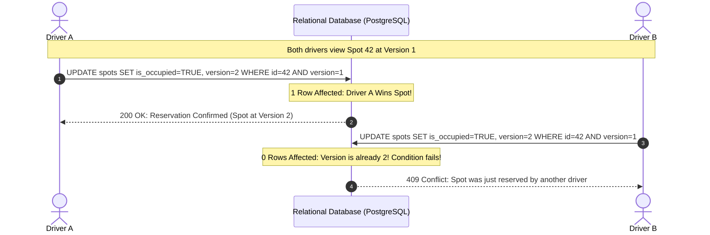

# Concurrency Control & Marketplaces

> Track: Stage 6 (Distributed Commerce, Ledgers & Physical 3D Shaders)  
> Prerequisite Knowledge: Relational databases, SQL transactions, distributed concurrency concepts  
> Estimated Build Time: 60 minutes  
> Target Project Outcome: Building a concurrent reservation engine with Optimistic Concurrency Control (OCC) that eliminates double-booking race conditions during high-demand reservation spikes

---

## 1. The Hook: Why You Need This in Your Arsenal

Imagine deploying a smart parking marketplace app (like *Parkly*) or a concert ticket booking platform.
A major event concludes, and 500 users open your app looking for parking.

Two drivers, Driver A and Driver B, spot the exact same prime parking spot: Bay #42.
- At `10:00:00.100`, Driver A taps "Reserve Spot".
- At `10:00:00.105`, Driver B taps "Reserve Spot".

In a naive database architecture, your server executes:
```sql
-- The Naive Read-Modify-Write Anti-Pattern
SELECT is_available FROM spots WHERE id = 42; -- Returns true for BOTH drivers
UPDATE spots SET is_available = false WHERE id = 42; -- Executes for BOTH drivers
```

Both drivers receive green confirmation screens. Both of their credit cards are charged \$30.
Thirty minutes later, two furious drivers are standing in a suburban driveway, honking at each other and demanding chargebacks.

In physical resource allocation and distributed commerce, reads and writes can never happen without strict concurrency invariants.
In **Parkly**, we solved this using **Optimistic Concurrency Control (OCC)**: allowing thousands of drivers to browse inventory concurrently with zero table locks, while ensuring that conflicting writes fail cleanly and safely.

---

## 2. The Mental Model: Intuitive Analogy & Visual Topology

### The Library Stamp Analogy
Think of a rare antique book in a library:
- **Naive approach**: Anyone can write their name on an index card claiming the book. If two people write their names at the same second, both believe they own it.
- **Pessimistic Locking**: The librarian locks the entire bookshelf behind a padlock whenever anyone touches any book. Everyone else must wait in a long, slow line.
- **Optimistic Concurrency Control (OCC)**: The book has a stamped version number (e.g. `Version 4`). When you want to borrow it, you tell the librarian: *"I am checking out Book 42, assuming it is currently Version 4. If it is still Version 4, stamp it to Version 5 and give it to me. If someone else changed it to Version 5 while I was walking to the desk, reject my request instantly."*



---

## 3. Deep Dive: Under the Hood

### The Atomic OCC SQL Invariant
Under Optimistic Concurrency Control, the database update is atomic in a single query:

```sql
UPDATE parking_spots
SET 
  is_occupied = TRUE,
  current_driver_id = 'driver_alice',
  version = version + 1
WHERE 
  id = 'spot_42' 
  AND is_occupied = FALSE 
  AND version = 1;
```

If Driver A and Driver B both submit requests based on Version 1:
1. Driver A's update executes first. The row version increments to `2`. Exactly `1` row is affected.
2. Driver B's update executes next. Because `version` is now `2`, the `WHERE version = 1` condition fails. Exactly `0` rows are affected.
3. The application checks the affected rows count (`result.count === 0`) and rejects Driver B's request before charging their payment method.

### Trade-Off Matrix: Concurrency Strategies

| Strategy | Read Throughput | Write Contention Behavior | Deadlock Risk | Best Use Case |
| :--- | :--- | :--- | :--- | :--- |
| **Pessimistic Locking** (`SELECT FOR UPDATE`) | Low (Reads blocked) | Waits on locks | High | High-contention banking balance updates |
| **Optimistic Concurrency (OCC)** | Very High (Unblocked) | Fast conflict rejection | Zero | Marketplace reservations, shopping carts |
| **Distributed Redis Mutex (Redlock)** | High | Requires TTL tuning | Network-dependent | Cross-microservice distributed workflows |

---

## 4. Zero-to-One Interactive Playground: Build It From Scratch

Let us write a simulation of an Optimistic Concurrency reservation engine in TypeScript. We will simulate two concurrent drivers competing for the same spot within a 5-millisecond window.

### Step 1: Environment Setup
Create a playground directory:

```bash
mkdir -p ~/aura-sandbox/occ-engine
cd ~/aura-sandbox/occ-engine
npm init -y
npm install typescript @types/node tsx
```

### Step 2: Implementation (`occ-reservation.ts`)
Create `occ-reservation.ts`:

```typescript
export interface ParkingSpot {
  id: string;
  name: string;
  isAvailable: boolean;
  version: number; // Monotonically increasing version counter
  reservedBy: string | null;
}

export interface BookingResponse {
  success: boolean;
  driverId: string;
  spotId: string;
  versionAtBooking?: number;
  error?: string;
}

export class OccMarketplaceEngine {
  private spots: Map<string, ParkingSpot> = new Map();

  constructor() {
    this.spots.set('bay-42', {
      id: 'bay-42',
      name: 'Downtown Bay 42',
      isAvailable: true,
      version: 1,
      reservedBy: null,
    });
  }

  public getSpotSnapshot(id: string): ParkingSpot | undefined {
    const spot = this.spots.get(id);
    return spot ? { ...spot } : undefined;
  }

  /**
   * Atomic reservation using Optimistic Concurrency Control.
   */
  public reserveSpot(spotId: string, driverId: string, expectedVersion: number): BookingResponse {
    const spot = this.spots.get(spotId);

    if (!spot) {
      return { success: false, driverId, spotId, error: 'SpotNotFound' };
    }

    if (!spot.isAvailable) {
      return { success: false, driverId, spotId, error: 'SpotAlreadyOccupied' };
    }

    // Atomic Version Invariant Check
    if (spot.version !== expectedVersion) {
      return {
        success: false,
        driverId,
        spotId,
        error: `OCC_CONFLICT: Expected version ${expectedVersion}, but current version is ${spot.version}`,
      };
    }

    // State Mutation
    spot.isAvailable = false;
    spot.reservedBy = driverId;
    spot.version += 1;

    return {
      success: true,
      driverId,
      spotId,
      versionAtBooking: spot.version,
    };
  }
}

// ---------------------------------------------------------------------------
// Simulation: Two Drivers competing concurrently for Bay 42
// ---------------------------------------------------------------------------
async function runConcurrencySimulation() {
  const engine = new OccMarketplaceEngine();
  console.log('Initial Spot State:', engine.getSpotSnapshot('bay-42'));

  // Both drivers read the spot simultaneously at Version 1
  const driverASnapshot = engine.getSpotSnapshot('bay-42')!;
  const driverBSnapshot = engine.getSpotSnapshot('bay-42')!;

  console.log(`\nDriver A sees spot at Version ${driverASnapshot.version}`);
  console.log(`Driver B sees spot at Version ${driverBSnapshot.version}`);

  console.log('\n--- Both drivers submit reservation requests simultaneously ---');

  const reqA = new Promise<BookingResponse>((resolve) => {
    setTimeout(() => {
      resolve(engine.reserveSpot('bay-42', 'driver-alpha', driverASnapshot.version));
    }, 10);
  });

  const reqB = new Promise<BookingResponse>((resolve) => {
    setTimeout(() => {
      resolve(engine.reserveSpot('bay-42', 'driver-bravo', driverBSnapshot.version));
    }, 12);
  });

  const [resA, resB] = await Promise.all([reqA, reqB]);

  console.log('Driver A Result:', resA);
  console.log('Driver B Result:', resB);

  console.log('\nFinal Spot State:', engine.getSpotSnapshot('bay-42'));
  console.log('Result: Exactly ONE driver booked the spot. Zero double-booking!');
}

runConcurrencySimulation();
```

### Step 3: Run and Test Instructions
Execute the script using `tsx`:

```bash
npx tsx occ-reservation.ts
```

Expected terminal output:
```text
Initial Spot State: {
  id: 'bay-42',
  name: 'Downtown Bay 42',
  isAvailable: true,
  version: 1,
  reservedBy: null
}

Driver A sees spot at Version 1
Driver B sees spot at Version 1

--- Both drivers submit reservation requests simultaneously ---
Driver A Result: {
  success: true,
  driverId: 'driver-alpha',
  spotId: 'bay-42',
  versionAtBooking: 2
}
Driver B Result: {
  success: false,
  driverId: 'driver-bravo',
  spotId: 'bay-42',
  error: 'OCC_CONFLICT: Expected version 1, but current version is 2'
}

Final Spot State: {
  id: 'bay-42',
  name: 'Downtown Bay 42',
  isAvailable: false,
  version: 2,
  reservedBy: 'driver-alpha'
}
Result: Exactly ONE driver booked the spot. Zero double-booking!
```

---

## 5. Battle Scars: What Breaks in Production & How to Debug It

### Top 3 Mistakes Beginners Make
1. **The Read-Modify-Write ORM Trap**: Writing `const s = await prisma.spot.findUnique()` followed by `await prisma.spot.update()`. Between the read and the update, another thread can write.  
   **Remediation**: Always place the expected version condition inside the `where` clause of the update query itself.
2. **Missing Retry Logic on Conflict**: Crashing the user's mobile app when an OCC conflict occurs.  
   **Remediation**: In non-exclusive bookings (e.g. updating an item count in a cart), write an automated retry loop that refetches the fresh version and re-attempts the update up to 3 times.
3. **Partition Hotspots on IoT Sensor Streams**: Writing 10,000 parking sensor updates per second into the same relational database table, causing connection pool exhaustion.  
   **Remediation**: Use a dual-database tier: high-velocity sensor pings go to DynamoDB, while transactional bookings stay in PostgreSQL.

---

## 6. The Weekend Hackathon Challenge: Your Turn to Build

### Challenge: The Concurrent Seat Booking Engine
Build a high-concurrency theater ticket booking service.

- **Level 1 (Core)**: Create a 50-seat venue in memory. Support simultaneous reservation requests from 20 simulated concurrent users using Optimistic Concurrency Control.
- **Level 2 (Advanced)**: Add a 3-minute Reservation Hold TTL: when a user claims a seat, hold it in a `RESERVED_PENDING_PAYMENT` state. If payment is not completed in 3 minutes, automatically release the seat.
- **Level 3 (Hardcore)**: Add Idempotency Key validation: if a user double-taps the "Confirm" button and sends two duplicate network requests within 500ms, return the identical reservation result without processing a duplicate charge.

---

## 7. Knowledge Check & Next Steps

1. **Scenario**: Why is Optimistic Concurrency Control preferred over Pessimistic Locking for parking slot browsing?  
   *Answer*: OCC does not hold open database table locks during network latency. Thousands of users can read availability at full speed, with conflicts caught only at final checkout.
2. **Scenario**: What occurs in an OCC system if two users attempt to update the same record at the same time?  
   *Answer*: The first update increments the version counter; the second update fails because its expected version condition is no longer met, affecting 0 rows.
3. **Scenario**: Why should high-velocity IoT telemetry be separated from relational financial booking tables?  
   *Answer*: High-frequency sensor pings exhaust relational connection pools and write-ahead logs, degrading the performance of mission-critical checkout transactions.

Next Lesson: [Double-Entry Accounting Invariants](./02-double-entry-accounting-invariants.md)
