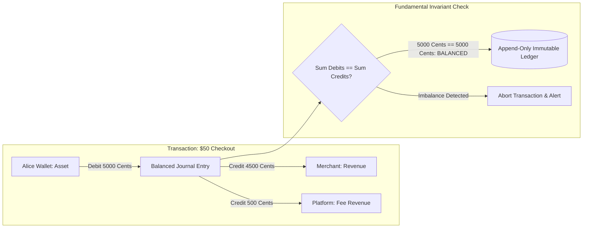

# Double-Entry Accounting Invariants

> Track: Stage 6 (Distributed Commerce, Ledgers & Physical 3D Shaders)  
> Prerequisite Knowledge: Basic accounting concepts, integer arithmetic, unit testing  
> Estimated Build Time: 60 minutes  
> Target Project Outcome: Building an immutable double-entry accounting ledger engine in TypeScript with integer cent precision and property-based verification using randomized transaction streams

---

## 1. The Hook: Why You Need This in Your Arsenal

In almost every introductory web tutorial, user balances are stored as a single mutable column:
```sql
-- THE CATASTROPHIC BALANCE UPDATE ANTI-PATTERN
UPDATE users SET balance = balance - 25.50 WHERE id = 'alice';
UPDATE users SET balance = balance + 25.50 WHERE id = 'bob';
```

This single anti-pattern causes three severe production failures:
1. **The Floating-Point Drifting Leak**: In JavaScript and standard IEEE-754 floats:
   ```javascript
   0.1 + 0.2 === 0.30000000000000004
   ```
   If your commerce platform processes 100,000 transactions with decimal tax and discount calculations, fractions of cents accumulate into thousands of dollars in accounting discrepancies.
2. **Money Created or Lost Out of Thin Air**: If the database crashes after Alice is debited but before Bob is credited, \$25.50 vanishes into thin air.
3. **Audit Impossibility**: When a financial auditor asks *"Where did this user's balance come from over the last 12 months?"*, you have no way to reconstruct history from a single mutable number.

In **COUNT**, we eliminated these failure modes by enforcing centuries-old **Double-Entry Bookkeeping Invariants** at the database constraint level. Every transaction is immutable, balanced, and verified using **Property-Based Testing**.

---

## 2. The Mental Model: Intuitive Analogy & Visual Topology

### The Airtight Plumbing Loop
Think of money in a financial system as water inside an airtight plumbing loop:
- Water cannot magically materialize from nowhere, and water cannot evaporate into nothing.
- If you pump 50 liters into Bob's tank (**Credit**), exactly 50 liters must be pumped out of Alice's tank (**Debit**).
- At any second, if you measure the sum of all changes across every tank in the building, the net change must equal **exactly zero**.



---

## 3. Deep Dive: Under the Hood

### The Accounting Equation & Invariant Rule
Every account belongs to a standard classification:
- **Assets**: What the entity owns (cash, receivables).
- **Liabilities**: What the entity owes to others (customer balances held in custody).
- **Equity**: Net worth.
- **Revenue**: Income generated.
- **Expenses**: Costs incurred.

The fundamental accounting identity is:

$$\text{Assets} = \text{Liabilities} + \text{Equity}$$

For every journal transaction $T$ consisting of $n$ legs:

$$\sum_{i=1}^{n} \text{Debit}_i - \sum_{i=1}^{n} \text{Credit}_i = 0$$

### Why Financial Systems Use Integer Cents
Never store currency in `FLOAT` or `DOUBLE` columns. Always store currency as:
- **Integer Cents**: \$10.50 is stored as integer `1050`.
- **Basis Points**: 8.25% tax is stored as integer `825` (where 10,000 basis points = 100%).

---

## 4. Zero-to-One Interactive Playground: Build It From Scratch

Let us build an immutable double-entry ledger validator in TypeScript. It validates balanced journal entries and calculates account balances using standard normal-balance conventions.

### Step 1: Environment Setup
Create a playground directory:

```bash
mkdir -p ~/aura-sandbox/ledger-engine
cd ~/aura-sandbox/ledger-engine
npm init -y
npm install typescript @types/node tsx
```

### Step 2: Implementation (`ledger-engine.ts`)
Create `ledger-engine.ts`:

```typescript
export type AccountType = 'ASSET' | 'LIABILITY' | 'EQUITY' | 'REVENUE' | 'EXPENSE';
export type Direction = 'DEBIT' | 'CREDIT';

export interface Account {
  id: string;
  name: string;
  type: AccountType;
}

export interface JournalLeg {
  accountId: string;
  direction: Direction;
  amountCents: number; // Strictly positive integer
}

export interface JournalTransaction {
  id: string;
  description: string;
  timestamp: string;
  legs: JournalLeg[];
}

export class DoubleEntryLedger {
  private accounts = new Map<string, Account>();
  private transactions: JournalTransaction[] = [];

  public registerAccount(account: Account): void {
    this.accounts.set(account.id, account);
  }

  /**
   * Posts an immutable double-entry transaction.
   * Throws an error if any invariant is violated.
   */
  public postTransaction(tx: JournalTransaction): void {
    if (tx.legs.length < 2) {
      throw new Error(`Transaction must contain at least 2 legs`);
    }

    let sumDebits = 0;
    let sumCredits = 0;

    for (const leg of tx.legs) {
      if (!this.accounts.has(leg.accountId)) {
        throw new Error(`Unknown account: ${leg.accountId}`);
      }
      if (!Number.isInteger(leg.amountCents) || leg.amountCents <= 0) {
        throw new Error(`Amount must be a positive integer in cents. Got: ${leg.amountCents}`);
      }

      if (leg.direction === 'DEBIT') {
        sumDebits += leg.amountCents;
      } else {
        sumCredits += leg.amountCents;
      }
    }

    // The Fundamental Invariant
    if (sumDebits !== sumCredits) {
      throw new Error(
        `LEDGER INVARIANT VIOLATION: Debits (${sumDebits}) != Credits (${sumCredits}). Delta: ${
          sumDebits - sumCredits
        } cents.`
      );
    }

    // Append to immutable log
    this.transactions.push(Object.freeze({ ...tx, legs: tx.legs.map((l) => Object.freeze({ ...l })) }));
  }

  /**
   * Computes balance for an account by aggregating historical immutable legs.
   */
  public getBalance(accountId: string): number {
    const acc = this.accounts.get(accountId);
    if (!acc) throw new Error(`Account ${accountId} not found`);

    let balance = 0;
    const isDebitNormal = acc.type === 'ASSET' || acc.type === 'EXPENSE';

    for (const tx of this.transactions) {
      for (const leg of tx.legs) {
        if (leg.accountId === accountId) {
          if (leg.direction === 'DEBIT') {
            balance += isDebitNormal ? leg.amountCents : -leg.amountCents;
          } else {
            balance += isDebitNormal ? -leg.amountCents : leg.amountCents;
          }
        }
      }
    }

    return balance;
  }
}

// ---------------------------------------------------------------------------
// Verification Simulation: Alice deposits $100 and pays Bob $40 with $2 fee
// ---------------------------------------------------------------------------
const ledger = new DoubleEntryLedger();

// Register accounts
ledger.registerAccount({ id: 'alice_cash', name: "Alice's Cash Wallet", type: 'ASSET' });
ledger.registerAccount({ id: 'bob_cash', name: "Bob's Cash Wallet", type: 'ASSET' });
ledger.registerAccount({ id: 'platform_fee', name: 'Platform Revenue', type: 'REVENUE' });
ledger.registerAccount({ id: 'bank_gateway', name: 'External Bank Gateway', type: 'EQUITY' });

console.log('--- Step 1: Initial Deposit: Alice loads $100.00 from Bank ---');
ledger.postTransaction({
  id: 'tx-01',
  description: 'Deposit funds via bank',
  timestamp: new Date().toISOString(),
  legs: [
    { accountId: 'alice_cash', direction: 'DEBIT', amountCents: 10000 },
    { accountId: 'bank_gateway', direction: 'CREDIT', amountCents: 10000 },
  ],
});
console.log(`Alice Balance: $${(ledger.getBalance('alice_cash') / 100).toFixed(2)}`);

console.log('\n--- Step 2: Alice pays Bob $40.00 with $2.00 Platform Fee ---');
ledger.postTransaction({
  id: 'tx-02',
  description: 'Service payment with fee',
  timestamp: new Date().toISOString(),
  legs: [
    { accountId: 'alice_cash', direction: 'CREDIT', amountCents: 4200 }, // Alice pays 42.00
    { accountId: 'bob_cash', direction: 'DEBIT', amountCents: 4000 },   // Bob receives 40.00
    { accountId: 'platform_fee', direction: 'DEBIT', amountCents: 200 }, // Platform revenue 2.00
  ],
});

console.log(`Alice Balance: $${(ledger.getBalance('alice_cash') / 100).toFixed(2)}`);
console.log(`Bob Balance:   $${(ledger.getBalance('bob_cash') / 100).toFixed(2)}`);
console.log(`Platform Fees: $${(ledger.getBalance('platform_fee') / 100).toFixed(2)}`);

console.log('\n--- Step 3: Attempting Unbalanced Transaction (Must Fail) ---');
try {
  ledger.postTransaction({
    id: 'tx-unbalanced',
    description: 'Creating money from nothing',
    timestamp: new Date().toISOString(),
    legs: [
      { accountId: 'alice_cash', direction: 'DEBIT', amountCents: 5000 },
      { accountId: 'bob_cash', direction: 'CREDIT', amountCents: 1000 }, // 4000 missing!
    ],
  });
} catch (err: any) {
  console.log('Caught Expected Error:', err.message);
}
```

### Step 3: Run and Test Instructions
Execute the script using `tsx`:

```bash
npx tsx ledger-engine.ts
```

Expected terminal output:
```text
--- Step 1: Initial Deposit: Alice loads $100.00 from Bank ---
Alice Balance: $100.00

--- Step 2: Alice pays Bob $40.00 with $2.00 Platform Fee ---
Alice Balance: $58.00
Bob Balance:   $40.00
Platform Fees: $2.00

--- Step 3: Attempting Unbalanced Transaction (Must Fail) ---
Caught Expected Error: LEDGER INVARIANT VIOLATION: Debits (5000) != Credits (1000). Delta: 4000 cents.
```

---

## 5. Battle Scars: What Breaks in Production & How to Debug It

### Top 3 Mistakes Beginners Make
1. **The Rounding Remainder Cent**: Splitting a \$100.00 cart three ways ($100 / 3 = 33.3333...$). Rounding each leg gives $33.33 \times 3 = 99.99$, losing 1 cent and failing the balancing invariant.  
   **Remediation**: Use the **Largest Remainder Method** or allocate the extra penny to a designated rounding-variance account.
2. **Deleting or Mutating Prior Ledger Entries**: A developer runs an `UPDATE` or `DELETE` query to fix an erroneous charge. This destroys historical auditability.  
   **Remediation**: Ledger tables must be append-only (`REVOKE UPDATE, DELETE`). Errors must be corrected by posting a balanced **Reversal Transaction**.
3. **Slow Balance Queries on Millions of Rows**: Recalculating account balance by scanning all entries across 5 years.  
   **Remediation**: Use snapshot checkpoints (e.g. daily balance snapshots) and calculate real-time balance as `snapshot + delta`.

---

## 6. The Weekend Hackathon Challenge: Your Turn to Build

### Challenge: The Multi-Currency Double-Entry Engine
Build an immutable financial ledger service.

- **Level 1 (Core)**: Implement the double-entry engine in integer cents supporting Asset, Liability, Equity, Revenue, and Expense accounts.
- **Level 2 (Advanced)**: Add Reversal Transactions: when a payment is refunded, generate a balanced reversal transaction that mirrors the original entries without mutating past data.
- **Level 3 (Hardcore)**: Write a property-based test using `fast-check` that executes 1,000 randomized multi-legged transactions with random split percentages, proving that the net system sum across all accounts always equals zero.

---

## 7. Knowledge Check & Next Steps

1. **Scenario**: Why should currency never be stored in standard floating-point variables?  
   *Answer*: IEEE-754 binary floating-point representation cannot represent decimal fractions precisely, causing fractions of cents to drift and corrupt accounting records over time.
2. **Scenario**: What occurs if a transaction leg is missing 1 cent due to rounding?  
   *Answer*: The double-entry engine rejects the entire transaction because total debits do not match total credits, preventing unbacked money from entering the ledger.
3. **Scenario**: Why are historical ledger entries never updated or deleted?  
   *Answer*: Ledger systems must be immutable to preserve forensic auditability. Mistakes must be corrected with explicit, balanced reversal transactions.

Next Lesson: [Ethical Data & Ephemeral Identity](./03-ethical-data-and-ephemeral-identity.md)
