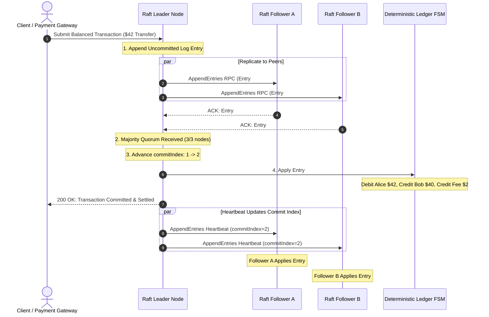

# Double-Entry Accounting & Replicated State Machine Invariants

> Track: Stage 6 (Distributed Commerce, Ledgers & Physical 3D Shaders)  
> Prerequisite Knowledge: Basic accounting principles, integer arithmetic, distributed consensus fundamentals  
> Estimated Build Time: 60 minutes  
> Target Project Outcome: Building a distributed double-entry financial ledger replicated across a Raft consensus cluster with integer cent arithmetic, deterministic state transitions, and linearizable log commit invariants

---

## 1. The Hook: Why You Need This in Your Arsenal

In almost every introductory web tutorial, user balances are stored as a single mutable column:

```sql
-- The Catastrophic Balance Mutation Anti-Pattern
UPDATE users SET balance = balance - 25.50 WHERE id = 'alice';
UPDATE users SET balance = balance + 25.50 WHERE id = 'bob';
```

In distributed commerce and financial engineering, this single anti-pattern creates four catastrophic production failures:
1. **The Floating-Point Drifting Leak**: In JavaScript and standard IEEE-754 floating-point arithmetic:
   ```javascript
   0.1 + 0.2 === 0.30000000000000004
   ```
   When processing millions of transactions with fractional fees, fractional cents accumulate into thousands of dollars in unreconciled audit discrepancies.
2. **Money Created or Destroyed Out of Thin Air**: If the database crashes after Alice is debited but before Bob is credited, money vanishes from the system.
3. **Audit Impossibility**: When regulatory examiners or financial auditors ask *"Prove where this user's balance originated over the last 12 months"*, a single mutable number cannot reconstruct the historical event stream.
4. **Replication Divergence (Split-Brain Corruption)**: In distributed databases, if two replicas accept conflicting writes during a network partition, both replicas believe their ledger is valid. Without deterministic State Machine Replication (SMR) and consensus log invariants (such as Raft or Paxos), accounts diverge permanently.

In **COUNT**, our mission-critical transaction platform, we solved this by combining centuries-old **Double-Entry Bookkeeping Invariants** with **Deterministic State Machine Replication**. Every transaction is immutable, balanced ($\sum \text{Debits} = \sum \text{Credits}$), and committed through quorum consensus before touching the state machine.

---

## 2. The Mental Model: Intuitive Analogy & Visual Topology

### The Airtight Plumbing Loop & The Three Court Clerks
Think of financial value and distributed consensus using two unified mental models:

- **The Airtight Plumbing Loop (Double-Entry Invariant)**:
  Money in a financial platform behaves like water inside a closed, airtight piping loop. Water cannot magically condense from nothing, nor can it evaporate into the void. If you pump 42 liters out of Alice's tank (**Debit**), exactly 40 liters must flow into Bob's tank (**Credit**) and 2 liters must flow into the Platform Fee tank (**Credit**). At any point in time, the sum of all changes across the building equals **exactly zero**.

- **The Three Court Clerks (Raft Consensus Invariant)**:
  Imagine a courtroom with a Chief Stenographer (the Leader) and two Associate Clerks (Followers).
  When a citizen brings an order to transfer money:
  1. The Chief Stenographer drafts the entry in their notepad in pencil (**Uncommitted Log Entry**).
  2. The Chief passes a copy to both Associate Clerks.
  3. Once at least two clerks (a **Majority Quorum** of 2 out of 3) verify that their notes match, the Chief strikes the entry into the permanent leather ledger with indelible ink (**Commit Index Advancement**).
  4. Only after the entry is inked does the courthouse treasury update the vault records (**State Machine Application**).
  5. If the Chief loses consciousness before a quorum inks the entry, the pencil draft is erased. **Uncommitted entries are never applied to the treasury vault.**



---

## 3. Deep Dive: Under the Hood

### The Accounting Equation & Custodial Balance Conventions
In financial platforms acting as custodians (holding user funds), accounts follow standard dual-entry classifications:
- **Assets**: What the institution controls (e.g., Vault Cash, Bank Reserves, Liquidity Pools). Assets are **Debit-Normal**: Debits increase the balance, Credits decrease the balance.
- **Liabilities**: What the institution owes to customers (e.g., Alice's Custodial Balance, Bob's Custodial Balance). Liabilities are **Credit-Normal**: Credits increase the balance, Debits decrease the balance.
- **Equity**: The net worth of the platform. Equity is **Credit-Normal**.
- **Revenue**: Platform fees earned from transactions. Revenue is **Credit-Normal**.
- **Expenses**: Operational costs incurred. Expenses are **Debit-Normal**.

The foundational accounting identity is:

$$\text{Assets} = \text{Liabilities} + \text{Equity} + (\text{Revenue} - \text{Expenses})$$

For every journal transaction $T$ composed of $n$ legs:

$$\sum_{i=1}^{n} \text{Debit}_i - \sum_{i=1}^{n} \text{Credit}_i = 0$$

### Why Financial Systems Use Integer Cents
Never store currency in `FLOAT` or `DOUBLE` database columns. In our systems, currency is represented strictly as:
- **Integer Cents / Minor Units**: \$10.50 is stored as integer `1050`.
- **Basis Points (BPS)**: Fractional interest and fees are computed in basis points where $1\text{ BPS} = 0.01\%$ ($10,000\text{ BPS} = 100\%$).

### Deterministic State Machine Replication (SMR) & Raft Invariants
A distributed ledger maintains multiple replicas to tolerate hardware crashes and network partitions. To guarantee that all replicas reach identical account balances, the system enforces **Deterministic State Machine Replication**:
1. **The State Machine is Pure & Deterministic**: Given state $S_k$ and committed transaction $T_{k+1}$, applying $T_{k+1}$ always yields state $S_{k+1}$ regardless of server CPU architecture, system time, or memory layout.
2. **The Write-Ahead Log (WAL) Dictates Total Order**: Every transaction is assigned a monotonically increasing log index $i$ and consensus term $t$.
3. **The Quorum Commit Rule**: An entry is committed once it is replicated across a strict majority of cluster nodes:
   $$\text{Quorum} = \left\lfloor \frac{N}{2} \right\rfloor + 1$$
   In a 3-node cluster, a quorum requires $\ge 2$ nodes. In a 5-node cluster, a quorum requires $\ge 3$ nodes.
4. **State Machine Safety Invariant**: If a node applies log entry $i$ to its state machine, no other node in the cluster will ever apply a different log entry for index $i$.
5. **Linearizable Read/Write Invariant**: Uncommitted entries are **never** applied to the double-entry state machine. If a leader partitions before achieving quorum, the uncommitted entry is dropped or overwritten by a successor term.

---

## 4. Zero-to-One Interactive Playground: Build It From Scratch

Let us build a complete distributed ledger in TypeScript that combines a **Deterministic Double-Entry State Machine** with a **3-Node Raft Consensus Cluster**.

We will simulate:
1. Initial custodial cash deposit via consensus leader.
2. Multi-legged transfer with platform fee replicated across followers.
3. Verification that all replicas share 100% identical account balances.
4. Network partition isolation: proving that uncommitted transactions isolated from quorum are never applied to the ledger.

### Step 1: Environment Setup
Create a playground directory:

```bash
mkdir -p ~/aura-sandbox/replicated-ledger
cd ~/aura-sandbox/replicated-ledger
npm init -y
npm install typescript @types/node tsx
```

### Step 2: Implementation (`replicated-ledger-engine.ts`)
Create `replicated-ledger-engine.ts`:

```typescript
export type AccountType = 'ASSET' | 'LIABILITY' | 'EQUITY' | 'REVENUE' | 'EXPENSE';
export type Direction = 'DEBIT' | 'CREDIT';

export interface Account {
  id: string;
  name: string;
  type: AccountType;
}

export interface JournalLeg {
  accountId: string;
  direction: Direction;
  amountCents: number; // Positive integer in cents
}

export interface JournalTransaction {
  id: string;
  description: string;
  timestamp: string;
  legs: JournalLeg[];
}

/**
 * Deterministic Double-Entry State Machine.
 * Custodial ledger model: User deposits are Liabilities (Credit-normal),
 * Platform fees are Revenue (Credit-normal), Cash Reserves are Assets (Debit-normal).
 */
export class DoubleEntryStateMachine {
  private accounts = new Map<string, Account>();
  private appliedTransactions: JournalTransaction[] = [];
  private balances = new Map<string, number>();

  public registerAccount(account: Account): void {
    this.accounts.set(account.id, account);
    if (!this.balances.has(account.id)) {
      this.balances.set(account.id, 0);
    }
  }

  /**
   * Applies a transaction to the state machine deterministically.
   * Enforces the Conservation of Value Invariant: Sum Debits == Sum Credits.
   */
  public applyTransaction(tx: JournalTransaction): void {
    if (tx.legs.length < 2) {
      throw new Error(`Transaction must contain at least 2 legs`);
    }

    let sumDebits = 0;
    let sumCredits = 0;

    for (const leg of tx.legs) {
      const acc = this.accounts.get(leg.accountId);
      if (!acc) throw new Error(`Unknown account: ${leg.accountId}`);
      if (!Number.isInteger(leg.amountCents) || leg.amountCents <= 0) {
        throw new Error(`Amount must be positive integer cents. Got: ${leg.amountCents}`);
      }

      if (leg.direction === 'DEBIT') {
        sumDebits += leg.amountCents;
      } else {
        sumCredits += leg.amountCents;
      }
    }

    // Fundamental Invariant Check
    if (sumDebits !== sumCredits) {
      throw new Error(
        `LEDGER INVARIANT VIOLATION: Sum Debits (${sumDebits}) != Sum Credits (${sumCredits}). Delta: ${
          sumDebits - sumCredits
        } cents.`
      );
    }

    // Apply balance mutations according to normal account conventions
    // Assets & Expenses: Debit increases (+), Credit decreases (-)
    // Liabilities, Equity & Revenue: Credit increases (+), Debit decreases (-)
    for (const leg of tx.legs) {
      const acc = this.accounts.get(leg.accountId)!;
      const isDebitNormal = acc.type === 'ASSET' || acc.type === 'EXPENSE';
      const cur = this.balances.get(leg.accountId) || 0;

      if (leg.direction === 'DEBIT') {
        this.balances.set(leg.accountId, cur + (isDebitNormal ? leg.amountCents : -leg.amountCents));
      } else {
        this.balances.set(leg.accountId, cur + (isDebitNormal ? -leg.amountCents : leg.amountCents));
      }
    }

    this.appliedTransactions.push(Object.freeze({ ...tx }));
  }

  public getBalance(accountId: string): number {
    return this.balances.get(accountId) ?? 0;
  }

  public getAppliedCount(): number {
    return this.appliedTransactions.length;
  }
}

/**
 * Raft Consensus Log Entry
 */
export interface LogEntry {
  index: number;
  term: number;
  command: JournalTransaction;
}

/**
 * Raft Consensus Ledger Node
 */
export class RaftLedgerNode {
  public readonly nodeId: string;
  public currentTerm = 1;
  public isLeader = false;
  public readonly clusterSize: number;

  // Raft Consensus Log
  public log: LogEntry[] = [];
  public commitIndex = 0; // Highest log entry known to be committed
  public lastApplied = 0; // Highest log entry applied to state machine

  // Deterministic local state machine
  public stateMachine = new DoubleEntryStateMachine();

  // Peer nodes in the cluster
  private peers: RaftLedgerNode[] = [];
  public isNetworkPartitioned = false;

  constructor(nodeId: string, isLeader = false, clusterSize = 3) {
    this.nodeId = nodeId;
    this.isLeader = isLeader;
    this.clusterSize = clusterSize;
  }

  public setPeers(peers: RaftLedgerNode[]): void {
    this.peers = peers;
  }

  /**
   * Client submits transaction to Leader.
   * Consensus Workflow:
   * 1. Append uncommitted entry to local log.
   * 2. Replicate to followers via AppendEntries RPC.
   * 3. Evaluate quorum: if majority of total cluster acknowledges, advance commitIndex.
   * 4. Apply newly committed entries to deterministic state machine.
   * 5. Linearizable invariant: uncommitted entries are NEVER applied to state machine.
   */
  public submitTransaction(tx: JournalTransaction): { success: boolean; commitIndex: number; error?: string } {
    if (!this.isLeader) {
      return { success: false, commitIndex: this.commitIndex, error: 'Not the leader; write rejected' };
    }

    const entryIndex = this.log.length + 1;
    const newEntry: LogEntry = {
      index: entryIndex,
      term: this.currentTerm,
      command: tx,
    };

    // 1. Append uncommitted to leader log
    this.log.push(newEntry);
    console.log(`[${this.nodeId}] Appended UNCOMMITTED Log Entry #${entryIndex} (Term ${this.currentTerm})`);

    // If partitioned from peers, cannot communicate
    if (this.isNetworkPartitioned) {
      console.log(`[${this.nodeId}] Network partitioned: 0 peer RPCs delivered.`);
      console.log(`[${this.nodeId}] Quorum FAILED (1/${this.clusterSize} nodes). Entry #${entryIndex} remains UNCOMMITTED.`);
      return { success: false, commitIndex: this.commitIndex, error: 'Quorum replication failed: partition detected' };
    }

    // 2. Replicate to peers
    let acks = 1; // Self ack
    const majorityQuorum = Math.floor(this.clusterSize / 2) + 1;

    for (const peer of this.peers) {
      if (peer.isNetworkPartitioned) continue;

      const replicated = peer.receiveAppendEntries({
        term: this.currentTerm,
        leaderId: this.nodeId,
        prevLogIndex: entryIndex - 1,
        prevLogTerm: entryIndex > 1 ? this.log[entryIndex - 2].term : 0,
        entries: [newEntry],
        leaderCommit: this.commitIndex,
      });

      if (replicated) {
        acks++;
      }
    }

    // 3. Quorum evaluation
    if (acks >= majorityQuorum) {
      this.commitIndex = entryIndex;
      console.log(`[${this.nodeId}] Quorum achieved (${acks}/${this.clusterSize} nodes). Committed Index -> ${this.commitIndex}`);

      // Apply to leader state machine
      this.applyEntriesToStateMachine();

      // Notify followers of new commit index via heartbeat
      for (const peer of this.peers) {
        if (!peer.isNetworkPartitioned) {
          peer.receiveAppendEntries({
            term: this.currentTerm,
            leaderId: this.nodeId,
            prevLogIndex: entryIndex,
            prevLogTerm: this.currentTerm,
            entries: [],
            leaderCommit: this.commitIndex,
          });
        }
      }

      return { success: true, commitIndex: this.commitIndex };
    } else {
      console.log(`[${this.nodeId}] Quorum FAILED (${acks}/${this.clusterSize} nodes). Entry #${entryIndex} remains UNCOMMITTED.`);
      return { success: false, commitIndex: this.commitIndex, error: 'Quorum replication failed' };
    }
  }

  /**
   * Follower handles AppendEntries RPC from Leader.
   */
  public receiveAppendEntries(rpc: {
    term: number;
    leaderId: string;
    prevLogIndex: number;
    prevLogTerm: number;
    entries: LogEntry[];
    leaderCommit: number;
  }): boolean {
    if (rpc.term < this.currentTerm) {
      return false;
    }

    // Log Matching Property check
    if (rpc.prevLogIndex > 0) {
      const prev = this.log[rpc.prevLogIndex - 1];
      if (!prev || prev.term !== rpc.prevLogTerm) {
        return false;
      }
    }

    // Append new entries if not already present
    for (const entry of rpc.entries) {
      const existing = this.log[entry.index - 1];
      if (existing) {
        if (existing.term !== entry.term) {
          this.log = this.log.slice(0, entry.index - 1);
          this.log.push(entry);
        }
      } else {
        this.log.push(entry);
        console.log(`  -> [${this.nodeId}] Replicated Log Entry #${entry.index} from Leader ${rpc.leaderId}`);
      }
    }

    // Update commit index up to leader's commit
    if (rpc.leaderCommit > this.commitIndex) {
      const oldCommit = this.commitIndex;
      this.commitIndex = Math.min(rpc.leaderCommit, this.log.length);
      console.log(`  -> [${this.nodeId}] Follower Advanced commitIndex ${oldCommit} -> ${this.commitIndex}`);
      this.applyEntriesToStateMachine();
    }

    return true;
  }

  /**
   * Linearizable state transition: apply only entries <= commitIndex
   */
  private applyEntriesToStateMachine(): void {
    while (this.lastApplied < this.commitIndex) {
      this.lastApplied++;
      const entry = this.log[this.lastApplied - 1];
      console.log(`[${this.nodeId}] APPLYING Log #${entry.index} to Double-Entry State Machine: "${entry.command.description}"`);
      this.stateMachine.applyTransaction(entry.command);
    }
  }
}

// ---------------------------------------------------------------------------
// Simulation Run: 3-Node Raft Cluster with Double-Entry Ledger
// ---------------------------------------------------------------------------
async function runReplicatedLedgerSimulation() {
  const leader = new RaftLedgerNode('node-leader', true, 3);
  const followerA = new RaftLedgerNode('node-follower-a', false, 3);
  const followerB = new RaftLedgerNode('node-follower-b', false, 3);

  // Wire cluster topology
  leader.setPeers([followerA, followerB]);
  followerA.setPeers([leader, followerB]);
  followerB.setPeers([leader, followerA]);

  // Register common accounts across all nodes
  for (const node of [leader, followerA, followerB]) {
    node.stateMachine.registerAccount({ id: 'bank_reserve', name: 'Bank Vault Reserve', type: 'ASSET' });
    node.stateMachine.registerAccount({ id: 'alice_custody', name: 'Alice Custodial Deposit', type: 'LIABILITY' });
    node.stateMachine.registerAccount({ id: 'bob_custody', name: 'Bob Custodial Deposit', type: 'LIABILITY' });
    node.stateMachine.registerAccount({ id: 'platform_rev', name: 'Platform Fee Revenue', type: 'REVENUE' });
  }

  console.log('--- Step 1: Client posts $100.00 Deposit via Consensus Leader ---');
  // Deposit: Bank Vault (Asset) +$100 (Debit), Alice Custody (Liability) +$100 (Credit)
  const tx1: JournalTransaction = {
    id: 'tx-01',
    description: 'Alice deposit $100.00 cash',
    timestamp: new Date().toISOString(),
    legs: [
      { accountId: 'bank_reserve', direction: 'DEBIT', amountCents: 10000 },
      { accountId: 'alice_custody', direction: 'CREDIT', amountCents: 10000 },
    ],
  };

  const res1 = leader.submitTransaction(tx1);
  console.log('Deposit Submission Result:', res1);

  console.log('\n--- Step 2: Alice transfers $40.00 to Bob with $2.00 Platform Fee ---');
  // Transfer: Alice (Liability) Debit $42 (reduces liability by $42)
  //           Bob (Liability) Credit $40 (increases liability by $40)
  //           Platform (Revenue) Credit $2 (increases revenue by $2)
  // Invariant check: Debits (4200) == Credits (4000 + 200) = 4200 cents!
  const tx2: JournalTransaction = {
    id: 'tx-02',
    description: 'Alice transfer $40 to Bob with $2 fee',
    timestamp: new Date().toISOString(),
    legs: [
      { accountId: 'alice_custody', direction: 'DEBIT', amountCents: 4200 },
      { accountId: 'bob_custody', direction: 'CREDIT', amountCents: 4000 },
      { accountId: 'platform_rev', direction: 'CREDIT', amountCents: 200 },
    ],
  };

  leader.submitTransaction(tx2);

  console.log('\n--- Step 3: Cluster Verification across All Replicas ---');
  for (const node of [leader, followerA, followerB]) {
    console.log(`[${node.nodeId}] Log Entries: ${node.log.length}, CommitIndex: ${node.commitIndex}, Applied: ${node.lastApplied}`);
    console.log(`  Bank Reserve (Asset):     $${(node.stateMachine.getBalance('bank_reserve') / 100).toFixed(2)}`);
    console.log(`  Alice Balance (Liability): $${(node.stateMachine.getBalance('alice_custody') / 100).toFixed(2)}`);
    console.log(`  Bob Balance (Liability):   $${(node.stateMachine.getBalance('bob_custody') / 100).toFixed(2)}`);
    console.log(`  Platform Fee (Revenue):    $${(node.stateMachine.getBalance('platform_rev') / 100).toFixed(2)}`);
  }

  console.log('\n--- Step 4: Uncommitted Entry Isolation (Partition Demonstration) ---');
  // Partition the leader from followers
  leader.isNetworkPartitioned = true;

  const partitionedTx: JournalTransaction = {
    id: 'tx-ghost',
    description: 'Ghost payment during network partition',
    timestamp: new Date().toISOString(),
    legs: [
      { accountId: 'alice_custody', direction: 'DEBIT', amountCents: 5000 },
      { accountId: 'bob_custody', direction: 'CREDIT', amountCents: 5000 },
    ],
  };

  const ghostRes = leader.submitTransaction(partitionedTx);
  console.log('Ghost Transaction Result:', ghostRes);
  console.log(`Leader Commit Index remains: ${leader.commitIndex} (Entry #3 is UNCOMMITTED)`);
  console.log(`Leader Alice Balance remains: $${(leader.stateMachine.getBalance('alice_custody') / 100).toFixed(2)} (UNCOMMITTED ENTRY NOT APPLIED!)`);
}

runReplicatedLedgerSimulation();
```

### Step 3: Run and Test Instructions
Execute the script using `tsx`:

```bash
npx tsx replicated-ledger-engine.ts
```

Expected terminal output:
```text
--- Step 1: Client posts $100.00 Deposit via Consensus Leader ---
[node-leader] Appended UNCOMMITTED Log Entry #1 (Term 1)
  -> [node-follower-a] Replicated Log Entry #1 from Leader node-leader
  -> [node-follower-b] Replicated Log Entry #1 from Leader node-leader
[node-leader] Quorum achieved (3/3 nodes). Committed Index -> 1
[node-leader] APPLYING Log #1 to Double-Entry State Machine: "Alice deposit $100.00 cash"
  -> [node-follower-a] Follower Advanced commitIndex 0 -> 1
[node-follower-a] APPLYING Log #1 to Double-Entry State Machine: "Alice deposit $100.00 cash"
  -> [node-follower-b] Follower Advanced commitIndex 0 -> 1
[node-follower-b] APPLYING Log #1 to Double-Entry State Machine: "Alice deposit $100.00 cash"
Deposit Submission Result: { success: true, commitIndex: 1 }

--- Step 2: Alice transfers $40.00 to Bob with $2.00 Platform Fee ---
[node-leader] Appended UNCOMMITTED Log Entry #2 (Term 1)
  -> [node-follower-a] Replicated Log Entry #2 from Leader node-leader
  -> [node-follower-b] Replicated Log Entry #2 from Leader node-leader
[node-leader] Quorum achieved (3/3 nodes). Committed Index -> 2
[node-leader] APPLYING Log #2 to Double-Entry State Machine: "Alice transfer $40 to Bob with $2 fee"
  -> [node-follower-a] Follower Advanced commitIndex 1 -> 2
[node-follower-a] APPLYING Log #2 to Double-Entry State Machine: "Alice transfer $40 to Bob with $2 fee"
  -> [node-follower-b] Follower Advanced commitIndex 1 -> 2
[node-follower-b] APPLYING Log #2 to Double-Entry State Machine: "Alice transfer $40 to Bob with $2 fee"

--- Step 3: Cluster Verification across All Replicas ---
[node-leader] Log Entries: 2, CommitIndex: 2, Applied: 2
  Bank Reserve (Asset):     $100.00
  Alice Balance (Liability): $58.00
  Bob Balance (Liability):   $40.00
  Platform Fee (Revenue):    $2.00
[node-follower-a] Log Entries: 2, CommitIndex: 2, Applied: 2
  Bank Reserve (Asset):     $100.00
  Alice Balance (Liability): $58.00
  Bob Balance (Liability):   $40.00
  Platform Fee (Revenue):    $2.00
[node-follower-b] Log Entries: 2, CommitIndex: 2, Applied: 2
  Bank Reserve (Asset):     $100.00
  Alice Balance (Liability): $58.00
  Bob Balance (Liability):   $40.00
  Platform Fee (Revenue):    $2.00

--- Step 4: Uncommitted Entry Isolation (Partition Demonstration) ---
[node-leader] Appended UNCOMMITTED Log Entry #3 (Term 1)
[node-leader] Network partitioned: 0 peer RPCs delivered.
[node-leader] Quorum FAILED (1/3 nodes). Entry #3 remains UNCOMMITTED.
Ghost Transaction Result: {
  success: false,
  commitIndex: 2,
  error: 'Quorum replication failed: partition detected'
}
Leader Commit Index remains: 2 (Entry #3 is UNCOMMITTED)
Leader Alice Balance remains: $58.00 (UNCOMMITTED ENTRY NOT APPLIED!)
```

---

## 5. Battle Scars: What Breaks in Production & How to Debug It

### Top 3 Mistakes in Replicated Ledger Systems
1. **The Phantom Read on Uncommitted Log Entries**: Exposing an API endpoint that reads account balances directly from the leader's volatile memory including uncommitted log entries. If the leader partitions and loses leadership before quorum is achieved, the client reads money that is subsequently rolled back.  
   **Remediation**: Linearizable reads must only execute against entries where `index <= commitIndex`, or the leader must exchange heartbeats with a majority quorum before serving balance reads (Raft ReadIndex).
2. **The Remainder Cent Imbalance on Split Payments**: Splitting a \$100.00 payment three ways ($100 / 3 = 33.3333\dots$). Rounding each leg to \$33.33 yields $3 \times 33.33 = 99.99$, losing 1 cent and crashing the balancing invariant $\sum \text{Debits} == \sum \text{Credits}$.  
   **Remediation**: Use the **Largest Remainder Method** or automatically allocate the rounding penny to an explicit platform variance or exchange-clearing account.
3. **Log Truncation and Snapshot Compaction Lag**: Allowing the Raft write-ahead log to grow unbounded over millions of transactions, exhausting node disk storage.  
   **Remediation**: Implement periodic snapshotting: checkpoint all account balances at index $K$, write the snapshot to durable storage, and truncate log entries $1 \dots K$. When a new follower joins, send an `InstallSnapshot` RPC instead of replaying the entire history.

---

## 6. The Weekend Hackathon Challenge: Your Turn to Build

### Challenge: The Replicated Multi-Currency Settlement Engine
Extend the replicated ledger into an automated multi-currency settlement clearinghouse:

- **Level 1 (Core)**: Implement multi-currency support: allow journal entries containing USD and EUR legs. Introduce a balanced Currency Clearing Account to ensure each individual currency sub-ledger balances to zero.
- **Level 2 (Advanced)**: Implement Leader Election: simulate a leader heartbeat timeout. When the leader fails, followers start an election term, cast votes, elect a new leader, and verify that the uncommitted log entries from the old leader are safely reconciled.
- **Level 3 (Hardcore)**: Write a property-based test using `fast-check` that simulates random network partitions across 5 nodes while bombarding the cluster with 500 concurrent multi-leg transfers. Prove that when the network heals, all 5 nodes converge to identical account balances with zero money creation or destruction.

---

## 7. Knowledge Check & Next Steps

1. **Scenario**: Why does a custodial double-entry system treat user balances as liabilities rather than assets?  
   *Answer*: User deposits represent funds held in custody that the platform owes back to the user upon demand. Under standard accounting conventions, customer obligations are Liabilities (Credit-normal), while the cash reserve held in the vault or bank is an Asset (Debit-normal).
2. **Scenario**: What occurs if a Raft leader crashes after appending a transaction to its local log but before receiving quorum replication?  
   *Answer*: The log entry remains uncommitted. Because it was never committed, it was never applied to the double-entry state machine. When a new leader is elected by the majority, the uncommitted entry will be overwritten, preventing phantom fund creation.
3. **Scenario**: Why must financial state machine transactions be strictly deterministic?  
   *Answer*: Replicas in a consensus cluster reconstruct state by sequentially applying committed log entries. If a state machine depended on nondeterministic factors (such as local system clocks or random numbers), different replicas would calculate different balances from the same transaction log.

Next Lesson: [Ethical Data & Ephemeral Identity](./03-ethical-data-and-ephemeral-identity.md)  
Case Study Reference: [COUNT & Transaction Ledgers Case Study](../../project-case-studies/distributed-commerce-and-marketplaces/count-and-transaction-ledgers.md)
