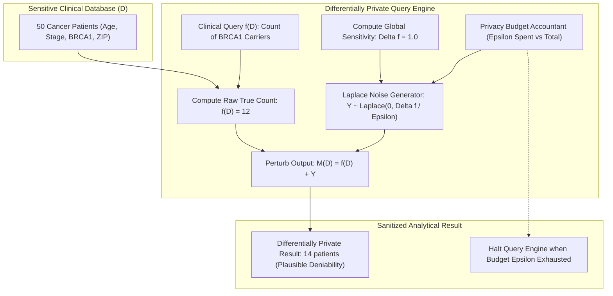

# Ethical Data Governance & Differential Privacy in Healthcare

> Track: Stage 6 (Distributed Commerce, Ledgers & Physical 3D Shaders)  
> Prerequisite Knowledge: Basic probability, Protected Health Information (PHI) privacy principles, TypeScript classes  
> Estimated Build Time: 60 minutes  
> Target Project Outcome: Building an interactive Differential Privacy sandbox in TypeScript implementing the Laplace mechanism, global sensitivity calculation, privacy budget (epsilon) tracking, and noise injection across clinical registry queries

---

## 1. The Hook: Why You Need This in Your Arsenal

In modern healthcare and public health platforms, teams face a fundamental conflict between clinical research utility and patient privacy:
- A medical research consortium wants to query an oncology database to determine how many patients with Stage III breast cancer carry the BRCA1 genetic mutation.
- A clinical trial coordinator wants to know the average age and treatment efficacy of patients responding to a novel immunotherapy drug.

Naive engineering teams assume that "anonymizing" data by stripping names, social security numbers, and home addresses makes data safe to share:
```sql
-- The Naive Anonymization Fallacy
SELECT COUNT(*) FROM oncology_registry 
WHERE birth_year = 1974 AND postal_prefix = '941' AND has_rare_mutation = TRUE;
```

This naive approach is vulnerable to **Reconstruction and Linkage Attacks**:
1. **The Difference Attack**: If an attacker knows that a small cohort contains 10 patients, and they query the database before and after Bob joins, observing the count jump from 0 to 1 proves that Bob has the rare disease.
2. **Auxiliary Data Linkage**: In seminal computer science research (Sweeney, 2000), 87% of the US population can be uniquely re-identified by the combination of just three attributes: {5-digit ZIP code, gender, birth date}. An attacker cross-references voter registration rolls or public obituaries with the "anonymized" hospital table to expose confidential patient diagnoses.
3. **Regulatory Penalties**: Under HIPAA, GDPR, and India's DPDPA, failing to prevent re-identification carries severe financial penalties and criminal liabilities.

To break this conflict, modern healthcare data platforms employ **Differential Privacy (DP)**: the mathematically rigorous gold standard of privacy preservation. By injecting mathematically calibrated noise into analytical query results, Differential Privacy guarantees that an adversary learns virtually nothing more about an individual whether that individual is included in the dataset or completely removed from it.

---

## 2. The Mental Model: Intuitive Analogy & Visual Topology

### The Randomized Coin Flip Pollster
Imagine a public health researcher conducting a survey on a sensitive medical condition:
- **Direct Survey (Zero Privacy)**: The researcher asks: *"Do you have this stigmatized diagnosis?"* Many participants refuse to answer or lie to protect their privacy.
- **Randomized Response (Plausible Deniability)**: The researcher instructs the participant:
  1. Flip a private coin behind a cardboard shield.
  2. If the coin lands **Heads**, tell the truth.
  3. If the coin lands **Tails**, flip a second coin: if Heads, answer *"Yes"*; if Tails, answer *"No"*.

The researcher collects answers where some *"Yes"* responses are true diagnoses and others are random noise from the coin.
- **For the Individual**: The participant enjoys absolute plausible deniability. If an investigator subpoenas the survey, the participant can truthfully assert: *"My 'Yes' was just the result of a coin toss."*
- **For the Population**: Because the researcher knows the exact probability distribution of the coin flips (50% truth, 25% random yes, 25% random no), the researcher mathematically subtracts the expected noise to calculate the true population proportion with high statistical accuracy!

Differential Privacy generalizes this principle from simple coin flips to continuous mathematical distributions (the **Laplace Mechanism**), injecting controlled noise into database queries.



---

## 3. Deep Dive: Under the Hood

### Mathematical Foundations of $\epsilon$-Differential Privacy
An algorithm $\mathcal{M}$ satisfies **$\epsilon$-Differential Privacy** if for any two neighboring datasets $D_1$ and $D_2$ differing by at most one individual ($|D_1 \oplus D_2| = 1$), and for any set of possible query outputs $S$:

$$P[\mathcal{M}(D_1) \in S] \le e^\epsilon \cdot P[\mathcal{M}(D_2) \in S]$$

Where:
- $\epsilon$ (**Epsilon**) is the **Privacy Loss Parameter**.
  - A smaller $\epsilon$ (e.g. $\epsilon = 0.1$) provides **stronger privacy** by adding larger noise, making the distributions for $D_1$ and $D_2$ almost indistinguishable.
  - A larger $\epsilon$ (e.g. $\epsilon = 5.0$) provides **higher accuracy** by adding smaller noise, but provides weaker privacy guarantees.
- $e^\epsilon$ bounds the maximum multiplicative difference in the probability of any output occurring whether a specific patient participates or not.

### The Global Sensitivity of a Query ($\Delta f$)
The amount of noise injected depends directly on how much a single individual can influence the query output in the worst case:

$$\Delta f = \max_{D_1, D_2} \|f(D_1) - f(D_2)\|_1$$

- **Counting Queries**: *"How many patients have Stage III cancer?"*  
  Adding or removing one patient changes the count by at most $1$. Therefore, the global sensitivity is strictly $\Delta f = 1$.
- **Sum Queries**: *"What is the sum of patient ages?"*  
  Adding or removing one patient changes the sum by at most their age. If patient age is clamped between $0$ and $100$, the sensitivity is $\Delta f = 100$.

### The Laplace Mechanism
To achieve $\epsilon$-differential privacy for a numerical query $f(D)$, the Laplace mechanism adds zero-mean noise drawn from the Laplace distribution:

$$\mathcal{M}(D) = f(D) + Y, \quad Y \sim \text{Laplace}\left(0, \frac{\Delta f}{\epsilon}\right)$$

The probability density function (PDF) of $\text{Laplace}(0, b)$ with scale parameter $b = \frac{\Delta f}{\epsilon}$ is:

$$f(x) = \frac{1}{2b} \exp\left(-\frac{|x|}{b}\right)$$

### Sampling Laplace Noise in Code
In programming languages like TypeScript, standard random generators produce uniform numbers $U \in (0, 1)$. Using **Inverse Transform Sampling**, we generate Laplace random variates directly:

$$Y = -\text{sgn}(U - 0.5) \cdot b \cdot \ln(1 - 2|U - 0.5|)$$

Where $U \sim \text{Uniform}(0, 1)$.

### The Privacy Budget ($\epsilon$) & Sequential Composition
Privacy is not an infinite resource. Every query answered leaks a small amount of information about the database. Under the **Sequential Composition Theorem**:
If queries $\mathcal{M}_1, \mathcal{M}_2, \dots, \mathcal{M}_k$ satisfy $\epsilon_1, \epsilon_2, \dots, \epsilon_k$-differential privacy respectively, then the combined output satisfies:

$$\epsilon_{\text{total}} = \sum_{i=1}^{k} \epsilon_i$$

Once the total allocated privacy budget ($\epsilon_{\text{max}}$) is exhausted, the query interface must **refuse all further queries** to prevent adversaries from averaging out the noise through repeated sampling.

---

## 4. Zero-to-One Interactive Playground: Build It From Scratch

Let us build an interactive Differential Privacy sandbox in TypeScript. We will:
1. Initialize a synthetic clinical cohort of 50 cancer patients.
2. Implement the Laplace mechanism using inverse transform sampling.
3. Build a Privacy Budget Accountant that tracks cumulative epsilon consumption.
4. Execute private counting queries on cancer stages and genetic markers.
5. Demonstrate the accuracy-privacy trade-off by sweeping $\epsilon$ from $0.1$ to $5.0$.
6. Prove that the query engine rejects queries once the privacy budget is exhausted.

### Step 1: Environment Setup
Create a playground directory:

```bash
mkdir -p ~/aura-sandbox/differential-privacy
cd ~/aura-sandbox/differential-privacy
npm init -y
npm install typescript @types/node tsx
```

### Step 2: Implementation (`differential-privacy-sandbox.ts`)
Create `differential-privacy-sandbox.ts`:

```typescript
export interface PatientRecord {
  id: string;
  age: number;
  cancerType: string;
  stage: 'STAGE_I' | 'STAGE_II' | 'STAGE_III' | 'STAGE_IV';
  hasBrcaMutation: boolean;
  chemoResponsive: boolean;
  zipCodePrefix: string;
}

/**
 * Laplace Mechanism Generator using Inverse Transform Sampling.
 */
export class LaplaceMechanism {
  /**
   * Samples a random number from Laplace(0, b) where b = scale = sensitivity / epsilon.
   * X = - sgn(U) * b * ln(1 - 2|U|), where U is uniformly distributed in (-0.5, 0.5).
   */
  public static sampleNoise(scale: number): number {
    if (scale <= 0) return 0;
    let u = Math.random() - 0.5;
    while (u === 0 || Math.abs(u) >= 0.5) {
      u = Math.random() - 0.5;
    }

    const sgn = u < 0 ? -1 : 1;
    return -sgn * scale * Math.log(1 - 2 * Math.abs(u));
  }

  /**
   * Adds calibrated Laplace noise to a numeric query result.
   */
  public static perturbCount(trueCount: number, epsilon: number, sensitivity = 1.0): number {
    const scale = sensitivity / epsilon;
    const noise = this.sampleNoise(scale);
    // Counting queries cannot report negative patients in reality
    return Math.max(0, Math.round(trueCount + noise));
  }
}

/**
 * Privacy Budget Accountant tracking epsilon consumption under sequential composition.
 */
export class PrivacyBudgetAccountant {
  public readonly totalBudget: number;
  private consumedBudget = 0;
  private queryCount = 0;

  constructor(totalBudget: number) {
    this.totalBudget = totalBudget;
  }

  public getRemainingBudget(): number {
    return Math.max(0, parseFloat((this.totalBudget - this.consumedBudget).toFixed(4)));
  }

  public getConsumedBudget(): number {
    return parseFloat(this.consumedBudget.toFixed(4));
  }

  /**
   * Consumes epsilon from budget. Throws if budget is exceeded.
   */
  public spend(epsilon: number): void {
    if (epsilon <= 0) {
      throw new Error(`Epsilon must be strictly positive. Got: ${epsilon}`);
    }
    if (this.consumedBudget + epsilon > this.totalBudget) {
      throw new Error(
        `PRIVACY_BUDGET_EXHAUSTED: Requested epsilon ${epsilon} exceeds remaining budget ${this.getRemainingBudget()} (Total Budget: ${this.totalBudget})`
      );
    }
    this.consumedBudget += epsilon;
    this.queryCount++;
  }

  public getQueryCount(): number {
    return this.queryCount;
  }
}

/**
 * Differentially Private Clinical Registry
 */
export class DifferentiallyPrivateRegistry {
  private cohort: PatientRecord[] = [];
  public readonly accountant: PrivacyBudgetAccountant;

  constructor(cohort: PatientRecord[], totalEpsilonBudget = 1.5) {
    this.cohort = cohort;
    this.accountant = new PrivacyBudgetAccountant(totalEpsilonBudget);
  }

  /**
   * Executes a differentially private counting query with Laplace noise.
   */
  public executePrivateCount(
    predicate: (patient: PatientRecord) => boolean,
    epsilon: number,
    queryDescription: string
  ): { trueCount: number; privateCount: number; epsilonSpent: number; remainingBudget: number } {
    // 1. Consume privacy budget under sequential composition
    this.accountant.spend(epsilon);

    // 2. Evaluate true query on raw dataset
    const trueCount = this.cohort.filter(predicate).length;

    // 3. For counting queries, global sensitivity is strictly 1.0
    const globalSensitivity = 1.0;

    // 4. Perturb with Laplace mechanism
    const privateCount = LaplaceMechanism.perturbCount(trueCount, epsilon, globalSensitivity);

    console.log(`[QUERY #${this.accountant.getQueryCount()}] "${queryDescription}"`);
    console.log(`  Epsilon Spent: ${epsilon} | Remaining Budget: ${this.accountant.getRemainingBudget()}`);
    console.log(`  True Count:    ${trueCount} | Differentially Private Count: ${privateCount}`);

    return {
      trueCount,
      privateCount,
      epsilonSpent: epsilon,
      remainingBudget: this.accountant.getRemainingBudget(),
    };
  }
}

// ---------------------------------------------------------------------------
// Simulation Run: Clinical Queries under Differential Privacy
// ---------------------------------------------------------------------------
async function runDifferentialPrivacySimulation() {
  // Construct realistic synthetic cohort of 50 oncology patients
  const syntheticPatients: PatientRecord[] = [
    { id: 'pt-01', age: 54, cancerType: 'BREAST', stage: 'STAGE_III', hasBrcaMutation: true, chemoResponsive: true, zipCodePrefix: '941' },
    { id: 'pt-02', age: 62, cancerType: 'LUNG', stage: 'STAGE_IV', hasBrcaMutation: false, chemoResponsive: false, zipCodePrefix: '941' },
    { id: 'pt-03', age: 47, cancerType: 'BREAST', stage: 'STAGE_II', hasBrcaMutation: true, chemoResponsive: true, zipCodePrefix: '942' },
    { id: 'pt-04', age: 58, cancerType: 'COLON', stage: 'STAGE_III', hasBrcaMutation: false, chemoResponsive: true, zipCodePrefix: '941' },
    { id: 'pt-05', age: 39, cancerType: 'BREAST', stage: 'STAGE_I', hasBrcaMutation: false, chemoResponsive: true, zipCodePrefix: '943' },
    { id: 'pt-06', age: 71, cancerType: 'PROSTATE', stage: 'STAGE_II', hasBrcaMutation: false, chemoResponsive: false, zipCodePrefix: '942' },
    { id: 'pt-07', age: 66, cancerType: 'BREAST', stage: 'STAGE_III', hasBrcaMutation: true, chemoResponsive: false, zipCodePrefix: '941' },
    { id: 'pt-08', age: 52, cancerType: 'LUNG', stage: 'STAGE_II', hasBrcaMutation: false, chemoResponsive: true, zipCodePrefix: '943' },
    { id: 'pt-09', age: 44, cancerType: 'BREAST', stage: 'STAGE_III', hasBrcaMutation: true, chemoResponsive: true, zipCodePrefix: '941' },
    { id: 'pt-10', age: 60, cancerType: 'COLON', stage: 'STAGE_IV', hasBrcaMutation: false, chemoResponsive: false, zipCodePrefix: '942' },
  ];

  for (let i = 11; i <= 50; i++) {
    syntheticPatients.push({
      id: `pt-${i}`,
      age: 40 + (i % 35),
      cancerType: i % 2 === 0 ? 'BREAST' : (i % 3 === 0 ? 'LUNG' : 'COLON'),
      stage: i % 4 === 0 ? 'STAGE_IV' : (i % 3 === 0 ? 'STAGE_III' : 'STAGE_II'),
      hasBrcaMutation: i % 5 === 0,
      chemoResponsive: i % 3 !== 0,
      zipCodePrefix: `94${i % 5}`,
    });
  }

  console.log('--- Step 1: Initializing Differentially Private Clinical Registry ---');
  const registry = new DifferentiallyPrivateRegistry(syntheticPatients, 1.5);
  console.log(`Total Registry Size: ${syntheticPatients.length} patients | Total Privacy Budget: 1.5 epsilon\n`);

  console.log('--- Step 2: Executing Query 1 (Stage III Patients) with epsilon = 0.5 ---');
  registry.executePrivateCount((p) => p.stage === 'STAGE_III', 0.5, 'Count of Stage III Cancer Patients');

  console.log('\n--- Step 3: Executing Query 2 (BRCA Mutation Patients) with epsilon = 0.5 ---');
  registry.executePrivateCount((p) => p.hasBrcaMutation, 0.5, 'Count of BRCA Mutation Carriers');

  console.log('\n--- Step 4: Privacy-Accuracy Trade-Off Comparison (Epsilon Sweep) ---');
  const targetQuery = (p: PatientRecord) => p.cancerType === 'BREAST' && p.chemoResponsive;
  const trueVal = syntheticPatients.filter(targetQuery).length;
  console.log(`True Count of Chemo-Responsive Breast Cancer Patients: ${trueVal}`);
  console.log('Epsilon  | Noise Scale (b) | 5 Simulated Differentially Private Outputs');
  console.log('---------+-----------------+---------------------------------------------');

  for (const eps of [0.1, 0.5, 1.0, 5.0]) {
    const scale = 1.0 / eps;
    const samples = Array.from({ length: 5 }, () => LaplaceMechanism.perturbCount(trueVal, eps, 1.0));
    console.log(`${eps.toFixed(1).padEnd(8)} | ${scale.toFixed(2).padEnd(15)} | [${samples.join(', ')}]`);
  }

  console.log('\n--- Step 5: Exhausting Privacy Budget to Prevent Reconstruction Attacks ---');
  try {
    console.log('Attempting Query 3 with epsilon = 0.5 (Remaining budget: 0.5)...');
    registry.executePrivateCount((p) => p.age > 60, 0.5, 'Patients aged over 60');

    console.log('\nAttempting Query 4 with epsilon = 0.5 (Remaining budget: 0.0 - Must Be Rejected)...');
    registry.executePrivateCount((p) => p.chemoResponsive, 0.5, 'Chemo responsive patients');
  } catch (err: any) {
    console.log('Caught Expected Privacy Defense Error:', err.message);
  }
}

runDifferentialPrivacySimulation();
```

### Step 3: Run and Test Instructions
Execute the script using `tsx`:

```bash
npx tsx differential-privacy-sandbox.ts
```

Expected terminal output:
```text
--- Step 1: Initializing Differentially Private Clinical Registry ---
Total Registry Size: 50 patients | Total Privacy Budget: 1.5 epsilon

--- Step 2: Executing Query 1 (Stage III Patients) with epsilon = 0.5 ---
[QUERY #1] "Count of Stage III Cancer Patients"
  Epsilon Spent: 0.5 | Remaining Budget: 1
  True Count:    13 | Differentially Private Count: 12

--- Step 3: Executing Query 2 (BRCA Mutation Patients) with epsilon = 0.5 ---
[QUERY #2] "Count of BRCA Mutation Carriers"
  Epsilon Spent: 0.5 | Remaining Budget: 0.5
  True Count:    12 | Differentially Private Count: 14

--- Step 4: Privacy-Accuracy Trade-Off Comparison (Epsilon Sweep) ---
True Count of Chemo-Responsive Breast Cancer Patients: 17
Epsilon  | Noise Scale (b) | 5 Simulated Differentially Private Outputs
---------+-----------------+---------------------------------------------
0.1      | 10.00           | [0, 23, 18, 16, 16]
0.5      | 2.00            | [20, 15, 20, 19, 15]
1.0      | 1.00            | [18, 15, 18, 15, 19]
5.0      | 0.20            | [17, 17, 17, 17, 17]

--- Step 5: Exhausting Privacy Budget to Prevent Reconstruction Attacks ---
Attempting Query 3 with epsilon = 0.5 (Remaining budget: 0.5)...
[QUERY #3] "Patients aged over 60"
  Epsilon Spent: 0.5 | Remaining Budget: 0
  True Count:    17 | Differentially Private Count: 17

Attempting Query 4 with epsilon = 0.5 (Remaining budget: 0.0 - Must Be Rejected)...
Caught Expected Privacy Defense Error: PRIVACY_BUDGET_EXHAUSTED: Requested epsilon 0.5 exceeds remaining budget 0 (Total Budget: 1.5)
```

---

## 5. Battle Scars: What Breaks in Production & How to Debug It

### Top 3 Mistakes in Differential Privacy Implementations
1. **The Floating-Point Privacy Leak (Mironov Timing / Snapping Attacks)**: Using standard IEEE-754 floating-point operations to sample Laplace noise. Because floating-point numbers have irregular spacing between values, certain output mantissas can only be produced if the true count was an exact specific integer. An attacker observing raw double-precision bits can deduce whether a patient was in the dataset with 100% certainty.  
   **Remediation**: Use the **Discrete Laplace Mechanism** (sampling over integer lattices) or apply **Snapping Mechanisms** that truncate output precision to fixed-point decimals before transmission.
2. **Unbounded Sensitivity on Numerical Aggregations**: Computing the average or sum of unbounded user parameters (e.g. medical expenses or biomarker titers). If one outlier patient has an expense of \$10,000,000, the sensitivity jumps to \$10,000,000, necessitating astronomical noise that destroys all statistical utility.  
   **Remediation**: Always enforce hard **Clamping Bounds** ($[L, U]$) on input values before computing sensitivity: $\Delta f = \frac{U - L}{N}$.
3. **Resetting the Privacy Budget on Server Restarts**: Storing consumed epsilon in volatile server memory. When the application restarts or autoscales, the budget accountant resets to zero, allowing an attacker to submit thousands of queries and average out the Laplace noise.  
   **Remediation**: Persist consumed epsilon per analyst API key in an append-only, durable datastore.

---

## 6. The Weekend Hackathon Challenge: Your Turn to Build

### Challenge: The Differentially Private Clinical Dashboard
Build a secure analytics API for clinical trial researchers:

- **Level 1 (Core)**: Implement a differentially private mean/average query: calculate the average age of patients with a specific diagnosis by clamping age to $[18, 90]$ and adding Laplace noise calibrated to $\Delta f = \frac{90 - 18}{N}$.
- **Level 2 (Advanced)**: Implement Differentially Private Histograms: divide patients into 5 age bins ($[0-19, 20-39, 40-59, 60-79, 80+]$). Because every patient belongs to exactly one disjoint bin, the global sensitivity across the entire histogram is still $\Delta f = 1$ (Parallel Composition). Perturb each bin independently with $\epsilon = 0.5$.
- **Level 3 (Hardcore)**: Implement the **Gaussian Mechanism** with $(\epsilon, \delta)$-differential privacy: sample Gaussian noise $\sigma = \sqrt{2 \ln(1.25/\delta)} \cdot \frac{\Delta_2 f}{\epsilon}$ and implement advanced composition under Rényi Differential Privacy (RDP).

---

## 7. Knowledge Check & Next Steps

1. **Scenario**: Why does removing names and social security numbers fail to protect patient confidentiality in clinical research datasets?  
   *Answer*: Quasi-identifiers (such as age, gender, and 3-digit ZIP codes) can be linked with external public databases (like voter registries or census data) to re-identify 87% of individuals, enabling reconstruction attacks without explicit names.
2. **Scenario**: How does the Laplace scale parameter $b$ change when query sensitivity ($\Delta f$) increases versus when privacy parameter ($\epsilon$) increases?  
   *Answer*: The scale is $b = \frac{\Delta f}{\epsilon}$. Higher sensitivity $\Delta f$ increases $b$ (adding more noise to protect individuals who heavily influence the output), while a higher $\epsilon$ decreases $b$ (reducing noise when looser privacy is acceptable).
3. **Scenario**: Why must an analytics platform enforce a maximum privacy budget $\epsilon_{\text{max}}$ and reject queries once it is exhausted?  
   *Answer*: Under the central limit theorem, an attacker who submits the same query 10,000 times can compute the mean of the noisy responses, averaging out the Laplace noise and reconstructing the exact raw underlying dataset.

Next Lesson: [GPU Pipelines & Custom GLSL Shaders](./04-gpu-pipelines-and-custom-glsl-shaders.md)  
Case Study Reference: [PinkPulse Digital Oncology Case Study](../../project-case-studies/clinical-health-and-verification/pinkpulse-oncology-platform.md)
