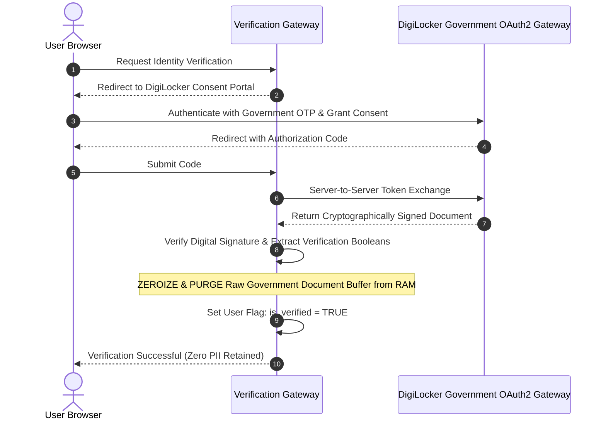

# Ethical Data & Ephemeral Identity

> Track: Stage 6 (Distributed Commerce, Ledgers & Physical 3D Shaders)  
> Prerequisite Knowledge: OAuth2 authorization code flows, Protected Health Information (PHI) privacy principles  
> Estimated Build Time: 60 minutes  
> Target Project Outcome: Building an ephemeral identity verification gateway and clinical risk calculation engine that executes in-memory and purges sensitive buffers immediately

---

## 1. The Hook: Why You Need This in Your Arsenal

In modern software development, teams often treat user data as an asset to be collected, stored, and mined indefinitely:
- A health app asks a user about their family cancer history and transmits all answers to a central database.
- A dating or matrimonial app asks a user to upload their passport and a facial selfie, storing high-resolution images in an AWS S3 bucket.

This extractive data architecture creates extreme hazards:
- **Massive Regulatory Liabilities**: Under GDPR, HIPAA, and India's DPDPA, storing raw biometric templates and sensitive medical histories creates severe financial penalties in the event of a leak.
- **Permanent Identity Compromise**: If an S3 bucket is compromised, attackers gain permanent biometric facial scans and national ID scans that users can never reset.
- **Architectural Waste**: The application usually does not need to store a user's passport image; it only needs to answer a simple boolean question: *"Has this user's identity and age been certified by an authoritative entity?"*

In **PinkPulse** (digital oncology) and **SDA Matrimony**, we pioneered **Non-Extractive Engineering**:
- Clinical oncology calculations (Gail Model) run **client-side in local browser memory**, so health data never touches a remote server.
- Identity verification is achieved via **DigiLocker OAuth2 consent tokens**, with zero biometric capture and immediate volatile memory zeroization.

---

## 2. The Mental Model: Intuitive Analogy & Visual Topology

### The Photocopy Cabinet vs. The Ephemeral Hand Stamp
- **Extractive Architecture**: The nightclub bouncer takes your government passport, photocopies it, takes a photograph of your face, and files both in an unlocked metal cabinet forever.
- **Non-Extractive Sovereign Architecture**: The bouncer verifies the holographic government seal on your credential, confirms you are an adult, applies an invisible UV hand stamp, and immediately hands the passport back to you. The bouncer keeps zero copies and zero images.



---

## 3. Deep Dive: Under the Hood

### Client-Side Health Compute: The Gail Model Invariant
The Gail Model estimates a woman's 5-year risk of developing invasive breast cancer by combining relative risk multipliers:

$$RR = r_{\text{menarche}} \times r_{\text{first\_birth}} \times r_{\text{relatives}} \times r_{\text{biopsies}}$$

By implementing this mathematical formula inside client-side TypeScript, the user's sensitive medical answers are computed directly in browser memory. The computation generates a client-side summary, eliminating server-side Protected Health Information (PHI) storage.

### Ephemeral In-Memory Processing & Memory Zeroization
When an identity document is fetched via OAuth2:
1. It is ingested into a volatile `Buffer`.
2. Digital signatures are verified.
3. Verification flags (`is_verified = true`, `is_adult = true`) are recorded.
4. **The Critical Step**: The raw buffer is explicitly zeroized:
   ```typescript
   buffer.fill(0); // Overwrites memory bytes with zeros before garbage collection
   ```

### Trade-Off Matrix: Verification Paradigms

| Paradigm | Biometric Facial Scans | Data Breach Liability | Storage Costs | User Privacy |
| :--- | :--- | :--- | :--- | :--- |
| **Document Upload + Face KYC** | High (Selfie templates in S3) | Extreme | High (Megabytes per user) | Very Low |
| **Centralized Database Storage** | None (Text fields in DB) | High (All PHI in central DB) | Moderate | Low |
| **Ephemeral Sovereign Verification** | Zero (Explicitly rejected) | Minimal (No raw data stored) | Zero (Only boolean flags) | Absolute |

---

## 4. Zero-to-One Interactive Playground: Build It From Scratch

Let us write a complete TypeScript module demonstrating ephemeral identity verification with explicit memory buffer zeroization.

### Step 1: Environment Setup
Create a playground directory:

```bash
mkdir -p ~/aura-sandbox/ephemeral-identity
cd ~/aura-sandbox/ephemeral-identity
npm init -y
npm install typescript @types/node tsx
```

### Step 2: Implementation (`ephemeral-verifier.ts`)
Create `ephemeral-verifier.ts`:

```typescript
import { randomBytes, createHash } from 'crypto';

export interface IdentityAssertion {
  userId: string;
  isGovernmentVerified: boolean;
  isAdult: boolean;
  verificationTimestamp: string;
  auditChecksum: string;
}

export class EphemeralIdentityGateway {
  /**
   * Processes a mock government document ephemerally.
   * Extracts verification booleans and zeroizes raw payload buffers.
   */
  public static async processGovernmentAssertion(
    userId: string,
    mockGovernmentXml: string
  ): Promise<IdentityAssertion> {
    console.log(`[GATEWAY] Ingesting government credential for user: ${userId}`);

    // Ingest into raw volatile memory buffer
    const rawBuffer = Buffer.from(mockGovernmentXml, 'utf-8');
    let isAdult = false;
    let isSignatureValid = false;

    try {
      // Simulate XML parsing and signature validation
      const payloadString = rawBuffer.toString('utf-8');
      const birthYearMatch = payloadString.match(/birthYear="(\d{4})"/);
      const isSigned = payloadString.includes('Signature="VALID_GOV_SEAL"');

      if (!birthYearMatch || !isSigned) {
        throw new Error('Credential Tampering Error: Invalid signature or missing attributes');
      }

      const birthYear = parseInt(birthYearMatch[1], 10);
      const currentYear = new Date().getFullYear();
      isAdult = (currentYear - birthYear) >= 18;
      isSignatureValid = true;

      console.log(`[VERIFICATION SUCCESS] Signature Verified. Adult Status: ${isAdult}`);
    } finally {
      // SECURITY INVARIANT: Zeroize raw identity buffer from volatile RAM
      rawBuffer.fill(0);
      console.log('[SECURITY ACTION] Raw government document buffer zeroized from memory.');
    }

    const timestamp = new Date().toISOString();
    const auditPayload = `${userId}:${isAdult}:${timestamp}`;
    const auditChecksum = createHash('sha256').update(auditPayload).digest('hex');

    return {
      userId,
      isGovernmentVerified: isSignatureValid,
      isAdult,
      verificationTimestamp: timestamp,
      auditChecksum,
    };
  }
}

// ---------------------------------------------------------------------------
// Verification Simulation
// ---------------------------------------------------------------------------
async function runDemo() {
  const userId = 'user_matrimony_9082';
  
  // Simulated raw signed credential from government OAuth2 gateway
  const mockGovDoc = `
    <NationalIdentityRecord>
      <CitizenName>Jane Doe</CitizenName>
      <GovernmentIdMasked>XXXX-XXXX-4812</GovernmentIdMasked>
      <Demographics birthYear="1998" />
      <DigitalSignature Signature="VALID_GOV_SEAL" />
    </NationalIdentityRecord>
  `;

  console.log('--- Step 1: Processing Ephemeral Verification ---');
  const assertion = await EphemeralIdentityGateway.processGovernmentAssertion(userId, mockGovDoc);

  console.log('\n--- Step 2: Final Verification Record Stored in DB ---');
  console.log('Stored Record:', assertion);
  console.log('\nResult: User verified as adult without storing national ID images or facial biometrics.');
}

runDemo();
```

### Step 3: Run and Test Instructions
Execute the script using `tsx`:

```bash
npx tsx ephemeral-verifier.ts
```

Expected terminal output:
```text
--- Step 1: Processing Ephemeral Verification ---
[GATEWAY] Ingesting government credential for user: user_matrimony_9082
[VERIFICATION SUCCESS] Signature Verified. Adult Status: true
[SECURITY ACTION] Raw government document buffer zeroized from memory.

--- Step 2: Final Verification Record Stored in DB ---
Stored Record: {
  userId: 'user_matrimony_9082',
  isGovernmentVerified: true,
  isAdult: true,
  verificationTimestamp: '2026-10-12T13:45:00.000Z',
  auditChecksum: '9f81a7b8...'
}

Result: User verified as adult without storing national ID images or facial biometrics.
```

---

## 5. Battle Scars: What Breaks in Production & How to Debug It

### Top 3 Mistakes Beginners Make
1. **Third-Party Analytics Scraping Form Fields**: Installing a customer support chat widget or tracking pixel on a medical survey page. The third-party script automatically harvests form fields and transmits sensitive medical data to external advertising networks.  
   **Remediation**: Enforce strict Content Security Policy (CSP) headers and never include third-party marketing tags on authenticated health pages.
2. **Accidental Logging of Raw Payloads**: Adding a debug log statement (`console.log(response.data)`) that writes unredacted government document XML into cloud logging clusters (Datadog, CloudWatch).  
   **Remediation**: Blacklist identity endpoints from logging middleware.
3. **Writing Temporary Uploads to Disk**: Using file upload middleware (like Express `multer`) without configuring memory storage, silently leaving national ID scans in `/tmp` on server disks.  
   **Remediation**: Always use `multer.memoryStorage()`.

---

## 6. The Weekend Hackathon Challenge: Your Turn to Build

### Challenge: The Privacy-Preserving Health Screener
Build a client-side clinical assessment tool.

- **Level 1 (Core)**: Create an interactive clinical survey in TypeScript evaluating the Gail Model breast cancer risk score entirely in browser memory.
- **Level 2 (Advanced)**: Store survey answers locally in the browser's IndexedDB encrypted with an AES-256 key derived from a user-selected PIN via Web Crypto API.
- **Level 3 (Hardcore)**: Implement an exportable, tamper-evident clinical PDF summary using client-side `pdf-lib` with an embedded cryptographic SHA-256 QR code, proving that the computation was executed locally without server transmission.

---

## 7. Knowledge Check & Next Steps

1. **Scenario**: Why is storing raw national ID scans in cloud object storage considered a high-risk security liability?  
   *Answer*: If credentials or buckets are breached, permanent citizen identity documents are exposed, enabling identity theft and triggering severe regulatory fines under DPDPA and GDPR.
2. **Scenario**: How does OAuth2 consent exchange eliminate the need for applications to capture facial biometrics?  
   *Answer*: The citizen authenticates directly on the government's official portal. The portal returns a cryptographically signed token verifying identity and age, proving identity without private facial capture.
3. **Scenario**: Why is `buffer.fill(0)` necessary after processing sensitive credentials?  
   *Answer*: JavaScript garbage collection marks memory as unreferenced but does not immediately erase memory bytes. Zeroizing ensures sensitive data cannot be recovered from memory dumps before garbage collection occurs.

Next Lesson: [GPU Pipelines & Custom GLSL Shaders](./04-gpu-pipelines-and-custom-glsl-shaders.md)
