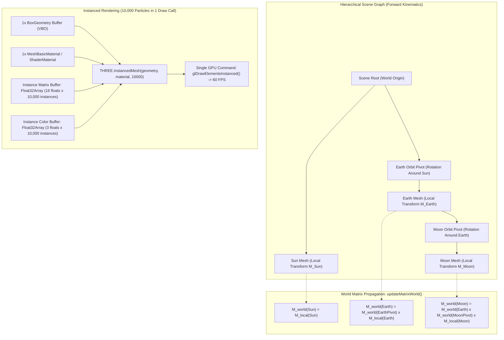

# High-Performance GPU Graphics: Instanced Rendering, Scene Graphs & WebGPU Pipelines

> Track: Stage 6 (Distributed Commerce, Ledgers & Physical 3D Shaders)  
> Prerequisite Knowledge: HTML5 Canvas, Three.js or WebGL basics, linear algebra (vectors, matrices), JavaScript animation loops  
> Estimated Build Time: 60 minutes  
> Target Project Outcome: Building a hardware-accelerated 60 FPS 3D engine in Three.js rendering 10,000 animated particles in a single draw call using Instanced Rendering (`THREE.InstancedMesh`), implementing hierarchical scene graph coordinate propagation, and architecting explicit WebGL 2.0 vs WebGPU pipelines

---

## 1. The Hook: Why You Need This in Your Arsenal

Interactive 3D graphics on the web can transform standard developer documentation, scientific dashboards, and consumer landing pages into unforgettable visual showcases.
However, 3D web applications are notorious for catastrophic performance failures that crash mobile browsers and drain device batteries:

1. **The Draw Call Bottleneck**:
   Suppose you want to render an asteroid belt, a particle swarm, or a dense data visualization containing 10,000 objects. If you create 10,000 individual `THREE.Mesh` objects:
   ```javascript
   // The Draw Call Catastrophe: 10,000 Separate Meshes
   for (let i = 0; i < 10000; i++) {
     const mesh = new THREE.Mesh(geometry, material);
     scene.add(mesh); // Triggers 10,000 CPU-to-GPU draw calls per frame!
   }
   ```
   Even on high-end desktop graphics cards, issuing 10,000 separate draw calls chokes the CPU-to-GPU driver bridge. Framerates collapse from 60 FPS down to 3 FPS, causing severe stutter and browser freezing.
2. **The Coordinate Matrix Collapse**:
   When building mechanical robots, planetary solar systems, or character skeletons, objects move relative to other moving objects. Without a rigorous **Hierarchical Scene Graph**, calculating the absolute position of a moon orbiting a rotating planet orbiting a moving sun turns into mathematical spaghetti.
3. **The WebGL Driver Overhead & The WebGPU Paradigm Shift**:
   WebGL 2.0 operates as a global mutable state machine designed in the 1990s (OpenGL). Every state change (`gl.bindTexture`, `gl.useProgram`) requires CPU driver validation on the main JavaScript thread. Modern graphics engineering is transitioning to **WebGPU**: an explicit, pipeline-driven architecture featuring native GPGPU compute shaders and multithreaded command recording.

In this module, you will master the foundational primitives of elite 3D graphics: **Instanced Rendering (`THREE.InstancedMesh`)** to draw 10,000 animated particles in **exactly 1 draw call**, **Hierarchical Scene Graphs** with forward kinematics matrix propagation, and the architectural mechanics separating **WebGL 2.0 from WebGPU**.

---

## 2. The Mental Model: Intuitive Analogy & Visual Topology

### The Movable Type Printing Press & The Nested Solar Mobile
To master high-performance 3D architecture, visualize two physical systems:

- **The Movable Type Printing Press (Instanced Rendering)**:
  - **Naive 10,000-Mesh Approach**: A medieval scribe copying a book by hand-drawing 10,000 individual letters one at a time, dipping a quill into ink for every single glyph.
  - **Instanced Rendering (`THREE.InstancedMesh`)**: Gutenberg's printing press. The press holds a single metal stamp for the letter (the shared base geometry). In one single mechanical stroke (**1 draw call**), the press imprints 10,000 instances onto the page simultaneously, varying only their coordinate positions and ink colors via an instance matrix buffer.

- **The Nested Solar Mobile (Hierarchical Scene Graph)**:
  Imagine a brass mobile hanging in a museum:
  - The **Sun** hangs from the ceiling. When you move the Sun, everything moves with it.
  - An arm extends from the Sun to the **Earth**. Earth has its own local spin around its axis.
  - A smaller arm extends from the Earth to the **Moon**.
  The Moon does not need to compute its absolute coordinates in the museum hall. The Moon only tracks its local orbit relative to Earth. The scene graph automatically compounds transformations down the tree:
  $$\mathbf{M}_{\text{world}}^{\text{Moon}} = \mathbf{M}_{\text{world}}^{\text{Sun}} \times \mathbf{M}_{\text{local}}^{\text{Earth}} \times \mathbf{M}_{\text{local}}^{\text{Moon}}$$



---

## 3. Deep Dive: Under the Hood

### Mathematical Mechanics of Hierarchical Scene Graphs
Every 3D object in a scene graph maintains a local transformation matrix $\mathbf{M}_{\text{local}}$ composed of translation ($\mathbf{T}$), rotation ($\mathbf{R}$), and scale ($\mathbf{S}$):

$$\mathbf{M}_{\text{local}} = \mathbf{T}(p_x, p_y, p_z) \times \mathbf{R}(q_x, q_y, q_z, q_w) \times \mathbf{S}(s_x, s_y, s_z)$$

When objects are nested in a parent-child relationship:
- The **Local Matrix** defines the position, orientation, and scale relative to its immediate parent.
- The **World Matrix** ($\mathbf{M}_{\text{world}}$) defines the absolute position, orientation, and scale in global world space.

The world matrix is computed recursively down the graph:

$$\mathbf{M}_{\text{world}}^{\text{child}} = \mathbf{M}_{\text{world}}^{\text{parent}} \times \mathbf{M}_{\text{local}}^{\text{child}}$$

#### The Forward Kinematics Invariant:
When an ancestor node transforms, all descendant nodes transform automatically without manual recalculation. Three.js optimizes this traversal using dirty flags: `updateMatrixWorld()` only recomputes nodes whose local transforms (or whose ancestors' transforms) have changed (`matrixWorldNeedsUpdate = true`).

### Mechanics of Instanced Rendering (`THREE.InstancedMesh`)
When drawing thousands of identical or similar geometric objects, Instanced Rendering eliminates CPU driver overhead:
- **Geometry & Shaders are Sent Once**: A single Vertex Buffer Object (VBO) and Index Buffer are uploaded to GPU VRAM.
- **Per-Instance Attributes**: Three.js allocates a typed array `Float32Array(16 * count)` holding a $4 \times 4$ transformation matrix for each instance, bound as an instanced vertex attribute divisor (`ANGLE_instanced_arrays` in WebGL 1, native in WebGL 2).
- **GPU Vertex Shader Execution**: In the vertex shader, each vertex position is transformed by its specific instance matrix before projection:
  ```glsl
  // GLSL Instanced Vertex Shader Transformation
  vec4 worldPosition = modelMatrix * instanceMatrix * vec4(position, 1.0);
  gl_Position = projectionMatrix * viewMatrix * worldPosition;
  ```
- **Updating Instances**: When positions animate, modify the instance matrix and notify the driver:
  ```typescript
  instancedMesh.setMatrixAt(index, matrix);
  instancedMesh.instanceMatrix.needsUpdate = true; // Signals GPU driver to re-upload buffer
  ```

### Architectural Shift: WebGL 2.0 vs. WebGPU (WGSL)
The web graphics ecosystem is undergoing its largest architectural transition since the introduction of WebGL in 2011.

#### Comprehensive Comparison Matrix:

| Architectural Dimension | WebGL 2.0 | WebGPU |
| :--- | :--- | :--- |
| **Driver Architecture** | Global Mutable State Machine (OpenGL ES 3.0) | Explicit Pipeline State Objects (Vulkan, Metal, DirectX 12) |
| **Resource Binding** | Slot-based global state (`glBindBuffer`, `glActiveTexture`) | Immutable Bind Groups and Bind Group Layouts (`GPUBindGroup`) |
| **Command Submission** | Synchronous, immediate driver execution on main thread | Recorded Command Buffers (`GPUCommandEncoder` $\rightarrow$ `queue.submit`) |
| **Multithreading** | Strictly single-threaded (main thread or 1 OffscreenCanvas worker) | Multithreaded command recording across multiple Web Workers |
| **GPGPU Compute** | No native compute shaders; emulated via texture ping-ponging | First-class Compute Pipelines (`@compute @workgroup_size(64)`) |
| **Shading Language** | GLSL ES 3.0 (C-style syntax) | WGSL (WebGPU Shading Language, Rust/ML-style typed syntax) |
| **Validation Overhead** | High (driver validates state on every draw call) | Minimal (pipelines pre-compiled and validated ahead of time) |

#### Shading Language Syntax Comparison: GLSL vs WGSL

In WebGL 2.0 (GLSL):
```glsl
#version 300 es
precision highp float;
in vec3 position;
uniform mat4 modelViewMatrix;
uniform mat4 projectionMatrix;
void main() {
  gl_Position = projectionMatrix * modelViewMatrix * vec4(position, 1.0);
}
```

In WebGPU (WGSL):
```wgsl
struct Uniforms {
  modelViewProjectionMatrix: mat4x4<f32>,
};
@group(0) @binding(0) var<uniform> uniforms: Uniforms;

struct VertexInput {
  @location(0) position: vec3<f32>,
};

@vertex
fn vs_main(input: VertexInput) -> @builtin(position) vec4<f32> {
  return uniforms.modelViewProjectionMatrix * vec4<f32>(input.position, 1.0);
}
```

---

## 4. Zero-to-One Interactive Playground: Build It From Scratch

Below is a complete, self-contained HTML/JS playground that builds a 60 FPS graphics engine combining:
1. **Instanced Rendering (`THREE.InstancedMesh`)**: Drawing **10,000 animated particles** in **exactly 1 draw call**.
2. **Hierarchical Scene Graph (Forward Kinematics)**: Central Sun $\rightarrow$ Orbiting Earth Pivot $\rightarrow$ Orbiting Earth Mesh $\rightarrow$ Orbiting Moon Pivot $\rightarrow$ Orbiting Moon Mesh.
3. **Dynamic Matrix Updates**: Per-frame instance matrix animation with mathematical wave deformation.
4. **Device Pixel Ratio Clamping**: Capping DPR to 2.0 to prevent mobile fill-rate explosion.
5. **Viewport Intersection Throttling**: Pausing the animation loop to 0% CPU/GPU when scrolled offscreen.
6. **Zero-Leak GPU Teardown**: Explicit `.dispose()` calls reclaiming geometry and material VRAM buffers.

Save this file as `instanced-3d-playground.html` and open it directly in any modern browser.

### Complete Implementation (`instanced-3d-playground.html`)

```html
<!DOCTYPE html>
<html lang="en">
<head>
  <meta charset="UTF-8">
  <meta name="viewport" content="width=device-width, initial-scale=1.0">
  <title>Aura - Instanced Rendering & Scene Graph Playground</title>
  <style>
    body {
      margin: 0;
      background-color: #0b0f19;
      color: #e2e8f0;
      font-family: -apple-system, BlinkMacSystemFont, "Segoe UI", Roboto, sans-serif;
      overflow-x: hidden;
    }
    .viewport-container {
      position: relative;
      width: 100vw;
      height: 80vh;
      display: flex;
      align-items: center;
      justify-content: center;
    }
    #webgl-canvas {
      position: absolute;
      top: 0;
      left: 0;
      width: 100%;
      height: 100%;
      z-index: 1;
    }
    .hud-overlay {
      position: absolute;
      top: 20px;
      left: 20px;
      z-index: 2;
      background: rgba(15, 23, 42, 0.85);
      border: 1px solid rgba(148, 163, 184, 0.2);
      border-radius: 8px;
      padding: 14px 18px;
      pointer-events: none;
      backdrop-filter: blur(8px);
    }
    .hud-stat {
      font-size: 0.9rem;
      margin: 4px 0;
      color: #94a3b8;
    }
    .hud-value {
      font-weight: 700;
      color: #38bdf8;
    }
    .spacer-section {
      padding: 4rem 2rem;
      max-width: 800px;
      margin: 0 auto;
      line-height: 1.8;
      color: #94a3b8;
    }
  </style>
  <!-- Three.js r128 CDN -->
  <script src="https://cdnjs.cloudflare.com/ajax/libs/three.js/r128/three.min.js"></script>
</head>
<body>

  <div class="viewport-container" id="hero-wrapper">
    <canvas id="webgl-canvas"></canvas>
    <div class="hud-overlay">
      <div style="font-weight: 700; color: #f8fafc; margin-bottom: 6px;">GPU Metrics & Scene Graph HUD</div>
      <div class="hud-stat">Active Instanced Particles: <span class="hud-value" id="hud-particles">10,000</span></div>
      <div class="hud-stat">Particle Draw Calls: <span class="hud-value" id="hud-drawcalls">1 Draw Call</span></div>
      <div class="hud-stat">Framerate: <span class="hud-value" id="hud-fps">60 FPS</span></div>
      <div class="hud-stat">Scene Hierarchy: <span class="hud-value">Sun -> Earth -> Moon</span></div>
      <div class="hud-stat">Render Throttling: <span class="hud-value" id="hud-status">Active (Viewport Visible)</span></div>
    </div>
  </div>

  <div class="spacer-section">
    <h2>Scroll down to observe automated render loop throttling</h2>
    <p>
      Open developer tools (<code>F12</code> -> Console). When the 3D viewport scrolls outside the visible screen,
      the <code>IntersectionObserver</code> immediately cancels <code>requestAnimationFrame</code>,
      dropping CPU and GPU usage to 0%. When scrolled back into view, the 60 FPS animation loop resumes instantly.
    </p>
  </div>

  <script>
    // ---------------------------------------------------------------------------
    // 1. Scene, Camera, and Clamped WebGL Renderer Setup
    // ---------------------------------------------------------------------------
    const canvas = document.getElementById('webgl-canvas');
    const heroWrapper = document.getElementById('hero-wrapper');
    const hudFps = document.getElementById('hud-fps');
    const hudStatus = document.getElementById('hud-status');

    const scene = new THREE.Scene();
    const camera = new THREE.PerspectiveCamera(45, window.innerWidth / (window.innerHeight * 0.8), 0.1, 1000);
    camera.position.set(0, 35, 75);
    camera.lookAt(0, 0, 0);

    const renderer = new THREE.WebGLRenderer({ canvas, antialias: true, alpha: true });
    
    // Performance Invariant 1: Clamp Device Pixel Ratio to a maximum of 2.0
    const clampedDPR = Math.min(window.devicePixelRatio, 2.0);
    renderer.setPixelRatio(clampedDPR);
    renderer.setSize(window.innerWidth, window.innerHeight * 0.8);

    // ---------------------------------------------------------------------------
    // 2. Hierarchical Scene Graph (Forward Kinematics System)
    // ---------------------------------------------------------------------------
    // Root Level: Central Sun
    const sunGeom = new THREE.SphereGeometry(3.5, 32, 32);
    const sunMat = new THREE.MeshBasicMaterial({ color: 0xffaa00, wireframe: true });
    const sunMesh = new THREE.Mesh(sunGeom, sunMat);
    scene.add(sunMesh);

    // Child Level 1: Earth Orbit Pivot (defines Earth orbital path around Sun)
    const earthPivot = new THREE.Group();
    sunMesh.add(earthPivot);

    const earthGeom = new THREE.SphereGeometry(1.4, 24, 24);
    const earthMat = new THREE.MeshBasicMaterial({ color: 0x00aaff, wireframe: true });
    const earthMesh = new THREE.Mesh(earthGeom, earthMat);
    earthMesh.position.set(22, 0, 0); // Local coordinate offset relative to pivot
    earthPivot.add(earthMesh);

    // Child Level 2: Moon Orbit Pivot (defines Moon orbital path around Earth)
    const moonPivot = new THREE.Group();
    earthMesh.add(moonPivot);

    const moonGeom = new THREE.SphereGeometry(0.5, 16, 16);
    const moonMat = new THREE.MeshBasicMaterial({ color: 0xe2e8f0, wireframe: true });
    const moonMesh = new THREE.Mesh(moonGeom, moonMat);
    moonMesh.position.set(4, 0, 0); // Local coordinate offset relative to Earth
    moonPivot.add(moonMesh);

    // ---------------------------------------------------------------------------
    // 3. Instanced Rendering: 10,000 Animated Swarm Particles in 1 Draw Call
    // ---------------------------------------------------------------------------
    const PARTICLE_COUNT = 10000;
    const particleGeom = new THREE.BoxGeometry(0.35, 0.35, 0.35);
    const particleMat = new THREE.MeshBasicMaterial({ color: 0xffffff });
    
    // Allocate single InstancedMesh
    const instancedSwarm = new THREE.InstancedMesh(particleGeom, particleMat, PARTICLE_COUNT);
    instancedSwarm.instanceMatrix.setUsage(THREE.DynamicDrawUsage);
    scene.add(instancedSwarm);

    // Seed particle orbital physics parameters
    const dummy = new THREE.Object3D();
    const particleData = [];
    const color = new THREE.Color();

    for (let i = 0; i < PARTICLE_COUNT; i++) {
      const radius = 8 + Math.random() * 32;
      const angle = Math.random() * Math.PI * 2;
      const speed = (0.2 + Math.random() * 0.8) * (Math.random() > 0.5 ? 1 : -1);
      const elevation = (Math.random() - 0.5) * 6;
      const scale = 0.5 + Math.random() * 0.8;

      particleData.push({ radius, angle, speed, elevation, scale });

      // Assign dynamic color gradient (Cyan to Purple)
      color.setHSL(0.5 + (radius / 40) * 0.3, 0.9, 0.55);
      instancedSwarm.setColorAt(i, color);
    }
    if (instancedSwarm.instanceColor) instancedSwarm.instanceColor.needsUpdate = true;

    // ---------------------------------------------------------------------------
    // 4. Throttled Animation Loop Controller
    // ---------------------------------------------------------------------------
    let isRenderingActive = true;
    let animationFrameId = null;
    const clock = new THREE.Clock();
    let frameCounter = 0;
    let lastFpsUpdate = performance.now();

    function renderLoop() {
      if (!isRenderingActive) return;

      const delta = clock.getDelta();
      const elapsed = clock.getElapsedTime();

      // 1. Animate Hierarchical Scene Graph (Forward Kinematics)
      sunMesh.rotation.y += delta * 0.2;            // Sun spins on local axis
      earthPivot.rotation.y += delta * 0.6;         // Earth orbits around Sun
      earthMesh.rotation.y += delta * 1.5;          // Earth spins on local axis
      moonPivot.rotation.y += delta * 2.5;          // Moon orbits around Earth

      // 2. Animate 10,000 Instanced Particle Transforms
      for (let i = 0; i < PARTICLE_COUNT; i++) {
        const pt = particleData[i];
        pt.angle += pt.speed * delta * 0.5;

        const x = Math.cos(pt.angle) * pt.radius;
        const z = Math.sin(pt.angle) * pt.radius;
        // Wave elevation ripple
        const y = pt.elevation + Math.sin(elapsed * 2.0 + pt.radius * 0.5) * 1.2;

        dummy.position.set(x, y, z);
        dummy.rotation.set(elapsed * pt.speed, pt.angle, 0);
        dummy.scale.setScalar(pt.scale);
        dummy.updateMatrix();

        // Write transform into instance matrix buffer
        instancedSwarm.setMatrixAt(i, dummy.matrix);
      }

      // Performance Invariant 2: Tell GPU driver instance buffer has changed
      instancedSwarm.instanceMatrix.needsUpdate = true;

      // Render Scene
      renderer.render(scene, camera);

      // FPS Measurement
      frameCounter++;
      const now = performance.now();
      if (now - lastFpsUpdate >= 1000) {
        hudFps.textContent = `${frameCounter} FPS`;
        frameCounter = 0;
        lastFpsUpdate = now;
      }

      animationFrameId = requestAnimationFrame(renderLoop);
    }

    // Performance Invariant 3: Viewport Intersection Throttling
    const observer = new IntersectionObserver((entries) => {
      entries.forEach((entry) => {
        if (entry.isIntersecting) {
          if (!isRenderingActive) {
            console.log('[GPU ENGINE] Viewport entered: Resuming 60 FPS instanced render loop.');
            isRenderingActive = true;
            hudStatus.textContent = 'Active (Viewport Visible)';
            clock.start();
            renderLoop();
          }
        } else {
          if (isRenderingActive) {
            console.log('[GPU ENGINE] Viewport exited: Halting render loop (0% CPU/GPU).');
            isRenderingActive = false;
            hudStatus.textContent = 'HALTED (Scrolled Offscreen)';
            if (animationFrameId) cancelAnimationFrame(animationFrameId);
          }
        }
      });
    }, { threshold: 0.05 });

    observer.observe(heroWrapper);

    // Tab visibility handling
    document.addEventListener('visibilitychange', () => {
      if (document.hidden) {
        isRenderingActive = false;
        if (animationFrameId) cancelAnimationFrame(animationFrameId);
      } else if (heroWrapper.getBoundingClientRect().bottom > 0) {
        isRenderingActive = true;
        renderLoop();
      }
    });

    // Window resize handler
    window.addEventListener('resize', () => {
      const width = window.innerWidth;
      const height = window.innerHeight * 0.8;
      camera.aspect = width / height;
      camera.updateProjectionMatrix();
      renderer.setSize(width, height);
    });

    // Start render loop
    renderLoop();

    // ---------------------------------------------------------------------------
    // 5. Explicit Zero-Leak GPU Memory Teardown Hook
    // ---------------------------------------------------------------------------
    function disposeGpuEngine() {
      console.log('[GPU ENGINE] Executing complete VRAM teardown...');
      if (animationFrameId) cancelAnimationFrame(animationFrameId);
      observer.disconnect();

      // Deallocate hierarchical geometries & materials
      sunGeom.dispose();
      sunMat.dispose();
      earthGeom.dispose();
      earthMat.dispose();
      moonGeom.dispose();
      moonMat.dispose();

      // Deallocate 10,000 instance buffers
      particleGeom.dispose();
      particleMat.dispose();
      instancedSwarm.dispose();

      // Shut down renderer & release WebGL context
      renderer.dispose();
      renderer.forceContextLoss();
      console.log('[GPU ENGINE] Complete VRAM deallocation verified.');
    }

    window.auraGpuTeardown = disposeGpuEngine;
  </script>
</body>
</html>
```

### Verification Steps
1. Save the file as `instanced-3d-playground.html` and open it in Google Chrome or Mozilla Firefox.
2. Open Developer Tools (`F12` -> Console).
3. Observe the HUD: **10,000 Active Particles** rendering smoothly at **60 FPS** in **1 Draw Call**.
4. Observe the planetary hierarchy: the Earth orbits the Sun, and the Moon orbits the Earth using forward kinematics.
5. Scroll down past the 3D canvas. Confirm the console log:
   ```text
   [GPU ENGINE] Viewport exited: Halting render loop (0% CPU/GPU).
   ```
6. Scroll back to the top. Confirm the console log:
   ```text
   [GPU ENGINE] Viewport entered: Resuming 60 FPS instanced render loop.
   ```

---

## 5. Battle Scars: What Breaks in Production & How to Debug It

### Top 3 Mistakes in Instanced Rendering & Scene Graphs
1. **The Missing `instanceMatrix.needsUpdate` Flag**: Modifying per-instance matrices in JavaScript with `instancedMesh.setMatrixAt(i, matrix)` but forgetting `instancedMesh.instanceMatrix.needsUpdate = true`. The CPU updates its typed array, but Three.js never signals WebGL to upload the dirty buffer to GPU VRAM, leaving all instances frozen in place.  
   **Remediation**: Always set `instanceMatrix.needsUpdate = true` immediately following the per-frame update loop.
2. **Frustum Culling Disappearance with `InstancedMesh`**: By default, Three.js computes the bounding sphere for `InstancedMesh` using only the base single-geometry dimensions centered at $(0, 0, 0)$. As soon as the camera pans slightly away from the origin, the frustum culler assumes the entire swarm is offscreen and culls all 10,000 instances, causing the entire visualization to pop out of existence.  
   **Remediation**: Disable automatic frustum culling on the instanced mesh (`instancedMesh.frustumCulled = false`) or manually compute a comprehensive bounding sphere enclosing the entire swarm:
   ```typescript
   instancedMesh.geometry.boundingSphere = new THREE.Sphere(new THREE.Vector3(0, 0, 0), maxSwarmRadius);
   ```
3. **Expensive `updateMatrixWorld(true)` Calls in Inner Loops**: Calling `scene.updateMatrixWorld(true)` inside animation loops or nested object iterations. This forces a synchronous recursive traversal across the entire scene graph tree, wasting milliseconds of CPU time per frame.  
   **Remediation**: Allow Three.js to automatically manage matrix updates in `renderer.render()`, or update only the specific branch being mutated (`subTreeGroup.updateMatrixWorld()`).

---

## 6. The Weekend Hackathon Challenge: Your Turn to Build

### Challenge: The Instanced Keplerian Asteroid Belt
Build an interactive, performant planetary simulation with GPU instancing:

- **Level 1 (Core)**: Create an instanced asteroid belt of 5,000 asteroids orbiting a parent planet. Compute realistic Keplerian orbital velocities ($v \propto \frac{1}{\sqrt{r}}$) so inner asteroids orbit faster than outer asteroids.
- **Level 2 (Advanced)**: Implement GPU-accelerated Raycasting: use `Raycaster.intersectObject(instancedMesh)` to detect which specific asteroid instance the user hovered over, dynamically scaling and tinting the selected instance.
- **Level 3 (Hardcore)**: Implement a WebGPU WGSL Compute Particle Pipeline: migrate the 10,000 particle simulation from JavaScript CPU matrix updates to a pure WebGPU compute shader (`@compute @workgroup_size(64)`), running particle gravity physics directly on GPU compute cores at over 120 FPS.

---

## 7. Knowledge Check & Next Steps

1. **Scenario**: Why does rendering 10,000 individual `THREE.Mesh` objects cause severe framerate collapse even on powerful GPUs?  
   *Answer*: Each individual mesh requires a separate draw call submitted from the CPU to the GPU driver. The CPU-to-GPU command submission bandwidth becomes the bottleneck, stalling the rendering pipeline regardless of GPU shading power.
2. **Scenario**: How does a Hierarchical Scene Graph compute the world position of a child object?  
   *Answer*: The scene graph compounds transformations recursively from parent to child by multiplying the parent's world matrix by the child's local matrix: $\mathbf{M}_{\text{world}}^{\text{child}} = \mathbf{M}_{\text{world}}^{\text{parent}} \times \mathbf{M}_{\text{local}}^{\text{child}}$.
3. **Scenario**: What is the primary architectural difference in resource binding between WebGL 2.0 and WebGPU?  
   *Answer*: WebGL 2.0 uses a global mutable state machine where textures and buffers are bound into global slots sequentially (`gl.bindBuffer`, `gl.activeTexture`). WebGPU uses immutable Bind Groups and Bind Group Layouts, allowing all resources needed by a pipeline to be pre-validated and bound atomically in a single command.

Return to: [Sovereign Developer Learning Path Index](../README.md)  
Case Study Reference: [ZEUS Interactive 3D Shaders Case Study](../../project-case-studies/creative-engineering-and-3d-web/zeus-interactive-3d-shaders.md)
