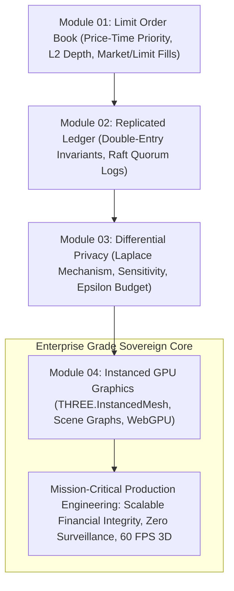

# Stage 6: Distributed Commerce, Ledgers & Physical 3D Shaders

> Production Rigor: Concurrency Controls, Limit Order Books, Replicated Double-Entry Ledgers, Differential Privacy, Instanced Rendering, and WebGPU Pipelines.

---

## Overview

The final stage of the Sovereign Developer Learning Path synthesizes high-concurrency systems, financial integrity, ethical data governance, and creative graphics engineering:
1. Solving high-demand continuous double auctions using an in-memory **Limit Order Book (LOB)** matching engine with price-time priority, level-2 depth, and cancellations.
2. Preserving immutable financial integrity using **Double-Entry Bookkeeping** combined with **Deterministic State Machine Replication (SMR)** and Raft consensus log invariants.
3. Architecting sovereign clinical evaluation engines (*PinkPulse*) and implementing **Differential Privacy** using the Laplace mechanism with strict privacy budget accounting.
4. Engineering visceral, hardware-accelerated 3D graphics on the web using **Instanced Rendering (`THREE.InstancedMesh`)** to draw 10,000 animated particles in 1 draw call, hierarchical scene graphs, and explicit **WebGL 2.0 vs WebGPU** pipeline comparisons.

---

## Technical Architecture: Stage 6 Commerce & Graphics Roadmap



---

## Modules in This Stage

```text
06-distributed-commerce-and-creative-engineering/
├── README.md                                         # Stage syllabus & roadmap
├── 01-concurrency-control-and-marketplaces.md         # Limit order book & price-time matching
├── 02-double-entry-accounting-invariants.md          # Replicated ledgers & consensus invariants
├── 03-ethical-data-and-ephemeral-identity.md          # Differential privacy & clinical ethics
└── 04-gpu-pipelines-and-custom-glsl-shaders.md       # Instanced rendering, scene graphs & WebGPU
```

---

## Learning Objectives

- **Order Book Matching**: Build an in-memory Limit Order Book matching engine supporting limit orders, market orders, partial fills, cancellations, and real-time depth visualization.
- **Replicated Financial Invariants**: Formulate double-entry balance equations ($\sum \text{Debits} = \sum \text{Credits}$) replicated across a Raft consensus cluster with linearizable state machine commit invariants.
- **Differential Privacy**: Implement the Laplace mechanism with global sensitivity $\Delta f$ and sequential privacy budget tracking ($\epsilon$) for sensitive clinical queries.
- **GPU Optimization & WebGPU**: Render 10,000 animated particles in a single draw call via `THREE.InstancedMesh`, propagate world transforms across hierarchical scene graphs, and architect explicit WebGPU pipelines.
