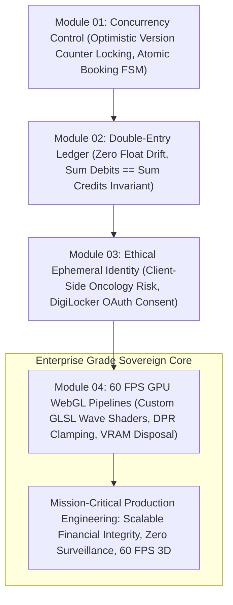

# Stage 6: Distributed Commerce, Ledgers & Physical 3D Shaders

> Production Rigor: Concurrency Controls, Double-Entry Invariants, Non-Extractive Verification, and 60 FPS WebGL Shaders.

---

## Overview

The final stage of the Sovereign Developer Learning Path synthesizes high-concurrency systems, financial integrity, ethical data governance, and creative graphics engineering:
1. Solving high-demand double-booking race conditions in decentralized marketplaces using **Optimistic Concurrency Control** (as built in *Parkly*).
2. Preserving immutable financial integrity using **Double-Entry Bookkeeping** and integer cent arithmetic verified by property-based testing (as built in *COUNT*).
3. Architecting sovereign clinical evaluation engines (*PinkPulse*) and document-only government identity gateways (*SDA Matrimony DigiLocker*) that explicitly reject biometric surveillance.
4. Engineering visceral, hardware-accelerated 3D graphics on the web using custom **GLSL Shaders**, viewport throttling, DPR clamping, and zero-leak GPU memory disposal (as built in *ZEUS*).

---

## Technical Architecture: Stage 6 Commerce & Graphics Roadmap



---

## Modules in This Stage

```text
06-distributed-commerce-and-creative-engineering/
├── README.md                                         # Stage syllabus & roadmap
├── 01-concurrency-control-and-marketplaces.md         # Optimistic locking & race conditions
├── 02-double-entry-accounting-invariants.md          # Immutable ledgers & property tests
├── 03-ethical-data-and-ephemeral-identity.md          # Zero-exposure health & DigiLocker
└── 04-gpu-pipelines-and-custom-glsl-shaders.md       # 60 FPS WebGL, GLSL & GPU memory cleanup
```

---

## Learning Objectives

- **Concurrency Mastery**: Prevent distributed double-booking bugs under heavy concurrent load using atomic version counter checks.
- **Financial Invariants**: Formulate double-entry balance equations ($\sum \text{Debits} = \sum \text{Credits}$) and eliminate floating-point currency drift.
- **Ethical Data Engineering**: Execute client-side clinical risk calculations and implement ephemeral OAuth2 verification with immediate RAM zeroization.
- **GPU Optimization**: Write custom vertex and fragment shaders in GLSL, clamp Device Pixel Ratios on mobile displays, and eliminate WebGL VRAM memory leaks.
