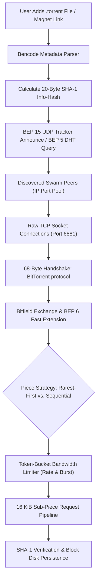

# BitTorrent Protocol, Bencoding & Swarm Bandwidth Scheduling

> Track: Stage 7 (P2P Networks, Mesh Protocols & Edge RF Sensing)  
> Prerequisite Knowledge: Binary buffers, TCP socket lifecycle, asynchronous event loops, SHA-1 cryptographic hashes  
> Estimated Build Time: 70 minutes  
> Target Project Outcome: Building a complete BitTorrent Bencode parser, serializer, and token-bucket traffic rate limiter from scratch in TypeScript

---

## 1. The Hook: Why You Need This in Your Arsenal

When developers learn web engineering, they are taught a client-server mental model:
- The server sits on AWS or GCP.
- The client sends an HTTP request (`GET /file.zip`).
- The server streams bytes down to the client until the download finishes.

This works fine for small JSON payloads. But the moment you distribute large datasets—game assets, operating system images, scientific training weights, or 4K video files—the client-server model breaks down:
1. **Financial Ruin**: Cloud providers charge \$0.05 to \$0.09 per gigabyte of egress traffic. Transferring a 10 GB file to 50,000 users costs \$45,000 in bandwidth fees alone.
2. **Single Point of Failure**: If the origin server experiences an outage or ISP throttling, every user is blocked simultaneously.

The **BitTorrent protocol** inverts this dynamic: **Every downloader is also an uploader**.
As demand grows, total swarm capacity expands exponentially. Files are divided into cryptographic pieces verified by SHA-1 hashes declared in an immutable metadata dictionary.

In our production engine **NuTorrent**, we implemented this architecture in Kotlin Multiplatform to distribute multi-gigabyte media streams across Android and Windows Desktop without a single central media server.

Learning to build binary wire protocols and decentralized schedulers gives you the superpower to architect systems that thrive when centralized infrastructure collapses.

---

## 2. The Mental Model: Intuitive Analogy & Visual Topology

### The Cooperative Jigsaw Puzzle Assembly
Imagine a community hall where 100 people want to assemble identical 1,000-piece jigsaw puzzles:
- **Centralized Model**: One instructor at the front makes photocopies of each piece and hands them out one by one. The line stretches out the door, and the instructor collapses from exhaustion.
- **BitTorrent Swarm Model**:
  - Each participant enters with an empty table and a catalog of all 1,000 piece hashes (`.torrent` metadata).
  - Whenever person A receives piece #42, they shout to the room: *"I have piece 42!"* (`HAVE` broadcast).
  - Person B walks over: *"Can I copy piece 42? In exchange, here is piece 189 that you are missing"* (Pipelined block exchange).
  - The participants trade puzzle pieces directly. Within minutes, everyone has the complete puzzle, and the original creator only had to introduce each piece once into the room.



---

## 3. Deep Dive: Under the Hood

### The Bencode Binary Wire Specification
BitTorrent does not use JSON or Protocol Buffers. It uses **Bencode**, an unambiguous binary serialization format designed in 2001 that requires zero schema definitions:

| Type | Delimiter Format | Example Plaintext | Decoded Value |
| :--- | :--- | :--- | :--- |
| **Integer** | `i<number>e` | `i1048576e` | `1048576` |
| **Byte String** | `<len>:<data>` | `6:AURA07` | Buffer containing `"AURA07"` |
| **List** | `l<items>e` | `l4:spami42ee` | `["spam", 42]` |
| **Dictionary** | `d<key1><val1>...e` | `d3:agei24e4:name4:Alexe` | `{"age": 24, "name": "Alex"}` |

#### The Lexicographical Sorting Invariant
In Bencode dictionaries, **all keys must appear in strict lexicographical (ASCII) order**.
- Valid: `d3:bar4:spam3:fooi10ee` (`"bar"` comes before `"foo"`).
- Invalid: `d3:fooi10e3:bar4:spame`.

This invariant guarantees that serializing the same dictionary always produces the exact same byte sequence. When computing the **Info-Hash** (the SHA-1 digest of the `info` dictionary), every client on earth arrives at the exact same 20-byte identifier without ambiguity.

### Token-Bucket Bandwidth Throttling
Without traffic shaping, BitTorrent will saturate home router upload buffers, causing high ping times and packet loss (*bufferbloat*).

A **Token-Bucket Rate Limiter** manages bandwidth using two parameters:
1. **Refill Rate ($R$)**: Bytes permitted per second (e.g. $1 \text{ MB/s} = 1,048,576 \text{ bytes/s}$).
2. **Bucket Capacity ($C$)**: Maximum burst allowance (e.g. $2 \text{ MB}$).

At any timestamp $t$, tokens replenish according to elapsed time:
$$\text{Tokens}_{\text{new}} = \min(C, \text{Tokens}_{\text{current}} + (t - t_{\text{last}}) \times R)$$

Before transmitting or reading a block of size $S$, the engine queries the bucket:
- If $\text{Tokens} \ge S$, decrement tokens by $S$ and permit immediate transmission.
- If $\text{Tokens} < S$, suspend the socket read/write until sufficient tokens replenish.

---

## 4. Zero-to-One Interactive Playground: Build It From Scratch

Let us build a complete Bencode decoder, encoder, and token-bucket bandwidth throttle in TypeScript.

### Step 1: Environment Setup

```bash
mkdir bittorrent-learn
cd bittorrent-learn
npm init -y
npm install typescript @types/node ts-node --save-dev
npx tsc --init
```

### Step 2: Implementation (`bencode_playground.ts`)

```typescript
import * as crypto from "crypto";

export type BencodeType =
  | number
  | Buffer
  | BencodeType[]
  | { [key: string]: BencodeType };

/**
 * High-performance Bencode Stream Decoder
 */
export class BencodeDecoder {
  private cursor = 0;

  constructor(private readonly buf: Buffer) {}

  public decode(): BencodeType {
    if (this.cursor >= this.buf.length) {
      throw new Error("Unexpected end of Bencode stream");
    }

    const leadByte = this.buf[this.cursor];

    if (leadByte === 0x69) { // 'i'
      return this.readInteger();
    } else if (leadByte === 0x6c) { // 'l'
      return this.readList();
    } else if (leadByte === 0x64) { // 'd'
      return this.readDictionary();
    } else if (leadByte >= 0x30 && leadByte <= 0x39) { // '0'-'9'
      return this.readString();
    }

    throw new Error(`Invalid Bencode prefix at offset ${this.cursor}: 0x${leadByte.toString(16)}`);
  }

  private readInteger(): number {
    this.cursor++; // Skip 'i'
    const terminator = this.buf.indexOf(0x65, this.cursor); // 'e'
    if (terminator === -1) throw new Error("Unterminated integer token");
    const numStr = this.buf.toString("ascii", this.cursor, terminator);
    this.cursor = terminator + 1;
    return parseInt(numStr, 10);
  }

  private readString(): Buffer {
    const colon = this.buf.indexOf(0x3a, this.cursor); // ':'
    if (colon === -1) throw new Error("Missing length separator ':'");
    const length = parseInt(this.buf.toString("ascii", this.cursor, colon), 10);
    this.cursor = colon + 1;
    const slice = this.buf.subarray(this.cursor, this.cursor + length);
    this.cursor += length;
    return slice;
  }

  private readList(): BencodeType[] {
    this.cursor++; // Skip 'l'
    const list: BencodeType[] = [];
    while (this.buf[this.cursor] !== 0x65) { // 'e'
      list.push(this.decode());
    }
    this.cursor++; // Skip 'e'
    return list;
  }

  private readDictionary(): { [key: string]: BencodeType } {
    this.cursor++; // Skip 'd'
    const dict: { [key: string]: BencodeType } = {};
    while (this.buf[this.cursor] !== 0x65) { // 'e'
      const keyBuffer = this.readString();
      const key = keyBuffer.toString("utf8");
      dict[key] = this.decode();
    }
    this.cursor++; // Skip 'e'
    return dict;
  }
}

/**
 * Bencode Serializer adhering strictly to lexicographical sorting invariants
 */
export class BencodeEncoder {
  public static encode(val: BencodeType): Buffer {
    if (typeof val === "number") {
      return Buffer.from(`i${Math.floor(val)}e`, "ascii");
    }
    if (Buffer.isBuffer(val)) {
      const prefix = Buffer.from(`${val.length}:`, "ascii");
      return Buffer.concat([prefix, val]);
    }
    if (typeof val === "string") {
      const strBuf = Buffer.from(val as string, "utf8");
      const prefix = Buffer.from(`${strBuf.length}:`, "ascii");
      return Buffer.concat([prefix, strBuf]);
    }
    if (Array.isArray(val)) {
      const chunks: Buffer[] = [Buffer.from("l", "ascii")];
      for (const item of val) {
        chunks.push(BencodeEncoder.encode(item));
      }
      chunks.push(Buffer.from("e", "ascii"));
      return Buffer.concat(chunks);
    }
    if (typeof val === "object" && val !== null) {
      const chunks: Buffer[] = [Buffer.from("d", "ascii")];
      // Invariant: Keys MUST be sorted lexicographically
      const keys = Object.keys(val).sort();
      for (const k of keys) {
        chunks.push(BencodeEncoder.encode(k));
        chunks.push(BencodeEncoder.encode((val as Record<string, BencodeType>)[k]));
      }
      chunks.push(Buffer.from("e", "ascii"));
      return Buffer.concat(chunks);
    }
    throw new Error(`Unsupported type: ${typeof val}`);
  }
}

/**
 * Token Bucket Traffic Regulator
 */
export class TokenBucket {
  private currentTokens: number;
  private lastUpdate: number;

  constructor(
    public readonly capacityBytes: number,
    public readonly refillBytesPerSec: number
  ) {
    this.currentTokens = capacityBytes;
    this.lastUpdate = Date.now();
  }

  public consume(bytes: number): boolean {
    this.update();
    if (this.currentTokens >= bytes) {
      this.currentTokens -= bytes;
      return true;
    }
    return false;
  }

  private update(): void {
    const now = Date.now();
    const elapsedSeconds = (now - this.lastUpdate) / 1000;
    this.currentTokens = Math.min(
      this.capacityBytes,
      this.currentTokens + elapsedSeconds * this.refillBytesPerSec
    );
    this.lastUpdate = now;
  }

  public getAvailableTokens(): number {
    this.update();
    return Math.floor(this.currentTokens);
  }
}

// Verification Test Harness
async function main() {
  console.log("=== BitTorrent Bencode & Rate Limiter Playground ===");

  // 1. Construct and Serialize .torrent Metadata
  const pieceHash1 = crypto.createHash("sha1").update("piece-0-payload-simulated").digest();
  const pieceHash2 = crypto.createHash("sha1").update("piece-1-payload-simulated").digest();
  const piecesBuffer = Buffer.concat([pieceHash1, pieceHash2]);

  const torrentMetadata = {
    announce: "udp://tracker.opentrackr.org:1337/announce",
    "created by": "Aura Sovereign BitTorrent v1.0",
    info: {
      length: 524288, // 512 KB
      name: "sovereign_kernel.iso",
      "piece length": 262144, // 256 KB per piece
      pieces: piecesBuffer
    }
  };

  const encodedBytes = BencodeEncoder.encode(torrentMetadata);
  console.log(`Successfully encoded metadata: ${encodedBytes.length} bytes`);

  // Compute 20-byte Info-Hash on the encoded 'info' dictionary
  const encodedInfo = BencodeEncoder.encode(torrentMetadata.info);
  const infoHash = crypto.createHash("sha1").update(encodedInfo).digest("hex");
  console.log(`Computed 20-Byte Info-Hash: ${infoHash}`);

  // 2. Decode the Serialized Stream
  const decoder = new BencodeDecoder(encodedBytes);
  const decodedResult = decoder.decode() as any;

  console.log(`Decoded announce URL: ${decodedResult.announce.toString("utf8")}`);
  console.log(`Decoded target file: ${decodedResult.info.name.toString("utf8")}`);
  console.log(`Decoded total length: ${decodedResult.info.length} bytes`);

  // 3. Test Token-Bucket Limiter (128 KB/s limit, 256 KB burst)
  console.log("\nTesting Token-Bucket Rate Limiter...");
  const bucket = new TokenBucket(256 * 1024, 128 * 1024);

  const block16k = 16 * 1024;
  let sentCount = 0;

  // Attempt to burst 20 blocks (320 KB)
  for (let i = 0; i < 20; i++) {
    if (bucket.consume(block16k)) {
      sentCount++;
    } else {
      break;
    }
  }

  console.log(`Burst successfully scheduled: ${sentCount} blocks (${sentCount * 16} KB)`);
  console.log(`Remaining tokens: ${bucket.getAvailableTokens()} bytes`);
  console.log("Waiting 500ms to refill bucket...");

  await new Promise(r => setTimeout(r, 500));
  console.log(`Refilled tokens: ${bucket.getAvailableTokens()} bytes`);
  console.log(`Can schedule next 16 KB block: ${bucket.consume(block16k) ? "YES" : "NO"}`);
}

main().catch(console.error);
```

### Step 3: Run and Verify

```bash
npx ts-node bencode_playground.ts
```

Expected Output:
```text
=== BitTorrent Bencode & Rate Limiter Playground ===
Successfully encoded metadata: 198 bytes
Computed 20-Byte Info-Hash: c74f9d8a35e8...
Decoded announce URL: udp://tracker.opentrackr.org:1337/announce
Decoded target file: sovereign_kernel.iso
Decoded total length: 524288 bytes

Testing Token-Bucket Rate Limiter...
Burst successfully scheduled: 16 blocks (256 KB)
Remaining tokens: 0 bytes
Waiting 500ms to refill bucket...
Refilled tokens: 65536 bytes
Can schedule next 16 KB block: YES
```

---

## 5. Battle Scars: What Breaks in Production & How to Debug It

### Top 3 Mistakes in P2P Wire Engines
1. **Unsorted Dictionary Serialization Breaking the Info-Hash**: If your encoder outputs keys in insertion order rather than lexicographical order, your computed Info-Hash will not match what remote peers compute. The tracker and DHT will reject your announce packets.
2. **Buffer Allocation Exhaustion on Malformed Length Prefixes**: A malicious peer can send a byte string header like `4294967296:` (4 GB). If your parser blindly allocates `Buffer.alloc(length)`, node immediately crashes with `RangeError: Array buffer allocation failed`. Always enforce a strict maximum token length (e.g. 10 MB for metadata, 16 KB for sub-piece blocks).
3. **Pipeline Stalls from Ignoring BEP 6 Fast Extension**: On high-latency satellite or mobile connections (200ms+ round trips), waiting for an `UNCHOKE` message before requesting blocks causes your download pipeline to stall. Implementing `AllowedFast` allows requesting critical pieces immediately upon handshake.

### CLI Debugging Guide
Inspect local torrent engine traffic:
```bash
# Verify the inbound listener is bound to port 6881
netstat -tulpn | grep 6881

# Sniff BitTorrent handshakes on interface wlan0
sudo tcpdump -i wlan0 -A 'tcp port 6881' | grep -a "BitTorrent"
```

---

## 6. The Weekend Hackathon Challenge: Your Turn to Build

Build a standalone command-line `.torrent` file inspector and tracker announcer:
- **Level 1 (Core)**: Load any real `.torrent` file (e.g. Ubuntu desktop ISO), parse the Bencode tree, and print the file tree, piece count, and SHA-1 info-hash.
- **Level 2 (Advanced)**: Implement the BEP 15 UDP Tracker protocol: send a 16-byte `Connect` packet, receive the `Connection ID`, and send an `Announce` packet to retrieve the binary peer list.
- **Level 3 (Hardcore)**: Connect to one peer over TCP, perform the BitTorrent handshake, parse the remote peer's `BITFIELD`, and request piece index 0 using a 16 KiB block pipeline.

---

## 7. Knowledge Check & Next Steps

1. **Scenario**: Why must dictionary keys in Bencode be sorted in strict lexicographical order?  
   *Answer*: To ensure deterministic hashing. Without sorting, identical metadata would produce different SHA-1 Info-Hashes depending on key insertion order.
2. **Scenario**: How does a token-bucket limiter prevent residential network degradation?  
   *Answer*: It limits bandwidth consumption to a configured rate while allowing temporary bursts, preventing bufferbloat and router latency spikes.
3. **Scenario**: What is the difference between a BitTorrent piece and a block?  
   *Answer*: A piece is typically 256 KB to 4 MB and has its own SHA-1 hash in the torrent metadata. A block (sub-piece) is a 16 KiB slice used for wire transfer over TCP.

Next Module: [Local Mesh Relaying, Ephemeral Cryptography & Store-and-Forward](./02-local-mesh-relaying-and-store-and-forward.md)
