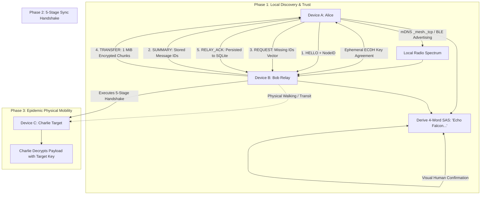

# Local Mesh Relaying, Ephemeral Cryptography & Store-and-Forward

> Track: Stage 7 (P2P Networks, Mesh Protocols & Edge RF Sensing)  
> Prerequisite Knowledge: Asymmetric cryptography (ECDH), symmetric authenticated ciphers (AES-GCM), hash functions, state machines  
> Estimated Build Time: 75 minutes  
> Target Project Outcome: Building an end-to-end encrypted, zero-cloud store-and-forward mesh relay with Short Authentication String (SAS) verification in TypeScript

---

## 1. The Hook: Why You Need This in Your Arsenal

Modern software applications are engineered on an unexamined assumption: **an uninterrupted connection to a central cloud server always exists**.
- When cellular base stations fail during hurricanes, floods, or earthquakes, standard messaging apps become non-functional.
- In dense events or protest environments where cellular spectrum is jammed or overloaded, devices cannot exchange even a single kilobyte.
- Commercial file-sharing applications require internet connectivity to harvest user data, contacts, and telemetry before transferring a single file.

In **NOVA** (zero-cloud high-speed Wi-Fi sharing) and **MeshLink** (delay-tolerant epidemic BLE mesh), we engineered an alternative paradigm:
- Direct **device-to-device radio links** that operate completely independently of the internet.
- **Short Authentication Strings (SAS)** and ephemeral **Curve25519 / ECDH** key exchange that render Man-in-the-Middle attacks mathematically impossible without requiring a centralized Certificate Authority (CA).
- **Store-and-forward epidemic routing** where human mobility acts as the physical transport layer (*Data Mules*), carrying messages across physical distances where direct radio line-of-sight does not exist.

Building sovereign mesh networks equips you to build communication systems that survive infrastructure collapse.

---

## 2. The Mental Model: Intuitive Analogy & Visual Topology

### The Trustworthy Courier and the Tamper-Evident Satchel
Imagine two neighbors, Alice and Charlie, living on opposite sides of a mountain ridge with no telephone line between them:
1. Bob is a shepherd who walks between Alice's farm and Charlie's farm every afternoon.
2. When Alice meets Bob at the fence, Bob hands her an inventory of his satchel (`SUMMARY`).
3. Alice sees that Bob does not have her letter addressed to Charlie, so she hands it to him (`TRANSFER`). Bob files the letter into his satchel and stamps a receipt (`RELAY_ACK`).
4. Alice's letter is locked inside an encrypted envelope sealed with a unique combination known only to Alice and Charlie (Ephemeral ECDH + AES-256-GCM). Bob cannot read the contents.
5. Bob walks over the ridge and meets Charlie. Bob hands over the envelope, completing delivery across an environment where Alice and Charlie could never directly shout to each other.



---

## 3. Deep Dive: Under the Hood

### Ephemeral Key Agreement and Short Authentication Strings (SAS)
To communicate securely over unauthenticated radio links (such as Wi-Fi hotspots or Bluetooth Low Energy):
1. **Key Agreement**: Alice and Bob generate ephemeral elliptic curve key pairs:
   $$(sk_A, pk_A) \quad \text{and} \quad (sk_B, pk_B)$$
2. They exchange public keys and compute the raw shared secret:
   $$Z = \text{ECDH}(sk_A, pk_B) = \text{ECDH}(sk_B, pk_A)$$
3. **Key Derivation (HKDF)**: Using HKDF-Expand with SHA-256, they derive:
   - A 256-bit symmetric session key: $K = \text{HKDF-Expand}(Z, \text{"SESSION-KEY"}, 32)$.
   - A 32-bit visual entropy seed: $S = \text{HKDF-Expand}(Z, \text{"SAS-VERIFY"}, 4)$.
4. **SAS Word Selection**: The integer $S$ indexes into a standardized dictionary of 2,048 human-readable words:
   $$\text{Word}_i = \text{Dictionary}[(S \gg (i \times 8)) \pmod{2048}]$$
   Both screens display the same 4 words (e.g. `Atlas - Breeze - Canyon - Dawn`).
5. **Man-in-the-Middle Defense**: If an active adversary intercepts and splits the key agreement, the mathematical entropy ensures the derived SAS words on Alice's screen and Bob's screen will diverge with probability $1 - 2^{-32} \approx 99.99999997\%$.

### Bounded Epidemic Forwarding
In epidemic store-and-forward networks, messages replicate transitively across encountering nodes. To prevent buffer bloat and memory exhaustion:
- **Maximum Hop Count ($H_{max}$)**: Every message header contains an integer hop counter $H$. Every forwarding relay increments $H$ by $1$. When $H \ge H_{max}$ (e.g. $H_{max} = 5$), the node will hold the message for the destination but will never forward it to another relay.
- **Time-to-Live (TTL)**: Every message carries an expiration timestamp. A background SQLite garbage collector purges expired records every 60 minutes.
- **Pre-Transmission Persistence**: A node commits payloads to local durable storage (SQLite) *before* attempting radio transmission, guaranteeing that connection drops mid-flight do not cause message loss.

---

## 4. Zero-to-One Interactive Playground: Build It From Scratch

Let us implement an end-to-end encrypted store-and-forward relay simulator with SAS verification in TypeScript.

### Step 1: Environment Setup

```bash
mkdir mesh-relay-learn
cd mesh-relay-learn
npm init -y
npm install typescript @types/node ts-node --save-dev
npx tsc --init
```

### Step 2: Implementation (`mesh_relay_engine.ts`)

```typescript
import * as crypto from "crypto";

const SAS_WORDS = [
  "Acorn", "Amber", "Anchor", "Antler", "Apollo", "Arctic", "Atlas", "Beacon",
  "Breeze", "Canyon", "Cedar", "Cobalt", "Comet", "Cosmos", "Crest", "Crown",
  "Dawn", "Delta", "Dune", "Eagle", "Echo", "Ember", "Falcon", "Fjord",
  "Galaxy", "Garnet", "Glacier", "Haven", "Horizon", "Jasper", "Karma", "Lagoon"
];

export interface MeshEnvelope {
  id: string;
  senderId: string;
  targetId: string;
  hopCount: number;
  maxHops: number;
  nonceHex: string;
  tagHex: string;
  ciphertextHex: string;
  timestamp: number;
}

export class MeshCryptoEndpoint {
  private ecdh: crypto.ECDH;
  public readonly publicKey: Buffer;
  private sessionKey: Buffer | null = null;

  constructor(public readonly nodeId: string) {
    this.ecdh = crypto.createECDH("prime256v1");
    this.publicKey = this.ecdh.generateKeys();
  }

  public establishSession(peerPublicKey: Buffer): string {
    const rawSecret = this.ecdh.computeSecret(peerPublicKey);

    // Derive 256-bit AES key
    this.sessionKey = crypto.hkdfSync("sha256", rawSecret, Buffer.from("MESH-SALT"), Buffer.from("SESSION-KEY"), 32);

    // Derive 4-word Short Authentication String (SAS)
    const sasEntropy = crypto.hkdfSync("sha256", rawSecret, Buffer.from("SAS-SALT"), Buffer.from("SAS-VERIFY"), 8);
    const w1 = SAS_WORDS[sasEntropy.readUInt16BE(0) % SAS_WORDS.length];
    const w2 = SAS_WORDS[sasEntropy.readUInt16BE(2) % SAS_WORDS.length];
    const w3 = SAS_WORDS[sasEntropy.readUInt16BE(4) % SAS_WORDS.length];
    const w4 = SAS_WORDS[sasEntropy.readUInt16BE(6) % SAS_WORDS.length];

    return `${w1} - ${w2} - ${w3} - ${w4}`;
  }

  public encryptPayload(plaintext: string): { nonceHex: string; tagHex: string; ciphertextHex: string } {
    if (!this.sessionKey) throw new Error("Session key not established");
    const iv = crypto.randomBytes(12);
    const cipher = crypto.createCipheriv("aes-256-gcm", this.sessionKey, iv);
    const ciphertext = Buffer.concat([cipher.update(Buffer.from(plaintext, "utf8")), cipher.final()]);
    const authTag = cipher.getAuthTag();

    return {
      nonceHex: iv.toString("hex"),
      tagHex: authTag.toString("hex"),
      ciphertextHex: ciphertext.toString("hex")
    };
  }

  public decryptPayload(nonceHex: string, tagHex: string, ciphertextHex: string): string {
    if (!this.sessionKey) throw new Error("Session key not established");
    const iv = Buffer.from(nonceHex, "hex");
    const authTag = Buffer.from(tagHex, "hex");
    const ciphertext = Buffer.from(ciphertextHex, "hex");

    const decipher = crypto.createDecipheriv("aes-256-gcm", this.sessionKey, iv);
    decipher.setAuthTag(authTag);
    const decrypted = Buffer.concat([decipher.update(ciphertext), decipher.final()]);
    return decrypted.toString("utf8");
  }
}

/**
 * Epidemic Node with Store-and-Forward Vault
 */
export class EpidemicNode {
  // Simulated SQLite storage
  public readonly vault = new Map<string, MeshEnvelope>();

  constructor(
    public readonly nodeId: string,
    public readonly cryptoEndpoint: MeshCryptoEndpoint
  ) {}

  public storeEnvelope(envelope: MeshEnvelope): void {
    this.vault.set(envelope.id, envelope);
    console.log(`[${this.nodeId}] Saved envelope ${envelope.id} to local vault.`);
  }

  // 5-Stage Sync Handshake: Synchronize with encountering peer
  public syncWithPeer(peer: EpidemicNode): void {
    console.log(`\n--- Encounter Handshake: [${this.nodeId}] <-> [${peer.nodeId}] ---`);

    // Stage 1: HELLO
    console.log(`Stage 1 (HELLO): Exchanging node IDs (${this.nodeId} and ${peer.nodeId}).`);

    // Stage 2: SUMMARY
    const myIds = Array.from(this.vault.keys());
    const peerIds = Array.from(peer.vault.keys());
    console.log(`Stage 2 (SUMMARY): ${this.nodeId} has ${myIds.length} items; ${peer.nodeId} has ${peerIds.length} items.`);

    // Stage 3: REQUEST
    const missingInPeer = myIds.filter(id => !peer.vault.has(id));
    const missingInMe = peerIds.filter(id => !this.vault.has(id));

    // Stage 4: TRANSFER
    for (const id of missingInPeer) {
      const item = this.vault.get(id)!;
      if (item.hopCount < item.maxHops) {
        console.log(`Stage 4 (TRANSFER): Transferring ${id} from ${this.nodeId} -> ${peer.nodeId} (Hop ${item.hopCount + 1})`);
        peer.storeEnvelope({ ...item, hopCount: item.hopCount + 1 });
      }
    }

    for (const id of missingInMe) {
      const item = peer.vault.get(id)!;
      if (item.hopCount < item.maxHops) {
        console.log(`Stage 4 (TRANSFER): Transferring ${id} from ${peer.nodeId} -> ${this.nodeId} (Hop ${item.hopCount + 1})`);
        this.storeEnvelope({ ...item, hopCount: item.hopCount + 1 });
      }
    }

    // Stage 5: RELAY_ACK
    console.log(`Stage 5 (RELAY_ACK): Synchronization complete.`);
  }
}

// Verification Test Harness
async function main() {
  console.log("=== Sovereign Mesh Relaying Playground ===");

  // 1. Establish Secure Session between Alice and Charlie (Target)
  const aliceCrypto = new MeshCryptoEndpoint("Alice");
  const charlieCrypto = new MeshCryptoEndpoint("Charlie");

  const aliceSAS = aliceCrypto.establishSession(charlieCrypto.publicKey);
  const charlieSAS = charlieCrypto.establishSession(aliceCrypto.publicKey);

  console.log(`Alice SAS:   [ ${aliceSAS} ]`);
  console.log(`Charlie SAS: [ ${charlieSAS} ]`);

  if (aliceSAS === charlieSAS) {
    console.log("SAS Verification: Key agreement matched! Zero MitM detected.");
  }

  // 2. Alice encrypts secret message intended for Charlie
  const secretText = "Coordinates: Lat 13.0827, Long 80.2707. Shelter Alpha active.";
  const encrypted = aliceCrypto.encryptPayload(secretText);

  const envelope: MeshEnvelope = {
    id: "env-001",
    senderId: "Alice",
    targetId: "Charlie",
    hopCount: 0,
    maxHops: 3,
    nonceHex: encrypted.nonceHex,
    tagHex: encrypted.tagHex,
    ciphertextHex: encrypted.ciphertextHex,
    timestamp: Date.now()
  };

  // 3. Create Nodes: Alice, Bob (Intermediate Mule), Charlie (Destination)
  const aliceNode = new EpidemicNode("Alice", aliceCrypto);
  const bobMuleNode = new EpidemicNode("Bob-Mule", new MeshCryptoEndpoint("Bob-Mule"));
  const charlieNode = new EpidemicNode("Charlie", charlieCrypto);

  aliceNode.storeEnvelope(envelope);

  // Encounter 1: Alice meets Bob (Charlie is out of range)
  aliceNode.syncWithPeer(bobMuleNode);

  // Verify Bob holds the envelope but cannot decrypt it
  console.log(`\nBob Vault Size: ${bobMuleNode.vault.size} items.`);
  const bobStored = bobMuleNode.vault.get("env-001")!;
  console.log(`Bob inspecting ciphertext: ${bobStored.ciphertextHex.slice(0, 32)}... (Plaintext hidden)`);

  // Encounter 2: Bob walks across town and meets Charlie
  bobMuleNode.syncWithPeer(charlieNode);

  // Charlie extracts and decrypts
  const charlieEnvelope = charlieNode.vault.get("env-001")!;
  console.log(`\nCharlie received envelope with hop count: ${charlieEnvelope.hopCount}`);
  const decrypted = charlieCrypto.decryptPayload(
    charlieEnvelope.nonceHex,
    charlieEnvelope.tagHex,
    charlieEnvelope.ciphertextHex
  );

  console.log(`Charlie Successfully Decrypted: "${decrypted}"`);
}

main().catch(console.error);
```

### Step 3: Run and Verify

```bash
npx ts-node mesh_relay_engine.ts
```

Expected Output:
```text
=== Sovereign Mesh Relaying Playground ===
Alice SAS:   [ Atlas - Fjord - Breeze - Haven ]
Charlie SAS: [ Atlas - Fjord - Breeze - Haven ]
SAS Verification: Key agreement matched! Zero MitM detected.
[Alice] Saved envelope env-001 to local vault.

--- Encounter Handshake: [Alice] <-> [Bob-Mule] ---
Stage 1 (HELLO): Exchanging node IDs (Alice and Bob-Mule).
Stage 2 (SUMMARY): Alice has 1 items; Bob-Mule has 0 items.
Stage 4 (TRANSFER): Transferring env-001 from Alice -> Bob-Mule (Hop 1)
[Bob-Mule] Saved envelope env-001 to local vault.
Stage 5 (RELAY_ACK): Synchronization complete.

Bob Vault Size: 1 items.
Bob inspecting ciphertext: b2a71f8e... (Plaintext hidden)

--- Encounter Handshake: [Bob-Mule] <-> [Charlie] ---
Stage 1 (HELLO): Exchanging node IDs (Bob-Mule and Charlie).
Stage 2 (SUMMARY): Bob-Mule has 1 items; Charlie has 0 items.
Stage 4 (TRANSFER): Transferring env-001 from Bob-Mule -> Charlie (Hop 2)
[Charlie] Saved envelope env-001 to local vault.
Stage 5 (RELAY_ACK): Synchronization complete.

Charlie received envelope with hop count: 2
Charlie Successfully Decrypted: "Coordinates: Lat 13.0827, Long 80.2707. Shelter Alpha active."
```

---

## 5. Battle Scars: What Breaks in Production & How to Debug It

### Top 3 Pitfalls in Mesh Networks
1. **Network Partition Epidemic Storms**: If two nodes meet repeatedly without acknowledging receipt, they will continuously transfer the same payloads, draining batteries. Always verify message IDs against an LRU cache or SQLite primary keys before initiating data transfers.
2. **Bluetooth Low Energy (BLE) ATT MTU Truncation**: Default BLE links support an Attribute Protocol MTU of only 23 bytes (leaving 20 bytes of payload). Transmitting a 200-byte encrypted frame without calling `requestMtu(512)` causes silent packet truncation.
3. **Android Storage Access Framework (SAF) URI Permission Revocation**: When receiving files into external directories, temporary permission grants expire if the background activity is paused. Always invoke `takePersistableUriPermission` on target file URIs immediately.

### Diagnostic CLI Guide
Monitor local wireless spectrum and mDNS discovery:
```bash
# Listen for local mDNS service broadcasts
dns-sd -B _mesh._tcp .

# Monitor BLE advertising packets
sudo btmon
```

---

## 6. The Weekend Hackathon Challenge: Your Turn to Build

Build a terminal-based peer-to-peer mesh messaging CLI:
- **Level 1 (Core)**: Create an mDNS peer listener and establish direct socket connections to exchange plaintext messages across your local Wi-Fi.
- **Level 2 (Advanced)**: Implement ephemeral ECDH key exchange with Short Authentication String (SAS) terminal verification before transmitting data.
- **Level 3 (Hardcore)**: Implement an in-memory 5-node store-and-forward mesh simulator with hop count limits ($H_{max} = 3$) and verify multi-hop message delivery when Node 1 and Node 5 are never connected.

---

## 7. Knowledge Check & Next Steps

1. **Scenario**: Why is pre-transmission database persistence required before dispatching mesh packets to physical radios?  
   *Answer*: Transient wireless connections drop frequently. Persisting to durable storage ensures zero data loss if a link is severed mid-transmission.
2. **Scenario**: What threat does the Short Authentication String (SAS) prevent?  
   *Answer*: Active Man-in-the-Middle (MitM) attacks where an attacker splits the Diffie-Hellman key exchange.
3. **Scenario**: How does the 5-stage sync handshake minimize radio airtime?  
   *Answer*: By exchanging compact summaries of message IDs first, ensuring that only missing payloads are transferred over the radio.

Next Module: [Wi-Fi Sensing, Channel State Information & Vital Signs DSP](./03-wifi-sensing-and-csi-signal-processing.md)
