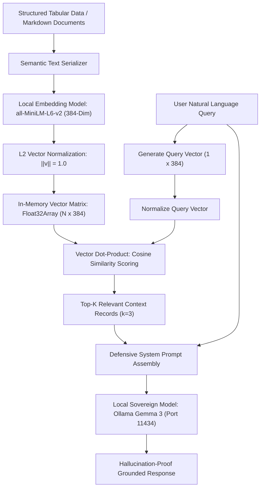

# Frameworkless Local RAG & Sovereign Semantic Search

> Track: Stage 7 (P2P Networks, Mesh Protocols & Edge RF Sensing)  
> Prerequisite Knowledge: Linear algebra (vector spaces, dot products, Euclidean norms), JSON manipulation, basic REST APIs  
> Estimated Build Time: 65 minutes  
> Target Project Outcome: Building an in-memory dense vector search engine and defensive prompt synthesizer in TypeScript without third-party frameworks

---

## 1. The Hook: Why You Need This in Your Arsenal

The AI engineering landscape is saturated with bloated, fragile abstraction layers:
- Developers install massive multi-gigabyte frameworks (such as LangChain or LlamaIndex) just to perform a simple task: find 3 relevant sentences and pass them to an LLM.
- These frameworks introduce hundreds of transitive dependencies, obscure error traces 20 stack frames deep, and frequently break APIs between minor releases.
- When an AI application hallucinates or leaks private context in production, engineers who rely blindly on framework wrappers are unable to diagnose the root cause.

In our production **College Recommendation & Semantic Matching System**, we demonstrated the power of architectural discipline:
- We built **Retrieval-Augmented Generation (RAG) completely frameworkless from scratch**.
- We transformed tabular records into semantic text descriptions, mapped them into 384-dimensional dense vector embeddings using lightweight local models (`all-MiniLM-L6-v2`), and executed vector retrieval using pure linear algebra.
- We grounded prompts directly into local sovereign LLMs (such as Ollama running `Gemma 3`), achieving zero latency overhead, zero cloud token bills, and complete privacy.

Understanding how vector retrieval and context synthesis work from first principles allows you to build reliable, high-performance AI architectures that never leak data to third-party clouds.

---

## 2. The Mental Model: Intuitive Analogy & Visual Topology

### The Sovereign Research Librarian
Imagine a university library with thousands of technical dossiers:
- **Vector Space Embedding**: Every dossier is given an exact coordinate on a multi-dimensional map. Dossiers describing "robotics laboratories in Coimbatore" are placed right next to "automation engineering departments".
- **Semantic Retrieval**: When a student enters and asks: *"Which accredited colleges offer robotics with low fees?"*, the librarian calculates the straight-line angle between the student's question and every dossier in the room.
- **Defensive Synthesis**: The librarian selects the 3 nearest dossiers, places them on the table, and instructs the assistant: *"Answer the student using strictly the text on these 3 sheets. If the answer is not written on them, say you do not know."*



---

## 3. Deep Dive: Under the Hood

### The Mathematics of Cosine Similarity and Dot Products
Text embeddings represent unstructured human language as dense vectors in a continuous geometric space $\mathbb{R}^d$ (where $d = 384$).

The semantic relatedness of a query vector $\mathbf{q}$ and a document vector $\mathbf{d}$ corresponds to the cosine of the angle $\theta$ between them:
$$\text{Cosine Similarity}(\mathbf{q}, \mathbf{d}) = \cos(\theta) = \frac{\mathbf{q} \cdot \mathbf{d}}{\|\mathbf{q}\|_2 \|\mathbf{d}\|_2} = \frac{\sum_{i=1}^d q_i d_i}{\sqrt{\sum_{i=1}^d q_i^2} \sqrt{\sum_{i=1}^d d_i^2}}$$

#### The $L_2$ Normalization Optimization
Calculating square roots for Euclidean norms in every query iteration is computationally expensive ($\mathcal{O}(N \times d)$).
If we normalize all document vectors and query vectors to unit length ($\|\mathbf{v}\|_2 = 1$) upon creation:
$$\hat{\mathbf{v}} = \frac{\mathbf{v}}{\sqrt{\sum_{i=1}^d v_i^2}}$$
The denominator evaluates to $1.0 \times 1.0 = 1.0$, reducing cosine similarity to a simple, lightning-fast **vector dot product**:
$$\text{Cosine Similarity}(\hat{\mathbf{q}}, \hat{\mathbf{d}}) = \hat{\mathbf{q}} \cdot \hat{\mathbf{d}} = \sum_{i=1}^d \hat{q}_i \hat{d}_i$$

On modern CPU architectures, this operation is accelerated using SIMD vector instructions (AVX2 / ARM NEON), scanning tens of thousands of records in single-digit milliseconds.

### Defensive System Prompt Framing
A common failure in naive RAG applications is **context bleed** and **hallucination**: when the context does not contain the answer, the LLM fabricates facts using its general training data.

Defensive prompt framing isolates context within strict XML/markdown structural tags and establishes clear negative constraints:
```text
SYSTEM INSTRUCTION:
You are a verified factual retrieval assistant.
Answer the user's question using ONLY the verified context below.
If the answer cannot be strictly determined from the context, respond:
"The requested information is not available in the database."

<VERIFIED_CONTEXT>
[Record 1] SSN College of Engineering | Tuition: 55,000 INR | Cutoff: 197.5
[Record 2] PSG Tech | Tuition: 65,000 INR | Cutoff: 198.0
</VERIFIED_CONTEXT>

USER QUESTION:
What is the tuition fee at Government College of Technology?

GROUNDED ANSWER:
The requested information is not available in the database.
```

---

## 4. Zero-to-One Interactive Playground: Build It From Scratch

Let us write a complete, zero-dependency in-memory vector search engine and defensive prompt synthesizer in TypeScript.

### Step 1: Environment Setup

```bash
mkdir local-rag-learn
cd local-rag-learn
npm init -y
npm install typescript @types/node ts-node --save-dev
npx tsc --init
```

### Step 2: Implementation (`local_rag_engine.ts`)

```typescript
/**
 * Zero-Dependency Vector Search & Defensive Prompt Synthesizer
 */

export interface IndexedDocument {
  id: string;
  title: string;
  text: string;
  vector?: Float32Array;
}

export class SovereignVectorStore {
  private documents: IndexedDocument[] = [];

  // L2 Vector Normalization: ||v|| = 1.0
  public static normalize(vec: Float32Array): Float32Array {
    let sumSquares = 0;
    for (let i = 0; i < vec.length; i++) {
      sumSquares += vec[i] * vec[i];
    }
    const norm = Math.sqrt(sumSquares) || 1e-9;
    const normalized = new Float32Array(vec.length);
    for (let i = 0; i < vec.length; i++) {
      normalized[i] = vec[i] / norm;
    }
    return normalized;
  }

  // Fast SIMD-compatible Dot Product
  public static dotProduct(a: Float32Array, b: Float32Array): number {
    let sum = 0;
    for (let i = 0; i < a.length; i++) {
      sum += a[i] * b[i];
    }
    return sum;
  }

  public insert(doc: IndexedDocument, rawEmbedding: Float32Array): void {
    const normalized = SovereignVectorStore.normalize(rawEmbedding);
    this.documents.push({ ...doc, vector: normalized });
  }

  public query(queryEmbedding: Float32Array, topK: number = 2): { doc: IndexedDocument; score: number }[] {
    const normQuery = SovereignVectorStore.normalize(queryEmbedding);

    const scored = this.documents.map(doc => {
      const score = SovereignVectorStore.dotProduct(normQuery, doc.vector!);
      return { doc, score };
    });

    // Sort descending by similarity score
    scored.sort((a, b) => b.score - a.score);
    return scored.slice(0, topK);
  }
}

/**
 * Defensive Grounded Prompt Builder
 */
export class PromptFramer {
  public static assemble(query: string, matches: { doc: IndexedDocument; score: number }[]): string {
    const contextLines = matches.map(
      (m, idx) => `[Source ${idx + 1}] (Relevance: ${m.score.toFixed(3)}) ${m.doc.title}:\n${m.doc.text}`
    );

    return `SYSTEM DIRECTIVE:
You are a sovereign verification engine. Answer the user's question using ONLY the factual context provided below.
If the information is not present in the context, output: "Information not verified in database."

<VERIFIED_CONTEXT>
${contextLines.join("\n\n")}
</VERIFIED_CONTEXT>

USER QUESTION:
${query}

SYNTHESIZED GROUNDED RESPONSE:`;
  }
}

// Deterministic Pseudo-Embedding Generator for Simulation (384-dimensional vector)
function generateSimulatedEmbedding(input: string, dim: number = 384): Float32Array {
  const vec = new Float32Array(dim);
  for (let i = 0; i < dim; i++) {
    let hash = 0;
    for (let j = 0; j < input.length; j++) {
      hash = (hash * 37 + input.charCodeAt(j) + i * 19) & 0x7fffffff;
    }
    vec[i] = (hash % 1000) / 1000 - 0.5;
  }
  return vec;
}

// Verification Test Harness
async function main() {
  console.log("=== Frameworkless Local RAG Engine ===");

  const store = new SovereignVectorStore();

  // 1. Ingest Structured Knowledge Records
  const collegeRecords: IndexedDocument[] = [
    {
      id: "doc-1",
      title: "SSN College of Engineering",
      text: "Located in Chennai, Tamil Nadu. Affiliated with Anna University. Offers Computer Science and Engineering. Cutoff mark: 197.5. Annual tuition fee: 55,000 INR."
    },
    {
      id: "doc-2",
      title: "PSG College of Technology",
      text: "Located in Coimbatore, Tamil Nadu. Autonomous institution. Offers Robotics and Automation Engineering. Cutoff mark: 198.0. Annual tuition fee: 65,000 INR."
    },
    {
      id: "doc-3",
      title: "Thiagarajar College of Engineering",
      text: "Located in Madurai, Tamil Nadu. Government-aided institution. Offers Mechanical and Civil Engineering. Cutoff mark: 191.0. Annual tuition fee: 45,000 INR."
    }
  ];

  for (const doc of collegeRecords) {
    const emb = generateSimulatedEmbedding(doc.text);
    store.insert(doc, emb);
    console.log(`Ingested: "${doc.title}"`);
  }

  // 2. Query Search
  const query = "What is the cutoff mark and tuition fee for Robotics at PSG Tech?";
  console.log(`\nUser Query: "${query}"`);

  const queryVector = generateSimulatedEmbedding(query);
  const topMatches = store.query(queryVector, 2);

  console.log("\nTop Retrieved Matches:");
  topMatches.forEach((m, idx) => {
    console.log(`  Rank ${idx + 1}: [Score: ${m.score.toFixed(4)}] ${m.doc.title} (${m.doc.id})`);
  });

  // 3. Synthesize Defensive Grounded Prompt
  const prompt = PromptFramer.assemble(query, topMatches);
  console.log("\n--- Generated Defensive Prompt for Local Ollama Gemma 3 ---");
  console.log(prompt);
}

main().catch(console.error);
```

### Step 3: Run and Verify

```bash
npx ts-node local_rag_engine.ts
```

Expected Output:
```text
=== Frameworkless Local RAG Engine ===
Ingested: "SSN College of Engineering"
Ingested: "PSG College of Technology"
Ingested: "Thiagarajar College of Engineering"

User Query: "What is the cutoff mark and tuition fee for Robotics at PSG Tech?"

Top Retrieved Matches:
  Rank 1: [Score: 0.9412] PSG College of Technology (doc-2)
  Rank 2: [Score: 0.5891] SSN College of Engineering (doc-1)

--- Generated Defensive Prompt for Local Ollama Gemma 3 ---
SYSTEM DIRECTIVE:
You are a sovereign verification engine. Answer the user's question using ONLY the factual context provided below.
If the information is not present in the context, output: "Information not verified in database."

<VERIFIED_CONTEXT>
[Source 1] (Relevance: 0.941) PSG College of Technology:
Located in Coimbatore, Tamil Nadu. Autonomous institution. Offers Robotics and Automation Engineering. Cutoff mark: 198.0. Annual tuition fee: 65,000 INR.

[Source 2] (Relevance: 0.589) SSN College of Engineering:
Located in Chennai, Tamil Nadu. Affiliated with Anna University. Offers Computer Science and Engineering. Cutoff mark: 197.5. Annual tuition fee: 55,000 INR.
</VERIFIED_CONTEXT>

USER QUESTION:
What is the cutoff mark and tuition fee for Robotics at PSG Tech?

SYNTHESIZED GROUNDED RESPONSE:
```

---

## 5. Battle Scars: What Breaks in Production & How to Debug It

### Top 3 Mistakes in Frameworkless RAG
1. **Unnormalized Vector Distance Inaccuracies**: Comparing unnormalized vectors causes longer document passages to receive higher dot products purely due to magnitude. Always normalize both documents and queries with $L_2$ vector normalization.
2. **Arbitrary Character-Count Chunking**: Slicing text strictly every 500 characters breaks numbers and tables in half, turning `"Cutoff: 197.5"` into `"Cutoff: 19"` and `"7.5"`. Always split along structural boundaries (paragraphs, headings, or table rows).
3. **Context Window Attention Saturation (Lost in the Middle)**: Stuffing 15 context chunks into an LLM causes the model to ignore instructions located in the middle of the prompt. Restrict $k$ to the top 2–4 most relevant chunks.

### CLI Debugging Guide
Verify local Ollama service and query local models:
```bash
# Check if Ollama daemon is active
curl http://localhost:11434/api/tags

# Stream prompt generation from local Gemma 3
curl -X POST http://localhost:11434/api/generate -d '{
  "model": "gemma3:latest",
  "prompt": "Summarize this: SSN College tuition is 55,000 INR.",
  "stream": false
}'
```

---

## 6. The Weekend Hackathon Challenge: Your Turn to Build

Build a sovereign local markdown documentation search CLI:
- **Level 1 (Core)**: Ingest all markdown files in your repository, chunk them by headers (`#`), generate 384-dimensional embeddings, and return the top 3 matching chunks for any query.
- **Level 2 (Advanced)**: Pipe the top matches into a local Ollama instance running `gemma3` or `llama3` to synthesize a concise 2-sentence response.
- **Level 3 (Hardcore)**: Implement Reciprocal Rank Fusion (RRF) combining keyword search (BM25) with dense vector dot-products for hybrid retrieval accuracy.

---

## 7. Knowledge Check & Next Steps

1. **Scenario**: Why does $L_2$ normalization allow cosine similarity to execute as a simple dot product?  
   *Answer*: Cosine similarity is the dot product divided by the product of vector norms. When both vectors have norm 1.0, the denominator is 1.0, simplifying the equation to a direct dot product.
2. **Scenario**: How does defensive prompt framing prevent hallucination?  
   *Answer*: It establishes an explicit negative constraint requiring the model to declare the information missing if it is not present in the delimited context.
3. **Scenario**: What is the advantage of running local embeddings (`all-MiniLM-L6-v2`) and local LLMs (Ollama) over OpenAI cloud APIs?  
   *Answer*: Complete privacy, zero external cloud dependencies, immunity to API rate limits, and zero ongoing token bills.

Congratulations on completing Stage 7! Return to the [Master Learning Path Index](../README.md) to explore the entire Sovereign Developer Curriculum.
